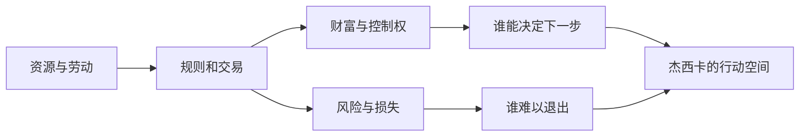

我读《不义之财》时最放不下的，并不是一个可以直接判对错的结论，而是一串关于涤火杰西卡的问题：她为什么会主动走上雇佣兵的路？这份工作危险、艰难，她为什么不离开？她面对镇民的困境时，是带着大小姐式的高位怜悯在看他们，还是正在学着真正理解他们？

这些疑问让故事从“某个人变勇敢”变成一段关于阶层位置、地方生活与行动责任的阅读。善意当然重要，但一个人的善意能否站住，还要看她是否肯让现实改变自己的理解，是否愿意承担帮助他人所带来的具体代价。

<!-- more -->

*图：《不义之财》官方活动主视觉，图源[鹰角活动公告](https://ak.hypergryph.com/news/2023085044.html)。*

## 先从“为什么留下”问起

杰西卡的出身使她与小镇里的许多人并不处在同一条起跑线上。她有家族、财富和组织身份，也有普通居民不一定能得到的退路。她并不是在一种完全没有选择的处境里被迫拿起武器。正因如此，她主动成为雇佣兵才值得追问：她想摆脱谁替她安排的人生？她是把战斗当作证明自己的方式，还是在寻找一种能由自己承担结果的生活？她的选择里可能同时存在勇气、冲动、理想化和对危险的误判。

如果把答案简化成“她善良，所以想帮助别人”，就会漏掉身份与行动的矛盾。善良可以成为行动的起点，却无法证明一个人已经理解了别人。一个出身优渥的人完全可能带着好意，却把自己的经验当成普遍经验；她可以急于拯救，却不清楚当地人真正需要什么；她也可能把自己面对危险的选择当成牺牲，却没有看见居民每天都在承担更久、更难逃开的风险。

所以，“为什么不离开”不是一个简单的勇气测试。留下可能是她在做出承诺后不愿把后果丢给同伴；可能是她第一次把自己放进不能由家族替她收拾的处境；也可能是她与镇民建立关系之后，发现退出会让先前的行动失去意义。不同动机可能叠在一起。判断人物时，重要的不只是她说了什么，还要看她在知道代价以后是否仍继续承担，以及她的行动有没有让身边的人获得更多选择。

故事的价值正在于：读者可以在同情杰西卡的同时保留疑问。她不必从第一幕起就是完全成熟的社会观察者，才有资格成为故事中心。一个人物能够带着不成熟进入社会冲突，逐步发现自己的盲区，甚至仍然犯错；这比把她写成一位已经懂得一切的善人更接近真实成长。

## 镇民不是杰西卡成长用的道具

讨论这类故事时，很容易让小镇居民只承担一个功能：让主角看见贫困，从而变得更善良。可如果居民只是用来触发主角的道德变化，他们的生活便会再次被别人代言。镇民有自己的关系、判断和利益，不应只被描述为“等待帮助的人”。他们可能并不信任外来者，也可能接受某些帮助却拒绝另一些；有时他们会彼此冲突，也会用旁观者看来不够体面的方式保护家人和地方生活。

外来者的帮助什么时候是帮助，什么时候变成替人决定？这是杰西卡面对的伦理问题。一个人可以提供资源、承担风险、阻止眼前伤害，却不能因此自动获得代表整个共同体的资格。真正的理解可能意味着承认别人有权拒绝自己的方案，也意味着接受别人对自己的批评。对杰西卡来说，成长不只是“发现大家都很不容易”，而是发现受苦的人仍有主体性，不需要先成为符合自己期待的好受害者，才值得被支持。

这也解释了为什么同情不能只停留在情绪上。同情看见他人痛苦，责任则开始追问痛苦如何形成、谁可以改变条件、改变的成本由谁承担。如果帮助只处理最显眼的伤口，却让造成伤口的力量完整离场，那么善意可能会成为结构的临时止痛药。它仍然有价值，但不能被误认为问题已经解决。

## “不义之财”不只是一笔钱

把标题的问题拆开，可以看到财富关系至少经过几道环节：资源如何取得，规则由谁制定，收益如何分配，风险又由谁承担。杰西卡的个人选择可以介入其中一部分，却无法自动替代所有公共决定。

这张图不是在断言活动里每一笔钱都有同一种来路，而是把我阅读标题时会追问的关系写清楚。只有把取得、分配和后果分开，才能避免用“她有钱”直接推导她有罪，或用“她帮助了人”直接推导财富关系已经公平。

标题里的“财”天然把我们带向钱、资产和所有权；“不义”则让人追问，财富是怎么来的、凭什么归某个人所有、代价又由谁支付。故事中的钱可以是具体资源，也可以是判断社会关系的一把尺：一个人是否有机会积累财富，另一个人为何只能用身体和风险换取生存；制度如何承认某种收入，却把另一种损失藏在账本之外。

金融机构、地方治理、公司利益和居民处境之间的冲突，不应被抽象成“有钱人坏、穷人好”的道德剧。交易可以合法，却仍然不公平；规则可以一致适用，却仍然让风险集中落到缺乏退路的人身上。相反，弱势者的反抗也不必自动被浪漫化成纯洁正义。人们可能在绝境里作出混乱甚至伤害他人的选择；理解他们的处境，不等于说每个行动都无可指摘。

“不义之财”因此可以指向不止一方。它可能让我们看到财富怎样通过制度、合同或资源控制积累，也可能反问一个拥有财富和身份的人如何参与不公关系。杰西卡不是站在体系之外的纯粹观察者：她与黑钢国际、家族资源和佣兵职业都有关系。她能否把这些资源用于帮助别人，当然重要；她是否看见这些资源同时赋予她行动权、保护和发言优势，也同样重要。

对杰西卡来说，金钱既是退路，也是责任的测量工具。有钱让她可以更自由地选择，却不意味着她比镇民更自由地承受后果。她可以把危险当成一段个人经历，而镇民可能必须长期活在危险后果里。她的冒险不会自动等于镇民的解放；只有当她愿意改变自己的理解、行动方式和责任边界时，这种冒险才可能变成共同生活的一部分。

我不想把标题解释钉死在某个唯一对象上。一个活动标题如果让读者追问“到底谁拿着不义之财”，它就可能把注意力从角色品德带到财富关系本身：财富并非孤立地躺在某个人手里，它连着土地、劳动、公司的决策、地方政府和可被承受的风险。故事是否让这种关系充分显形，可以继续争论；但这个标题至少给了我们一个比“杰西卡是不是好人”更宽的入口。

## 善意需要通过行动检验

当一个有资源的人进入贫困者的生活，善意可以帮助他开始靠近，却不能替他免除学习。杰西卡需要知道自己不知道什么：她的阶层经验不等于所有人的经验，她的风险承受力也不等于镇民的风险承受力。她需要听见具体的人对自己说什么，而不是把对方的感谢当作行动正确的证明。

这并不是要求主角先获得完美的政治理论，才有资格做任何事。现实中人经常必须在信息不全的条件下行动。关键是行动之后能不能接受反馈，能不能根据结果修正方案，能不能继续承担那些没有被掌声消除的后果。善意不是一张免罪牌，而是一种需要反复落实的倾向。

由此，杰西卡留下来的意义不在于她证明“大小姐也能当好人”，而在于她能不能把个人的自我证明变成真正与别人共同承担。她必须从“我选择了危险，所以我很勇敢”走向“我是否看见别人每天面对的危险，以及我的选择究竟改变了什么”。这一步不会因为她英勇作战就自动完成。

## 佣兵身份与道德责任

*图：《不义之财》活动公告中的新干员宣传视觉，图源[鹰角官方活动公告](https://ak.hypergryph.com/news/2023085044.html)。*

佣兵工作把个人与制度之间的距离变得清晰。佣兵按合同行动，组织会规定任务、报酬和边界；可故事中的地方冲突不会因为合同结束就恢复原状。人物可能发现，合同要求与道德责任并不总是一致：受雇者可以完成任务，却仍然要面对自己参与了什么、保护了谁、把什么留给了当地人。

杰西卡的职业选择也让“自由”不再是抽象价值。离开原有生活、进入佣兵体系，确实可能让她拥有更多行动能力；但行动能力本身并不能保证她的决定正当。自由还意味着承担选择的后果，并且接受别人不会因为她的动机感人就必须认可她。她必须从外部秩序提供的身份里走出来，同时也不能把“我在反抗安排”当作新的免责理由。

这里的成长不是与旧身份彻底切割。她出身带来的资源仍然存在，组织关系仍会影响别人怎样看她，过去也无法一笔勾销。更成熟的行动不一定是抛弃所有资源，而是清楚资源如何运作、能帮助谁、可能遮蔽什么，并愿意对使用方式负责。阶层不会因为人物有一颗好心就消失，但人物可以选择如何面对自己的位置。

## “不义”要看关系，也要看谁能离场

谈财富正义时，最容易陷入“谁是坏人”的人物审判。可财富关系真正棘手的地方，常常在于它不需要一个人每天主动作恶，也能持续制造不平等。合同可能在形式上自愿，价格可能由市场决定，管理者也可能只是在执行组织目标；但如果一方能够承担失败、转身离开，另一方却要失去住所、生计或社区，那么双方承担的风险并不对称。

这并不意味着只要有钱的人就负有无限责任，也不意味着当地人的所有要求都必然正当。它要求我们追问：谁控制资源，谁制定规则，谁能拒绝交易，谁有能力把损失转移给更弱的一方？讨论权力不能只看财富最终落在谁手上，也要看它通过什么过程变成财富，过程中哪些劳动和风险被算进了价格，哪些被当作外部代价。

故事把杰西卡放在这个问题中间。她有能力投入资源，也能通过战斗介入冲突；这种能力带来实际帮助，却同时使她获得了比许多镇民更大的解释权。她可以把当地困境称为一次任务、一次经历，完成之后回到别处；居民无法把生活当成任务结束后就能退出的场景。两者都可能勇敢，但勇敢的时间尺度不同。

因此，判断她有没有成长，不该只看她愿不愿意冒险，还要看她是否愿意留下来听取结果：自己做的事有没有让居民更安全？帮助有没有附带让人难以拒绝的条件？她有没有在行动后接受居民并不感谢、甚至不认同她的可能？善意的检验不只发生在最危险的瞬间，也发生在行动者是否愿意承担不被理解的日常后果。

## 从个人选择到结构问题，中间不能跳步

读者当然可以从一个故事谈阶层、公司和地方治理，但不能把主题词当成文本证据。若要说某种财富“不义”，需要具体指出资源如何取得、决策由谁作出、代价落到谁身上，以及人物是否有机会改变这些关系。只说“有钱人进入穷困地区”还不足以得出完整判断；只说“主角出手帮忙”也不能证明结构已经改变。

这种谨慎不会让文章变得无力。相反，它能把批评放在可讨论的位置：哪一项规则让某些人更难退出？哪个组织从风险中获益？地方居民是否参与决定本地资源如何使用？杰西卡的身份让她能否影响这些决定？如果故事没有给出全部答案，我们可以把它写成开放的问题，同时区分哪些是剧情明确展示的，哪些是我们借标题与事件结构作出的解释。

对我来说，这种区分正是“不剪枝”的一部分。完整并不是把每个疑问都写成肯定句，而是把疑问追到它真正需要证据的地方。杰西卡的善意可以成立，镇民的主体性也可以同时成立；她可能做对了某些事，也可能仍然没有改变造成困境的条件。让这些判断并存，比给她颁发“好人”证明更接近这个故事的伦理重量。

### 财富的来路、用途与责任不能混为一谈

“不义之财”还可以拆成三个彼此相关、却不能相互替代的问题。第一，钱是怎样积累的：它来自劳动、继承、资源控制还是规则优势？第二，钱被拿来做什么：它维持了谁的生活，扩大了谁的决定权？第三，拥有者对产生财富的关系负有什么责任：她能否改变规则，是否愿意承认自己得到的保护和机会并非人人都有？

把这三层混成一个道德判断，会让分析很快滑向两个极端：要么只要有钱就被认定有罪，要么只要把钱用于善事就被认为完成赎罪。前者忽略了不同财富来源和个人行动的区别，后者则把公共关系降格成富人个人品格的试金石。即便一笔捐助、一次救援确实改善了处境，它也不能自动回答财富怎样取得、规则由谁决定、受助者是否能参与长期安排。

杰西卡面对的不是一道“是否慷慨”的单选题。她可能愿意把资源拿出来，也可能需要学习为何自己的资源能迅速转化为行动，而镇民的需要却长期得不到回应。她能提供帮助，是她个人的善意；能否促使资源分配和决策方式发生变化，则涉及制度与集体行动。前者值得肯定，后者不能仅凭前者推定。

这一区分也保护人物免于承担不可能的任务。一个年轻的雇佣兵不可能独自解决所有阶层矛盾；要求她一出场就完成结构改革，是把社会责任全压到主角身上。但如果故事只给她一段英勇的个人成长，随后让镇民和不平等关系一起退场，读者也有理由追问：她改变了什么，谁会继续面对余下的问题？

### 同情、理解与代表不是同一件事

杰西卡可以同情镇民，努力理解他们，也可以在冲突中采取行动；但这三件事并不会自动赋予她代表镇民发言的资格。同情是情感上的回应，理解是不断修正自己的认识，代表则需要被相关的人授权并接受问责。一个人越有资源、越容易被媒体和故事聚焦，就越可能无意中占据“解释大家遭遇”的位置。

这对角色写作也很重要。镇民不必因为杰西卡是主角就把她视为救世主，故事也不必让每个人都用感谢来证明她成长。居民可能接受一部分帮助，同时继续不信任她；可能认为她做得还不够，也可能不想让她参与某些决定。这些反应不是对善意的惩罚，而是共同生活中真实的自主权。

如果杰西卡能接受这种不被默认认可的状态，她的成长就更接近责任而不是自我奖赏。她不只是获得了“我也能帮助别人”的满足，还要学会在别人不按她期待回应时，仍然尊重他们的选择。她可以成为同行者、资源提供者或承担风险的人，但不需要因此成为小镇的代言人。

## 为什么我记得这段故事

《不义之财》把政治议题压到一个人要不要离开、一群人能否相信她、财富是否正当、外部帮助能不能尊重地方主体这些具体问题里。它没有要求我先拥有统一的政治结论，才读得懂角色；它让我一边关心她，一边不停止追问她。人物的可爱与批评空间同时存在，才让成长不只是奖励动画。

我读完后仍然想知道杰西卡到底为什么留下，也仍然不想替她的每个决定写好答案。这个悬而未决不是文章没有结论，而是故事让判断保持在行动之中：以后她如何使用自己获得的经验和资源，才会继续说明这次选择意味着什么。

这也是我会期待方舟里的地方故事的原因。一个小镇、一份工作、一段雇佣关系，能让社会结构变得可见，却不把人物压成结构的例子。故事让我们看见人会怎样在不公平的关系里行动，也让我们承认善意需要学习，财富需要追问，理解别人不是替别人说话。

### 原作与延伸阅读

- [《不义之财》鹰角官方活动公告](https://ak.hypergryph.com/news/2023085044.html)
- [返回总论：从一首离别的歌到两个世界的时间]()
- [阅读总论中的时间与文化颗粒度专题]()
