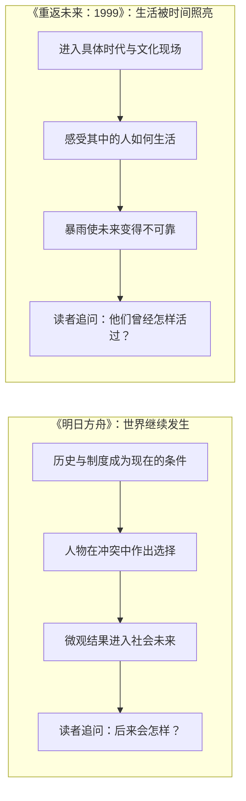

我最初想讨论的，甚至不是一部游戏，而是一种很难解释的听觉经验：一首歌、一张封面，远处似乎有船，岸上的少女朝它望去。画面带着斜角，像是风正在把什么推向远方；笛声又高又亮，明明没有讲清楚故事，却让我突然感到离别，甚至有一点 homesick。奇怪的是，我并没有离开过自己的家，也没有具体想起某个现实地点。那种乡愁更像是作品暂时替我造出了一段生活：有人离开，有人留在岸边，而我们不知道那艘船会不会回来。

顺着这种感觉，我们谈到了《明日方舟》和《重返未来：1999》。起初看起来，这是一次关于两款游戏叙事风格的比较；谈得越久，我越觉得真正浮现出来的，是两种彼此对称的历史经验：一种让我想知道一个世界后来会怎样，另一种让我想在一个已经过去的时代里多待一会儿。方舟让我思考、见识，并不断回到一个仍在生长的世界；1999让我感受、记忆，并在故事结束后留下难以命名的余温。

这不是把两部作品划成“理性”和“感性”两类，也不是说一部有思想、另一部只有氛围。方舟有极细密的个人感情，1999也有宏大的历史与文明问题。更准确地说，它们各自安排了不同的情感重心：方舟经常让微观的人进入宏观历史，继续成为未来的原因；1999则让具体生活在暴雨与时间断裂中变得格外可触，哪怕它最终没有未来。两者都写离别、记忆和文明，只是让我们的目光停在不同的地方。

<!-- more -->

*图：《今夜星光灿烂》官方活动主视觉，图源[重返未来：1999官方活动页](https://re1999.movergames.com/page/new_51656.html)。*

---

## 目录

1. [从“我没有离家，为什么会想家”开始](#一从我没有离家为什么会想家开始)
2. [面向未来的历史感，与回望过去的时间感](#二面向未来的历史感与回望过去的时间感)
3. [文化颗粒度：理解一个世界，和进入一段文化记忆](#三文化颗粒度理解一个世界和进入一段文化记忆)
4. [方舟的文学性：大历史如何落到具体的人身上](#四方舟的文学性大历史如何落到具体的人身上)
5. [《不义之财》：大小姐为什么留下来](#五不义之财大小姐为什么留下来)
6. [《人们，我们》：一群人如何成为一段历史](#六人们我们一群人如何成为一段历史)
7. [《崔林特尔梅之金》：怀念一种并未真正存在的过去](#七崔林特尔梅之金怀念一种并未真正存在的过去)
8. [成年人的童话：苦难没有取消幸福的资格](#八成年人的童话苦难没有取消幸福的资格)
9. [1999的梦与悬疑：为什么有些故事不替我们解释完](#九1999的梦与悬疑为什么有些故事不替我们解释完)
10. [暴雨里的小镇：微小的圆满为什么仍然重要](#十暴雨里的小镇微小的圆满为什么仍然重要)
11. [失败、遗产与新文明：谁有权决定未来](#十一失败遗产与新文明谁有权决定未来)
12. [阿戈尔的智斗场：思想自由能否维系共同体](#十二阿戈尔的智斗场思想自由能否维系共同体)
13. [两种远行，以及一个共同的价值判断](#十三两种远行以及一个共同的价值判断)

## 专题深读

这篇总论先把聊天里形成的主要关系放在一起。下面的专题文分别展开一个问题；从任一篇都可以回到总论，也可以继续读相邻主题。

- [可被理解的世界与可被怀念的时代：方舟与1999的时间方向、文化颗粒度和音乐经验]()
- [从学生团到国家命运：《人们，我们》中的乌萨斯历史]()
- [《不义之财》：阶层、善意与涤火杰西卡的选择]()
- [《酸橙》：成年人的童话与幸福资格]()
- [暴雨之前的人怎样生活：1999的怀旧、悬疑与微观圆满]()
- [失败不能穷尽人的价值：特蕾西娅、克丽斯腾与文明遗产]()
- [阿戈尔的智斗场：文明存续与海嗣融合的伦理问题]()

每篇专题都可以独立阅读。它们不要求读者先接受总论中的概括；各文会从具体场景出发，重新说明论点、限制和仍未解决的问题。

## 一、从“我没有离家，为什么会想家”开始

有些乡愁指向真实的故乡：老房子、街道、亲人，或一个已经回不去的生活阶段。但也有一种乡愁找不到对应的个人记忆。我从未到过某座海边小镇，从未坐过那艘船，也没有经历过画面里的分别，却会被一首音乐突然拖进一种失落。它不是在提醒我“曾经失去了什么”，而是让我短暂地经验“失去可能是什么感觉”。

《The Invitation of the Dead》的封面和音乐，给我的就是这种感受。少女望向远处，画面似乎被风吹斜；船与笛声一起提供了离开的方向。真正使画面变成离别的，不一定是船本身画得多清楚，而是少女没有看向观众。她在看一个我们看不见、也无法挽留的对象。于是离开者甚至可以缺席，却仍然支配整幅画的情绪。歌曲与封面的信息可以在[专辑页面](https://tomoakikawabaya.bandcamp.com/album/the-invitation-of-the-dead)继续听、继续看；它们没有替我们把故事说死，反而给想象留下了位置。

聊天的另一条音乐线索是《铁花飞》。歌词里反复出现迟来的理解：人会先服从、再疑问，长大后才发现曾经以为完美的人也会逞强；有善意的人也会犯错，身世与处境又不是自己选择的。它不是要把冲突处理成“从头到尾大家都没错”，而是把理解放在经历之后：当我终于看见另一个人的梦魇、看见他为什么如此坚强，我才可能不再只拿自己的视角衡量他。

歌词里“mandarin”与腐烂的蜜橘相连，也留下了我最初的提问：这里是否同时在玩语言与文化意象？无论双关是否为作者本意，这个词放进整首歌之后，都让“甜美、成熟、腐坏”几种感觉挤在一起；而“demons”也不是一首温柔歌里突兀塞进来的怪物词，它可以指向一个人无法摆脱的纠缠与伤痛。歌曲不急着给过去划分正确与错误，而是让两个人承认：当时的我们可能各自带着善意，也各自被自己的视角关住。它的原作与制作信息可以从[塞壬唱片发布页面](https://www.bilibili.com/video/BV1BqFZzVEYJ/)查看。

这和“离别的歌”似乎是两回事，却共同指向一种叙事能力：作品不一定要先把结论交给我们。它可以让声音、视角和人物留下的空缺，先构成一种经验，再让我们慢慢寻找它的意义。后来我发现，这种差别正好也是我理解1999和方舟的一把钥匙：一个更常让情绪先抵达，一个更常让历史与人物的因果关系不断展开；但它们都不要求我们只站在一个人的位置上。

## 二、面向未来的历史感，与回望过去的时间感

最初浮现的对照很简单，却一直没有失去解释力：读完方舟的一段国家故事，我会好奇这个社会接下来会怎样；读完1999的一段时代故事，我更容易惆怅那个年代真的过去了。

方舟的时间常常像一条正在形成的历史链：过去留下创伤与制度，创伤在现在变成矛盾，而人物的选择又会改变未来。谢拉格从相对封闭的山地社会开始接触现代化，铁路、外部力量和宗教权威带来的变化不会在一个活动结束时自动消失；叙拉古的新城市与法典也不是一段故事的装饰，它们会让人继续追问制度能否活下来、旧秩序会怎样反扑。我会期待乌萨斯后续，不只是因为偏爱某个王女或某位角色，而是想看这个沉重国家如何进入下一阶段。甚至一部出乎预料的公路片，只要继续发生在泰拉，也足以让人愿意跟着走——因为这个世界本身还在产生生活。

《重返未来：1999》的时间体验则由“暴雨”不断制造断裂。它当然有主线、有未来悬念，也不能简单说成“只回望过去”；但很多篇章会把一个时代的生活质感推到情感前景。故事让我们先触摸某个历史切片里的人如何工作、演奏、相爱、争执，再意识到这些生活可能无法完整地留到下一个时代。读者于是会问：他们曾经怎样生活？这种浪漫为何在那个时刻出现？我们为什么会觉得它已经失去了？

因此，“面向未来”并不等于方舟没有乡愁，“回望过去”也不等于1999没有行动。关键是叙事把情感的终点放在哪里。方舟经常把过去当作解释现在的力量，再把现在推向未来；1999经常让过去的生活本身成为情感目的地，即使它不能成为未来的基础。

## 三、文化颗粒度：理解一个世界，和进入一段文化记忆

我们谈到过“文化颗粒度”。这个词不是说哪款作品的设定更多、更复杂，而是问：一个意象背后有没有可供读者进入的生活质地？它能否唤醒不只来自设定说明的意义？

方舟可以让人理解一种理想为什么产生。谢拉格的列车可以象征现代化对传统社会的冲击，也可以是银灰所承担的政治选择。我们知道它为何重要，也能从势力关系、宗教传统、资源与阶级变化中解释它。但这份意义主要要由方舟自己的文本一点点建立：我们需要看见谁支持铁路、谁害怕铁路、谁会从铁路获利、谁会被迫改变日常，钢轨才会从一个现代化符号变成谢拉格人的历史。

1999的歌剧、绘画、文学、音乐与历史环境，则经常能借用现实文化已经积累的意义。歌剧传统本身就带着现实世界的历史记忆；某个时代的服饰、口音、音乐和政治空气，也可能把玩家带到游戏之外，去找真实存在过的作品与社会。它让玩家沿着游戏的线索“走出去”，发现一大片现实文化；方舟则常让玩家沿着原型与制度线索“走进去”，继续研究泰拉内部的政治逻辑。

这不是“1999有文化，方舟没有文化”。方舟当然有意象，也有鲜明的文化象征；莱塔尼亚、乌萨斯、炎国等地区都能唤起现实原型。但有时玩家在故事外找到的首先是“它借鉴了什么”“这个国家影射什么”，这更接近考据；1999则经常直接让现实历史与艺术传统成为情绪材料。两种路径都能深，也都可能失手，只是它们借力的文化距离不同。

“来呀审计”让这种差异变得更细。我感受到它触及苏联红色文化时，能够直接碰到那种文化自身的浪漫气息；方舟近来的乌萨斯故事也可能让人想到人民、集体与历史，但它更多从普通人的生活感知出发，不会让我立刻觉得自己进入了某种现实红色文化传统。两者的差别不是谁更进步，而是互文线索在阅读中扮演的角色不同：一个让历史文化本身参与造情绪，一个把读者留在泰拉内部，观察人们如何生活、如何理解彼此。

方舟的世界因此像一个可以被理解、但未必能够被怀念的外星文明。我们能研究它的制度来源，能从似是而非的文化内核中辨认熟悉感，却不一定会像怀念某个真实时代那样怀念泰拉的一条街、一场歌剧或一间老咖啡馆。1999恰好能把我们带入一种“从未亲历却仿佛曾经失去”的怀旧。《崔林特尔梅之金》中关于怀念未曾经历生活的表达，正好碰到这种复杂心理：怀念对象未必是个人记忆，也可能是作品替我们搭起的一种文化记忆。

但这种文化记忆也不能被概括成“1999的所有故事都在复刻现实历史”。我后来补充，《宇宙序曲》虽然借用了太空竞速时代的浪漫，却发生在拉普拉斯科算中心的实验背景里，是架空的主线／前传内容，不是现实历史本身。它正好说明1999也会把现实的文化气味和虚构世界的科学设定揉在一起：现实提供了可感的时代颗粒，故事仍然可以在虚构宇宙里发展自己的命题。

## 四、方舟的文学性：大历史如何落到具体的人身上

如果只说方舟擅长宏大历史，就会漏掉我后来意识到的部分：它并不是先摆出国家、制度和历史，然后让人物沦为讲解员。许多大问题是从一个个具体的人进入的；不同立场也会落在各自无法轻易摆脱的生活里。读者一会儿看见学生团，一会儿看见军阀、自由民、追随者、皇帝与大臣，视角可以变，社会却仍然是同一张互相牵动的网。

《不义之财》很能说明这一点。大小姐为什么主动成为雇佣兵？既然战斗这么艰难，她为什么不干脆离开？她面对受苦的人时，究竟是在以高位者的方式俯视他们，还是已经开始产生同情？这些问题并不能靠一句“她是好人”回答。人物的善意需要与她的出身、行动、选择和盲点放在一起看。她是否理解普通人的处境，不能只由她自称的动机来证明；她为何留下，也要放回她真正愿意承担什么代价来判断。

这类微观人物问题，是文学性的重要来源。人物不是理念的标本，而是理念在生活中的摩擦面。一个人可能有勇气，却并不完全理解自己帮助的人；可能愿意承担危险，却仍然带着阶级偏见；可能做出了正确行动，却还没有成熟到能解释它。读者要在行动与动机之间来回判断，而不是等作者发一张道德判决书。《不义之财》的活动信息可以从[鹰角官方活动公告](https://ak.hypergryph.com/news/2023085044.html)进入；这里真正吸引我的，则是我对大小姐的那串具体疑问。

同样的从微观进入宏观，也存在于《崔林特尔梅之金》：选帝侯政治并非只有棋盘上的权力计算。那个曾经是诗人的人有爱人和女儿，后来却为了国家承担婚姻与政治责任；妻子的崩溃、女儿被囚禁在高塔，与双子皇帝之间的情谊和隔阂，都会让“国家必须如此”这句话变得难以轻轻说出口。巫妖、邪魔与亚空间提供奇幻尺度，但真正使它沉重的，是抽象权力如何进入家庭、身体和亲密关系。这里也需要谨慎：怀念巫妖王时代的人，未必是在怀念一个更好的时代；那个时代有秘密警察，怀旧本身可能选择性地删掉了它不愿记住的部分。

所以，方舟的文学野心不只是“有很多字”或“设定很复杂”。更重要的是，它持续追问：一个人怎样被时代塑造，又怎样在时代里作出自己的选择？它可以让我们从一个少女、一位雇佣兵、一座新城市、一场政治婚姻，慢慢看到整个社会结构。宏观与微观不是两种互斥的写法，而是互相检验：宏大理想要由个人生活验证，私人选择也会进入历史后果。

我也常觉得，方舟让人觉得泰拉大陆“人人都是智者”：来自卡兹戴尔、乌萨斯、大炎、维多利亚、哥伦比亚的领袖与行动者，常常都能说出有分量的历史判断。这个印象不是说故事里的每个人都全知、每个领导人都正确，而是作品愿意赋予许多行动者足够的思想能力，让他们能解释自己为什么选择一条道路。于是冲突不再只是聪明人与蠢人的冲突，而是多个理解历史的人在有限条件下做出彼此不相容的决定。这种“智识上的英雄主义”也有代价：如果每个人都能讲出哲理，生活可能显得过于概念化；但方舟最好的篇章会用个人欲望、家庭关系、阶级位置和具体牺牲，把这些理念重新压回人的生活。

这也是我拿它和FGO比较时，真正想指出的差异。不是说FGO只能写王道拯救世界，而是我在方舟这里体验到的重点不止是世界危机的终局：我更在意历史中的不同人、国家命运、偶然变量，以及抽象政治实体内部那些具体的人。两款游戏在叙事结构和关注尺度上各有目标；方舟对我的独特吸引力，是它把多地区、多世代的生活持续放在同一个历史世界里，让一个活动留下的后果能被另一个活动重新照亮。

因此，讨论它的“字数”或拿文本体量和传统小说直接比较，不能只做字符加总。视觉、配音、战斗间隔与信息重复都会改变实际阅读速度；但它的文学感也不只来自总字数，而来自长期积累的社会关系、人物回返和因果回声。许多单独看像支线的故事，放到几年后的新剧情里，会成为读者判断制度是否变化、人物是否成长的记忆底稿。与其只问它像几本小说，不如问它有没有让一个世界在读者心中持续变厚。

*图：《不义之财》活动主视觉，图源[鹰角官方活动公告](https://ak.hypergryph.com/news/2023085044.html)。*

## 五、《不义之财》：大小姐为什么留下来

我想把《不义之财》单独拿出来写，因为这段讨论最能显示我为什么会长期追着方舟的故事看。它没有先把我带到国家存亡或文明终局，而是把我留在一个镇子、一群居民和一个带着特殊出身的年轻人之间。我反复想的是几个很具体的问题：大小姐为什么会主动去当雇佣兵？既然这份工作如此危险，她为什么不离开？她面对镇民的苦难时，到底是带着上位者的怜悯俯视他们，还是确实看见了他们？

这些问题看起来像是在判断人物善恶，实际上是在追问行动的来源。一个出身优渥的人愿意帮助贫困者，这当然可以是善意；但善意本身并不能证明她理解了对方的处境。她可以想象自己在拯救别人，却仍然不知道别人真正需要什么。她也可能带着傲慢开始，后来在相处中发现，镇民不是等着被她拯救的抽象对象，而是有自己的判断、尊严、关系网和活法的人。真正的变化不是“大小姐变得更善良”，而是她对自己和他人的认识都被现实磨动了。

她选择留下，因而比“她有钱，所以可以冒险”复杂得多。金钱和家庭背景能为她提供某种安全网，也会让她误以为可以把危险当成一项体验；可是当她真的置身其中，选择就会产生不可撤销的后果。离开并不只是从战场上撤退，也可能意味着重新接受那个替她规定人生的身份：家族的女儿、公司体系里被保护的人、被安排好道路的人。成为雇佣兵，既是主动争取行动权，也可能是她还没有找到更成熟的表达方式。她的自由不是一句宣言，而要看她愿意为这份自由承担什么。

这也使“她为什么不走”不该被一句浪漫化的“因为她勇敢”轻轻盖过去。留下可能包含责任、愧疚、好奇、对同伴的承诺，也可能混杂着年轻人对危险的误判。一个人物可以同时有勇气和天真，可以想帮助别人却尚未掌握帮助的尺度。故事若让她在不断的接触中重新判断自己，人物才不是道德模范，而是一个会被他人改变的人。

镇民的处境也不能只被当作大小姐成长的教材。镇上的贫困、地方生活和外来力量的介入，牵涉的不只是某个人心地好不好，而是资源如何流动、谁有权决定当地的未来，以及困境中的人能不能拒绝别人替他们定义“幸福”。当地方政府、金融机构或公司撤出、介入、重新估价某个地方时，形式上合法的决定也可能把代价全部交给普通人。居民的反抗未必漂亮，也未必符合旁观者对“正确抗争”的想象；但如果只用秩序与规则衡量他们，就会忽略规则本身是谁制定的、利益又由谁承担。

所以故事标题里的“不义之财”值得留出多义空间。它当然可以指向显眼的钱财和利益，但更深的“不义”可能不只存在于某一笔赃款：一边是被制度承认的收益，另一边是被制度排除的人；一边是可以把风险外包的财富，另一边是不得不在原地承受后果的生活。财富是否“正当”，不能只看它有没有经过账面手续，还要问它依靠了什么关系、把损失转给了谁。故事里不同人物各自拿着什么、失去什么，也会改变这四个字的指向。

我也不想把这写成“有钱的大小姐终于学会同情底层”的单线故事。那样会把镇民再一次变成她的道德课程。更有意思的可能是：她带着既有身份来到一个她不熟悉的地方，而地方的人并没有因为她的主角身份就立即认可她；她必须通过行动证明自己能不能成为共同承担后果的人。她得到的不是替所有人发言的权力，而是与别人共同处在一个局面里的机会。

这类故事把宏观政治压缩在可触摸的关系里。制度、资本与地方社会不是远处的背景板，它们会进入一个人是否留下、怎样工作、敢不敢相信别人、是否有权说“不”的具体时刻。读者对大小姐的判断也因此要不断移动：我们既能看见她身上真实的善意，也能看见善意不能替她免除理解的责任；既能承认她的行动有价值，也能追问她仍然拥有多少选择余地。

这正是我觉得《不义之财》不应被简化成“某位角色的成长支线”的原因。它把阶层、财富、地方共同体与个人行动放在同一张桌上，却仍然让我们关心这个年轻人到底会不会走、会不会留下、会不会在看见别人之后改变自己。它的政治性不是把人物变成议题的代言人，而是让社会结构变成他们生活中的重量。[鹰角官方活动公告](https://ak.hypergryph.com/news/2023085044.html)可以帮助定位活动；更完整的阅读仍应回到活动剧情本身。

## 六、《人们，我们》：一群人如何成为一段历史

《人们，我们》让我感兴趣的地方，是它没有只让“国家”以一个抽象主语说话。我们会从学生团体看起，再遇见皇帝、大臣、军人、地方势力、自由民和追随者。每次换视角，乌萨斯都不是同一个东西：有人把它当作必须延续的国家，有人把它当作权力机器，有人把它当作自己唯一的家，有人只是在其中寻找一条能活下去的路。

这种视角移动不是简单地把故事越写越大。它让先前建立的理解被后来的视角重新检验。学生们的恐惧和勇气有自己的重量，但他们并不因此自动掌握全局；掌握权力的人也不是因为身处高位就能看透每个人。皇帝、大臣和军方各自有立场，可能做出冷酷选择，也可能被制度和历史限制。故事不急着把其中一方写成唯一清醒的人，再把其余人降格为愚蠢的障碍。

我曾经对早期阅读产生过一种印象：方舟先讲宏大政治，再把情绪和人物补进来。后来重读乌萨斯这些故事，我发现这个印象并不准确。它常常从一群学生、一个家庭或一个普通人的遭遇开始，之后才把更多身份和社会位置接进来。宏观不是预先摆好的全景镜头，而是由众多有限视角拼出来的。每个人知道的都不完整，他们的生活却共同构成了国家的现实。

这也解释了我为什么会期待乌萨斯之后的故事。我期待某位王女的命运，当然有角色喜爱在里面；但我的期待早已越过“我喜欢她，所以要看她有没有后续”。我想知道这个庞大、沉重、内部充满矛盾的国家会走向哪里，旧有政治结构会不会变化，普通人能否在新的秩序里活得更好。国家不是一个角色，却可能像角色一样让人牵挂：它有过去，有伤口，有制度惯性，也有尚未决定的未来。

而我并不要求方舟每次都推进这条宏大主线。《直到大地变成一颗酸橙》这样的公路故事也让我愿意继续读，因为只要它发生在泰拉，我就能看到这个世界又长出一种新的生活。读者不只是追着一个谜底走，而是在学习一个地方如何工作、如何相爱、如何交易、如何旅行。世界本身成为可以积累的阅读对象。

“人民”在这里也不是一个没有差异的整体。不同阶层、地区和政治身份的人，可能对同一个国家怀有互相冲突的期待。有人希望它强盛，因为只有强盛才能阻止外敌；有人害怕强盛会继续压迫自己；有人怀念旧秩序，因为旧秩序至少可预测；有人希望彻底改变，却不知道改变会把谁推向危险。故事把这些态度并排展开，不要求读者把复杂性迅速缩减成一个口号。

这当然有风险：当太多人都能说出有道理的话，文本容易显得人物过于“会思考”，好像每个行动者都在替作者做历史评论。但它的理想状态不是让所有人都成为正确的智者，而是承认历史中的人并非只能被动等待领袖解释。普通人能判断，精英也会误判；有知识不等于能控制结果，有权力也不等于掌握未来。于是宏大历史里仍然留着人的不确定性。

## 七、《崔林特尔梅之金》：怀念一种并未真正存在的过去

谈《崔林特尔梅之金》时，我被它的政治与家庭纠缠吸引。选帝侯之间有利益交换，诗人出身的主人公并不渴望王位，却被推到必须承担的位置；爱情与婚姻被国家事务重新安排，妻子在这种安排里崩溃，女儿被隔绝在高塔之中。政治联盟听起来像棋盘上的一着，但它落在一个家庭里，就变成了谁能选择自己的伴侣、谁能决定孩子的生活、谁有资格拒绝“为了国家”的牺牲。

双子之间的感情也不是一个现成答案。他们可以彼此珍惜，也会被位置与责任撕开；亲密并不意味着他们能同时得到自己想要的生活。奇幻设定把世界推向更陌生的尺度，巫妖、邪魔和异常力量使这段历史具有传说感，但人物所承受的仍是非常具体的东西：想爱的人、不能公开的愿望、被安排的婚姻，以及对国家未来的责任。

这类故事容易触发怀旧，可怀旧并不等于那个过去更好。我后来补充，巫妖王时代存在秘密警察；这条事实会改变“黄金年代”的想象。我们可能怀念一种充满仪式、艺术与政治戏剧性的生活，却把监控、恐惧与被压制者从画面里裁掉。过去的浪漫可以是真的，过去的压迫也可以是真的。两者同时成立，才要求我们仔细看待怀念本身。

《重返未来：1999》常常让我产生一种“怀念未曾亲历之物”的感觉。现实文化的符号和时代气味让过去变得亲近，但亲近不意味着我们真的生活过其中。我们是在作品提供的材料里，想象那个年代的人怎么穿衣、工作、演奏、恋爱，想象某种浪漫如何产生；随后又意识到，这个时代无法原样留存。那份怀念既指向历史，也暴露了当下的想象。

于是，怀旧不是把过去判定为更美好，而是承认过去曾经拥有自己的现在。对当时的人来说，它不是一张复古海报，而是尚未结束的生活；他们不知道后来会怎样，也不会把自己当成我们怀念的“时代”。当我们把他们放进一个美丽的历史框架里，可能也在替他们删去痛苦。好的历史叙事会让这种浪漫和删改的危险同时可见。

## 八、成年人的童话：苦难没有取消幸福的资格

方舟有时会给人一种“成年人的童话”感。《直到大地变成一颗酸橙》尤其明显：它可以让人读得开心、有趣，同时不放弃苦难、家庭矛盾、商业竞争、地方文化和科技改变生活这些现实层次。几个少女结识、产生隔阂、再重新理解彼此，公路上的风土人情和自然奇观不是用来把现实抹掉的背景；它们让现实中仍然有旅行、好奇、争吵、友谊与欢乐。

这里的童话不是“世界没有大灰狼”，而是即使看见大灰狼，人物仍然没有被剥夺欢笑的权利。面对绝望的人，帮助可能有限；公司与商业利益不会因为少女们真诚就自动消失；家庭创伤也未必被一次谈话彻底治愈。但故事依旧可以让一段旅程真实地好玩，让某些关系在摩擦后变得更牢，让人相信普通人的善意不是毫无意义。

这和廉价乐观的差别在于：幸福不负责证明苦难已经解决，它只证明苦难没有占有全部生活。少女们仍能为沿途的事物感到新奇，仍能因为同伴而开心，不是因为她们不了解现实，而是因为现实没有取得定义她们全部经验的权力。成年人的童话承认世界不公，却不把悲惨当作严肃的唯一形式。

我把这种感受与1999的篇章对照，想到的不是“1999没有欢乐”，而是它的生活可能被历史断裂重新解释。两边都写打趣、情谊与微观的温暖；差异在于，这些温暖后来有没有机会继续长进未来。方舟会让某些努力成为后续故事的条件，1999则可能让一个小镇即使已经和解、找到新的发展可能，仍然被暴雨吞没。于是同样的笑声，在一边可以成为未来的记忆，在另一边可能成为我们只能悼念的最后现场。

童话的“成年”还体现在它不把人和制度拆开。少女们能短暂地解决眼前冲突，却不能因为友谊突然获得改变公司、地方经济或家庭权力关系的超能力。故事也没有要求她们必须背负所有人的命运，才能证明自己善良。她们可以在能力有限的情况下，先把一个具体关系处理得更诚实一点；这个小结果很有限，但有限不等于虚假。

旅途因此成为一个检验人物的空间。公路把人从熟悉环境里带走，让她们面对没有预设答案的地方和陌生人，也让关系中的小裂缝逐渐显形。同行并不自动带来理解：疲惫、误会、价值差异和家庭经历都会让人说错话或做错事。重要的是人物后来如何承担这些摩擦，是否愿意重新看对方，而不只是旅程结束后大家一起拍一张和解合照。

我喜欢这类故事还有一个原因：它允许快乐本身保有复杂性。笑声不必是苦难的装饰，也不必被解释成“不懂事”。在残酷世界里感到快乐，不等于背叛正在受苦的人；有时恰恰说明受苦者仍然是完整的人，除了痛苦也会有兴趣、幽默、欲望和关系。若创作者只允许苦难者痛苦，就会把他们也变成单一符号。
## 九、1999的梦与悬疑：为什么有些故事不替我们解释完

我读《今夜星光灿烂》时，甚至觉得自己没看懂。它从画面隐喻、病态的伊索尔德，到最后暴雨降临，都不像一篇把因果和道德结论逐项讲明的故事。更特别的是，卡卡尼亚是伊索尔德的主治医生，也与她有深厚关系，却未能提前看见伊索尔德那种病态依赖的全部重量。读者试图理解她，甚至会感觉自己像在看一场悬疑：事情已经发生，可能很糟糕，我需要理解、处理，但也许没有一个完整解释能把一切安置好。

《今夜星光灿烂》作为官方第六章的资料入口，可从[《重返未来：1999》官方活动页](https://re1999.movergames.com/page/new_51656.html)进入；这里的链接只帮助读者找到作品，不替任何解读盖章。

这种“没看懂”未必是阅读失败。它也可能是作品主动留下的经验形式。假如最亲近的人都没有真正理解伊索尔德，读者当然不必被授予全知视角。我们可以推测、回看、怀疑，却不能轻易说“她其实就是因为某一个原因才这样”。人不是一组等着被破解的密码；创伤、依赖、表演与欲望交织时，解释有时只能逼近，不能占有。

我还想到另一个暴雨场景：剪纸般的几何插画、特殊的颜色、低沉平静的叙述，以及有人把手伸进安全区却只留下那只手。它的力量不来自大声煽情，而来自叙述与灾难之间的冷静距离。暴雨不是一个抽象的世界观设定，而是突然切断具体生活的物理事件：身体、空间、亲人和日常秩序都可能在一瞬间失去连续性。那只手让不可逆的历史变得可见，也让观看者意识到安全区的边界不是公正边界。

同样，那座小镇：居民经过分歧后重新凝聚，似乎找到了新的发展可能，结果仍被暴雨回溯，只有少数人被维尔汀带走。它让微观圆满与宏观历史发生残酷错位。一个故事可以在人物的生活尺度上获得阶段性答案，却不因此获得穿越时代的权利。1999常让情绪停留在这个无法消化的部分：不是所有认真生活的人都能进入未来，不是所有和解都能被历史保存。

这也是“梦”这个比喻的意义。梦未必留下清晰的论证大纲，却会把气味、光线、旋律和不安留在醒来之后。1999经常让我们先身处时代，再回头问自己为什么如此惆怅。官方介绍把它的基本机制写作“暴雨”降临后世界回到旧时代；更具体的篇章则让这种机制进入一个个不可替代的人与地方。[《重返未来：1999》官方网站](https://re.bluepoch.com/home/)可以作为理解世界前提的入口，但真正留下情绪的，仍然是那些故事里的生活细节。

## 十、暴雨里的小镇：微小的圆满为什么仍然重要

1999的暴雨最残酷之处，不只在于它会夺走生命，而在于它能把刚刚形成的未来一并抹掉。来亚什基的居民并非没有自己的生活，也不是只为了给维尔汀提供一个伤感的背景。小镇的人彼此有旧账、有误解，也有必须继续过下去的日常；在冲突和变化之后，他们终于能重新找到相处方式，甚至看见一种新的发展可能。

如果把故事只看成宏观历史的注脚，这种和解很容易被结局吞掉：暴雨到来，历史继续，人被带走或消失，于是小镇的一切仿佛都没有意义。但我越来越觉得，恰恰要把这两种尺度同时放在眼前。镇民在有限时间里达成的理解是真实的；暴雨使他们失去未来，也是真实的。后者并不会倒过来证明前者不值得发生。

这和方舟常见的历史感形成了鲜明差异。谢拉格的改革或叙拉古的制度变动，会让人继续追问成果能否保存、会不会被后来的政治反扑吞没；我们能想象这些变化成为下一段历史的条件。来亚什基的和解则可能没有这样的延续机会。它的价值更像一段完成过的生活，而不是一项等待写入国家年鉴的制度成果。

维尔汀的行动也因此带着无力感。她能带走的人很少，无法把整个地方装进箱子，也不能保证被带走的人从此安全。救援不是一场能够补偿所有损失的胜利，而是在无可挽回的时间里做有限的选择。被留下的人不是因为不重要才无法同行；能力的边界与选择的痛苦同时存在。

这种叙事不会因为没有宏大解决方案就失去政治性。它迫使我问：若一个地方的生活没有机会进入未来，它还值得我们认真看待吗？我的答案是值得。日常生活并非只有被历史保存下来才有价值。人与人曾经停止互相敌视，曾经一起想象新的生活，这些事实即使不会在下一个时代留下可见遗产，也没有因此变成虚假。

这也是1999的失落与方舟的希望能够相互照见的地方。方舟提醒我，微小行动可能进入未来；1999提醒我，有些行动即使无法进入未来，也不是白费。两种故事都不把人的价值完全交给结果裁定，只是前者更容易让我为尚未完成的事业期待，后者更容易让我为已然消失的可能性惋惜。

## 十一、失败、遗产与新文明：谁有权决定未来

方舟的乐观不是“人类最终一定胜利”。前文明已经灭亡；博士曾经作出过可怕的选择；特蕾西娅没有亲眼看见理想实现；克丽斯腾的探索也不是一场保证凯旋的胜利。故事仍然保有希望，是因为失败没有穷尽人的价值，也没有穷尽后来者重新赋予世界意义的能力。

特蕾西娅与特雷西斯的分歧，不只是兄妹感情悲剧，也关乎萨卡兹要如何面对历史。特雷西斯想为萨卡兹争取一个能够生存的未来；特蕾西娅则试图让萨卡兹拥有一个不再完全被过去决定的未来。她的死亡没有让她的选择自动获胜，但她把王冠交给阿米娅，至少表明民族未来不必由血统和复仇逻辑封闭。理想主义者可以死去，理想仍可能被后来者重新理解，而非被原样复制。

博士与普瑞赛思、凯尔希与特蕾西娅、前文明与泰拉之间，也围绕着一个相似问题：一个已经消失的文明留下遗产，后来者是否必须完成它未竟的使命？技术可以被继承，历史可以被重新发现，责任却不能简单地从死人手里整包交到活人手里。阿戈尔知道前文明遭遇毁灭，却不理解究竟是什么毁灭了它。这份知识既是警告，也是一种没有答案的压力。阿戈尔可以从遗迹获得技术，但它仍须决定自己要保护什么、如何生活；继承不等于复制，承认过去也不等于服从过去。

在这条更长的生命链里，我想到预言家从木卫二带来生命种子的设定、泰拉由此演化而来的设定，给“传承”增加了一个很特别的尺度：生命可能从一个已经失败的文明出发，经历漫长变化，最后长成它无法预见的新世界。后来者并不是前文明的备份，也未必会认可前人的所有目标。正因为传承会改变形状，泰拉的存在才不只是旧文明苟延残喘的证明，而是一个新文明正在形成的证据。

*图：《孤星》活动主视觉，图源[鹰角官方活动公告](https://ak.hypergryph.com/news/2970.html)。*

《孤星》里，克丽斯腾找到前文明的“墓地”，那里有数不尽的石棺，却没有一个可以被她轻易唤醒的古老未来。弗里斯顿最终把能源交给她，未必是在代表前文明作出一项宏大、经过计算的文明投资；也可以被理解成一个已经失去自己时代的智能，被一个后来者打动，决定帮助她去做一件可能没有归途的事。它不是保证她回来，而是没有因为她可能失败，就替她取消探索。

“帮助她走上死路”当然带着危险的浪漫化，需要拆开来看。我们不该赞美死亡本身，也不能把个体牺牲当成集体进步的燃料。真正动人的问题是：若一个人清醒地追求无法保证回报的知识，周围的人是否只能用安全和收益否决她？一个文明若只允许确保存续的行动，它可能活得更久，却不一定仍保有探索未知的能力。克丽斯腾的行动与弗里斯顿的援助，重要之处不是证明她必然成功，而是承认一个个体可以提出不服务于旧文明使命的新问题。

## 十二、阿戈尔的智斗场：思想自由能否维系共同体

《生路》把文明存续的问题进一步推进到阿戈尔内部。阿戈尔并非一个没有理性传统、只能靠权威统一思想的社会。我特别在意它拥有受到尊重的智斗场；然而明面上领导层选择抵抗海嗣、维护阿戈尔文明，仍有人投向海嗣，甚至协助威胁共同体的力量。思想都不能统一，智斗场又意味着什么？

这里需要区分“思想多元”和“共同体解体”。正常的政治分歧，是人们仍以阿戈尔可以继续存在为共同问题，只是对路径有不同判断。智斗场可以让这些路径受到质疑、补充与修正。但如果一部分人不再认为阿戈尔作为独立文明值得保存，双方争论的就不只是方法，而是还是否共享讨论对象。

辩论制度能保障发言，却不能强迫参与者永远拥有同一目标。它可以让观点公开，也无法保证有人会接受辩论结果；可以让人们用理由彼此回应，也无法把每一种立场都转换成共识。阿戈尔的脆弱不是“发展艺术与哲学害了他们”，而是一个高度文明的社会有能力严肃地质疑自身形态，偏偏又在文明存亡的危机中遇到足以让这种质疑变成现实路线的海嗣。

要公平理解海嗣派，必须承认他们并不一定觉得自己正在放弃思想与艺术。他们可能相信群体意识可以消除痛苦、误解、战争与死亡，甚至能创造人类个体无法想象的工程；在他们看来，这不是消灭文明，而是超越文明。可这个论证仍有两个不能跳过的问题：如果个体思想、朋友间的争论和艺术追求都被取消，所谓更高级的生命究竟“丰富”在哪里？即使某种新体验可能更丰富，谁有权替别人决定这种改变值得发生？

效率必须回答“为了什么”。科学不只是把世界变成可控制的对象，也承载探索未知的欲望；艺术不是吃饱之后的装饰，也可能是人体验与创造美的方式；朋友之间的辩论不只是低效地交换信息，因为我珍惜的正是那个与我不同、不会被我彻底拥有的人。若融合只是把别人变成自己的延伸，它消除的或许不只是隔阂，也包括他者本身。

这并不意味着现有文明每一种传统都值得保留，更不意味着任何集体行动都是压迫。阿戈尔必须面对真实危险，也必须讨论如何分担风险。但如果存续成为最高目标，最终被要求存续的文明形态却被牺牲了，那么胜利究竟属于谁？《生路》的标题因此可以被读成一个伦理问题：真正的生路，不仅是避免灭绝，也要让那些值得活下去的生活方式仍有机会延续。活动公告中保留了“斗智场的谜题”这一入口，可以从[《生路》活动公告](https://ak.hypergryph.com/news/1525)回到它的设定现场。

## 十三、两种远行，以及一个共同的价值判断

于是，最初那艘可能离岸的船，又回到了讨论的中心。1999的许多故事让我望向留下来的人、失去的时代和没有办法挽回的生活；方舟的《孤星》则让我望向一个主动离开的人，想象她如何越过边界。前者更像是在黄昏里辨认谁曾经真诚生活过，后者更像是在黑夜里看着有人仍然决定出发。

这两种感受不互相抵消。怀念不是怯懦，远行也不是对留下者的轻视。离开的船之所以让人难过，是因为有人还站在岸上；克丽斯腾的离开之所以让人骄傲，是因为她不是被历史随手卷走，而是主动朝着未知伸手。那艘船是否回来，并不能决定少女的感受是否真实；克丽斯腾是否成功，也不能穷尽她选择的价值。

现在回头看，我明白自己为什么会觉得这两部作品对称。方舟满足我理解世界的欲望：看不同的人如何判断、承担和改变共同历史，期待国家与社会的故事继续发生。1999满足我体验世界的欲望：在现实文化与时代余温里生活片刻，感到某些东西为什么美，又为什么不能被完整保存。一个让我问“后来呢？”，另一个让我想说“真希望那一刻再长一点”。

两者共同抵抗一种单一的成败算法。微观生活未必能进入宏大历史，文明也未必能逃过毁灭；但不能因此说那些人没有真正生活过，或他们的选择没有意义。另一方面，记忆与哀悼也不必让人停在过去。前人的失败可以成为后人的知识，却不必成为后人的命运；一段无法挽回的生活可以被郑重记住，而新的生活仍然有权开始。

也许这就是我从一首离别的歌、一个望向海面的少女，走到泰拉与1999的原因。我们既会为留下的人怀念，也会为离开的人祝福；既想保存记忆，也想允许未来脱离过去的命令。事物不必永远存在，才值得被珍惜；失败也不必被改写成成功，才配拥有价值。能够真诚地生活过、能够在知道风险后仍作出选择、能够把世界交给后来者重新理解——这些本身，就已经构成了希望的一部分。

---

### 延伸阅读与原作入口

- 《不义之财》：[鹰角官方活动公告](https://ak.hypergryph.com/news/2023085044.html)
- 《生路》：[鹰角官方活动公告](https://ak.hypergryph.com/news/1525)
- 《孤星》：[鹰角官方活动公告](https://ak.hypergryph.com/news/2970.html)
- 《直到大地变成一颗酸橙》：[活动资料页](https://arknights.wiki.gg/wiki/Till_the_Lands_Become_an_Orange)
- 《今夜星光灿烂》：[《重返未来：1999》官方活动页](https://re1999.movergames.com/page/new_51656.html)
- 《铁花飞》：[塞壬唱片发布页面](https://www.bilibili.com/video/BV1BqFZzVEYJ/)
- 《重返未来：1999》世界观入口：[官方网站](https://re.bluepoch.com/home/)
- 《The Invitation of the Dead》：[Tomo Akikawabaya 专辑页](https://tomoakikawabaya.bandcamp.com/album/the-invitation-of-the-dead)
