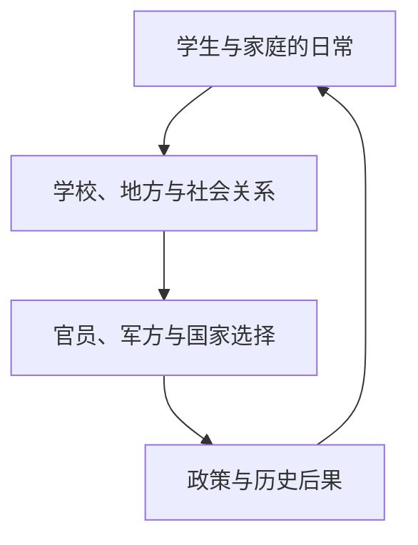

我对乌萨斯后续的期待，已经超过了“喜欢某位角色，所以想看她的下一段剧情”。我想知道这个庞大、沉重、内部充满矛盾的国家会走向哪里；它会怎样面对自己的历史，普通人能不能在新的秩序里拥有不同的生活。让我产生这种期待的，是《人们，我们》把宏大国家拆成许多有限的人生，再让这些人生彼此照亮。

<!-- more -->

*图：SideStory「人们，我们」活动视觉，图源[鹰角官方活动公告](https://ak.hypergryph.com/news/1461)。*

## 不是先讲国家，再给人物分配台词

最初我也以为方舟的叙事习惯是先摆出国家政治与历史大局，再让人物承担解释任务。重新回看乌萨斯相关故事后，我发现这个印象并不准确。它经常从一群学生、一次冲突或普通人的日常开始，之后才慢慢把皇帝、大臣、军方、地方势力、自由民和追随者接进同一张网。

这不是单纯的镜头拉远。视角从学生切换到掌权者，不等于前一个视角被后一个视角取消。学生团的经验有自己的真实性：他们面对的恐惧、同伴关系、对外界的想象和反抗方式，都不需要先经过宏大政治认证才有价值。与此同时，他们也不可能掌握国家机器的全貌。后来的政治视角补上新的限制，却不能替普通人宣布他们应该怎样理解自身处境。

这种叙事使国家从单数变成复数。对皇帝来说，乌萨斯可能是边疆、战争和帝国秩序；对官员来说，它是权力交接、政策与风险；对学生来说，它可能是学校、家庭、饥饿、朋友和逃离的念头；对自由民与地方居民来说，它又是他们必须谋生的土地。大家谈论同一个国家，却不一定生活在同一个乌萨斯里。

## 多个有限视角共同构成历史

可以把这篇故事的视角运动粗略理解为由生活经验逐步接触制度，再回到更广阔共同体的过程。它不是单向“拉远镜头”：宏观决定会重新落到具体人的生活，人的反应也会改变读者如何理解国家。

这个环不是说普通人能够随意改变国家，而是提醒我，国家叙事若要完整，就必须让决策重新回到被决策影响的人身上。否则故事只完成了“解释权力”，没有完成“呈现后果”。

《人们，我们》的可贵之处，是不让一个全知者替所有人总结答案。故事带我进入不同社会位置，人物各自知道一部分事情，也承担一部分后果。读者必须自己把这些局部拼在一起，而且拼出的整体仍然可能不完整。

因此，叙事里的政治人物不必被写成愚蠢的靶子，普通人也不必被写成纯洁无误的受害者。掌握权力的人可能有理由，却也可能把代价转嫁给别人；反抗者可能看见了制度的不公，却未必知道改变以后会发生什么；普通人能够做判断，也会受限于信息与眼前生存。理解一个人的行动逻辑，和认同这个行动，是两回事。

这也是方舟常给我“泰拉人人都是智者”的印象的原因。来自不同地区的领袖和行动者往往有能力解释自己为何选择某条路。故事不太依赖“一个聪明人指出其他人全是蠢货”来结束冲突，而是让多个有经验、有判断的人站在彼此不相容的位置上。所谓智识上的英雄主义，首先是承认人物能够思考，能够对自己的历史负责。

但这种写法也有风险。如果每个人都能说出一段完整的历史哲学，普通生活就会被概念淹没，人物听起来会像作者的演讲台。方舟表现得较好的时候，会把理念重新压回身体和关系：人物有家人、旧友、债务、食物、职业、创伤和对未来的具体要求。论点要经过他们的生活，而不是只靠漂亮台词站立。

## 从学生团到国家命运

### 从学生团走向国家，并不是从“情感”走向“正确答案”

故事把视角交给学生时，读者得到的不是一份缩小版的国家报告。学生首先在意的是身边的人、眼前的危险和自己能否继续生活。他们的政治认识常常从具体经验里长出来：学校如何对待他们，家人怎样谈论国家，某次暴力如何改变了他们对安全的理解。对他们而言，“乌萨斯”不是一个供人辩论的概念，而是每天必须穿过的制度和环境。

随着叙事接触到权力中心，尺度扩大了，但不能把先前的经验归类为“只讲情绪”。害怕、依恋、愤怒和信任本来就是政治生活的一部分。政策不是在抽象空间里发生，它会落到学生能不能继续上学、家人是否安全、一个社区有没有选择上。把宏观视角看作理性、微观视角看作情绪，反而会重演故事试图拆开的等级：仿佛只有掌权者说出的国家利益才算历史，普通人的生活只负责提供感染力。

相反，学生团也不能被当成天然正确的道德共同体。共同受压迫不保证成员之间互相信任，也不保证他们会对风险作出相同判断。有人可能愿意反抗，有人更想保护身边的人，有人会选择离开，还有人可能把熟悉的秩序看得比未知的自由更安全。让这些差异存在，才使学生真正成为政治行动者，而不是等待读者同情的象征。

### “我们”是一项尚未完成的工作

标题里的逗号让我想到，“人们”与“我们”之间并没有自然的等号。“人们”可以是被统计、被统治、被叙述的一群人；“我们”则意味着有人尝试建立共同的语言和责任。但谁有权说“我们”？说话者是否把没能发声的人也算进去？这个共同体能否容纳不同的历史记忆？这些问题会决定“我们”究竟是包容性的承诺，还是把差异抹平的政治口号。

国家叙事尤其容易把“人民”写成单一意志：人民支持某条路线，人民需要某位领袖，人民将从某次胜利中获益。可真实的共同体内部始终有不同利益与风险。边疆、首都、军队、地方居民和学生面对的政策后果并不一样。若故事只让一个领袖替所有人总结愿望，“我们”就会变成权力的代词；若每个人都只坚持自己的经验无法交流，共同行动又会失去基础。

所以我期待乌萨斯未来，不是期待它终于找到一个可以让所有人闭嘴的正确答案，而是想看它能否形成一种更可靠的共同生活：让受政策影响的人能够参与判断，让不同立场可以争论，同时让承担代价的人不再只是被动接受决定。政治成熟未必是冲突消失，也可能是冲突不再只能靠暴力或沉默来处理。

### 国家会留下制度的惯性

即使王女或其他重要人物获得新的行动空间，国家也不会随之变成一张白纸。官僚体系有自己的利益，军队有自己的组织逻辑，地方权力会重新解释中央命令，普通人则会用实际生活检验改革。一个政策在首都被宣布时可能意味着希望，到了地方却可能遇到资源不足、旧关系网和执行者自保。于是同一项改革会在不同地区变成不同的现实。

这也是长期连载适合讲国家命运的地方。故事有机会让我们看到事件之后的回声：谁继续推动改变，谁从新秩序中获利，哪些旧做法换了名字却继续存在，哪些人终于拥有了过去没有的选择。若只有革命时刻，没有后续生活，变革就会像舞台布景；若只写制度变动而不写个人代价，历史又会变成抽象棋局。

乌萨斯并不需要被写成必然进步的国家，才值得读者期待。一个社会可能改革、停滞、反扑，也可能在局部取得成果、在别处付出代价。读者期待未来，正是因为结果尚未确定。能否让普通人的经验进入后续历史，将决定这个国家是否真的在变化，而不只是换了一批角色继续谈论它。

## 为什么我想继续看乌萨斯

对乌萨斯的期待不是一张角色清单，而是一种认识关系。我会关心王女的命运，也会关心她身后的国家能不能改变。一个国家有历史惯性，旧秩序不容易因为一场行动消失；即使出现改革愿望，执行者、地方利益与普通人的生活也会重新塑造改革的结果。

我想看的是这个国家如何进入下一阶段：它会继续依赖军事扩张吗？谁能参与决定政治道路？旧制度会以什么方式留下来？人民会不会只在故事标题里出现，还是能实际拥有改变生活的空间？这些问题没有单一英雄可以代答。也正因为答案需要许多人的行动和时间，乌萨斯才像一个真正会继续发生的世界。

《人们，我们》的标题本身就把这个问题摆在两种尺度之间。“人们”可以指身处历史中的许多具体个人，“我们”则像是一种共同体的自我称呼。但谁能使用这个“我们”？它能不能容纳彼此冲突的人？如果“我们”只由掌权者定义，普通人就会被代表；如果每个人只承认自己的受害经验，公共生活又可能无法继续。标题里的逗号像一道短暂停顿，让我意识到“人们”并不会自动变成“我们”。

这使群像不只是人物多。真正的群像要让人物之间互相改变对方的意义：学生的故事让帝国不再抽象，国家政治又使学生的选择拥有超出个人的后果。每个人仍然是自己，而不是总和的一部分；但他们也无法完全脱离共同生活。

## 有理由的人物仍然可以被批评

“泰拉人人都是智者”不是说每个人都能预见全部后果，也不是说人物只要有一套自洽理论就自动正确。它更像一种叙事尊重：人物不应该为了让主角显得聪明，就被写成只会犯低级错误的陪衬。一个人可以掌握重要信息、理解自身处境，也可以在利益、恐惧和历史限制中作出有缺陷的决定。

这让批评变得更难，也更有价值。若对手只是愚蠢，反驳他就等于赢得辩论；若对手的理由真实回应着某种危机，读者就必须承认他看见了自己未必愿意面对的部分。我们可以理解某种军事路线为何受到支持，同时继续追问它会给普通人带来什么代价；可以理解改革者的理想，也可以质疑理想如何处理现实中的安全与资源。

对乌萨斯未来的期待因此不是等待一个“正确领袖”替整个国家解决问题。领袖当然重要，但制度改革需要许多具体行动者，受影响的人也不应只在故事结尾出来接受新生活。读者会关注国家后续，正因为自己已经看见观点之间都有现实成本。国家的未来不是一道读者能在弹幕里解出的谜题，而是一组不断被行动验证的承诺。

长篇游戏叙事有机会让这种验证发生在很长的时间里。角色回归、地方变化、政策后果和旧事件的新解释，都会让早期故事获得第二层意义。它的风险也在这里：如果人物和事件只被用来提供宏大金句，后续却不再关心普通人的生活，历史积累就会退化成设定资料。真正的世界延续，需要剧情记得自己曾让哪些人承担代价。

## 方舟的世界会积累

读完乌萨斯故事，我会期待谢拉格、叙拉古和其他国家未来发生什么。这种期待来自一种长期阅读的积累：谢拉格的现代化不是活动结束时就冻结的结论，列车能不能改变贸易、权力与日常仍是开放问题；叙拉古的新城市与法典也会面对执行、腐蚀、反扑与重新解释。每个故事都能使我更会读后来的故事。

这就是为什么我也愿意读看似“不推进主线”的公路篇章。只要故事仍发生在泰拉，它可能让我认识一种地方文化、一种职业生活、一种技术改变社会的方式，或一个此前没有机会发声的人。对我来说，追故事与认识世界不是两项互不相干的活动。剧情可以不推进同一条大主线，却继续增加世界的厚度。

相比只等一个终极结局，这种阅读更像持续参与历史。一个活动留下了人物和制度的记忆，下一次更新可能把它们放回新的环境里。读者能记得曾经发生过什么，也能观察此前的愿望是否变成现实。方舟由此提供一种“世界继续”的快感：我不是只想知道故事如何收尾，我还想知道那些生活将怎样改变。

## 和其他长篇游戏叙事的比较

我曾把方舟和FGO放在一起谈，想说明自己在两者身上获得的文学经验不同。这个比较不需要贬低另一部作品。王道拯救世界、历史人物与世界危机可以构成极有力量的叙事；方舟对我的吸引，则更多来自许多国家、制度和普通人的命运长期共处于同一世界，并且彼此留下后果。

比较文本体量也不能只数字符。手机游戏的演出、配音、战斗间隔、阅读界面和重复内容都会改变实际阅读节奏；而文学感也不等于总字数。更有意义的问题是：多年之后，一个角色或地方再次出现时，我是否能用此前积累的经验理解它？世界是否有自己的社会关系，而不是只在主线需要它时暂时被调用？

## 结尾：国家命运从人的有限生活里出现

方舟让我期待乌萨斯的未来，不是因为我相信历史会自动进步，而是因为它愿意让我看到不同的人如何争夺、继承、反对或重新解释共同体。国家并非一个有统一意志的巨大角色。它由许多有限的人组成，而这些人无法被完全归并成同一个声音。

《人们，我们》留给我的不是“乌萨斯应该怎么做”的简答，而是一种继续追问的阅读关系。我想看这个国家后来会怎样，也想看它的普通人如何在宏大选择里继续生活。理解世界使我愿意等待后续；等待后续又让我意识到，世界不是背景，而是许多人仍然在其中生活的地方。

### 原作与延伸阅读

- [《人们，我们》鹰角官方活动公告](https://ak.hypergryph.com/news/1461)
- [《人们，我们》活动开启前的制作组通讯](https://ak.hypergryph.com/news/6251)
- [返回总论：从一首离别的歌到两个世界的时间]()
