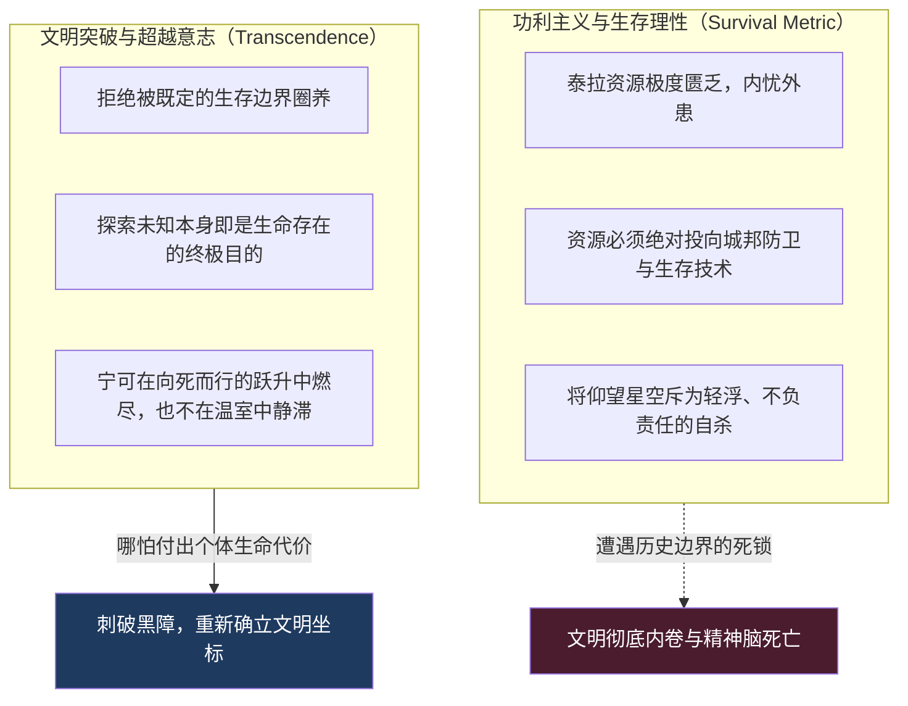
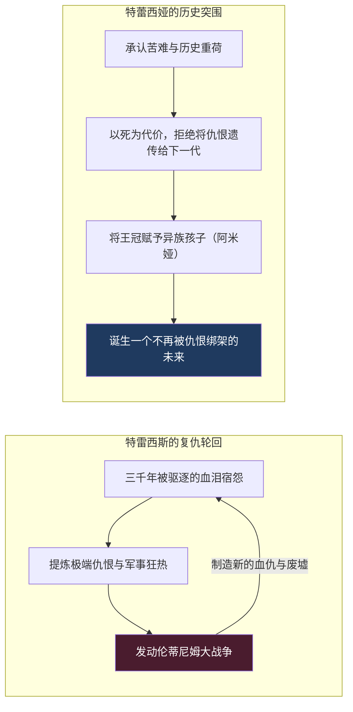
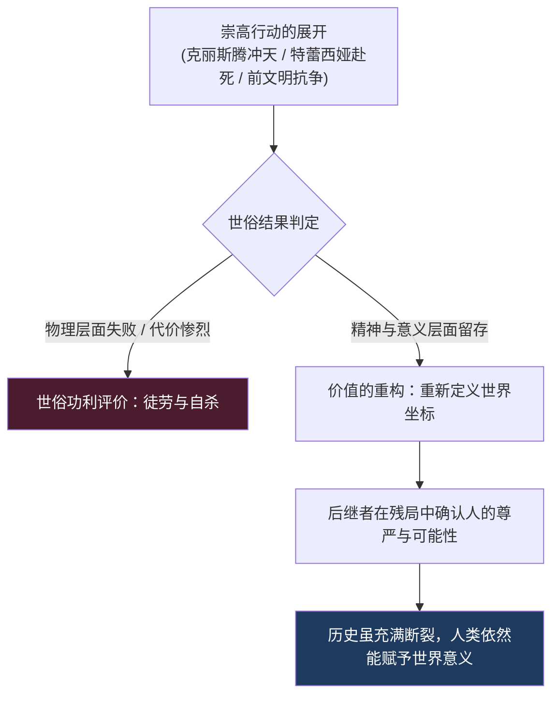

在探讨《明日方舟》那厚重、甚至略带冷峻的世界观时，有一句在长谈中脱口而出的直觉断言，久久在脑海中回荡：

> **“帮助她走上死路。”**

这句话诞生于我们对四周年剧情《孤星（Lone Trail）》总辖克丽斯腾·莱特的复盘。

当克丽斯腾倾尽莱茵生命的全部技术积累、赌上整个哥伦比亚军政各方的资源，孤注一掷将“万星园”太空梭推向三万五千米高空的静滞阻隔层时，所有人都清楚：**这是一场大概率有去无回的绝命远征。** 在那片被前文明黑障死死锁死的物理边界之外，等待她的不是鲜花与掌声，而是极度的严寒、未知的深空辐射、以及漫长无期的低温休眠。

然而，从塞雷娅、赫默、缪尔赛思，到前文明遗留的超级 AI 弗里斯顿，乃至屏幕前握紧手机的读者，在看透了这一不可逆的终局之后，心中涌动的却不是阻止自杀的惊惶，而是一种混合着战栗与崇敬的悲壮：

我们看着她，理解她，甚至在各方博弈的暴风雨中，默默为她扫清最后的障碍——**我们帮助她走上了这条注定的死路。**

这揭示了一个现代功利主义与理性计算所无法解答的残酷悖论：  
**如果一个人的探索注定会让她失去生命、甚至在世俗标准下注定“失败”，我们为什么依然要成全她？当一个文明面临存亡绝境时，究竟是什么东西，能够超越纯粹的“生存利益”？**

<!-- more -->

---

## 一、 “帮助她走上死路”：超越生存利益的浪漫悖论

现代工具理性（Instrumental Rationality）告诉我们：一切行动必须服务于“效用最大化”与“生命存续”。

按照最理性、最安全的算法：
* 泰拉大地被源石、天灾与海嗣团团包围，内陆城邦之间的战争连绵不休；
* 在这种险恶的生存环境下，任何一克高精度聚合材料、任何一焦耳的裂变源石能量，都应该被优先投入到城邦防御装甲、矿石病抑制剂研发或者粮食合成农业之中；
* 将海量资源烧在一条飞向虚无阻隔层的单向太空梭上，在商业与地缘政治的标准看来，是不折不扣的资源浪费与集体疯狂。

可是，人类文明的演进史一再向我们展示这样一个反常规律：

**如果一个文明只允许人们去做那些“能够确保生存、能够确保收益、能够确保安全”的事情，那么这个文明哪怕能够延续一万年，它也永远无法真正突破自己的存在边界。**

它可能会变成一个极其高效的封闭温室，但最终只会在日复一日的存量内耗中走向死寂。

克丽斯腾·莱特的浪漫主义，恰恰诞生在对这种“绝对生存理性”的叛逆之中。她不需要向国防部证明“天上的星空能带来多少吨粮食或多少矿区收益”；她只需要证明一件事：**泰拉不是一座永远无法仰望星辰的地下囚笼。**

当弗里斯顿——这位孤独地守候了先史文明上万年、见证了人类母文明彻底湮灭的机械智能——最终决定交出核心权限、为克丽斯腾的升空提供最后的能量支柱时，他所完成的，不是一次基于算力的风险投资，而是一次跨越万年的伟大放手：

> 他并不确信这个年轻、稚嫩、甚至连自己星球上的矿石病都无法解决的后生种族，能够战胜当年毁灭前文明的深空天灾；  
> 他甚至清楚克丽斯腾此去大概率只是化作深空中的一具冰冷骸骨；  
> **但他依然选择成全她——因为一个文明如果连“允许一个灵魂为求知而死”的底气都已丧失，那么它所苟延残喘的存续，也将不再具备任何崇高的意义。**

---

## 二、 特蕾西娅的选择：一个不再被过去所决定的未来

如果说克丽斯腾是对“外部物理边界”的超越，那么萨卡兹的王女特蕾西娅，则是对“内部历史宿命”的悲壮突围。

在《明日方舟》主线与《巴别塔》活动中，特雷西斯与特蕾西娅兄妹二人形成了整个泰拉文学世界中最令人扼腕的路线决裂：

| 政治路线与历史观 | 摄政王·特雷西斯 | 王女·特蕾西娅 |
| :--- | :--- | :--- |
| **核心政治诉求** | 为萨卡兹争取一个**“能够生存的未来”** | 让萨卡兹拥有一个**“不再被过去决定的未来”** |
| **对待仇恨的态度** | 将三千年的苦难与被驱逐作为动员合力 | 拒绝将仇恨作为构建新秩序的砖瓦 |
| **行动基石** | 纯粹的现实主义、军事铁血、王庭联合 | 超越民族仇杀的伦理自觉、不天真的救赎 |
| **历史终局** | 制造更大的杀戮，重蹈毁灭轮回 | 承受暗杀与背叛，但将希望播撒向外族 |

特雷西斯代表了一种极其沉重、甚至令人同情的现实主义悲剧。

他深知萨卡兹人被泰拉诸国屠戮、驱逐、视作魔族与佣兵的血泪史。为了让这个民族不再漂泊，他选择成为最冷血的君王。他操纵军事委员会，联合腐朽的食人王庭，将整个伦敦蒂姆乃至维多利亚拖入血海。他的所有行动逻辑，全部建立在对“过去的仇恨与负债”的清算之上。

而特蕾西娅看到了这套逻辑背后永无止境的莫比乌斯环：**如果未来的每一个支点，都必须从过去的仇恨与复仇中提炼，那么萨卡兹就算最终征服了陆地，他们也依然是过去苦难的囚徒。**

特蕾西娅的伟大与残忍在于：**她试图斩断这根历史的因果链条。**

这也是为什么方舟被称为“成年人的童话”：

它毫不避讳地告诉你：**最纯粹的理想主义者，往往会被现实击得粉碎。**  
特蕾西娅不仅没有活到黎明到来的那一刻，甚至在巴别塔的密室中，被自己最信任、曾一同推演文明未来的战友（前文明执念主导下的博士）亲手设局斩落。

如果在廉价的爽剧或通俗叙事中，这样的结局足以让所有人陷入彻头彻尾的虚无与厌世。

但在方舟的笔下，奇迹恰恰发生在理想主义者肉体陨落的那一瞬间：  
特蕾西娅没有选择报复，没有在生命的最后时刻诅咒背叛者；她微笑着洗去了博士沾满血腥的残酷记忆，把象征萨卡兹最高正统的魔王之冠，托付给了一个甚至不属于萨卡兹民族的小卡特斯女孩——阿米娅。

**她用自己的死亡，做出了最后的政治表态：理想不必随着理想主义者的死亡而终结。**  
她把萨卡兹从单一民族血统的神话中解放出来，将民族救赎的命题，升华为了整个泰拉大地对生命尊严与相互理解的普遍追求。

---

## 三、 坚韧的悲观主义：失败何以不能穷尽人的价值？

在经典童话与浅层进步主义叙事中，世界总是许诺给读者一个廉价的乌托邦：只要你坚持正义，正义终将战胜邪恶；只要你付出牺牲，最终的大决战一定会迎来无瑕的黎明。

但《明日方舟》的世界观，从根基上就建立在一种**深刻而坚韧的悲观主义（Tragic / Stoic Optimism）**之上。

请看泰拉世界里那些最崇高的探索与人物结局：

1. **先史人类（前文明）**：拥有超越神明的科技，能够改造星球、驯服恒星、创造源石与机械网络，但他们最终在无法名状的宇宙天灾面前彻底覆灭，只留下几具沉眠的石棺与幽灵般的机械巡警；
2. **特蕾西娅**：穷尽一生追求和解，最终在黑暗的走廊中倒在血泊里，未能亲眼见到巴别塔哪怕一砖一瓦的落成；
3. **克丽斯腾·莱特**：她的太空梭突破了第一宇宙速度，但那不是一次凯旋，而是一场漫长而孤独的流放；
4. **失忆后的博士**：从切尔诺伯格石棺中醒来，即便成为了罗德岛的大脑与救世主，也依然必须日夜面对自己亲手铸就的历史断代与血腥幽灵。

如果以“结果导向论（Result-Oriented）”去衡量，他们的计划没有一个是圆满成功的，他们的身上刻满了世俗意义上的“失败”。

**但方舟最让人心头滚烫的地方，恰恰在于它始终坚守着这样一条底线：**

> ### **失败不能穷尽人的价值。**

一个探索者的价值，绝不仅仅由他最终是否活着领到了奖章来决定；  
一个改革者的崇高，绝不因为他在半途被暗箭射倒而减损半分。

克丽斯腾躺在太空梭的休眠舱里，看着舷窗外那片静谧而浩瀚的真实群星。她或许再也无法回到哥伦比亚的实验室，再也无法喝到一杯热咖啡；但当她穿透黑障的那一刻，泰拉所有仰望天空的人，都明白了地平线之外并非只有绝望。

**方舟的乐观，不是“我们最终一定会赢”这种轻浮的口号；  
它的乐观是：“即使我们最终依然会失败，即使宇宙与历史残酷到不允许完美的结局，人在抗争与探索中所展现出的勇气、智识与爱，依然能够赋予这个荒谬的宇宙以不可磨灭的意义。”**

这种哲学态度，彻底击碎了庸俗成败论的枷锁。它让悲剧摆脱了自怨自艾的泥淖，拥有了一种如同古希腊悲剧般庄严、肃穆且充满韧性的生命力。

---

## 四、 结语：为那个敢于离开的人感到骄傲

如果将这种精神与我们在卷一中探讨的《重返未来：1999》进行对比，我们会发现两种极其迷人的美学对照：

* 面对一场注定无法归来的远行，**1999 的叙事往往会让你把全部的目光投向那个被留下的人与被遗落的时代**：看着站台上挥舞的手帕、听着雨水中渐弱的汽笛，在巨大的虚空与怀念中为失去的一切流泪；
* 而**方舟的叙事，虽然同样描绘离别的刺痛，却会让你忍不住擦干眼泪，将目光投向那个正在加速远去的背影**——哪怕你知道前方是深渊，你知道她将独自面对无垠的严寒，你依然会为了那个敢于挣脱引力、奔向未知的人，感到由衷的骄傲与自豪。

这两种情绪并不相互排斥，它们共同构成了人类面对命运时的完整光谱。

有些人负责在废墟中立起石碑，用深情的文字记下那些曾经灿烂过的瞬间，告诉后人“他们真诚地存在过”；  
有些人则负责在狂风中点燃最后的燃料，将自己化作一枚信号弹射向夜空，告诉后来者“边界已经被打破，向前走，不要回头”。

有些事物的价值，从来不取决于它们能否永存；  
有些生命的伟大，正恰恰存在于他们明知会粉身碎骨、却依然选择向死而行的那一刹那。
