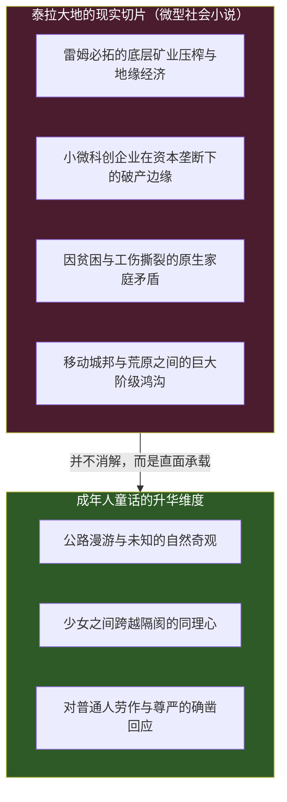
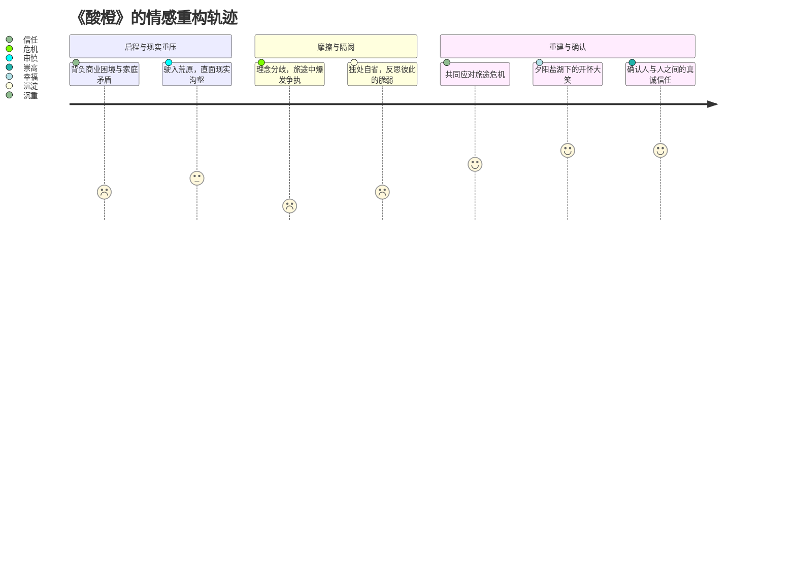

在《明日方舟》那片被天灾、矿石病、城邦阴谋与文明灭绝阴影常年笼罩的泰拉大地上，有一个非常特殊、甚至带有一丝“叙事异质感”的篇章——《直到大地变成一颗酸橙（Till the Lands Became an Orange）》。

如果你只看它的宣传壁纸与活动视觉：

湛蓝通透的天空、翻滚的白云、一辆几乎要在盐湖水面与旷野上腾空飞跃的橙色越野车，四散在半空中的野营折叠椅、行李箱、相机、望远镜、汽水甜筒，以及在失重状态下开怀欢笑的少女们……

在长久以来习惯了切尔诺伯格石棺惨剧、伦蒂尼姆大轰炸和深海猎人血腥撕扯的玩家眼中，这样一部轻快的“公路片”，很容易被下意识地归类为官方在大战间歇期端上来的“爆米花甜点”或日常番外。

然而，在与朋友反复推敲这段文本之后，我们得出了一个截然相反的结论：

**《直到大地变成一颗酸橙》绝不是一部脱离泰拉现实的幼稚童话；恰恰相反，它代表了《明日方舟》文本体系中极其珍贵、甚至极具哲学硬度的一种叙事形态——“成年人的童话（Adult Fairytale）”，或者说，一种“不天真的理想主义（Untruthful/Grounded Idealism）”。**

它在严正回答一个看似平凡、实则极其沉重的现代性命题：**当我们彻底看清了世界的残酷与虚无之后，我们究竟凭什么、又该如何去讲述幸福？**

<!-- more -->

---

## 一、 童话不等于幼稚：剥开糖衣后的微型社会小说

在流行文化的刻板印象中，“童话”往往与“幼稚”、“回避现实”以及“廉价的皆大欢喜”划等号。许多二游在描写轻松日常时，往往倾向于将外部世界的矛盾彻底抽离，将角色放置在一个无菌的真空温室里。

但《直到大地变成一颗酸橙》完全不是这样。

如果你将少女们嘻笑打闹的表层镜头剥离，冷静地审视这部短篇故事所依托的社会舞台，你会惊愕地发现：**它几乎是一部结构严谨、甚至带着几分批判现实主义色彩的微型社会小说。**

在这趟看似随性的公路旅行沿途，故事毫无保留地展现了以下切片：

1. **边缘荒原的生存苦难**：雷姆必拓的荒漠边缘不是度假胜地，那里盘踞着矿区尘肺病的阴霾、被资本遗弃的开采废墟，以及为了换取微薄口粮而不得不在极端天候下劳作的底层荒原游民；
2. **小微企业在垄断夹缝中的窒息感**：故事涉及的商业竞争没有浪漫化，那是真实的小微工坊面对大财团技术封锁、专利壁垒与资金链断裂时的绝望挣扎；
3. **沉重而无法愈合的原生家庭创伤**：人物背负着由于上一代人的缺席、破产或理念决裂而造成的家庭裂痕，这些创伤没有因为一场简单的谈话就“奇迹般冰释前嫌”；
4. **地方文化的凋零与生存异化**：古老的部族民俗在现代工业与商业浪潮的冲刷下，正在不可逆转地沦为旅游橱窗里的廉价消费符号。

**童话的真正力量，从来不在于假装苦难不存在。**

幼稚的童话试图告诉孩子：“世界上没有大灰狼，只要你听话，一切都很美好”；  
而真正的、属于成年人的童话，早已看透了贫困、疾病、死亡、背叛与不公的普遍存在，但它依然笃定地相信：**即便世界并不公正，人依然可能通过理解、勇气、善意和具体的行动，让某些角落的事情变得好上那么一点点。**

《酸橙》没有把雷姆必拓美化成天堂。少女们的吉普车行驶在坑洼不平的粗粝公路上，车轮扬起的尘土里满是柴油与铁锈的味道。但正是在这种毫不妥协的现实地基之上，她们所经历的情感与成长，才拥有了超越虚无的千钧重量。

---

## 二、 拒绝让沉重吞没幸福：在残酷大地上大笑的权利

在很多所谓的“严肃严肃文学”或“硬核深度黑深残二游”中，创作者常常陷入一种奇怪的道德自恋：似乎只要故事里出现了苦难，就必须剥夺所有人物感到快乐的权利；仿佛一个人如果在痛苦的世界上笑出声来，就是一种轻浮或对苦难的背叛。

但《明日方舟》在这部作品中展现出了一种非常高级、非常健康的美学克制：

> **方舟并不认为，承认世界的残酷，就必须放弃讲述幸福。**

在《酸橙》的旅途中，少女们经历了意见不合、理念碰撞，甚至一度产生了尖锐的隔阂与疏离。她们各自背负着现实生活的重压，谁也不是无忧无虑的温室花朵。

但当越野车冲上沙丘，当落日将整片浩瀚的盐湖染成不可思议的柠檬酸橙色，当凉爽的夜风吹散白日的燥热时，她们依然可以真诚地为彼此开一个无伤大雅的玩笑；依然可以为了抢最后一口汽水而争吵；依然可以为沿途发现的一株奇特荒漠植物而两眼放光；依然可以因为身旁伙伴的一个眼神，而感到一种毫无保留的幸福。

这种描写之所以极其动人，是因为它还原了人类最本真的生存韧性。

现实生活中，绝大多数生活在困顿与压力中的普通人，并没有整日以泪洗面，也没有在宏大叙事的压迫下变得麻木僵死。人们在逼仄的流水线旁讲笑话，在艰难的创业期互相打气，在疲惫的通勤路上因为一抹晚霞而驻足——**这种在苦难的缝隙里绽放出来的微观幸福，绝非对现实的遗忘，而是生命为了不被现实碾碎所必须保有的尊严。**

方舟在《酸橙》里做到的，正是这种精妙的平衡：**它让沉重的内容构成了旅途的底色，却没有让这股底色吞没旅行本身的快乐。**

---

## 三、 警惕乡愁的政治化，确认人与人的信任

在长谈中，我们提到了一个非常深刻的观察：

> **“方舟中的这句话，可能不是邀请玩家沉浸于乡愁，而是在要求玩家警惕乡愁如何被塑造，以及它怎样成为现实政治的力量。”**

这个洞见极其犀利地揭示了方舟叙事在面对“过去”与“家园”时的政治清醒。

在许多传统叙事中，“怀念故乡”、“回归传统”往往被不假思索地赋予崇高的道德光环。但纵观《明日方舟》全篇：
* 在卡兹戴尔，特雷西斯与军事委员会正是利用萨卡兹人长达三千年对“失去的家园”的病态乡愁，将其塑造成了狂热的复仇机器，驱使无数年轻萨卡兹化为战场上的焦黑炮灰；
* 在乌萨斯，旧军贵族利用对“帝国昔日开拓荣光”的怀念，疯狂扼杀任何可能带来内部变革的温和改革派；
* 在莱塔尼亚，对“金律乐章”原教旨主义的执念，险些让整个国家陪葬在巫王的余音之中。

**方舟始终在警惕：当乡愁被抽象化、图腾化为某种不可置疑的宏大叙事时，它往往会沦为野心家绑架普通人生命的政治绞肉机。**

而《酸橙》所代表的公路片精神，恰恰是对这种政治化乡愁的最彻底解毒。

在公路上，家园不是一个神圣不可侵犯的静态坐标，而是流动的、正在被创造的现实。少女们离开狭隘的故土，在漫长而充满意外的旅程中重新打量大地：
* 她们没有沉湎于“过去有多好”或“祖先有多伟大”的虚幻宏大叙事；
* 她们在真实具体的行进中，学会了如何与一个和自己观念完全不同的人共处；
* 她们在风餐露宿中，确认了**人与人之间那种最朴素的信任——不是基于血统、不是基于阶级、不是基于共同的仇恨，而是基于我们曾在一辆车上共享过干粮、在暴雨中合力推过抛锚的越野车。**

故事在终局处，给予了人物极其明确的精神回应：
它没有狂妄地宣称“雷姆必拓的阶级矛盾从此彻底解决”，也没有让商业对手突然良心发现全额注资；
但它让每一个读完故事的人无比坚信：**在经历了这一趟飞扬跋扈的公路漫游之后，某些最珍贵的东西得到了无可撼动的确认——信任是可能的，尊严是存在的，普通人的善意不是徒劳的，明天依然值得满怀期待地醒来。**

---

## 四、 结语：橘色天空下的大地

这便是我之所以认为《直到大地变成一颗酸橙》是不可替代的杰作的原因。

它证明了一部成熟的虚构作品，既可以去探讨星空黑障（《孤星》）、去探讨深海演化（《生路》）、去探讨古老民族的流亡与赎罪（《巴别塔》）；也同样拥有足够的广度与温柔，去记录一辆颠簸在荒野中的二手越野车。

在故事的尾声，当车身凌空跃起，日光穿透云层将大地染成一枚饱满多汁的酸橙，那一刻的失重感，不仅属于画面中的少女，也属于屏幕前紧绷了太久的读者。

**它像极了成年人世界里最珍贵的那种瞬间：生活依然沉重，账单依然冰冷，明天依然充满未知；但在此时此刻，在这片酸橙色的大地之上，我们真实地活着，真诚地爱着，并且无比骄傲地大笑过。**
