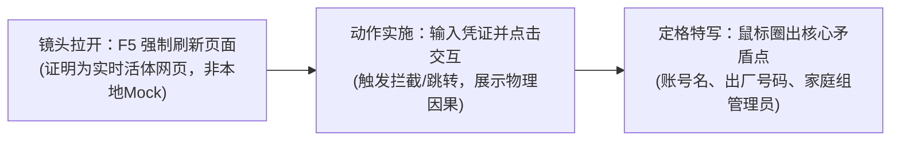

在全栈开发与 AI 原生工作流中，获取海外云服务与大模型订阅账号是不少开发者的常规需求。然而，繁荣的跨境虚拟商品二级市场背后，却盘踞着一条极其隐蔽、依靠信息差和规则漏洞肆意收割买家的灰色产业链。

近日，笔者在海外知名游戏与数字商品交易平台 **G2G** 上采购了两笔订单（共 6 个号称“100% 独立私有、独享 5TB 空间、带 30 天质保”的成品账号），遭遇了经典的**“挂羊头卖狗肉（Bait-and-Switch）”**商业欺诈：卖家不仅私自将账号全部塞入陌生人共享的家庭组拼车池，还在账号中埋下了无法解绑的出厂手机号死锁。

面对 70 级老牌卖家的推诿与跨国仲裁客服极其严苛的举证门槛，笔者通过法医级技术排查、连续一镜到底录屏取证与精准契约打击，最终迫使 G2G 官方下达胜诉裁决并全额退款。本文完整复盘这一过程，彻底拆解跨境账号黑产的底层套路与跨国维权的实操法则。

<!-- more -->

---

## 一、 欺诈解剖学：黑产如何把“家庭组拼车”包装成“独享 5TB”？

在 G2G 平台上，涉案卖家 `DSGameVault`（拥有超过 70 级商户信誉）在其商品 Listing 中做出了极其确凿的承诺：

```text
★ 100% Private Account (Global)
★ 5TB Google One Cloud Storage
★ Full 30 days warranty
```


表面上看，这是一笔标准的“高规格独立账号”交易：买家支付合理溢价，换取一个干净、无关联、完全属于个人的数字资产底座。然而，交付完成后的真实系统状态却令人触目惊心。

### 1. 狸猫换太子：家庭组共享冒充个人独占

当登录进交付的账号并访问 `families.google.com` 时，一个赤裸裸的违规事实浮出水面：
* 账号右上角显示为买家的交付邮箱；
* 页面正中却赫然显示：该账号已经作为一个“子成员（Member）”，加入了一个由孟加拉籍管理员（`srmehedi hasan`）所掌控的 **Google 家庭组（Google Family Group）**；
* 家庭成员列表中，还密密麻麻并列躺着另外 5 个互不相识的陌生人账号！


### 2. 底层机制的毁灭性代价：365 天锁死红线

许多小白买家可能会产生误解：“只要容量给够了，拼车用用难道不行吗？”

答案是：**在底层技术与法律层面上，这种行为具有毁灭性的不可逆损伤！**

1. **容量池争抢与随时腰斩**：Google One 的家庭共享并不是给每个人分配 5TB，而是**整个家庭组所有成员共同瓜分管理员购买的总容量池**。任何一个成员疯狂上传文件，其他人的配额就会被瞬间挤占；更致命的是，一旦管理员随时取消订阅或踢人，买家的数据瞬间面临丢失风险。
2. **Google 刚性 365 天家庭组限制**：根据 Google 官方的安全策略，**任何一个 Google 账号在加入一个家庭群组后，365 天内仅允许加入一次家庭群组**。这意味着，卖家为了摊薄几块钱的成本，强行把账号塞入垃圾拼车组，直接导致该账号在接下来整整一年内废弃，无法再加入买家自己的任何合法家庭计划。
3. **数据隐私裸奔**：家庭组管理员拥有极高的管理特权，可以随时查看共享成员的使用概况与基础信息，个人数字隐私荡然无存。

---

## 二、 核心违约本质：从“假独立真共享”到质保期死锁

必须澄清一个核心事实：**本案卖家的根本违约，从来不是什么“未提供 2FA”或“配置不当”，而是一场彻头彻尾的“以共享冒充独立”的虚假陈述（Bait-and-Switch）。**

在常规交易中，买卖双方交付账号密码即可完成履约。但为什么本案中“用家庭组拼车冒充 Private Account”会导致整个交付在短短几天内彻底崩盘？

### 1. 账号主权缺失导致的次生风控死锁

当一个账号是真正的“100% Private 独立账号”时，买家拥有该账号的完整控制权：即便异地登录触发 Google 的安全提示，买家也可以绑定自己的手机、安全设备或通过常规方式验证通行。

然而，一旦账号被卖家秘密塞入第三方家庭组：
1. **主权受限**：账号实质上成了寄生在他人管理权限下的附庸子号；
2. **验证死锁**：交付使用数天后，当 Google 依据日常安全策略触发常规验证（例如提示向初次注册关联的电话号码发送短信，或强制要求使用已登录受信任设备扫码）时，买家根本没有可用的自主解锁通道；
3. **彻底瘫痪**：买家既不是该家庭组的主人，也无法通过受信任设备解除拦截，账号当场沦为无法登入的死号。


### 2. 30 天质保承诺的法律刚性

涉案卖家在 Listing 中明确承诺了 **`Full 30 days warranty`（30 天全额质保）**。

在商业契约与平台争议规则中，这项承诺构成了无法辩驳的责任闭环：
* **第一重违约（定性欺诈）**：标称“100% 独立私有”，实付“多人共享家庭组”，构成根本违约；
* **第二重违约（质保兜底）**：账号在交付后仅仅 10 天便因共享环境与验证死锁无法正常登入，完全落在卖家承诺的 30 天质保期内。

无论卖家在站内私信中如何试图将责任归咎为“买家操作触发风控”，只要账号处于 30 天质保期内且核心属性货不对板，卖家就必须无条件承担全额退款责任。

---

## 三、 跨国仲裁实盘：如何击穿官方客服的“免责推诿防线”？

确认了卖家的双重欺诈后，笔者正式通过 G2G 官方的 **GamerProtect / Freshdesk 客服仲裁通道**提起争议申诉（分别针对两笔订单：工单 `#5892950` 与 `#5893028`）。

然而，维权之路绝非一帆风顺。国际平台客服的日常工作机制，本身就构建了一道高耸的“劝退漏斗”。

### 1. 避开第一个坑：跨国客服为何秒拒“静态截图”？

在工单 2 中，笔者最初提交了一张展示 `dawabxcoc` 被手机号拦截的截图。客服 Aisha Delaney 在数小时内冷淡回复：

> *"Please provide us with a video recording instead."*

**为什么静态截图在国际仲裁中毫无效力？**
因为在现代化浏览器中，任何用户都可以通过 F12 开发者工具（Inspect Element）在 3 秒钟内随意篡改 DOM 文字、拼接错误提示。面对大商户的资金扣划，平台法务要求极高规格的免责归档——**必须有动态一镜到底视频，以证明网页具备实时网络通信与真实因果链。**

### 2. 避开第二个坑：警惕“局部退款”的语言诱导

在工单 1 中，笔者提交了一段展示 `unknowncoc6288` 处于家庭组的录屏。客服 Diana Prescott 在确认视频后回复道：

> *"We deeply apologize for the inconveniences caused. Please kindly confirm if the issue only occurred for account #3?"*

**这是一个极其隐蔽的“退款核定陷阱”。**  
如果买家稍不留神回复“对，这个号有问题”，客服就会名正言顺地判定“局部履约瑕疵”，仅退还 1/3 的金额（约 $2.99），而让卖家吃掉剩余款项！

笔者当即回信进行精准驳斥：
> *“不，这笔订单的全部 3 个账号均受到同一个未授权家庭组欺诈波及：视频中展示的账号 #3 为当前登录者，而账号 #2（otvazcoc）直接实名展示在成员列表中；账号 #1 则在最初证据邮件中被证实接收了相同的入组通知。整笔订单属于系统性虚假陈述，要求全额退款 $9.33 USD。”*

面对 Diana 随后提出的“必须为剩余两个账号也录制同等标准视频”的要求，笔者毫不妥协，在 20 秒内开 OBS 录制了一镜到底的连贯视频提交归档，彻底封死了任何局部扣款的退路。

### 3. 黄金取证原则：如何录制令平台无法辩驳的“物理铁证”？

总结本次全量通关的 5 段视频录屏，高胜率取证必须满足以下三要素：



1. **证明真实性（Liveness Check）**：视频开头先按 `F5` 刷新页面，让客服看到 URL 地址栏重新加载和证书绿锁，根除“本地静态 HTML 造假”怀疑；
2. **展示因果链（Causal Link）**：演示从“点击登录/发送”到“页面跳转报错”的全过程，证明不是买家凭空断网；
3. **特写对齐（Anchor Elements）**：鼠标在右上角登录邮箱、家庭组管理者名称以及拦截尾号处悬停 2 秒，与订单账单上的账号信息完全咬合。

### 4. 战术纪律：切断站内私信，保持绝对冷处理

在工单被官方升级后，卖家 `DSGameVault` 收到扣款警告，火急火燎地在 G2G Chat 发来私信质问：
> *“what’s wrong bro? why did you reported what’s wrong with thr accs aren’t they working?”*

此时最忌讳的就是在私信里跟卖家争辩“账号能不能用”。卖家的目的只有两个：
1. 把“欺诈（货不对板）”偷换概念为“技术故障”，诱导买家在私聊中承认自己操作不当；
2. 许诺私下换号，诱骗买家撤回工单。而根据 G2G 规则，**工单一旦买家主动撤销，永久无法二次立案**。

**正确的应对策略是：彻底视若无睹，一个标点符号都不回。一切争议严格锁死在官方仲裁工单中。**

---

## 四、 胜诉终局与冷酷反思：没有额外赔偿的维权，意义何在？

经过多轮攻防，2026 年 10 月 25 日凌晨，G2G 官方争议仲裁委员会正式向笔者下达了最终胜诉裁决书：

> **“We would like to inform you that we have canceled and refunded this order 1792124124161B4PZ in the form of Store Credits. Therefore, we have favored you on this case. As the matter has been resolved, we will proceed with closing this ticket.”**


涉案订单被全额取消，款项原路返还至账户余额，案件以买家 100% 胜诉划上圆满句号。

### 制度的冷酷真相：为什么平台没有“假一赔三”？

仔细审视整场博弈，一个现实的问题浮出水面：**买家投入了时间、算力和情绪精力，最终得到的最好的结果，不过是“拿回自己原本付出的本金”，为什么没有惩罚性赔偿？**

这揭示了现代跨国电商平台最底层的清算所逻辑：
1. **平台的责任上限（Liability Cap）**：平台在用户协议（TOS）中早已锁死了自身的免责上限——仅限于订单本身的实际成交额。平台不是法院，没有法定公权力去判罚“误工费”或“精神赔偿”；
2. **罚金去了哪里？** 平台会对欺诈商户征收惩罚性的争议处理费（Dispute Fee）并没收保证金，但这笔收益**全部沉淀进了平台的腰包，绝不会分给买家哪怕一分钱**。

### 那么，较真维权的真正价值是什么？

如果我们仅仅把维权看作一次“赚取超额回报的投资”，在显性账面上它确实是一场平局。但跳出局部看大势，这场较真的意义远超十几美元本身：

1. **击穿恶人的无风险收割模型**：黑产商贩的暴利模型建立在“95% 的人嫌麻烦吃哑巴亏”的概率假设上。每一场彻底的法医级维权，都在物理上迫使违约者吐出非法所得，并为其商户信誉敲下一记沉重的风控丧钟；
2. **全链路数字契约能力的实战演练**：从底层身份协议（Google IAM / Family Policy）、跨国工单流转、到反向博弈与法医级取证，这是一场极具含金量的实操演练。未来在跨国工程合作或商业交付中，这套敏锐抓死核心证据的逻辑，是工程师不可或缺的防身铠甲；
3. **适时翻篇的高阶心智**：在拿到 100% 胜诉退款的瞬间，果断抽离情绪、复盘留痕、将注意力迅速调转回有正向复利的技术研发中——**不任人收割，亦不为烂事缠身，这才是对抗不完美规则最清醒的姿态。**
