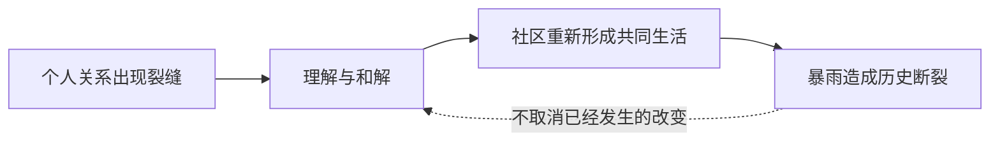

我读《今夜星光灿烂》时，常觉得自己没有真正看懂。画面有隐喻，伊索尔德的病态依赖并不透明，卡卡尼亚既是她的主治医生又与她亲近，却没能看见那种依赖的全部重量。接着暴雨降临，事情变得不可逆。我读它时有时像在看悬疑片：事情发生了，可能很糟糕，我需要理解、处理，却未必能找到一个足以安置所有感受的完整解释。

这种不确定不是我想尽快排除的障碍。它让我意识到，1999常把人物放进一个无法由读者完全占有的时代经验里：我能靠近他们，却不保证能掌握他们；我可以感到惆怅，却不一定能把惆怅翻译成一条清楚的道理。

<!-- more -->

*图：《今夜星光灿烂》官方活动主视觉。官方活动介绍将故事置于二十世纪十年代初的维也纳，见[活动页](https://re1999.movergames.com/page/new_51656.html)。*

## 时代不是布景，而是人的生活环境

1999经常借现实历史、音乐、文学与视觉艺术的记忆来建立文化颗粒。作品不只告诉我“这是哪个年代”，还会让我从服饰、演出、建筑、礼仪与城市生活里感到那个年代如何运作。它的互文性能够把我从游戏带出去：我可以沿着歌剧、艺术传统或太空竞速的线索，去认识现实世界里更广阔的历史与作品。

这种借用并不等于历史复刻。《宇宙序曲》带着太空竞速时代的浪漫，却发生在拉普拉斯科算中心的实验背景中，是架空世界的主线前传。现实记忆为它提供了能被感知的时代质地，虚构情节则继续提出自己的问题。现实文化与架空世界可以彼此照亮，不需要其中一方被另一方吞没。

1999让我怀念一些我从未真正生活过的时代。所谓怀旧，不一定源自自传记忆，也可能是作品替我建造了一种想象中的归属。我知道自己没有在那个维也纳生活过，却能从舞台与城市气息里想象人们曾怎样出入沙龙、争论艺术、谈论未来。那个时代因此不像历史课中的时间标记，而像一段曾经拥有自己现在的生活。

## 怀旧为什么需要警惕

怀念过去不等于证明过去更好。一个时代可以有浪漫、艺术和繁盛，也可以同时拥有监控、恐惧和压迫。这里我会想到《崔林特尔梅之金》里围绕巫妖王时代形成的怀旧：巫妖王时期并非没有秘密警察。若后来的人只把过去记成秩序、荣耀与艺术的黄金时代，就会把秘密警察与受害者从记忆里删掉。

没有亲历过那个年代的人，有时反而更容易把它理想化。现实中，人们对现在不满时会创造一个被筛选过的过去，再拿它批评眼下的世界。怀旧在此不是私人情绪那么简单，它可以成为政治力量：它决定谁被记住，谁被遗忘，也决定今天的改变被说成进步还是堕落。

因此，虚构作品的时代浪漫越有吸引力，我越想同时问：这份浪漫由哪些现实经验支撑？它展示了谁的生活，又省略了谁的代价？艺术不必取消怀旧的美，但可以让我看见怀旧会如何编辑历史。方舟与1999在这里提供不同角度：方舟常追问怀旧怎样进入政治行动，1999则更常让我先感受时代记忆本身的温度；这不是绝对划分，只是两种常见的叙事重心。

## 伊索尔德与卡卡尼亚：亲近也无法保证理解

*图：伊索尔德的舞台场景，见[《E lucevan le stelle》章节剧情档案](https://uttu.merui.net/story/main/chapter-6/en?part=18)。*

### 先把维也纳这一章的关系链摆出来

《今夜星光灿烂》设在一次大战前的维也纳。伊索尔德是歌剧演员，出身于能与亡者沟通、借由灵魂附身完成表演的神秘学家家庭；哥哥西奥菲尔去世后，她的悲痛、通灵能力与舞台身份纠缠在一起。她会听见亡者的声音，也把这些经验当成自己生活的一部分。外界不断将她定义成病人、危险人物或可以被管理的神秘学家，伊索尔德却并不认为自己的整个人生都该由诊断来概括。

卡卡尼亚与她相识后，尝试以精神分析帮助她。她反感催眠，因为在她看来，治疗不该绕开当事人的意志；她相信伊索尔德需要看见自己，而不是被他人控制。两人的关系因此不只是“医生拯救病人”：卡卡尼亚既是治疗者，也是朋友和“魔圈”组织的创办者；伊索尔德既需要她，也会试着理解她的理想。恰恰因为卡卡尼亚把自己的政治判断、私人情感和治疗关系放在一起，她说出口的话才可能被伊索尔德当作更直接的行动指引。

另一条线里，马库斯与导师霍夫曼调查维也纳的“魔圈”、神秘学家活动和重塑之手。伊索尔德举办展览，讲述哥哥遗作《救赎》与“金色岛屿”的想象；亨利希借此把她的悲伤、卡卡尼亚的理想和重塑之手的叙事接在一起。伊索尔德逐渐相信，自己可以通过行动帮助卡卡尼亚、拯救她珍视的人与理想。她在歌剧《托斯卡》的演出中杀死分部负责人卡尔，舞台上的情节与现实谋杀重叠；观众仍像被演出吸住一样没有及时反应，基金会调查也被拉进暴雨前不断升级的危机。

伊索尔德后来向卡卡尼亚解释，她以为杀死卡尔会让卡卡尼亚高兴：卡尔是她憎恶的官僚，压迫神秘学家，也曾在两人谈话里被描述为时代病症的一部分。卡卡尼亚却从未授意她杀人。伊索尔德把朋友的分析理解成行动许可，这既是对她主观经验的揭示，也是关系中的严重误读。卡卡尼亚说自己后悔曾那样谈论卡尔；伊索尔德则听成朋友忽然背弃了共同理想。她们亲近，却没有共享同一种理解。

更尖锐的是，卡卡尼亚最后不得不面对自己的原则。暴雨逼近，基金会需要从伊索尔德那里获得关键的免疫术式信息；卡卡尼亚一向认为催眠侵犯患者意志，却参与对伊索尔德实施催眠治疗。这个决定不是单纯证明她虚伪，也不是因为结果重要就自动正确。它让保护数以千计的人与尊重一个具体个体的自主权正面相撞。卡卡尼亚选择了行动，也必须面对这一选择对伊索尔德造成的伤害。

于是故事给我的悬疑，不是“谁是真正的坏人”这么简单。重塑之手利用并扭曲人的愿望，制度对神秘学家的压迫又构成真实背景；伊索尔德作出杀人的决定，不能因为她受操纵便从责任讨论中消失；卡卡尼亚的理想值得理解，也不能免除她作为朋友和治疗者的责任；基金会得到重要情报，却是通过一个违反卡卡尼亚原则的手段。每一条因果线都是真的，但没有一条足以独自解释全部的人。

《今夜星光灿烂》最令我不安的地方，是角色之间的亲密没有自动变成透明。卡卡尼亚自认以精神分析帮助他人，却没有正式行医许可；她和伊索尔德既有治疗关系，也有私人友谊。她比陌生人更靠近伊索尔德，却仍未能看见对方如何把私人谈话、政治判断与行动许可连在一起。

这使故事避开了“只要足够关心，就能及时发现一切”的安慰。医生可能错过病情，朋友可能没能读懂暗示，亲密关系也可能被表演、依赖、羞耻和权力关系遮蔽。一个人能够靠近另一个人，却依旧不知道对方内心正在发生什么。

我读这条关系时会不断修正判断。病态依赖不是“她太爱某个人”的浪漫化描述，也不能被抽象成一个角色缺乏理性的道德缺陷。依赖会影响一个人如何感知自己、如何寻求安全、如何把他人的回应当作生活的支点。它还会反过来影响被依赖的人，使对方被推到照护者、医生、情人或救援者的多个位置里。卡卡尼亚的失察既有个人责任，也显示了关系中知识与理解的限度。

悬疑感就在这里产生：事情发生了，但它不是一个等待侦探揭晓唯一凶手的谜题。读者会回头查看台词和行动，寻找因果线索，却可能发现每条线都只解释了一部分。我们需要承担判断，也必须承认判断不完整。理解人物不等于抓住一个核心秘密之后就能把她讲透。

## 暴雨的视觉叙述：冷静如何让灾难更具体

*图：维也纳歌剧院场景，见[《E lucevan le stelle》章节剧情档案](https://uttu.merui.net/story/main/chapter-6/en?part=24)。*

我尤其记得一段暴雨表现：类似剪纸或拼贴的几何插画，色块简化，形体被压缩；旁白低沉而平静，不以起伏很大的情绪替观众规定该如何悲伤。有人试着把手伸进安全范围，最后却只留下那只手。

这个场景把宏大灾难缩到身体尺度。我们不需要先知道有多少人消失、灾害覆盖多少地图，便能理解安全边界突然断裂意味着什么。伸出的手原本是一个人试图抵达他人的动作；只剩下手的画面，则让身体与关系同时被切断。

旁白的冷静并不是对灾难冷漠。恰恰因为叙事没有替我们宣泄，观众必须自己面对画面已经发生的事实。暴雨不只是神秘设定，也不是为了在结尾制造一个漂亮的悲剧；它会改写人物能够继续生活的条件。那只手让不可逆变得可见，却没有提供安慰性的解释。

形式在这里不是装饰。抽象几何让现实像正在失去原有结构，克制的叙述则留下一段空白，使我们感到经验尚未被语言消化。方舟经常让人物阐述历史立场，读者能够沿着这些理由讨论选择；1999的某些段落则让我先看见，再面对无法说完的感受。这正是它的一种艺术能力：允许叙事停留在尚未消化的经验上。

## 来亚什基：圆满可以真实，却没有明天

*图：来亚什基活动视觉，见[《Farewell, Rayashki》剧情档案](https://www.gacha.gg/reverse-1999/story/farewell-rayashki)。*

这条叙事经验可以分成三个层次：人物在关系中获得阶段性改变，社区开始想象共同未来，暴雨却切断了这条未来通向后续历史的路径。第三层并没有抹去前两层，只是让它们无法成为长久延续的保证。

这种关系也说明，悲剧并不是把前面的圆满揭穿成虚假。人物的和解在当时发生过，社区的未来想象也曾经存在；灾难夺走的是它们继续发展的机会，而不是它们曾经真实的事实。

我很难忘记来亚什基的居民。镇上的人经历分歧，逐渐重新凝聚，也开始看见新的发展可能。按许多传统故事的结构，这会是未来的开端：矛盾化解，社区有了共同目标，接下来只要继续建设，生活就能向前。

但1999的暴雨没有义务遵守这种结构。小镇刚刚形成的圆满仍可能被时间抹除；维尔汀能带走的人有限，其他人留在暴雨之中。救援不可能补偿所有损失，获救也不意味着从此安全。读者不能把结局改写成“至少他们都留下了美好回忆”，因为故事并未承诺每个人都能带着记忆活下来。

我仍然认为居民的和解是真实的。未来被暴雨夺走，不会倒过来证明他们此前的努力是假的。日常生活不是只有被历史保留下来才值得重视。人们曾经停止相互敌视，曾经一起想象新的生活；这些事实即使不进入后续文明的记忆，也依旧发生过。

如果把情节细节放回来，这种希望与失去的关系会更复杂。来亚什基的镇民并非只在结尾突然变成团结的共同体。镇长叶夫根尼担心矿藏将尽、周边生物袭击增多，接受了泽诺兵器学院的帮助方案；维拉则反对未经居民同意就把他们整体迁往避难所。公司提供的“救援”同时包含人员筛选与迁离安排，谁能得到工作、谁必须离开，背后是资源和决定权的问题。叶夫根尼并非纯粹恶意：他担心居民死在寒冷和袭击中，也认为自己必须对选择负责；维拉并非只是在固执守家：她守的是一个由不同种族、不同技能的人共同建设的生活实验。

风歌原本以为自己只是来调查地脉、完成研究任务。她先被泽诺的利益逻辑吸引，后来发现自己的研究和技术也可能被拿来为强制迁离背书。她的介入帮助镇民识别矿井里的新资源，也促使她重新思考自己的研究是否只为学术履历服务。阿夫古斯对矿石生物的观察、工人们重新启用旧机器、居民分担劳动，这些具体行动才让“留下”成为可以讨论的方案，而不是一句热爱家乡的宣言。

但留下并不是没有代价。重启矿井意味着危险，居民必须修整房屋、重新分配空间和工作；叶夫根尼最后驾驶改装机械为镇民争取时间并牺牲，镇民也没有一致把他的选择视为理想的牺牲——有人愤怒他没有让大家投票。暴雨随后抹去了他们继续生活的时代条件。小镇的共同体既真实地形成过，也没有被作品许诺为可以完整保留下来的乌托邦。正是这种具体建设与不可逆失去并存，让我相信他们曾有过的生活，而不是把它当成一段只为制造眼泪的梦。

这让我更理解1999为什么会带来惆怅：它让一个故事在人物生活的尺度上获得阶段性答案，却拒绝保证答案能穿过历史断裂。方舟常让我想看成果如何进入未来，1999会让我哀悼有些成果连进入未来的机会都没有。两种情感不是价值高低，而是对“结果”持有不同态度。

## 悬疑结构让玩家参与判断，也让判断保持有限

我说自己像在看悬疑片，不是因为所有故事都藏着一个最终揭晓的谜底，而是因为阅读过程要求我不断回看：某个人当时为什么这样说？这段亲密关系里谁知道得更多？一场灾难发生之前，哪些信号已经出现？人物已经作出选择，但选择的动机、依赖和恐惧没有一次性向读者敞开。于是我不只是接收答案，也会重新排列先前的细节。

这种悬疑感和传统推理有一点不同。推理故事往往承诺，在证据足够时，事件能够被重建；1999的一些人物经验却并不保证透明。读者可以发现新的线索，却仍然无法把一个人的内心变成完全可读的材料。我们可以判断卡卡尼亚错过了什么，也可以讨论她作为医生和亲近者的责任，但不能因此声称自己已经彻底掌握伊索尔德的主观经验。

这种限制不是替人物免除责任。理解的边界与行动责任可以同时存在：卡卡尼亚或许不可能知道一切，但她仍需要面对自己知道的部分；伊索尔德的病态依赖可以解释她的行为，却不意味着关系中的其他人没有受到影响。故事拒绝一个全知解释，不等于所有解释都一样正确。读者仍须从文本中辨认证据，并把确定的部分与推测分开。

因此，1999给我的参与感并不是“我终于解出真相”的胜利，而是我意识到自己的判断随时可能需要修订。某个人先前看起来像被动受害者，后来也可能显出主动选择；一个看似冷漠的行为，可能同时包含保护、恐惧和失职。人物不是等待我一次性分类的谜面，而是会不断超出我已有理解的人。

## 记住不是把失去修复成一个漂亮结局

当我说“记住他们曾经存在”，这并不是一种对消失者的充分补偿。记忆不能把死者带回来，不能恢复被暴雨截断的小镇，也不能让幸存者免于失去。若我们把记忆写成一种足以抵消灾难的力量，就会再次把受苦者的遭遇安排成供旁人获得成长的材料。

记忆更有限，也更具体：它拒绝让消失被轻易说成“本来就没有意义”。一个社区曾经产生过信任，一段关系曾经真实地改变某个人，一种生活曾经拥有自己的节奏，这些事实不因后来没有延续而自动归零。读者能做的不是替角色补造未来，而是在文本允许的范围内辨认他们生活过的细节，并承认自己的阅读无法还原全部经验。

这也是“怀旧”与“修复”的区别。怀旧可以让我靠近一个已经失去的时代，修复则容易让人误以为只要理解得足够完整，就能把过去重新拼好。1999反复给我看的，正是理解和挽回之间的距离：我可以逐渐知道发生过什么，仍然不能让所有人回来。这个距离令人难受，却让悼念保持诚实。

它也解释了为什么一段没有圆满结局的故事仍然值得反复阅读。重新阅读不是为了找到一个隐藏的乐观答案，而是因为第一次阅读中没看见的人、没理解的动作，可能会在下一次显出新的重量。意义可以增加，损失却不因此消失。两者同时成立，才是这类叙事给我的成熟温柔。

## 互文让过去可进入，也让怀旧需要负责

现实文化材料给1999带来的，不只是“认出典故”的乐趣。一个时代的歌剧、文学、服饰和城市空间都连着现实世界里曾经存在的人与制度。玩家沿着线索走出去，会遇见比游戏更大的文化史；再回到游戏时，也会发现角色身处的并非空白布景，而是一组已经被现实历史赋予重量的符号。

但这种互文也要求读者保持两层意识：我是在感受作品怎样重新编排历史，不是在把虚构故事当成现实历史的说明书。维也纳的艺术生活可以提供想象入口，却不会自动告诉我所有人的处境；太空竞速的浪漫可以成为《宇宙序曲》的情绪资源，却不意味着剧情发生在真实的太空竞赛中。分辨现实参照与作品改写，能让欣赏更自由，也能避免把时代浪漫误认成没有代价的黄金年代。

怀旧尤其容易把历史里的矛盾柔化成风格。舞台灯光、音乐、服饰与建筑可以令人向往，但真正生活在那个时代的人并不只活在艺术品里。谁能进入剧院、谁为城市繁荣付出劳动、谁受到监控，都是怀旧需要重新看见的部分。《崔林特尔梅之金》里的权力与家族关系提醒我，回望一个时代时不能只选择优雅的一面，巫妖王时期的秘密警察也属于那段历史。

因此，1999的文化借用对我最有价值的地方，不是给过去涂上一层金色，而是让过去重新变得可感，同时保留它的裂缝。一个时代值得被怀念，不代表它值得被复原；怀念可以是承认曾经有过的生活与美，也可以是哀悼那些在美的叙事中被遮蔽的人。

## 梦留下余温，却不给结论

有些故事我不需要完全解开，仍然会被它们留下的画面影响很久。一个人没有被最亲近的人及时理解，一个小镇刚找到共同未来却被暴雨吞没，一只手从安全区外伸进来又与身体分离——这些意象不一定组成一个整齐的论证，但它们会留在记忆里，使我重新思考理解、救援和历史。

我说自己没看懂，不一定是在宣布作品失败。它也可能是在承认我无法把人物经验压缩成一条可以控制的解释。阅读依然需要推理，只是推理不能假装自己拥有全知视角。对于某些被暴雨切断的生活，最诚实的回应可能不是替它们安排意义，而是先记住它们曾经具体存在。

这篇专题从《今夜星光灿烂》的一段关系与一种视觉形式展开，也回到1999反复触及的时间问题：如果某个时代不能保存，它仍然值得被记住吗？我认为值得。记住不是恢复，也不是复活；但它能拒绝让消失变成从未发生。

### 原作与延伸阅读

- [《今夜星光灿烂》官方活动页](https://re1999.movergames.com/page/new_51656.html)
- [《今夜星光灿烂》剧情文本索引（按章节场景浏览）](https://uttu.merui.net/story/main/chapter-6/?lang=en)
- [第六章剧本文本示例：歌剧演出与卡尔遇刺场景](https://reverse1999.fandom.com/wiki/6TH-18/Story)
- [《托斯卡》剧情梗概：标题咏叹调与歌剧结局的互文背景](https://zh.wikipedia.org/wiki/%E6%89%98%E6%96%AF%E5%8D%A1)
- [《再见，来亚什基》完整剧情文本索引](https://www.gacha.gg/reverse-1999/story/farewell-rayashki)
- [《重返未来：1999》官方网站](https://re.bluepoch.com/home/)
- [返回总论：从一首离别的歌到两个世界的时间]()
- [阅读两款作品的时间方向与文化颗粒度专题]()
