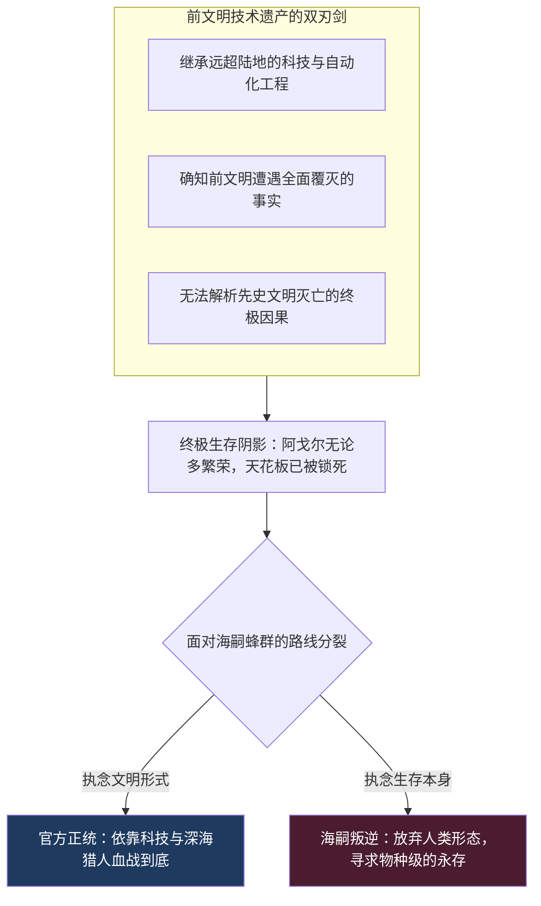
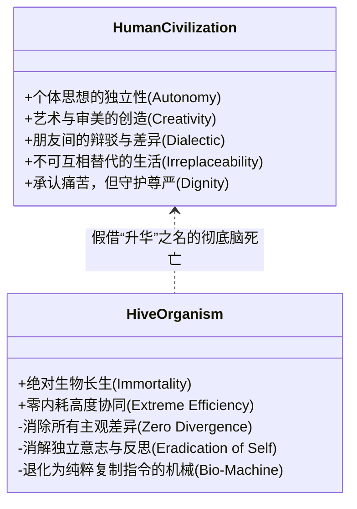
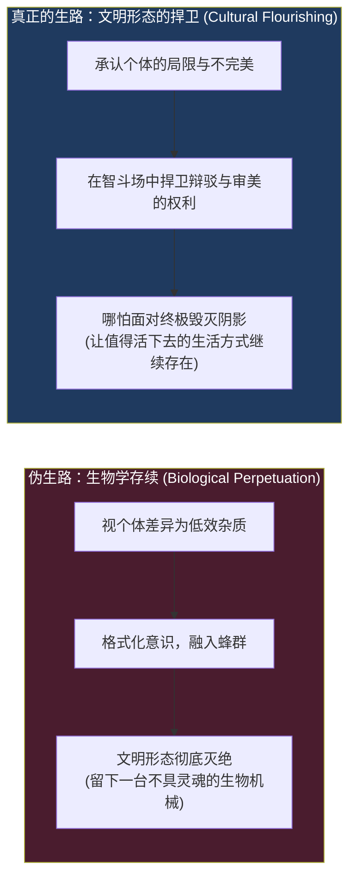

在探讨《明日方舟》海洋二期剧情《生路（Path of Life）》与阿戈尔文明的漫长深夜里，曾有一句极其尖锐、甚至带着几分愤怒的反问，直接击中了整部深海科幻设定的心脏：

> **“所以我很疑惑，你思考得再远，你难道要舍弃自己的思想，舍弃与朋友辩论的机会，舍弃现有的你我对于艺术的追求吗？如果这些都没了，所谓的进化到底在进化什么？”**

这个质问所针对的，不是传统二游里那种脸谱化的“被恶魔蛊惑的反派”，而是阿戈尔文明内部那些受过最高等科学训练、深谙哲学与美学、却最终选择背叛母国、主动倒向海嗣（Seaborn）的精英转化派。

在科幻文学与当代超人类主义（Transhumanism）的思潮中，“蜂群意识（Hive Mind）”与“生物大同”常常被包装成某种超越人类局限的终极福音：没有饥饿、没有疾病、没有个体隔阂、没有内部损耗、基因近乎永生、全知全能的超级生命体……

然而，《生路》之所以是一部极具思想硬度的作品，正是因为它没有停留在“正义击败怪物”的浅层快感中，而是逼迫每一个读者去直面一个现代文明最不愿正视的形而上学深渊：

**当一个文明把“活下去（Survival）”提升为凌驾一切的最高绝对律令时，被要求存续的那个文明本身，究竟还在不在？**

<!-- more -->

---

## 一、 知晓毁灭却不知缘由：阿戈尔繁荣背后的深海阴影

要理解阿戈尔内部为何会发生如此骇人的思想撕裂，首先必须澄清一个关键的设定事实：**阿戈尔并非因为无知而盲目，恰恰相反，他们是因为知道得太多而陷入了终极恐慌。**

在《生路》的文本补完中明确指出：阿戈尔人不仅继承了前文明遗留的海底工业遗产，更重要的是，**他们明确知道先史文明（The Precursors）曾经遭遇了彻底的、不可逆的毁灭。**

但他们极其痛苦地发现：以阿戈尔现有的全部科学仪器与理论模型，他们根本**无法理解**究竟是什么力量在物理法则上毁灭了那个曾经能够改造星球的前文明。

这种认知状态，在历史哲学上被称为“天花板绝望（Ceiling Despair）”：

* 如果你不知道前文明的存在，你可以像陆地诸国一样，沉浸在蒸汽机轰鸣、源石法术开拓与封建地缘扩张中，保有一种天真的、初生牛犊式的乐观；
* 但阿戈尔生活在一个时刻被警示的穹顶之下：**比你聪明万倍、技术比你发达百倍的造物主，已经横尸在深空与海底。**

与此同时，由于阿戈尔文明长期迁居深海，脱离了泰拉陆地各城邦之间连年不断的泥泞战争与资源绞杀，他们享受了极其漫长的技术和平红利。

在这段黄金时期里，阿戈尔人建立起了高度发达的科学共同体，发展出了登峰造极的音乐、雕塑、建筑与哲学学派。他们拥有充足的社会余裕，去追问“什么是美”、“什么是存在的本质”、“生命的终极价值是什么”。

然而，这种思想上的极度繁荣与开明，却在海嗣这一毁灭性生物潮水涌来时，转化成了一种前所未有的**结构性脆弱**：

一个每天为了争夺黑面包而拔刀的蛮荒部落，脑子里只有一个念头：“怎么活过今天”；  
而一个已经习惯了探讨形而上学、习惯了反思自身局限的高度文明，已经有余裕去提出一些极其危险的问题：  
*“人类这种充满缺陷、充满私欲与内耗的形态，真的是生命演化的终点吗？”*  
*“如果现有的文明形态注定无法逃脱前文明毁灭的命运，我们为什么还要死守着这副脆弱的躯壳？”*

---

## 二、 智斗场的隐喻：为什么最受尊重的理性辩论防不住背叛？

在长谈中，我们聚焦了一个非常具体、也非常讽刺的制度细节——**“智斗场（Agon / Arena of Ideas）”**。

阿戈尔并不是一个依靠权威压制异端、只允许官方单一声音的专制极权社会。恰恰相反，阿戈尔文化中存在着一种极其神圣且受到全社会尊重的机制：**智斗场**。

在智斗场上，任何学者、公民都可以就科学公理、城邦管理路线乃至哲学伦理展开公开、平等的辩论。谁能够用更严密的逻辑、更无可辩驳的实证论据击败对手，谁的主张就能获得社会的采纳与学术的加冕。这几乎是古典时代雅典广场辩论与近代同行评审制度的终极理想形态。

**但令人战栗的历史反讽恰恰在此爆发：**

明明官方执政官与科学院的正式立场是“坚定抗击海嗣、保卫阿戈尔文明”，明明阿戈尔拥有如此成熟、公信力极高的理性对话平台，**为什么内部依然源源不断地出现了像布兰都斯那样地位崇高、技术拔尖的内部叛徒，甚至在暗中协助海嗣攻陷防御网络？**

这里的根本症结，在于**“程序理性”与“共同体底线”的脱钩**：

### 1. 思想多元不等于虚无主义
一个健康的社会允许人们激烈争论不同的发展道路、甚至质疑执政官的战略决断，这叫作思想多元。但这种辩论之所以能够促进团结，是因为所有辩论者心中都有一个不可动摇的默认公理：**我们都希望阿戈尔作为一个拥有独立人格与文化认同的实体，能够继续存在。**

争论的只是“怎样实现存续的手段”，而不是“是否要消灭我们自己”。

### 2. 当一方自认掌握了“降维真理”，辩论即告死亡
然而，海嗣派的致命转变在于：**他们不再承认“阿戈尔的独立存续”是一切讨论的基石。**

在他们眼中，海嗣不仅不是敌人，反而是进化的神启。他们认为阿戈尔的文字、艺术、阶级与智斗场，不过是低阶生物为了掩盖自身认知缺陷而搭建的“玩具积木”。  
当一个人已经在内心认定了“只要融入蜂群，宇宙的终极真理就能直接灌注进脑海”时，你再去邀请他登上智斗场，去心平气和地用三段论和统计学表格与你辩论，在他看来已经毫无意义，甚至是某种可怜而顽固的低维挣扎。

**制度能够保障辩论的流程，却无法强迫参与者认同共同体的生存意义。**  
当理性发展到能够轻易解构自身的立足点、却又无法在虚无中重新奠基时，高度文明的辩论场，便在最极端的异化面前彻底失去了防卫能力。

---

## 三、 蜂群同化的功利主义深渊：“效率究竟是为了什么？”

为了给这场交锋最公正的哲学审视，我们必须首先替海嗣派陈述其理论逻辑中最具诱惑力的一面。

海嗣派并不是单纯的疯子，他们背后站着一整套极端功利主义（Extreme Utilitarianism）与生命工程学的自洽逻辑：

> *“你看，人类文明为了维持‘个体’的独立性，付出了多么恐怖的交易成本：  
> 两个人哪怕相爱一生，依然可能产生误解与伤害；两个阶级哪怕同坐一张谈判桌，依然会因为利益分配不均而爆发内战；你们发展出复杂的语言、艺术与智斗场，本质上只是因为大脑与大脑之间隔着一层头盖骨，你们不得不制造出这些低效的符号来笨拙地传达心意。  
> 但只要融入‘大群’——意识网络将消除一切隔阂，痛觉与衰老将被遗传代码修复，数十亿躯体如同细胞般完美协同，甚至在深海与太空中建造起人类不可想象的巨构……这难道不是更高阶的幸福与升华吗？”*

**这个论证极其狡猾，但它恰恰隐瞒了最致命的一个原点问题：**

### **效率究竟是为了什么？长生究竟是为了服务谁？**

如果海嗣真的消除了所有的饥饿、疾病与战争，完成了一台永不停歇、完美运转的生物巨构，**但这台机器里已经没有哪怕一个拥有独立主观体验、能够感到好奇与悲悯的‘我’，那么这种存续，究竟是在拯救生命，还是在为生命举行一场最宏大的葬礼？**

阿戈尔人发展科学，是为了满足理智对未知的渴望；  
阿戈尔人创作歌剧与雕塑，是为了在无常的物理世界中锚定美；  
阿戈尔人走上智斗场，是因为不同个体的思想值得被倾听、被质疑、被回应。

**这些从来不是文明在吃饱穿暖之后为了消遣而制造的奢侈品，它们本身就是人类文明值得延续下去的唯一理由！**

正如你在长谈中所做出的那个极具震撼力的文学反驳：

> 假设你有一位相识几十年的挚友。你们在智斗场上争吵了一辈子，各执一词，谁也无法说服谁。你之所以珍视他、尊重他，正因为**他是一个与你完全不同、拥有独立意志、永远不可能被你完全透视的独立灵魂**。  
> 某一天，他忽然微笑着对你说：“我们不必再辩论了，只要加入大群，我的意识就是你的意识，隔阂彻底消除。”  
> 你一定会感到彻骨的寒冷，你会愤怒地回答他：  
> **“可我热爱的，恰恰是与你辩论的过程，而不是强行吞并你的结论！我爱的是那个作为‘他人’的你，而不是我自己意识的扩充镜像！”**

**友谊与爱的前提，是对方不是我；思想的前提，是差异的存在。**

如果为了消除误解而消灭个体，为了消除战争而消灭意志，那么大群所创造的既不是进化的奇迹，也不是文明的彼岸，它只是一片**生物学意义上的虚无死海**。

---

## 四、 智斗场的真正隐喻：什么是“真正的生路”？

顺着这个逻辑推演下去，阿戈尔的“智斗场”在《明日方舟》的叙事谱系中，突然获得了一种崇高的象征意义：

**一个文明最值得骄傲的特质，从来不是让所有人最终达成高度一致、毫无噪音的“统一正确答案”；  
而是无论面对多么悬殊的观念分歧、多么巨大的外部恐慌，他们依然能够保有个体的差异与尊严，继续作为“不同的人”，坐在一起，平等地争论答案。**

这种争论甚至可能伴随着摩擦，伴随着低效，甚至伴随着危险。但只要这种争辩依然在发生，思想的火种就依然在跳动，人与人之间的联结就依然具有真实的伦理重量。

这也恰恰构成了我们对活动标题《生路（Path of Life）》最深刻的终极解读：

**所谓生路，从来不是在绝境中为了不被灭绝，而跪倒在某种更高效的非人存在面前苟且偷生；**  
**真正的生路，是在看清了宇宙与演化的无情冰冷之后，依然有勇气拔出剑来，守护那些让我们之所以成为“人”的生活方式——我们的艺术、我们的争论、我们的友谊、以及我们爱一个独立灵魂的权利——让它们哪怕多在泰拉大地上延续一天，也是文明对深渊最伟大的胜利。**
