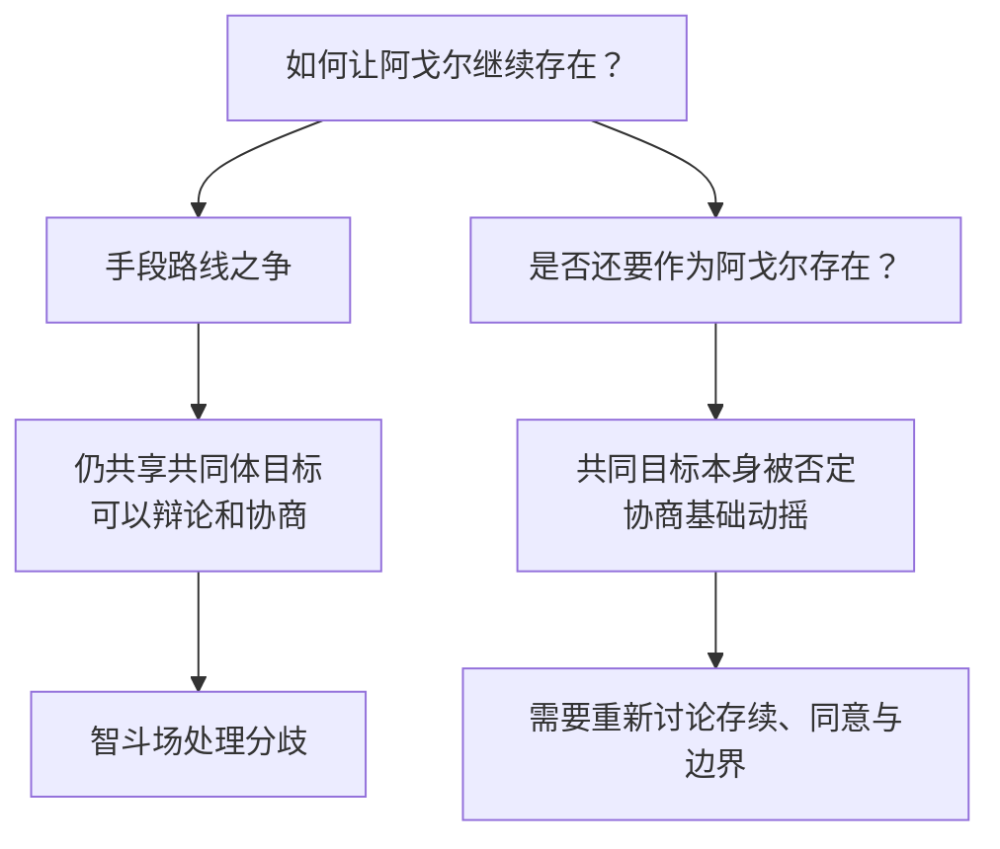

《生路》里的阿戈尔让我困惑的，不只是它能不能抵抗海嗣，而是一个拥有高度发达知识与辩论传统的文明，为什么仍会在存续问题上发生如此激烈的内部路线冲突。阿戈尔有受到尊重的智斗场，明面上的领导层选择抵抗海嗣、维护自身文明，却有人转向海嗣一边。思想可以被认真讨论，为什么讨论仍然不能带来共同行动？

这里的“脆弱”是内部共同体的脆弱，不是说阿戈尔没有战斗能力，也不是说科学、艺术和哲学害了它。真正的问题是：一个文明可以允许人们质疑自己的存在形式，却未必能让所有人继续承认“阿戈尔作为阿戈尔值得延续”是共同目标。

<!-- more -->

*图：《生路》官方活动主视觉，图源[鹰角活动公告](https://ak.hypergryph.com/news/1525)。*

## 思想多元不等于共同体破裂

把阿戈尔内部争论拆成两条轴线，能看清为什么“意见不同”并不足以判断共同体是否已经破裂：

图里的区分不是把海嗣派统一归入某种动机，也不是说所有反对官方路线的人都背叛共同体。它只是指出：路线分歧仍以共同体为讨论对象；存在意义的分歧则可能改变“我们是谁”以及谁有权替别人决定未来。

首先需要分清两种分歧。第一种是关于“怎样让阿戈尔继续存在”的分歧：有人主张依靠既有制度抵抗，有人认为需要改革，有人相信更深入地理解前文明遗产才可能找出生路。即便这些路线相互冲突，只要各方仍然把阿戈尔的存续当作共同问题，分歧仍可以进入政治讨论。

第二种分歧更根本：有人不再认为阿戈尔作为一个独立文明值得保留，甚至愿意协助海嗣去摧毁或取代它。此时争论就不只是“怎么做”，而是“我们还在不在讨论同一个共同体”。一方想保护阿戈尔，另一方认为阿戈尔的现有形态本身就应该被超越。辩论可以澄清彼此立场，却不能保证两方最终拥有同一个目的。

智斗场的存在因此并不自动意味着共识。它能够为论证提供空间，不能迫使参与者接受同一答案；能够让反对意见公开，不会让所有人都把讨论程序当作最高规则。一个制度可以保护发言，却无法控制人们最后会怎样行动。若一方认定自己已经掌握超越现有文明的真理，可能会觉得继续遵守旧文明的讨论方式毫无必要。

这不是智斗场没有意义。它至少表明阿戈尔并非靠压制异见维持表面团结。更悲剧的地方在于，理性讨论本身不能替文明做最后选择。制度能维持讨论的条件，不能预先决定所有参与者是否愿意共同承担讨论的后果。

## 为什么高度文明会认真怀疑自己

阿戈尔长期远离泰拉大陆许多国家的战争与生存竞争，把更多精力投入科学、哲学、艺术、审美和制度设计。它有余裕问一些不只关乎“明天能不能活下来”的问题：文明是什么？个体值得保留吗？生命必须以现在的形式延续吗？一种新的存在形式是否比现有社会更自由？

这些问题不是软弱的证明。恰恰相反，只有文明发展到一定程度，社会才可能认真讨论自己是不是必须保持原有形态。阿戈尔的智慧让它可以设想超越自身，也让这种超越不再只是哲学课堂上的思想实验：海嗣以一种真实的生命力量出现，给那些思考“另一种存在是否更好”的人提供了具体选项。

危险不在于阿戈尔允许人想得太远，而在于一个关于共同未来的问题，可能转化成对共同体底线的放弃。自由讨论的社会仍须回答：当某一条路线会消灭参与讨论的个体和制度时，它是否仍然只是普通的意见之一？

也要避免另一个过度简单的结论：不要因为阿戈尔内部出现叛徒，就说“思想多元导致分裂，所以应该统一思想”。思想统一可能消灭争论，却不会自动产生忠诚、智慧或有效行动。强迫所有人接受同一结论，只是把问题从公开冲突转移到沉默、恐惧和地下行动里。

## 替海嗣派提出最强的理由

若要认真理解海嗣派，就不能把他们写成被外敌诱骗的傻瓜。他们可能相信群体意识能减少个体痛苦、误解、战争与死亡；高度协调的生命形式可以完成单个个体无法完成的工程。若现有社会总是在冲突中耗损生命，若个体总被孤独、疾病和暴力击败，那么融合确实可能显得像一种解放。

从功利角度看，海嗣也可能更有效率、更适应环境、更容易维持群体生存。把个体意识、边界和语言都当成低效的旧机制，融合便像是跳过反复争论，直接共享认知。这样的主张不一定来自邪恶欲望；它可能来自对痛苦的厌倦，也可能来自相信更高层次的生命会带来更丰富体验。

这个理由不能被一句“我们是人类，所以保持原状最好”驳倒。我们无法先验地证明一种超越个体的意识绝不可能有更丰富的体验。海嗣派完全可以追问：为什么现有形式应被视为不可侵犯？为什么把个体差异看得比生命延续更重要？

如果文明只以延续时间衡量自己，那么它确实必须面对一种极其残酷的比较：更长寿、更强大、更能适应环境的生命形态，是否有资格取代脆弱的阿戈尔？但这个比较把“活下来”先设成了唯一目标，尚未解释为何生存本身要凌驾于所有价值之上。

## 效率为了什么

阿戈尔发展科学，不只是为了把世界变得可控制，也为了探索未知；发展艺术，不只是让生存之后的闲暇变得好看，也为了创造与体验美；建立智斗场，不只是为了更快地传递观点，而是承认不同的思想值得被表达、质疑和回应。

所以我会问：如果一种更高级的生命形式要求我舍弃自己的思想，舍弃和朋友辩论的机会，舍弃现有的艺术追求，甚至舍弃作为“我”的边界，那么它保存的究竟是什么？如果融合把痛苦与误解一并消除，却也把可以彼此反驳的不同个体消除，它是否还保留了友谊？

人与人之间的理解不必以彻底合并为终点。我珍惜朋友，部分正因为对方不是我的延伸：他能反驳我，让我改变想法，也能保留我永远无法完全进入的内部生活。辩论不是信息交换的低效版本；它是一种共同存在的方式。艺术也不只是在传递可以被更高效编码的信息，它可能让一个人的经验成为另一人无法取代的感受。

即使融合后的存在确实拥有更高级的体验，也还要回答第二个问题：谁有权替其他人决定他们应该经历这种变化？“可能更好”不是强迫的授权。文明不只是等待优化的机器，它还包含无数不能互相代替的生活。对某些个体而言，保留差异、记忆、朋友和艺术，可能就是他们愿意活下去的理由。

## 存续不该把文明本身牺牲掉

博士曾经因为前文明的存续使命，几乎否定泰拉新文明自主发展的意义；海嗣派中的一些人则可能因为追求生命的更高层次存续，愿意放弃阿戈尔文明原有的形态。两边都碰到同一个危险：当存续变成最高目标，被要求存续的那个文明本身反而可能被牺牲。

存活下来的如果已经不再保留原先的人、社会关系、思想和艺术，那么“文明存续”这个词究竟描述了什么？保存一个名称、地理位置或生物群体，未必等于保存了那些成员认为值得延续的生活。反过来，保护现有生活也不等于拒绝一切改变。阿戈尔要面对海嗣的真实威胁，也必须思考怎样改革、怎样分担风险、怎样让共同体不被旧问题拖垮。

真正的争论不是“现状一切都好”与“海嗣绝对邪恶”之间的选择，而是：面对一个可能消灭现有生活、也可能消除部分痛苦的替代方案，我们要保护什么、愿意改变什么、又能否由当事人自己决定？

## 智斗场的象征意义与局限

我曾觉得智斗场在这里具有一种象征意义：一个文明最值得骄傲的，也许不是所有人终于得到同一个答案，而是不同的人仍然可以坐下来争论答案。现在我会给这个判断加上限制。一个公开辩论空间很珍贵，却不能单凭存在就保证团结；一个社会允许异见，也仍然需要某种最低限度的共同承诺，才能一起承担冲突与风险。

这个共同承诺不必是所有人相信同一套哲学，它可以是更薄的底线：不以暴力剥夺对方继续参与共同生活的资格，不替别人决定是否失去个体性，允许受影响者拒绝不可逆的转变。若海嗣融合不可逆，那么它更需要明确的自愿条件，而不能以群体生存或更高效率为名强迫不同个体放弃自己。

但《生路》也没有让这些原则轻松解决危机。阿戈尔面对的是可能灭绝文明的现实压力，选择拖延也可能付出生命代价。谁来定义“自愿”？如何在信息不足时判断融合之后还剩下什么？如果少数人的选择会改变整个共同体，其他人的拒绝权如何保障？这些问题没有简单的制度答案。故事的力量正来自它不把哲学冲突写成一场只要找到正确口号就能结束的辩论。

## 事件的世界规模与角色的经验规模

世界级事件需要时间才能落到角色身上，但读者需要某种可见的中间环节。阿戈尔公开现身之后，故事未必必须立刻写一场各国首脑会议；它可以先写港口消息如何传播、研究机构如何争论、地方势力如何误读新盟友、普通人如何担忧海洋贸易与安全。关键不是所有地区立刻采取同一行动，而是这个消息在世界里留下可追踪的回声。

这种回声也能反过来丰富阿戈尔专题。若陆地社会把阿戈尔当成技术资源，阿戈尔内部的路线分歧就会影响合作底线；若陆地社会因海嗣威胁而要求军事协助，关于融合和文明存续的争论就会从思想问题变成外交条件。外部世界不是只给阿戈尔提供观众，它也可能迫使阿戈尔重新定义自己愿意承担的责任。

因此，我对“后续反应不够”的感受不是要求每条主线都围绕阿戈尔旋转，而是期待作品兑现自己制造的因果。一个地方性故事可以暂时不提全球局势，只要世界时间线上仍能看到这件事怎样逐渐改变条件。长期叙事给了作品处理延迟的空间，也让读者有理由期待这些被延迟的影响终究会抵达人物生活。

## 《生路》之后：一个世界级宣告如何进入后续历史

我还在意《生路》结尾阿戈尔向大陆公开现身、寻求合作的事件。按设定规模看，这应该改变泰拉各国对海洋、技术与外交的认识；但后续其他地区故事并没有立即显出与之相称的全球连锁反应。

这里需要分清世界内部与叙事安排。世界内部可以有很多原因：各国有自己的危机，政治关系不会因一次宣告马上建立，活动的现实推出顺序也不等于泰拉内部的时间顺序。单凭后续暂时没有写到，就不能认定事件毫无影响。

但从读者体验看，若一个故事把事件塑造成世界级转折，却长期没有展示它对外交、军事、贸易、科技或普通生活的影响，转折的分量确实可能被削弱。阿戈尔的公开现身意味着一个技术先进、拥有不同生命知识的文明重新进入陆地政治视野；读者自然会期待陆地国家做出反应，也会期待阿戈尔自身的分歧影响合作方式。

因此，《生路》留下两个不同层次的开放问题。故事内部的命题是阿戈尔选择何种存在方式；整个系列的叙事问题则是这个文明的选择如何真正改变泰拉。设定已经打开一扇很大的门，后续作品还需要让人物和社会一步步走进去。把这两层分开，既能保留《生路》的思想力量，也能承认世界级事件尚待兑现的叙事期待。

## 共同体的团结不需要思想同质

我最初会疑惑“既然有智斗场，为什么思想不能统一”，后来觉得需要把“统一”换成“共同承担”。思想统一意味着大家最终说同一句话；共同承担则允许人们继续持有不同答案，但承认彼此仍然属于同一个需要面对后果的社会。前者看起来更整齐，后者更难维持，却不必以消灭差异为代价。

阿戈尔内部的叛变让这种差别变得尖锐。一个人可以在辩论中反对官方路线，也可以主张改变现有文明形态；但如果他把自己的确信转化为未经同意的强制，便已经越过了公开讨论与共同决策的边界。共同体不能保证人人忠诚，却需要认真讨论如何保护被分歧影响的人，尤其是那些可能被迫失去个体性的人。

这也让我不愿把“团结”简化成战时口号。真正可靠的团结要让成员能看到自己的意见被听见，能知道风险由谁承担，也能在路线失败时追究责任。否则所有人暂时朝同一方向行动，可能只是恐惧造成的沉默。一旦外部压力稍有变化，没被处理的分歧仍会以更剧烈的形式回来。

如果海嗣只被看成外部敌人，胜利就像是把生命威胁消灭；但当它成为一种可能的文明道路，问题就变成了我们是否愿意以现有生活为代价换取更长的生存。也许“生路”不只是找到一种不会灭绝的生命形式，而是让那些值得活下去的生活方式仍有机会存在。

阿戈尔可以承认自己的制度会失败、个体会痛苦、文明会受威胁，也可以认真考虑超越自己的可能。但它不能把“更有效率”当成价值论证的终点。它需要解释效率为了什么，谁来决定何为进化，改变会保留谁的记忆与关系，以及不愿融合的人能否继续作为不同的人生活。

一个文明并不因能够自我怀疑就必然脆弱。自我怀疑可能让分歧变得危险，也可能让它有机会看见旧制度造成的伤害。智斗场不能保证共识，却能提醒我：不同意见仍然需要具体的人来表达；若所有人最终只剩一个答案，争论本身也就不复存在了。

### 原作与延伸阅读

- [《生路》鹰角官方活动公告](https://ak.hypergryph.com/news/1525)
- [返回总论：从一首离别的歌到两个世界的时间]()
- [继续阅读：失败不能穷尽人的价值]()
