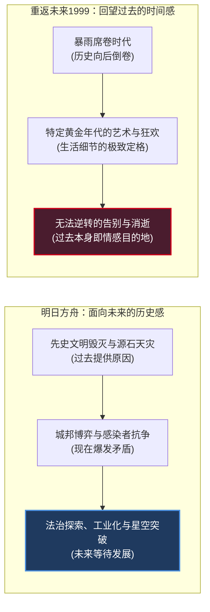
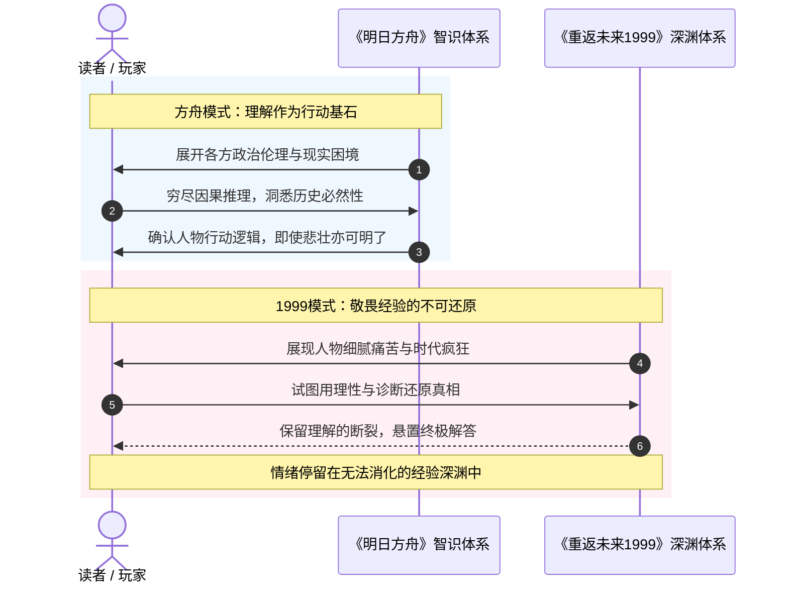

在与朋友和 AI 探讨二次元叙事文学的长夜里，一个耐人寻味、甚至有些反常的阅读现象反复浮现出来：

同样是国产二次元移动游戏中顶尖的文本驱动型作品，当你读完一段《明日方舟》的国家故事——无论是谢拉格的雪山政变、叙拉古的雨夜法治试验、阿戈尔的技术回归，还是乌萨斯庞大沉重的政治洗牌——你的心头总会升腾起一种**“历史学家的好奇”**：这个社会接下来会怎样？十年后的铁路能否穿透雪原？原有的政治结构被打破后，新的秩序能否在这片苦难大地上扎根？

然而，当你读完一段《重返未来：1999》的时代篇章——无论是咆哮的二十年代华尔街、维也纳歌剧院里哀婉的挽歌，还是六十年代伦敦街头的迷幻波普——你在掩卷沉思的那一刻，产生的却是一种极其复杂、甚至无法完全被理性语言消化的**情绪怅惘**：那个璀璨的年代真的已经过去了；曾经有人那样真诚地生活过、抗争过、相爱过，但历史的风暴终究没有给他们留下通往未来的出口。

**方舟能够让你理解一种理想为什么产生；1999 则可能让你感受到，曾经有人怎样真诚地生活在这种理想之中。**  
《明日方舟》的世界是可以被理解的，却不一定是可以被怀念的；《重返未来：1999》的世界则恰恰以“能够被怀念”为绝对前提。

两种截然相反的审美体验，并非单纯源于题材的科幻与魔幻之别，而是扎根于更深层的叙事结构命题：**时间之矢的朝向、文化颗粒度的互文性、对人类行动能力的信念，以及在面对不可逆历史时，创作者向人类处境投去的不同温柔。**

<!-- more -->

---

## 一、 时间之矢的朝向：“等待被发展”的未来 vs “以能够被怀念为前提”的过去

要解开这两种截然不同的阅读心理，首先必须检视两者在世界观底层所设定的**“时间动力学（Temporal Dynamics）”**。

在经典文学批评中，巴赫金（Mikhail Bakhtin）提出了“时空体（Chronotope）”的概念：叙事中的时间与空间并非中性的舞台，而是直接决定了人物命运如何展开、事件意义如何沉淀的引力场。而在现代互动叙事中，时间之矢朝向何方，直接划定了玩家情感的终点站。

### 1. 《明日方舟》：面向未来的历史感

在《明日方舟》构筑的泰拉大地上，时间的流动具有一种近乎冷峻的因果刚性：

$$\text{过去提供原因} \longrightarrow \text{现在爆发矛盾} \longrightarrow \text{未来等待发展}$$

当你沉浸在泰拉诸国的故事中时，你对一个国家、一个阵营的期待，往往已经远远超越了传统二游“我喜欢某一个特定角色，所以我想看他的个人后续”的粉丝心态。你关心的是一个庞大、沉重、充满内生矛盾的**社会共同体的命运**：

* 你在看谢拉格的《风雪过境》与《雪山降临》时，真正牵动心弦的是恩希欧迪斯（银灰）强推的现代化改革，究竟会在多大程度上摧毁蔓珠院千百年的传统宗教自治？那条劈开雪原的现代列车，十年后会不会将谢拉格拖入维多利亚与哥伦比亚的资本争霸？
* 你在看叙拉古的《叙拉古人》时，重点不是哪位狼母杀手的恩怨情仇，而是贝尔纳多与萨卢佐家族倒塌之后，新城市法典能否在黑帮密布的旧土壤里艰难存活？法治秩序能否在个人英雄主义退场后继续延展？
* 甚至面对乌萨斯这个庞然大物，读者会期待王女的故事，期待这个沾满冻土鲜血与旧贵族阴谋的帝国走向下一阶段，期待它崛起，更期待其内部残酷政治结构的重构。

**这是一种极其特殊的阅读关系：你不是在被动追逐单向的情节反转，而是在持续、自主地认识一个客观存在的异世界。**

而在人类的认知图式中，“认识”是具有物理累积性的。过去所发生的一切苦难、灭绝、背叛与牺牲，在方舟的文本里都不是最终的情绪终点，它们是**推动现实发生形变的齿轮**。因此，读者的目光永远被编剧引向地平线的前方——泰拉大地永远在等待下一个十年。

### 2. 《重返未来：1999》：回望过去的时间感

与之形成最鲜明戏剧对照的，是《重返未来：1999》。

在这部作品中，时间之矢被“暴雨（The Storm）”这一超自然现象彻底扭断并倒转。公元 1999 年成为了无法逾越的历史封顶，世界的刻度不再向 2000 年之后的未知宇宙延展，而是不断向后剥落，退回 1960 年代、1920 年代、甚至 19 世纪末。

这意味着什么？这意味着 1999 的世界，**从立意之初就是以“能够被怀念”作为存在前提的。**

在《重返未来：1999》中，历史的终局是先验已知的。读者与主角维尔汀（Timekeeper）一样，在踏入每一个时代的瞬间，心里就清楚地明白：眼前的爵士乐演奏、狂欢的股票交易大厅、维也纳艺术沙龙里关于先锋派的热烈争吵，全部都在走向一场注定的物理蒸发。

* 你关心那些人曾经如何生活；
* 你关心某个时代的浪漫与灵韵为何在那样一个独特的切片里绽放；
* 你更深刻地痛心于，这种璀璨为什么无法完整地留存到今天。

**在 1999 里，过去本身就是情感的目的地。**

它不承担“为未来寻找解决方案”的工具属性。哪怕故事里的人在当下作出了最惊艳的哲学沉思、完成了最无私的人性救赎，当暴雨自地表升向天空、雨水倒流之际，这一切微观生活的繁华都会被时代巨手毫不留情地抹去。

读完方舟，你像一个合上档案夹的历史学家，脑中高速演算着制度演化的下一步推论；读完 1999，你像一个在落日余晖中走出废弃歌剧院的旅人，站在湿漉漉的石板路上，任由一种难以排遣的怅惘将你浸透：**那个时代真美，而它真的已经死了。**

---

## 二、 文化颗粒度与互文性：现实母体的回响 vs 架空意义的从零建构

在长谈中，我们触及了一个极具洞察力的美学概念：**文化颗粒度（Cultural Granularity）及其背后的“互文性（Intertextuality）”**。

为什么两部作品在唤醒读者共情时，所调动的心理机制完全不同？这取决于意象背后究竟依赖何种文化记忆。

| 比较维度 | 《重返未来：1999》 | 《明日方舟》 |
| :--- | :--- | :--- |
| **意象来源** | 现实人类历史积淀的真实文化与艺术传统 | 现实地缘政治、工业革命与意识形态的提炼借喻 |
| **文化互文性** | **高强互文**：直接调用现实读者既有的情感母体 | **低度互文 / 内生建构**：必须在游戏文本内从零赋予重量 |
| **玩家探索动线** | 顺着游戏线索**“走出去”**，发现更庞大的现实文化宇宙 | 顺着设定线索**“走进去”**，在虚构世界内部完成逻辑闭环 |
| **读者心理机制** | **审美唤醒（Evocation）**：唤醒对既有时代的哀悼与乡愁 | **智识认知（Cognition）**：理解一套架空历史法则的运转 |

### 1. 1999 的现实互文：调用人类文明沉淀数百年的意义资产

《重返未来：1999》最强大的美学抓手，在于它极其奢侈地调用了现实世界数百年积累下来的文化资产。

当 1999 在维也纳篇章中奏响歌剧，当它在台词中埋入里尔克的诗句、弗洛伊德精神分析的术语、维特根斯坦式的哲学辩驳，或者表现主义绘画的线条时，**这些意象的意义并不完全是由游戏编剧在有限的几万字文稿中临时赋予的。**

意象的背后，站着整个人类近现代文明璀璨的艺术传统。
* 读者根本不需要游戏去专门证明“为什么歌剧是崇高的”；
* 也不需要编剧花三个章节去解释“为什么 20 世纪初维也纳的沙龙文化代表了某种优雅生活的顶峰”。

现实世界的历史记忆早已在读者的潜意识里为这些意象完成了赋魅。编剧所做的工作，是精准地挑动那根跨越现实与虚构的琴弦，借助**互文性**，让游戏文本与现实中人类对“美好时代（Belle Époque）”或“咆哮二十年代（Roaring Twenties）”的集体乡愁产生共振。

正如对话中指出的：**玩家可以顺着 1999 的线索走出去，发现一个真实存在、浩瀚无垠的现实文化世界。** 这种体验更接近文学漫游，游戏只是通往真实人类精神宝库的一扇拱门。

### 2. 方舟的内生建构：在荒原上从零夯实意象的重量

反观《明日方舟》，它走的是一条阻力大得多、但也硬核得多的**内生建构（Ex Nihilo Construction）**之路。

不可否认，方舟同样拥有海量的现实原型考据：维多利亚影射大英帝国，乌萨斯承袭帝俄与苏联的复合体，哥伦比亚呼应现代资本主义工业霸权，莱塔尼亚折射德奥神圣罗马帝国的金律与双王。

但至关重要的区别在于：**方舟不能、也从不指望直接套用现实文化的现成共情。**

在泰拉的大地上，没有现实的伦敦，没有现实的维也纳，也没有现实中已被文学作品千锤百炼过的象征体系。
* 谢拉格的列车当然可以象征“工业现代化对传统农牧宗教社会的冲击”；我们作为受过现代教育的读者，在理智上能够迅速“理解”它为什么重要；
* **但这种“理解”不是天然免费的。** 方舟的编剧必须在极端受限的游戏活动篇幅里，亲手搭建起恩希欧迪斯的家族血海深仇、蔓珠院大长老的宗教保守立场、圣女初雪作为权杖工具的痛苦，以及底层雪山猎人面对铁轨时的惊惶与迟疑。

方舟必须用纯粹的原创虚构文本，从零向读者证明：**为什么谢拉格必须修这条铁路？为什么修这条铁路要流血？为什么哪怕流血也依然要修？**

当玩家走出方舟的故事去查阅资料时，他们找到的往往是“这个国家参考了现实的哪个制度”、“这段剧情借鉴了哪场历史事变”。这更接近**社会学与政治史的考据与映射**。

方舟必须依靠自身严丝合缝的因果律，在原本空无一物的荒原上，为每一个意象夯实物理与伦理的重量。你之所以被谢拉格的列车打动，不是因为你怀念 19 世纪的蒸汽机车，而是因为你亲眼见证了那个虚构民族在雪山风暴中被这台钢铁巨兽推向未知的阵痛。

---

## 三、 智识英雄主义 vs 人的不可理解性：理解能否成为行动的基石？

当文本深入到“人如何行动、人为何做出决定”这一核心文学议题时，两部作品在哲学立场上出现了最深邃的分野。

### 1. 《明日方舟》：智识上的英雄主义（Intellectual Heroism）

《明日方舟》在骨子里散发着一种**坚定的理性主义（Rationalism）光芒**。

泰拉世界的历史，仿佛是一群具有高度“历史自觉（Historical Consciousness）”的人，在极端残酷、复杂的外部条件下共同推演出来的产物。

方舟塑造的核心人物，无论立场是正是反，往往都拥有一种惊人的行动清晰度：
* 摄政王特雷西斯屠戮同胞、发动战争，但他能够清晰无误地阐明他背负的三千年萨卡兹民族宿怨与生存困境；
* 特蕾西娅选择赴死、将魔王之力赋予阿米娅，同样有着一套超越历史冤冤相报的深邃伦理构想；
* 凯尔希活了万年，她的言语充满古老典籍的晦涩，但她每一次布局、每一次介入城邦冲突，其行动逻辑与维护新文明火种的动机，最终都会坦坦荡荡地向读者与博士敞开；
* 哪怕是被称为偏执狂的克丽斯腾·莱特，她在《孤星》最后面对整个特里蒙、面对国防部与各方势力时，也依然能够平静而完整地陈述她为什么要击碎苍穹。

**方舟崇尚的不仅是武力与牺牲，更是一种“智识上的英雄主义”。**

这种英雄主义不仅在于面对天灾敢于拔剑，更在于：人物具备透彻的判断力、对历史后果的绝对担当、以及**在明知各方逻辑均能自圆其说、矛盾依然无法调和的前提下，依然敢于做出抉择并付出代价的勇气。**

在方舟的哲学假定中：**理解是可以达成的，而理解能够成为行动的基石。**  
故事最终倾向于让读者看懂每一个人为什么这么做。即使他们拔刀相向，你也不会觉得对方是个不可理喻的疯子，你会感叹于历史结构对个体的无情挤压。

### 2. 《重返未来：1999》：对“人的不可理解性”的文学敬畏

然而，《重返未来：1999》展现了截然不同、却同样震撼的现代主义文学气质：**它敢于保留人的不可理解性。**

以其最负盛名的第五章、第六章维也纳故事（《出发！向着明日之星》《忧郁的热带》/ 维也纳歌剧院事件）为例：

精神分析医生卡卡尼亚是整个故事中最渴望用理性、医术与同理心去拯救伊索尔德的人。从世俗标准来看，卡卡尼亚拥有最高的医学造诣、最善良的初衷，以及自童年起与伊索尔德建立的深厚羁绊。她是全剧“最有资格理解伊索尔德”的人。

可是，直到大幕落下、狂乱的《图兰朵》歌声撕裂剧场、伊索尔德在绝望与毁灭的漩涡中引颈高歌的那一刻，卡卡尼亚才惊恐地意识到：**她自始至终，未曾真正理解过伊索尔德心灵深处的黑洞。**

甚至屏幕前的读者，调动全部的智识与注意力，也未必能比卡卡尼亚更彻底地看穿伊索尔德的终极动机。读者感觉自己像在看一部情绪浓稠的心理悬疑片：事情已经轰然爆发，人物在血泊与旋律中做出了决绝的献祭，但那个最核心的精神内核，却如同深渊一般，拒绝向观众彻底敞开。

1999 在这里展现出极高超的艺术胆魄：**它敢于让叙事停留在“无法消化的经验”之上。**

它告诉我们：人不是精密钟表，人的精神创伤与时代疯狂不是只要列出几条因果律就能完全化解的。在极端的情境下，理解一个人究竟有多困难？那种横亘在两个心灵之间的鸿沟，哪怕倾注一生的爱意与科学，也依然可能是一片漆黑的未竟之地。

方舟相信人与人之间终究可以通过思想的碰撞寻找交点；1999 则残酷而诚实地叩问：**如果真正的深渊本来就无法被对岸的人看清，我们该如何面对那种无法挽回的孤独？**

---

## 四、 微观小确幸的归宿：能够生长的法典 vs 被雨水抹去的孤本

这种哲学分歧，不可避免地投射到了两部作品对“微观生活（Micro-Life）”与“宏观历史（Macro-History）”之关系的处理上。

### 1. 叙拉古的小城能够生长进未来

在《明日方舟》中，宏大政治与微观生活并不是非此即彼的割裂物。

即便世界充满了天灾与矿石病的阴霾，方舟依然倾向于让那些在微观尺度上的努力，**有机会获得穿越时间、进入未来历史的入场券**：

* 在叙拉古的雨夜里，伺夜、德克萨斯、蚩妥、拉维尼亚所争取的，并不是拯救整个泰拉大陆，而只是在黑帮盘根错节的旧体系上，撕开一道口子，建立一个允许普通平民依循法典生活的小城市（新沃尔西尼）；
* 这个成果在宏观地缘政治看来可能微不足道，随时面临外部公国的颠覆；
* 但方舟明确告诉读者：**这个成果被保留了下来。** 新的法典在被印制，市民在学习遵守红绿灯，孩子们在新学校里朗读，哪怕未来风雨飘摇，这项微观成果已经成为了泰拉文明演进史上真实存在的一环。

方舟的叙事机制允许普通人的善意、法治的微弱尝试，像植物一样在泥土中持续生根、发芽，延展到下一个资料片、下一次时代跨越中。

### 2. 1999 的小镇被暴雨定格为无可挽回的孤本

而在《重返未来：1999》中，历史的断裂是绝对无情的。

在暴雨倒卷的时代切片里，小镇上的人们可能已经历经艰险，解决了家庭矛盾，重拾了彼此的信任，甚至在剧场里完成了一场载入史册的绝美谢幕。从戏剧学来看，他们在自己的生活尺度上，已经取得了毫无争议的圆满与胜利。

**但冷酷的“暴雨”根本不在乎这种生活尺度的胜利。**

当钟表倒拨，水滴从地面升向铅灰色的天空，那个刚刚获得救赎的小镇、那些刚刚擦干眼泪相拥的人群，连同他们呼吸过的空气、写在羊皮纸上的乐谱，全部在量子退相干般的雨幕中融化瓦解。

**这是 1999 最具悲剧力量、也最让人心碎的审美特质：它允许一个故事在微观人物层面获得无瑕的圆满，却在宏观历史层面被彻底剥夺未来。**

那些美好的生活细节，不是通向明天的阶梯，而是被封存在琥珀里的断代孤本。你只能看着它，怀念它，在手册里记下他们的名字与生日，然后伴随维尔汀的皮箱，孤身一人走向下一场注定消逝的时代雨幕。

---

## 五、 结语：两种对人类处境的温柔

行文至此，我们终于能够回答最初的那个命题：为什么两部作品会带给读者如此截然不同、却又同样深入骨髓的精神震颤？

因为它们在本质上，代表了当代最具才华的创作者们，在面对浩瀚、冷酷且充满不确定性的历史时，**向人类生存处境投去的两种截然不同、却同样博大的温柔**：

> **《明日方舟》有一种对“人类智慧与行动能力”的浪漫主义。**  
> 它告诉你：即便世界深陷泥沼，前文明毁灭，星空被黑障遮蔽，大地被天灾蹂躏；但只要人拥有历史自觉，只要人愿意运用智识去分析、去抗争、去结成同盟，人就依然可以理解世界、参与世界、并一寸一寸地改变世界。  
> **它不一定天真，但它始终相信行动的力量。**

> **《重返未来：1999》有一种对“人类感受、记忆与不可挽回之物”的浪漫主义。**  
> 它告诉你：哪怕人类的智慧在时间与宇宙的风暴面前何其脆弱；哪怕有些时代的逝去不可避免，有些人心中的深渊永远无法被另一个人完全读懂；但那些真诚生活过的瞬间、那些在剧场里流淌过的旋律、那些握紧又松开的手，其本身的璀璨就已经完成了自我证明。  
> **它不一定悲观，但它愿意为所有失去未来的美好，留下一场庄重的停顿与哀悼。**

前者让你胸怀历史学家的野心与开拓者的意志，面向明天，去追问一个未知的未来；  
后者让你怀揣诗人的眼睛与守林人的行囊，回首过往，去守护那些永不再来的黄昏。

而这两种审美体验在今天的碰撞，恰恰构成了这个时代最珍贵的精神镜像：**我们既需要相信明天的勇气去冲破现实的引力，也需要悼念昨天的温柔来保全内心的尊严。**
