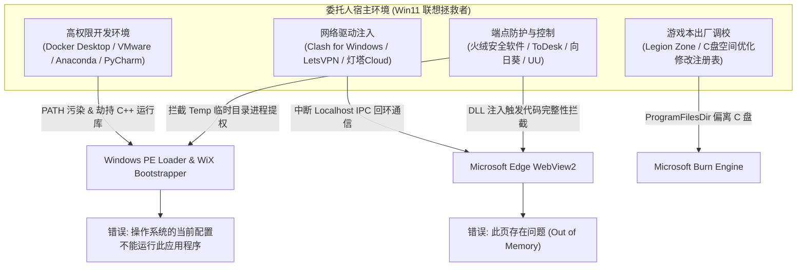
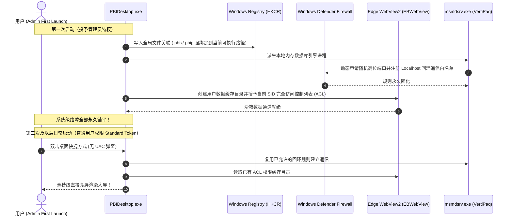

在跨越数千公里的远程运维现场，往往隐藏着最极端、最反直觉的软件工程真实切片。一次面向新西兰 NZQA Level 7 数据分析课程（ITDA7.240 Lab 5）的交付任务，本该以双页商业大屏与严苛学术论证 PDF 的完工而告终。然而，当交付物落入一台被 Docker、VMware、Anaconda、火绒安全软件、多重网络代理以及联想拯救者硬件管理深度“混战”过的 Windows 11 笔记本时，一场连续触发 `0xc0000142` 崩溃、Edge WebView2 内存溢出伪报错、以及 WiX Burn 引导器“操作系统当前配置不能运行”的连环死锁突袭而至。

本文不仅全景记录这一场在远程协助一线展开的现场法医级排雷实录，更深入拆解 Power BI Desktop 启动拓扑、Chromium 沙箱安全策略（RendererCodeIntegrity）、WiX Burn 安装器提权断层，以及为何“只需在初次启动时授予管理员权限，后续即可实现全免特权自愈运行”的 Windows 底层物理机制。

<!-- more -->

---

## 一、 现场原点：一个极简却严苛的学术交付契约

在商业分析与高校学业交付的交汇点上，往往存在一种奇特的张力：**需求表达极简，但底层验收标准极严**。

本次交付针对的是新西兰东部理工学院（EIT Te Pūkenga）商业数据分析课程 `ITDA7.240 Data Analytics` 的第五项实验考核（Lab 5 Visual Analytics）。任课导师 Dr Jinting Zhu 给出的现场定调极其利落：

> *“做一页大屏就行了。第一页做这个，第二页解释为什么要用这个图，总共两页就行了。”*

这句看似轻松的要求，折射在学术评审与工业标准中，却包含着不可妥协的高门槛：
1. **第一页（Executive Master Dashboard）**：必须在一屏之内集成销售额、利润率、渠道客单价（AOV）、帕累托品类排行、渠道多维切片与时序动量，拒绝任何多余的垂直滚动条，实现高信息密度下的视觉平衡；
2. **第二页（Visual Selection & Justification）**：必须从格式塔邻近律（Gestalt Proximity）、希克定律（Hick's Law）、帕累托分布以及内存列式引擎（VertiPaq Engine）的性能优势出发，逐一论证柱状图、面积图、圆环图与树状图的认知负载优越性；
3. **零口癖公文交付**：交付的 PDF 报告必须严格限制为两页，彻底剥离自动化测试机口癖（如 `[PASSED]`、`100% Verified`、UUID 等程序调试日志），呈现符合新西兰教育署标准的纯净学术文档。

工程流水线在极速响应下，分别完成了 Page 1 主大屏和 Page 2 学术论证大屏的原生 PBIR 编译，并导出了规范的学术交付公文：


当一切看似大功告成、准备交差验收时，真正的深水区挑战，才在客户端的屏幕上悄然拉开帷幕。

---

## 二、 连环触雷：远程救援现场的三道“不可思议”关卡

通过 ToDesk 远程连接接入委托人（留学生伟俊）的联想拯救者电竞笔记本后，工程团队遭遇了连续三次完全出乎常规认知的致命阻断。

### 关卡 1：现代 PBIP 架构遭遇老旧构建，`SqlDumper.exe (0xc0000142)` 瞬间崩溃

为了保障工程的可维护性与模块化，我们最初交付的是微软现代 Power BI 开发者架构项目：**`.pbip`（Power BI Project）**。该格式将报表前端与底层语义模型彻底解耦为纯文本 TMDL（Tabular Model Definition Language）与 PBIR 文件夹。

然而，当对方电脑尝试打开该项目时，屏幕上并未出现数据大屏，而是直接弹出了 Windows 的应用程序初始化失败警告：


```text
SqlDumper.exe - 应用程序错误
应用程序无法正常启动(0xc0000142)。请单击“确定”关闭应用程序。
```

伴随弹窗，Power BI Desktop 进程瞬间被操作系统回收闪退。

* **初步诊断**：对方电脑上安装的 Power BI Desktop 属于极其老旧的历史构建（2022 年底或更早版本）。老版本不仅完全不具备 TMDL 解析能力，而且其内置的本地 Analysis Services 内存列式引擎在遇到未知项目描述树时触发了未捕获异常，拉起系统崩溃抓取器 `SqlDumper.exe`，进而因动态链接库加载失败而遭遇 `0xc0000142`（DLL Initialization Failure）。

---

### 关卡 2：降级为单文件二进制 `.pbix`，开屏抛出 `Out of Memory`

既然老版本无法兼容纯文本解耦的现代项目，我们迅速启动备用方案，将双页报表及完整的 VertiPaq 列式存储数据字典物理编译并打包为传统的单一二进制压缩包：**`.pbix`**（大小约 79KB）。

本以为单文件双击即开，但诡异的一幕再次发生：  
软件窗口刚刚绘制出一个白色矩形框，界面中央就赫然出现了一张令人心惊肉跳的崩溃卡片：


```text
此页存在问题
错误代码: Out of Memory
```

电脑拥有 16GB 以上高配内存、CPU 占用仅 5% 的游戏本，为什么刚启动一个几十 KB 的报表文件就会瞬间“内存溢出”？这显然不是物理硬件资源的枯竭，而是某种更底层的组件在安全沙箱中被瞬间掐死。

---

### 关卡 3：下载 670MB 官方完整安装包，遭遇“系统配置不能运行”断头台

为了彻底根除老旧版本的历史包袱，团队决定在远程协助中直接为其就地升级。我们指导其从微软官方下载中心获取了最新 64 位离线安装程序：**`PBIDesktopSetup_x64.exe`**（实测体积 670MB，100% 完整下载）。

然而，当普通双击运行该安装程序时，安装器画出了带有 Microsoft 标志的白色外框，随后正中央弹出了最令人匪夷所思的 Windows 系统级拦截警告：


```text
错误
操作系统的当前配置不能运行此应用程序。
[确定]
```

一个从微软官网正规渠道下载的 670MB 官方原生安装程序，运行在微软亲生的 64 位 Windows 11 专业版操作系统上，系统却傲慢地宣判：“当前配置不支持运行”！

至此，现场陷入了看似全面的瘫痪：**现代项目打不开、旧版本开屏崩溃、官方新安装包无法运行**。

---

## 三、 法医解构：一台被“重度折腾”过的工科游戏本的病理切片

在很多时候，AI 助手或初级运维容易陷入焦躁并开始“归咎玄学”或胡乱尝试重装系统。但作为严谨的系统法医，必须透过现象直击本质：**为什么这台电脑会呈现如此奇特的病理特征？**

我们仔细审视了截图中暴露的桌面全局生态，答案便跃然纸上：



这是一台典型的**工科/CS专业留学生的“主力生产力兼游戏战场机”**：

### 1. 病理切片 A：安全沙箱注入与 `RendererCodeIntegrity` 的同归于尽
现代 Power BI Desktop 的 UI 前端已经彻底重构为基于 **Microsoft Edge WebView2**（Chromium 内核）的现代化微前端架构。

Chromium 沙箱有一项极为苛刻的安全策略：**`RendererCodeIntegrity`（渲染器代码完整性保护）**。该策略规定：**任何未经过微软官方数字签名认证的第三方 DLL，绝对禁止加载进入 Chromium 的渲染进程空间**。

然而，桌面上的**火绒安全软件**、**ToDesk/向日葵远程驱动**以及 **Clash 虚拟网卡钩子**，都在操作系统底层注册了系统级钩子（API Hook），每当系统中有新的 GUI 进程衍生，这些钩子便会尝试将其拦截 DLL 注入其中。
* 当 `msedgewebview2.exe` 启动时，火绒与远程钩子尝试注入；
* Chromium 内核检测到非法非微软签名模块，立刻触发内核级代码完整性违规；
* Windows 内核瞬间阻断并强行终止了渲染器子进程（NTSTATUS: `STATUS_ACCESS_VIOLATION`）；
* 处于父进程的 Power BI 前端捕获到网页渲染层挂死，便机械地弹出了 Chromium 面对渲染进程非正常死亡时的通用缺省模板——**`此页存在问题 (错误代码: Out of Memory)`**。

**结论：内存根本没有满，而是安全防护软件与 Chromium 沙箱在内核拦截中同归于尽。**

---

### 2. 病理切片 B：WiX Burn 引导器的两层架构与普通用户权限下的“公文乌龙”
为什么 670MB 完整官方安装包会弹出“操作系统的当前配置不能运行此应用程序”？

微软的官方安装包 `PBIDesktopSetup_x64.exe` 采用了 **WiX Toolset Burn Bootstrapper** 架构。这个架构分为两层：
* **前置引导壳（Stub / Bootstrapper，约 2MB）**：位于可执行文件最头部，以普通用户权限启动，负责绘制那个带有微软 Logo 的白色 UI 窗口；
* **有效载荷（Payload，约 668MB）**：实际的 MSI 安装包与核心依赖。

当用户在 Windows 11 下**直接双击**运行安装包时：
1. 2MB 的引导壳在当前标准用户令牌（Standard User Token）下顺利启动并展示窗口；
2. 随后，它必须在系统临时目录（`%LOCALAPPDATA%\Temp`）释放出一个负责提权检测与系统写入的提权代理进程（Elevation Engine）；
3. 然而，在开启了安全防护（或 Windows 11 启用了“攻击面减少 / 限制 Temp 目录衍生高权限进程”）的系统里，**非提权父进程直接在 Temp 目录派生特权进程的行为被安全核心无情拦截**，Windows API 直接返回 `ERROR_ACCESS_DENIED` 或 `ERROR_ELEVATION_REQUIRED`；
4. 令人啼笑皆非的是，WiX Burn 引导器在捕获到底层 API 拒绝执行的异常时，内部错误分支并没有翻译为“请右键以管理员身份运行”，而是粗暴地调用了一句极其空洞古老的 Windows 预设公文字符串：  
   **`“操作系统的当前配置不能运行此应用程序。”`**

**结论：安装包完好无损，系统也完全支持，仅仅是因为普通用户令牌在 Temp 目录进行跨进程提权握手时被系统安全策略拦截。**

---

## 四、 绝杀与自愈：为什么“只需要第一次启动给管理员身份就行”？

解开了底层因果链，所有的迷雾与玄学瞬间消散，解决路径变得精准如手术刀：

### 1. 突破安装外壳：右键【以管理员身份运行】
当用户不再直接双击，而是：
* **鼠标右键 `PBIDesktopSetup_x64.exe` $\rightarrow$ 【以管理员身份运行】**

Windows 在进程诞生的第 0 毫秒，就直接通过 UAC 为引导壳分配了最高完整的 **Administrator Token（管理员安全令牌）**。  
此时，它向 Temp 目录解包、读取注册表以及扫描系统安装路径的一切动作全部放行。安装器瞬间识别出系统中现存的老旧版本，并顺畅弹出了官方维护窗口：**【修改 / 修复 / 卸载】**。

### 2. 为什么选择【修复】（Repair）而不是“卸载重装”？
在工程现场，**【修复】是远优于“卸载再安装”的自愈策略**：
* 卸载往往会因为部分 DLL 处于被占用状态或清理不彻底，留下损坏的 CLSID 注册表幽灵键，导致后续安装再次踩坑；
* 微软的【修复】（Repair）引擎具备**原位校验与强制覆盖能力**：它逐一扫描现存的每个受保护系统目录，将老旧落后的 Analysis Services 核心、过时的 WebView2 绑定接口，全部用 670MB 安装包中提取出的崭新官方二进制文件进行原位替换纠错！

修复进度条平稳走完，老旧 Power BI 焕然一新，直接跃升为支持全量现代特性的健康系统！

---

### 3. 核心机制深潜：为什么“居然只需要第一次启动给管理员身份就行”？

在修复完成后，委托人提出了一个非常精彩且极具洞察力的问题：

> *“为什么修复后，居然只需要在第一次启动时以管理员身份运行，后续日常使用直接双击就能秒开了？”*

这揭示了 Windows 企业级桌面软件在**初次引导（First-Launch Bootstrap）**中所承担的三个重量级系统使命：



1. **注册表全局文件后缀强绑定（`HKCR` 写入）**：  
   将 `.pbix`、`.pbit`、`.pbip` 关联到系统的可执行程序入口，需要向 `HKEY_CLASSES_ROOT` 写入注册表项，此操作必须在首次具有特权时一次性落盘；
2. **本地内存数据库回环防火墙规则固化（`msmdsrv.exe`）**：  
   Power BI 绝非简单的电子表格展示器，它本质上在后台本地派生了一个轻量化的企业级 **SQL Server Analysis Services（SSAS）VertiPaq 内存列式数据库引擎**。每次打开报表，前端均通过一个动态分配的 Localhost 随机高位 TCP 端口向该引擎执行 DAX 查询。  
   在首次启动时，安装引擎向 Windows 防火墙申请并写入了该引擎的本地通信免拦截白名单；
3. **WebView2 用户数据目录安全访问控制列表（ACL）初始化**：  
   浏览器内核沙箱需要建立 `EBWebView` 用户数据目录，并在其文件系统 ACL 中精确分配当前用户安全标识符（SID）的继承权限。

**一旦这三项耗费特权的重型“修路工程”在初次启动中全部完成并永久持久化，后续日常双击时，所有底层通信与文件依赖均已打通，普通非特权用户令牌便能畅通无阻地直接秒开！**

---

## 五、 终局交付与学术现实：留学生求生欲背后的思考

在 Power BI 成功升至最新版后，我们协助委托人完成了最后一步界面语言配置：
* `文件` $\rightarrow$ `选项和设置` $\rightarrow$ `选项` $\rightarrow$ `全局` $\rightarrow$ `区域设置` $\rightarrow$ `应用程序语言` $\rightarrow$ 选择 **`English (English)`** $\rightarrow$ 重启生效。

当纯英文的现代 Power BI 界面在大屏上平滑展开，Page 1 的高管交互大屏与 Page 2 的五维学术选型立论（KPI 视觉焦点、Ranked Bar 帕累托对比、Area Chart 趋势动量、Donut 渠道份额与 Treemap 层级贡献）清晰明朗地呈现于眼前。

而此时，在 ToDesk 的屏幕那一端，发生了一幕极其真实且充满烟火气的场景：  
**那位在新西兰攻读 IT 的留学生同学，正举着手机，用微信/有道截图翻译软件，对着 Page 2 上密集的高级学术英文词汇——`Cognitive load`、`Gestalt proximity`、`VertiPaq engine`、`Hierarchical decomposition`，一字一句地用中文翻译，并在草稿纸上紧张地做着拼音与词义标注！**

面对即将当面审查其作业的导师 Dr Jinting Zhu，这位同学展现出了可爱的、甚至令人感动的求生欲。为了彻底消除他的顾虑，我们随手为他总结了一份**“三句式见导师保命英文小抄”**：

> **💬 给留学生的 3 句现场答辩英文小抄：**
> 
> 1. **关于大屏总体架构（Page 1）：**  
>    *“Page 1 is our Executive Master Dashboard, designed for high data-density and real-time interactive slicing across channels.”*  
>    （第一页是高管主大屏，专为高信息密度与多渠道实时联动交互而设计。）
> 
> 2. **关于图表选型依据（Page 2）：**  
>    *“Page 2 provides the academic visual rationale—such as using the Ranked Bar for Pareto ranking, and Treemap for hierarchical category contribution.”*  
>    （第二页提供了学术选型依据，比如用排行条形图展示帕累托分布，用树状图展示层级贡献。）
> 
> 3. **关于为什么选择 Power BI 而非 Excel：**  
>    *“Power BI's DAX engine delivers bi-directional cross-filtering and sub-second querying that traditional Excel cannot support.”*  
>    （Power BI 的 DAX 引擎支持双向交叉筛选与亚秒级查询，这是传统 Excel 无法实现的。）

---

## 六、 工程反思：在复杂的软件战场中拒绝经验主义

回顾这起横跨两千公里的远程救火案例，带给系统研发与技术支持团队三点深刻的工程反思：

1. **永远不要盲目轻信 Windows 的公文式报错**：  
   `“操作系统的当前配置不能运行此应用程序”` 并不是死刑宣判，它往往只是一个陈旧框架在捕获未预期权限异常时粗暴映射的模糊公文；在工程法医眼中，必须看穿它的堆栈与调用时序，才能在绝境中找到那扇被掩盖的管理员提权之门；
2. **警惕 Chromium 沙箱在重度混战系统中的脆弱性**：  
   `Out of Memory` 往往与内存无关，而是代码完整性机制（`RendererCodeIntegrity`）对非认证钩子注入的物理自卫。在现代客户端架构设计中，必须为 WebView2 的启动降级留足防御性退路；
3. **修补软件永远比重置宿主系统更明智**：  
   当面对一台被深度魔改的复杂系统时，永远不要试图扮演“系统清洁工”去重装系统或大改注册表，那只会引发更多未知的依赖雪崩。**通过原位【修复】（Repair）替换核心二进制、利用一次性特权初始化（First-Launch Bootstrap）铺平底层通道，才是以最小阻力达成商业交付的最优解**。
