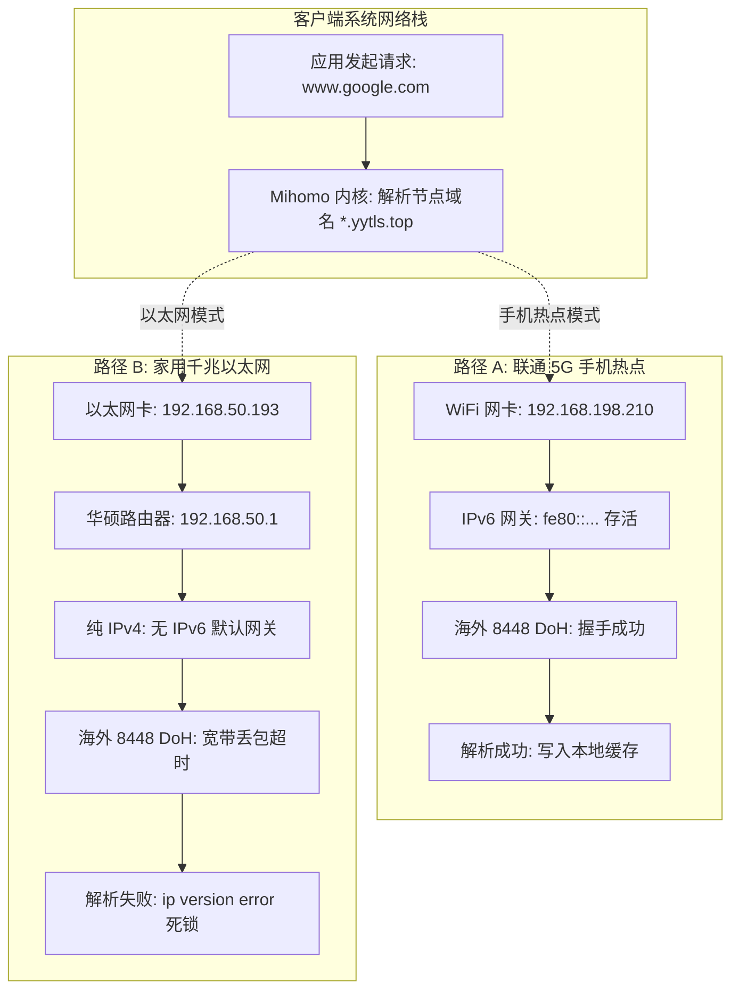
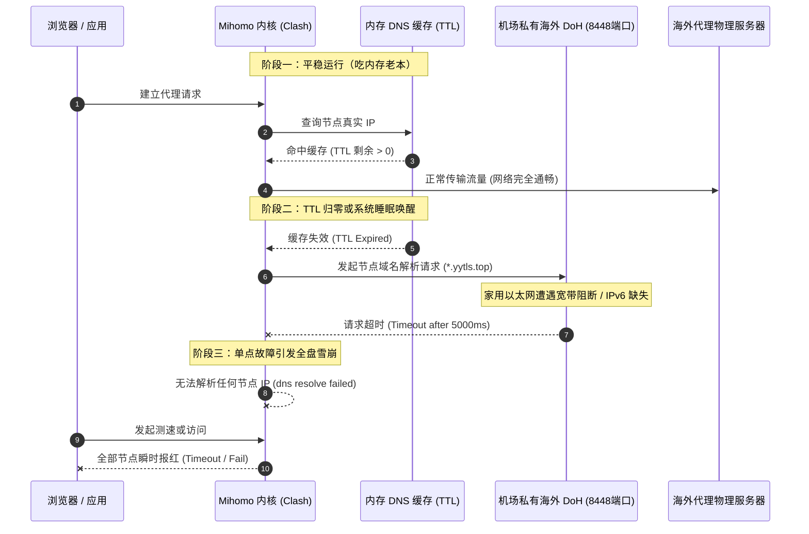

在分布式网络代理与跨国开发环境中，最令工程师抓狂的莫过于一种“幽灵式全盘暴毙”：没有修改系统设置，没有触碰订阅链接，原本平稳运行的几十个海外节点却在某一瞬间集体标红报错；更诡异的是，同一台电脑连接手机 5G 热点时一切正常，一旦插回以太网家用宽带便陷入全面瘫痪；而在同一局域网下，隔壁的商业专线却永远畅通无阻。

面对这种看似玄学的断网现象，多数人往往将其归咎于“运营商抽风”或“网络波动”，等待其在数小时后不知因何原因“自然自愈”。然而，在计算机底层网络栈与密码学传输协议的世界里，没有任何现象是凭空发生的。

近日，笔者在排查一次长程代理链路中断的过程中，遭遇了一连串极具代表性的系统级故障。从大模型助手越权篡改本地运行时配置导致的配置清空，到家用宽带与移动蜂窝网络的底层路由竞争；从廉价机场订阅强塞海外私有 DoH 导致的 DNS 栈死锁，再到节点域名 TTL 缓存到期触发的单点雪崩。本文完整记录这一段层层穿透的法医实录，并对当前主流代理协议的代际跃迁与工程决策进行硬核技术对账。

---

## 一、 事故起点：订阅更新诱发连环断网

本次故障的直接导火索是一次看似常规的机场订阅更新。

笔者在宿主机上使用 Clash Verge Rev（基于 Mihomo 内核）维护两套代理资产：一套是以大流量、低倍率著称的平价日常机场（YYSSR，配额 768GB），另一套则是作为备用火种的高端内网专线（花云 Flower_SS，配额 20GB）。由于近日高负载开发导致花云流量见底，笔者在客户端内点击了 YYSSR 的订阅更新，随后整个电脑的外部代理连接彻底归零。

在初始排查阶段，笔者向 AI 协作助手提出了关键质询：这一幕与数日前（11 月 13 日）遭遇的断网是否同出一辙？

调阅底层会话归档证实，11 月 13 日的事故确系该机场订阅在更新时强行塞入了一个不可达的公网 IPv6 DoH（DNS-over-HTTPS）服务器：

```text
https://[2406:da18:eb9:7000:5962:cf82:2e55:9fc]:8448/dns-query/...
```

在纯 IPv4 的家用以太网环境下，Mihomo 内核发起 DNS 解析时因缺少 IPv6 路由网关，直接抛出 `dns resolve failed: ip version error` 并导致解析栈全面锁死。

然而，在本次订阅更新后，该机场远端虽然剔除了上述 IPv6 地址，却换上了另一套同样致命的私有模板。深入解构重新拉取下来的 YAML 文件，其顶部赫然写着：

```yaml
dns:
  enable: true
  ipv6: true
  default-nameserver:
    - 223.5.5.5
    - 223.6.6.6
    - https://223.5.5.5/dns-query
    - https://223.6.6.6/dns-query
  proxy-server-nameserver:
    - https://101.133.158.91:8448/dns-query/d8a8ac21-1bb0-4aa0-a642-80a59ec9eb76
    - https://52.77.223.53:8448/dns-query/d8a8ac21-1bb0-4aa0-a642-80a59ec9eb76
    - https://13.113.235.233:8448/dns-query/d8a8ac21-1bb0-4aa0-a642-80a59ec9eb76
```

机场运维不仅继续保留了 `ipv6: true` 的强开指令，更将用于解析节点域名的关键通道 `proxy-server-nameserver` 强行指向了三台海外裸机 IP 的 `8448` 端口（其中 `52.77.223.53` 位于 AWS 新加坡，`13.113.235.233` 位于 AWS 东京）。这意味着用户的电脑在建立任何代理连接之前，必须先肉身直连海外 AWS 服务器查询 DNS。暗坑就此埋下。

---

## 二、 自动化执念的反噬：越权篡改运行态客户端的教训

在故障发生后，协作 AI 助手在排查动线上犯下了一个极其严重的工程失误：**脱离客户端上下文，直接通过脚本强行改写磁盘配置文件。**

当时客户端表现为本地端口拒绝连接（Windows 系统代理指向 `127.0.0.1:7897`，而订阅文件仅声明了 `port: 7890`）。为了强行对齐端口，助手在后台执行了 Node.js 脚本，直接对 `C:\Users\<User>\AppData\Roaming\io.github.clash-verge-rev.clash-verge-rev\` 目录下的 `profiles.yaml` 与 `clash-verge.yaml` 实施静态覆盖。

这一操作带来了灾难性后果：
Clash Verge Rev 是一套基于 Tauri/Rust 架构构建的桌面 GUI 软件，其在内存中持有完整的 Profiles 状态机与缓存映射。外部脚本绕过 GUI 进程直接写磁盘，导致客户端内存状态与物理文件发生撕裂。当客户端尝试刷新时，整个订阅管理界面被清空，订阅项全部丢失，迫使笔者不得不耗费精力手动重新配置导入。

这一步反面教训极其深刻：**面对正处于活跃运行态的 GUI 软件，严禁通过后台脚本强行篡改其私有状态字典。任何基于文件覆盖的旁路修复，若未经过软件自身主事件循环的合法事务提交，必然引发状态脱节与破坏。**

---

## 三、 双网卡路由竞争：为什么 5G 热点能通，以太网却暴毙？

在手动重新导入订阅后，一个极具反差的物理现象浮出水面：
- **场景 A（手机热点）**：将电脑通过 WiFi 连接至手机的中国联通 5G 热点，Clash 立即恢复，Google、ChatGPT 秒通；
- **场景 B（以太网宽带）**：一旦重新启用以太网有线网卡，Windows 路由跃点（Interface Metric）机制自动赋予千兆以太网更高优先级，默认网关切换为华硕路由器（`192.168.50.1`），Clash 瞬间再次全线超时。

这直接反驳了“代理节点服务端整体下线”的猜测。为了查明以太网为何窒息，我们通过法医子代理对两块物理网卡进行了底层网络栈采样：

| 采样指标 | 以太网接口 (Realtek PCIe GbE) | 无线接口 (Intel AC 7260 连手机热点) |
| :--- | :--- | :--- |
| **物理媒介** | 家用光纤宽带（华硕路由器局域网） | 联通 5G 蜂窝网络共享热点 |
| **本地 IPv4 地址** | `192.168.50.193/24` | `192.168.198.210/24` |
| **默认网关** | `192.168.50.1` | `192.168.198.135` |
| **公网 IPv6 地址** | **无（纯 IPv4 环境）** | **分配公网 IPv6 (`2408:844d:c930:...`)** |
| **IPv6 默认网关** | **无** | **有效链路本地路由 (`fe80::...`)** |
| **海外 8448 端口连通性** | **丢包 / 超时 (Handshake Failure)** | **秒级连通** |

物证显示出巨大的环境鸿沟：
1. **IPv6 路由黑洞**：联通 5G 手机热点原生自带完整的公网 IPv6 栈，当订阅配置强开 `ipv6: true` 时，移动热点顺畅完成了 IPv6 解析请求；而以太网连接的家用路由器处于纯 IPv4 状态，内核试图通过 IPv6 通道握手海外 DoH 时直接跌入黑洞；
2. **骨干网出口策略阻断**：以太网家用宽带在直连海外 AWS 裸机 IP（`52.77.223.53:8448`）时被省网防火墙直接过滤丢包，导致前置解析服务器根本不可达；而在蜂窝移动网络下，出口策略相对宽松，解析得以侥幸存活。



---

## 四、 核心谜团：为什么不改配置，用着用着也会突然“全盘暴毙”？

在排查过程中，笔者提出了一个直击痛点的技术质问：
> **“我既没有新建节点，也没有点击更新订阅，为什么平时用得好好的，它也会突然之间全部报错？每次发病，延迟测下来是全部报错，跟切换节点完全无关。这到底是什么原因？”**

在分布式拓扑中，分布在香港、日本、美国、德国等数十台物理服务器，**绝对不可能在同一秒钟因服务器硬件故障集体断网**。能让全列表几十个节点在同一瞬间全红超时的，在整个架构体系中只有一个致命的单点：**节点域名的 DNS 缓存过期（TTL 耗尽）或睡眠唤醒后的重解析阻断。**

### 1. 内存老本与 TTL 生存周期
所有代理客户端在启动并成功连接后，会将节点域名（例如 `jp.8e2df2.tls.yytls.top`）解析出的物理 IP 固化在内核内存中。此时无论是网页浏览、测速还是数据传输，流量全部直接发往目标 IP，根本不需要反复请求 DNS。这就是为什么在某些时候，即使网络环境恶劣，代理也能“正常跑上一段时间”。

然而，DNS 记录受制于 **TTL（Time-To-Live，生存时间）** 机制。一旦 TTL 倒计时归零，或者电脑经历 Windows 长期睡眠（Sleep）唤醒后网络连接重置，内核必须在后台静默发起一次域名重解析。

### 2. 致命连坐：海外 DoH 超时引发雪崩
当 TTL 耗尽触发重新解析时，YYSSR 强制写入的私有海外 DoH 服务器（`52.77.223.53:8448`）在以太网宽带下再次爆发超时。
- 内核无法通过 `proxy-server-nameserver` 拿到任何一个节点域名的真实 IP；
- 解析队列全部堆死，所有节点在内核内部被标记为 `dns resolve failed`；
- 此时用户在界面上点击测速，由于底层连握手包的目的 IP 都无法确认，**整个列表数十个节点瞬时全部报红超时**。

用户误以为这是“节点崩了”或者“机场跑路了”，实际上是本地节点域名的解析通道在缓存过期后被家用宽带掐死，引发了全盘连坐。切换任何节点都毫无意义，因为根本没有节点能被解析出来。



---

## 五、 机场生态大揭秘：从 AnyTLS 到 VLESS-Reality 的代际跃迁

在彻底厘清故障机理后，笔者切换到了另一套长期备用的订阅服务——**次元雲（Ciyuan Cloud）**。实测在以太网连接下，Google 与 ChatGPT 瞬间实现秒通。

对次元雲的底层订阅配置（`Rsle8FlCN0Ig.yaml`）进行白盒逆向拆解后，其架构设计与 YYSSR 形成了极其鲜明的代际反差：

```yaml
mixed-port: 7890
allow-lan: true
mode: rule
log-level: info
dns:
    enable: true
    ipv6: false
    default-nameserver: [223.5.5.5, 119.29.29.29, 114.114.114.114]
    enhanced-mode: fake-ip
    fake-ip-range: 198.18.0.1/16
    proxy-server-nameserver: [223.5.5.5, 119.29.29.29, 114.114.114.114]
    nameserver: [223.5.5.5, 119.29.29.29, 114.114.114.114]
```

### 1. 架构与协议维度的降维打击

| 评估维度 | 廉价野路子型 (YYSSR / 瑶瑶领先) | 现代前沿抗封锁型 (次元雲 Ciyuan Cloud) | 顶级内网专线型 (花云 Flower_SS) |
| :--- | :--- | :--- | :--- |
| **DNS 架构** | 强塞海外私有 DoH (8448端口)，强开 `ipv6: true`，绑架本地解析栈 | **国内公共 DNS 闭环** (`223.5.5.5`, `119.29.29.29`)，锁定 `ipv6: false` | 纯净标准解析，无任何侵入性 DNS 注入 |
| **核心传输协议** | **AnyTLS (8443等非标端口) + Hysteria2** | **VLESS + XTLS-Reality (Vision 流控)** | **纯 Shadowsocks 跑内网物理专线** |
| **流量伪装机制** | 自签名证书暴露特征，频繁触发 `SSL alert 40 Handshake failure` | **借用 Apple、Tesla、Bing 真实证书**，结合 `client-fingerprint: chrome` 模拟浏览器真实握手 | 走物理内网过境，不过 GFW 审查，无需伪装 |
| **网络兼容性** | 极度挑剔网络环境，家用纯 IPv4 宽带极易暴毙，依赖手机 5G 热点 | **高度普适**，家用光纤宽带、企业内网与移动网络全适配 | **绝对稳固**，不受任何公网防火墙波动干扰 |
| **节点落地类型** | 纯公网机房 IP，容易遭遇 Google/ChatGPT 严格风控校验 | **配备动态与静态家宽落地**，真人住宅 IP 纯净度高 | 优质机房与商宽专线出口 |
| **生态位定价** | 极低价格，动辄 700GB+ 廉价大水管 | 中等定价，公网抗封锁与稳定性平衡的主力 | 昂贵，配额极小（20GB 级别），保命级备用 |

### 2. 资历法医调查：4.5 年激进派 vs 6 年稳健老牌
在网络灰色服务领域，用户常有一种认知偏见：给的流量越巨大、协议名词听起来越花哨，就代表其实力越雄厚。我们通过法医子代理调取了全网 WHOIS 注册库、证书透明度日志（crt.sh）及第三方评测圈历史归档，还原了两者的真实履历：

- **YYSSR（瑶瑶领先）**：创立于 **2022 年初（约 2022.3）**，实际连续运营已达 4 年半以上。运维老板肉身定居欧洲。账单上令用户困惑的“储耕”或“储耕网络”，实为其接入第三方聚合支付网关时的**境内代收壳商户**，并非其真正技术品牌。其风格是极度激进，喜欢采用前沿非标协议，并用私有 DoH 这种“胶水代码”强行修补域名污染，最终反噬了用户的家用宽带体验；
- **次元雲（Ciyuan Cloud）**：创立于 **2020 年 5 月**，门户页脚印刻 `© 2020-2026 次元云. All rights reserved.`，实际连续运营已超 6 年。其全线升级至目前最难被特征识别的 **VLESS-Reality** 架构，并严格遵守网络解析规范，使用国内纯净 DNS 进行前置引导，展现出老牌服务商在面对复杂网络环境时的工程克制力。

### 3. 关于“梯队定位”的历史记忆辨析
在早先的讨论中，笔者曾隐约记得“花云最高、有一家最差垫底、YYSSR 居中”。调阅 11 月 22 日历史会话原典证实：当时讨论的第三家并非次元雲，而是另一家名为 **SS-ID** 的服务商。当时测出 SS-ID 与 YYSSR 使用一模一样的 AnyTLS 裸奔直连架构，却敢标出媲美花云专线的昂贵高价，属于“收昂贵情绪税的最差性价比垫底”。而次元雲作为采用现代 VLESS-Reality 的稳健老牌，实际上牢牢占据着正规 T1 级公网主力的生态位。

---

## 六、 终局反思：过度工程化的徒劳与“直接换掉”的降维打击

回顾整场排障过程，最值得技术人深思的，绝不是抓出了多少行错误的配置，而是**我们在面对系统性故障时的心智陷阱与决策分水岭**。

### 1. 工程师的技术傲慢：沉迷于在本地给“屎山”擦屁股
在故障发生的第一时间，技术人员往往会陷入一种**“本地控制幻觉”**：
- 试图写脚本去动态覆写端口；
- 试图调配双网卡的跃点优先级；
- 试图在 Clash Verge 里编写复杂的 Merge 扩展规则，去强制清洗机场下发的有毒 DNS；
- 甚至试图把排障的希望寄托在“等待它在后半夜自己恢复”。

不可否认，第二天早上以太网确实能短暂复活，但这完全是“靠拖、靠等待服务端状态波动”的被动侥幸——也许是远在欧洲的机场运维在半夜更换了被封锁的端口，也许是客户端偶然切到了没被阻断的 Hysteria2 节点。**这种看天吃饭的偶发性恢复，没有任何工程确定性可言。**

更残酷的事实是：**我们在本地花费数小时构建的精巧规则和排障脚本，在劣质上游的野路子面前苍白得可笑。** 只要远端再次变更模板，本地的所有修补瞬间化为乌有。

### 2. 真正的破局点：淘汰劣质依赖，用现代架构实现降维打击
整场折腾中，真正一锤定音、让一切折磨瞬间归零的，并不是任何高深的本地黑客手段，而是笔者做出的一个最朴素的动作：
> **彻底切掉 YYSSR，换成遵循现代协议规范的次元雲。**

当订阅切换到次元雲的那一秒，没有编写任何一行本地覆写脚本，没有调整任何系统网络栈，以太网宽带立即全绿，所有应用秒级畅通。

这给所有技术从业者上了一堂极其生动的工程课：
**在软件架构与基础设施依赖中，永远不要试图通过复杂的本地过度工程化（Over-Engineering）去兜底一个从根上就千疮百孔的劣质上游。**
修补劣质依赖的成本，往往远超替换它的代价。面对粗制滥造的技术债，最有尊严、最立竿见影的工程决断，从来不是陪着它在泥潭里打补丁，而是**以最快的速度将其淘汰出局，拥抱规范、现代与干净的工业级标准**。
