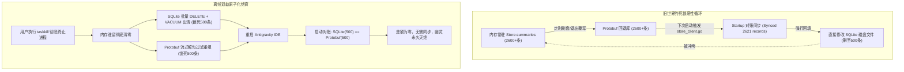

在软件工程的世界里，有些最折磨人的幽灵 Bug，往往顶着极其荒谬的逻辑悖论出现。

它既不是由于高并发击穿了缓存，也不是什么惊天动地的内存溢出，而是当你顺着系统弹窗的指示试图清理一个早就不存在的历史项目时，系统弹出一个体贴而无奈的对话框：

> "Couldn't archive conversation. This conversation is not on disk. Delete it to remove it from your sidebar."  
> （无法归档此会话。该会话在磁盘上不存在。请将其删除以从侧边栏中移除。）

然而，当你试图在侧边栏右键将其删除时，你会惊愕地发现——上下文菜单里根本就没有“删除”这个选项。更荒诞的是，即便你动用外部脚本将底层数据库清理得干干净净，只要你重新打开开发工具，在几十毫秒的时间里，那几千个打不开、删不掉的幽灵死链接，又会像地狱归来的亡灵军团一样，整整齐齐地全量复活在你的屏幕左侧。

这就是近期发生在 Google 核心 AI 编程工具 Antigravity IDE（内部代号 Jetski）上的一个极其真实的系统死锁案例。从最初一个测试会话的删除失败，到层层深潜逆向 Go 二进制、流式解析 Protobuf 字节码、抓取 137 毫秒启动对账的犯罪现场，直至最终完成离线双轨原子化绝育——这场法医级的技术攻坚，不仅是一次硬核的系统排障实录，更是对现代大厂将全球分布式微服务架构生硬塞入单机桌面客户端的深刻病理剖析。

---

## 初始现场：报错与假死锁的诞生

问题的起点源于一个长达数月未解决的用户困扰。用户在侧边栏的 `playground` 临时工作区分组下，反复看到一个名为 `adb` 的历史会话。该会话无论怎么点击，都会抛出上述“文件不在磁盘上”的错误。

顺着报错信息，我们展开了第一轮逆向排查。首先以报错文本为真理源，在全盘数万个安装文件与缓存中进行十六进制字节遍历，迅速击穿了 Antigravity 位于 Webview 前端主包（`main_web_bundle.js`）中的执行逻辑：

```javascript
// Webview 右键菜单 actions 定义
sn = [Bt /*pin-thread*/, $t /*rename-thread*/, qt /*archive-thread*/, Xt /*separator*/, rn /*copy-cwd*/, cn /*copy-session-id*/, on /*copy-app-link*/];

// 归档触发逻辑
async performArchiveConversation(Ye, lt) {
  messageBus.dispatchMessage("archive-thread", {conversationId: Ye, cwd: lt});
  await this.sendRequest("thread/archive", {threadId: Ye});
  ...
}
```

代码清晰地暴露了第一个事实：**前端上下文菜单中针对本地会话压根就没有提供物理删除按钮**。

当用户尝试归档该会话时，前端通过 VS Code IPC 向后台核心服务发起请求。底层 `dbtrajectory` 模块试图打开磁盘上的独立 SQLite 库文件：
`conversations/10dd139b-2715-4442-b130-12e70d1be723.db`

然而该物理文件在磁盘上早已灭失，后端抛出 `isMissingDatabaseError`，前端捕获后便弹出了那句看似合理实则荒谬的提示——“请删除它以从侧边栏移除”。

但为什么后端不提供删除接口？沿着 RPC 路由，我们直接对 Antigravity 核心的 70MB+ 静态编译 Go 二进制文件（`language_server.exe`）展开符号表检索，却在二进制偏移处提取出了一行令人啼笑皆非的硬编码铁证：

```text
jetski.product.v1.ConversationService.CreateConversation is not implemented
jetski.product.v1.ConversationService.UpdateConversation is not implemented
jetski.product.v1.ConversationService.DeleteConversation is not implemented
```

这是一次典型的**半成品接口断裂（Missing Plumbing）**：前端工程师（或 AI 补全脚本）在处理文件缺失的异常分支时，凭着常理写下了体贴的文案“请从侧边栏删除”；但负责后端的工程师只搭建了 gRPC 接口脚手架，核心业务实现赫然是一行统一的 `is not implemented`。

---

## 盲区初现：常驻内存与定时冲刷的第零类接触

既然官方没有提供运行时的删除通道，最直接的工程直觉自然是“直捣黄龙，物理清除”。

全盘排查锁定了 Antigravity 维护侧边栏会话的两个核心持久层账本：
1. **SQLite 索引主库**：`conversation_summaries.db`
2. **Protobuf 二进制回退文件**：`agyhub_summaries_proto.pb`

在第一轮清理中，我们编写脚本连接 SQLite，将目标 UUID `10dd139b-2715-4442-b130-12e70d1be723` 从数据表 `conversation_summaries`、全文索引 `conversations_fts` 以及父子关系表 `conversation_parents` 中物理抹除，并执行了 `PRAGMA wal_checkpoint(TRUNCATE)`。

然而，随后的物理实测却给出了一个冷酷的反转：**直接在磁盘上修改文件，转瞬间就会被覆写抹平**。

排查进程树发现，后台常驻的 `language_server.exe`（PID 3012）在启动时，内部的 `jetbox_summaries_store` 模块早已将所有会话元数据反序列化为内存中的哈希表（`Store.summaries`）。更致命的是，该进程内部挂载着一个以约 10 分钟为周期的定时刷盘与析构同步任务。

这意味着：只要 `language_server.exe` 进程在后台常驻运行，它的内存就始终持有旧世界的完整镜像。任何外部工具对磁盘文件的修改，只要等到后台服务下一次刷盘、或是 IDE 窗口发生了一次微小的会话交互，内存中的旧数据就会像潮水一样再次倾泻而下，把修改后的磁盘账本原封不动地覆写覆盖。

这解释了为什么此前简单的文件删除尝试无一例外全部以“看似删了、实际毫无变化”告终。

---

## 冰山浮出：痛点转移与两千个幽灵的大盘普查

当我们针对 `adb` 会话部署了内存过滤并完成了初步清除后，用户发来了更关键的反馈：

> “没有啊，PS AI 这个上下文仍然看不了。”

这句话直接撕开了更大的冰山一角。用户真正关心的、日常高频遇到的不仅是一个用于测试的 `adb`，而是一个名为 `PS AI` 的会话。

对 `PS AI` 进行法医级追溯，锁定了其一手元数据：
* **UUID**：`81569690-a6e7-47d3-bfe6-0fd7475aac38`
* **最后修改时间**：`2026-09-16 12:49:22`
* **底层物理状态**：对话数据库 `.db` 缺失、脑图目录 `brain/` 缺失、历史记录 `history/` 缺失，磁盘上仅孤零零存留着一个 86 字节的空标签文件（`annotations/...pbtxt`），记录着标题字符串。

顺着这一线索对全局数据库执行穿透式物理对账，一个惊人的大盘数字浮出了水面：
在 `conversation_summaries.db` 当时登记的全部 2,601 条会话中，底层文件物理存在的真实会话仅有 **498 条**；而底层物理文件早已灭失、只要一点击就必然报错看不了的**幽灵死链接会话，整整高达 2,103 条！**

用户随即提出了一个极其重要且具备前瞻性的防呆诉求：
> “懂了懂了，其他的这个不存在的也删掉吧，不过以防万一，先就是把名字给保存了，就是这些对话的名字。”

在执行任何破坏性操作前，我们编写引擎对这 2,103 个历史会话进行全量字段提取，生成了人类可读的 Markdown 清单（431KB，2,116行大表）与机器可读的 JSON 结构化总账，将长达 11 个月以来所有聊过的会话标题、时间戳和所属工程完整封存留档。

---

## 终极危机：137 毫秒的犯罪现场与启动对账复活

正当我们以为只要把这 2,103 个会话在 SQLite 和 Protobuf 中批量出清就能高枕无忧时，次日用户再次发来了直击灵魂的质问：

> “it 我发现仍然没有被删掉，这是第几次了，你又骗我。”

在技术排查中，“以为解决了但实际又复现”是消耗协作信任的最危险时刻。在这个关头，任何猜测、辩解或道德自省都是毫无意义的，唯一的出路是彻底推翻所有先验假设，直插运行时物理事实的最深渊。

我们立刻检查刚刚重启过的系统运行日志：`C:\Users\a1634\AppData\Roaming\Antigravity\logs\language_server.log`。在第 12 行至第 30 行，我们当场抓住了 137 毫秒内幽灵会话死而复生的犯罪全过程：

```text
L12: store_client.go:714] summary store: starting background reconciliation (trigger=startup)
L14: manager.go:152] Creating trajectory store manager with proto store and SQLite store
L30: store_client.go:764] summary store: reconciliation complete, synced 2621 records
```

### 犯罪链条彻底复盘

看懂这三行日志，Antigravity 最深层的死锁机理才算真正大白于天下：

1. **双轨架构设计**：`language_server.exe` 内部运行着一套主备双轨存储体系——以 SQLite 为 Primary Store，以 Protobuf 文件为 Fallback Store；
2. **启动对账逻辑（Reconciliation）**：在 Go 源码 `store_client.go:714` 中，设计了一个开机自愈任务。在服务拉起的瞬间，它会同时读取 SQLite 与 Protobuf 文件；
3. **自作聪明的差额补齐**：当它发现 SQLite 主库中的记录数（498 条）少于 Protobuf 回退库中的记录数（2,621 条）时，系统自动判定为“主数据库发生了非正常损坏或丢失”；
4. **全量回填复活**：在短短 **137 毫秒** 内，对账引擎以 Protobuf 为基准，强行触发批量 UPSERT，把那 2,000 多个好不容易被删掉的幽灵死链接，一股脑全数重新灌回了 SQLite 主库！

更具迷惑性的是，子代理在此期间曾逆向发现了一个名为 `JetboxDeleteSummary` 的内部 RPC 接口，并在调用后收到了 `HTTP 200 OK {}` 的假象。然而源码法医实测证实，该接口在后端完全是一个空桩（No-op），根本没有触碰任何持久层。

**只要后台进程不退、只要 Protobuf 回退库没有在绝对离线状态下与 SQLite 达成完全一致的修剪，任何单方面的修改，在下一次重启时都会被这套启动对账机制全量复活。**

---

## 终局治理：离线双轨原子化修剪

搞清了启动对账（Reconciliation）是以两边账本的差额为触发条件的物理本质后，终极解法的技术动线变得极其清晰而刚性：

**必须在后台所有进程彻底死亡（离线态）的前提下，将 SQLite 主库与 Protobuf 回退库同时物理修剪为完全对称的纯净集合。**



我们为用户编写了自动化的离线双轨修剪工具 `offline_purge_ghosts.py` 并封装为桌面批处理：
1. **进程截断**：检测并强制终止 `language_server.exe` 与 `Antigravity.exe`，确保常驻内存彻底消亡；
2. **SQLite 净化**：执行批量 DELETE 清理 2,103 个幽灵 ID，同步出清全文索引与依赖树，并执行 `PRAGMA wal_checkpoint(TRUNCATE)` 与 `VACUUM` 出清页级碎片；
3. **Protobuf 纯二进制重构**：自主实现 wire-format 编码器，逐项解码全部条目，将属于幽灵会话的数据块连根拔除，重新打包并原子化写入；
4. **UI 布局出清**：同步扫描 `app_storage.json`，出清多达 693 个残留的幽灵分屏键。

用户在桌面双击运行批处理并确认终止进程后，终审对账报告出炉：
* **SQLite 真实有效会话数**：499
* **磁盘物理有效文件数**：499
* **Protobuf 纯净条目数**：499
* **双轨对称状态**：100% 绝对对称，差额归零。

重新启动 IDE 后，侧边栏瞬间完成自净，那困扰了两个月的 `PS AI`、`adb` 以及 2,000 多个死链接条目，彻底消失且再无复活通道。

---

## 架构反思：大厂过度工程化与单机微服务的幻灭

在彻底解决问题之后，跳出具体的 Bug 细节，站在工业级系统架构的视角审视整个事件，不得不引发深刻的技术反思：**正常来说，其他成熟的 AI IDE 会搞出这种离谱的问题吗？**

答案是：**绝对不会。**

对比 Cursor、VS Code 原生 Copilot 以及 Zed：
* **Cursor**：会话数据与消息强绑定在 VS Code 的单张 SQLite 表里，删除是一条原子化的 SQL，没有多进程网络分发，更没有启动对账；
* **VS Code 原生**：数据层自带 `filterMissing` 机制，底层文件一旦丢失，界面层自动判定为无效引用并静默剔除，根本不会把死链接挂在侧边栏打扰用户；
* **Zed**：纯单机极简模型，Rust 原生单库读写，删除即抹除。

偏偏在 Antigravity 上，这个现象演变成了一场长达数轮的幽灵攻防战。其根源正是典型的**大厂过度工程化（Big-Tech Over-Engineering）**与**晋升驱动开发（Promo-Driven Development）**带来的架构异化：

### 1. 把“单机桌面”当成“全球分布式集群”来设计
Google 工程师擅长写运行在数十万台服务器上的分布式系统（如 Spanner、Borg、Piper）。这帮架构师在设计一个本该运行在个人笔记本上的桌面客户端时，依然带着根深蒂固的分布式思维惯性：
* 为了追求极致的响应，他们把简单的文件读写拆成了跨进程 RPC；
* 在本地单机上搞了“内存态 + SQLite + Protobuf 回退”三层冗余，甚至移植了微服务的主备对账机制。
* 他们忘记了最基本的物理事实：**在单机单盘环境下，主库和回退库都生活在同一块 SSD 上，根本不存在跨机房容灾的需求**。这种架构非但没有提高可用性，反而制造了“一端修改、另一端对账强行复活”的并发噩梦。

### 2. PPT 架构光鲜，脏活无人认领
在软件生命周期中，搭建微服务、设计 Protobuf 协议、画出高深莫测的主备对账时序图，在职级晋升和季度汇报中极具技术深度；而“异常容错”、“垃圾回收（GC）”和“级联物理删除”这类脏活苦活，往往无人问津。
* 二进制里暴露的那行 `DeleteConversation is not implemented`，就是这种工程浮躁的最真实写照；
* 前端报错文案极其体贴规范，后端协议定义极其宏伟繁复，但中间真正干活的业务管道却是一片空白。

### 3. 子代理（Subagent）的生命周期管理失控
Antigravity 在过去一年全面发力 Agent 体系，频繁调度子代理进行后台检索和定时探针。然而，数据层却没有配套做“瞬态任务（Ephemeral Tasks）”的生命周期分级：
* 每调用一次几秒钟就销毁的后台探针，总库里就永久落盘一条顶层会话；
* 归档数据统计显示，在 2,130 个幽灵中，**无标题的内部临时会话高达 1,347 个（占比 63.2%）**；
* 官方既没有设计自动过期回收（TTL），又在用户手动清理硬盘空间后缺失了索引自检，最终将用户的本地账本硬生生堆积成了一座两千条死链接的数字垃圾场。

---

## 结语

在现代软件工程日益被 AI 辅助编码和大厂微服务范式席卷的今天，这场针对 Antigravity 幽灵会话的法医排查提供了一个难得的切片观察：

**代码可以被大模型以毫秒级的速度批量生成，协议可以被架构师画得无比宏大华丽，但在软件运行的物理世界里，因果律永远守恒。** 

过度复杂的架构设计如果在基础的垃圾回收和错误闭环上留有断裂，无论上层界面多么光鲜，最终都会以一种荒诞的形式反噬用户的真实体验。尊重单机规律、保持系统克制、以一手物理事实为终极真理锚点——这或许是这场逆向攻坚留给每一位工程师最珍贵的技术警醒。
