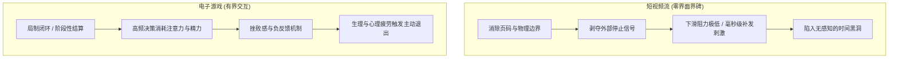
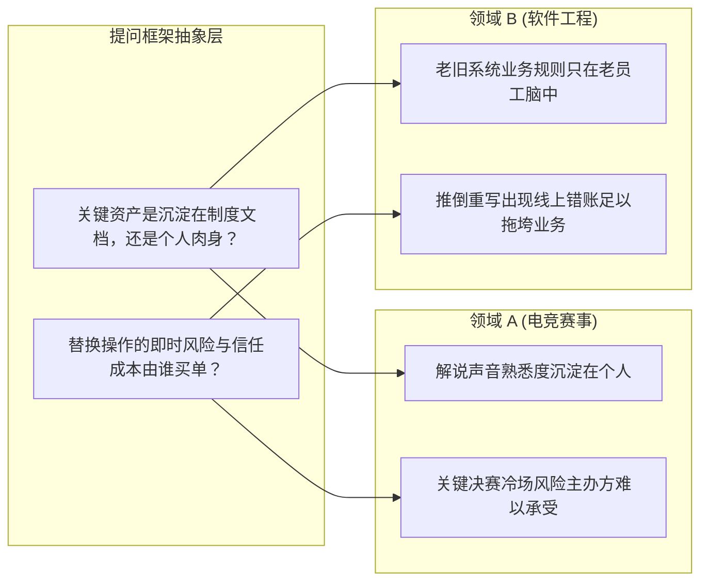
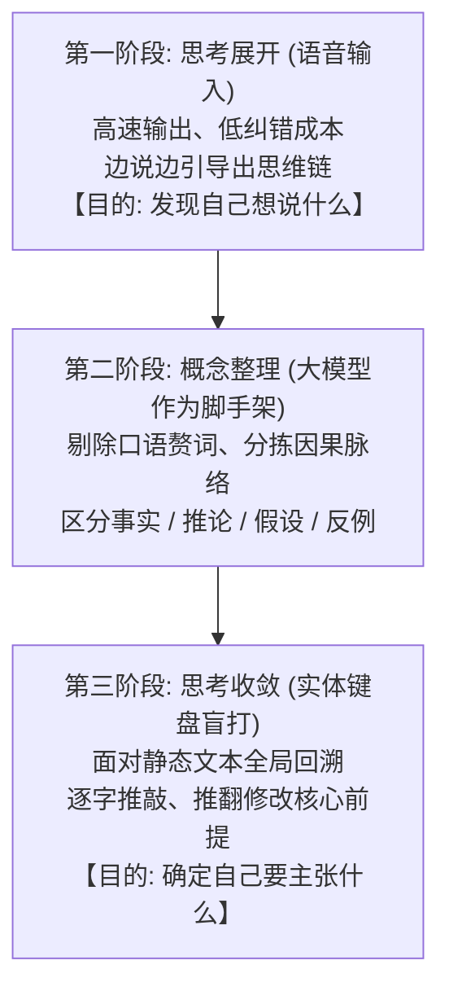

## 引言：注意力的机会成本与认知资产

在大模型普及的今天，关于学习与生产力的讨论，大多数仍停留在技术工具的参数与功能上。然而在现实生活中，人和人之间真正的思维分化，往往始于极其微小的信息消费习惯。

在节假日与亲戚朋友聚会时，很多人会感受到一种微妙的“错位感”：同龄人聚在一起，话题大多集中在抖音短视频的搞笑段子、热搜八卦或生活琐事；而另一部分人虽然生活在同一个时代，平时的信息流里却挤满了前沿技术的探索实验、开源项目架构与社会制度运转。

这种错位感并不是某种优越感，而是一个非常现实的账本核算：
**同样投入一小时的注意力，我们换回来的究竟是转瞬即逝的即时快感，还是能在未来反复复用、持续产生复利的认知资产？**

要回答这个问题，我们需要从注意力的生存环境谈起，一路推演到产业经验的跨界迁移，以及我们究竟该如何运用语音与打字来构建真正高效的人机思维回路。

---

## 第一章：媒介的内生停止机制——短视频为何停不下来，而游戏可以？

注意力的流向，首先受制于我们所使用的媒介形态。很多人责怪自己意志力薄弱、容易沉迷短视频，但如果仔细拆解界面交互与心理机制，就会发现这并不是意志力的问题，而是媒介的“停止机制”存在根本差异。

### 1.1 短视频对“外部界碑”的系统性抹平

在纸质书时代，一本书是有厚度的，一卷报纸是有边缘的。翻到最后一页时，触觉与视觉会同时给你一个明确的信号：“这里结束了。” 哪怕在早期的互联网论坛和博客时代，网页也有页码和滚动条底端，这些都是外界赋予的**“停止界碑”**。

然而，现代短视频平台在产品设计上的核心革新，就是彻底抹平了所有停止信号：
- 单条视频播完不会暂停，而是无限循环或自动下滚；
- 页面淡化了时间显示，完全取消了页码；
- 算法根据用户的停留毫秒数，动态分配下一段刺激。

在这样的环境里，“停下来”所需要的决策成本极高——你必须主动调动注意力去强行掐断正在播放的内容，而顺从地继续下滑却几乎不需要任何成本。用户并非不想停下，而是整个界面把停止机制彻底拿掉了。

### 1.2 游戏为何具备天然的刹车机制？

与短视频相比，电子游戏常被同样视作娱乐，但在实际体验中，玩家连续玩几小时后往往会主动关机或感到疲惫，很少陷入短视频那种彻底无感知的状态。

原因在于游戏系统内置了严谨的**“内生停止机制”**：
1. **明确的局制闭环**：无论是对战游戏的基地爆炸、还是通关一局的结算画面，游戏存在明确的“开局-博弈-结算”周期。结算界面的跳出，强迫玩家在心里做一次主动选择：“是否还要开下一把？”
2. **高强度的双向交互与精力消耗**：刷短视频是被动接收，而玩游戏需要眼脑手高度协同，计算资源、走位与技能冷却。这种高密度的注意力投入，会在一两个小时后带来明显的脑力疲劳；
3. **挫败感与负反馈阻尼**：游戏存在失败与惩罚。连续失误或输掉对局会带来真切的挫败感，这种心理阻力会迅速压制继续游玩的冲动，促使人关掉设备去休息。

**启示**：没有任何停顿界碑的环境容易让人陷入麻木，而具备边界与反馈阻力的系统，反而能够让人保持自主性。这同样适用于知识生产——如果我们任由大模型把思考变成完全被动的顺滑应答，人就失去了深度推演的能力；我们必须在思考流程中，像游戏局制一样主动设立明确的停顿点与推演界碑。

---

## 第二章：为什么我们要了解“暂时用不到的世界”？

在注意力的分配上，还有一个常见的误区：很多人认为，了解与自己工作或现实生活无关的领域是浪费时间。

比如，一个人可能不怎么玩 Dota 2，但他依然会饶有兴致地去研究：为什么这个曾经风靡一时的游戏会陷入新玩家枯竭？为什么顶级战队会在某个时期突然解散？为什么职业赛事的解说席常年被老面孔占据？

表面上看，这些游戏生态的八卦和产业变迁，既不能直接提高生存技能，也不能变成明天的收入。但这背后引出一个至关重要的命题：**人为什么要持续了解自己暂时用不到的世界？**

答案在于两点：

1. **核算注意力的机会成本**：
   每天面对海量碎片信息，如果仅仅为了打发时间去刷短视频，换回来的只是一堆用完即丢的杂质；而如果将同样的注意力投向一个完整事件的因果链条，即便该领域跟自己当前职业无关，换回来的也是对复杂系统运作方式的真实感知。
2. **训练提炼“分析维度”的能力**：
   具体的新闻和事件细节过几个月就会被遗忘，但在这个过程中梳理出的因果逻辑——例如“外部缺乏新鲜血液时，内部组织如何走向存量博弈”、“高风险决策下如何权衡沉没成本”——会沉淀为长期的认知工具。

---

## 第三章：经验的间接迁移与提问框架的复利

这正是人类认知最强大的地方：**我们不需要亲自经历每一个行业，就能提前建立理解它的结构。**

### 3.1 案例：从电竞解说生态到技术团队架构

以一个具体的分析为例：

观察电竞赛事（如 Dota 2 或英雄联盟）时，常常会发现一个看似不合理的现象：某些资深元老解说的游戏理解明显落后于新版本，团战也经常看错技能，但官方在关键决赛中依然把他们排在核心解说台，而游戏分段更高、业务更熟练的新生代解说却很难上位。

如果只看专业技术，容易简单归结为“不讲专业、人情世故”。但如果从组织运作的维度去提炼，可以得出两道通用的**“提问探针”**：
1. **核心资产沉淀在谁身上？**
   解说这项业务的真正价值不仅是客观播报，还包含观众长达数年形成的听觉熟悉感、陪伴感与情感寄托。这种资产沉淀在具体的个人身上，无法被简单制度化。
2. **替换一个人的即时风险由谁买单？**
   让一个技术更强的新人上场，观众需要漫长的适应期。一旦关键场次冷场或出现节奏事故，主办方承担的是即时、不可逆的品牌声誉损失。替换的风险是瞬间爆发的，而收益却是微弱且漫长的。

现在，把这一套提问框架原封不动地迁移到一个完全不同的领域——**企业老旧系统维护**：
为什么一个核心系统的代码写得混乱不堪、到处是临时补丁，维护它的老架构师甚至不熟悉新技术，但主管却严禁任何人重构这套代码，并对老员工格外依赖？

套用上面的提问框架，答案一目了然：
- 系统的业务规则经过多年修补，根本没有写在需求文档里，全在那位老员工的脑子里（资产沉淀在个人）；
- 找新人用最新框架重构的理论很美，但生产环境上一旦出现一笔难以复现的账目错误，业务停摆的风险是公司无法承受的（替换风险极不对称）。

两个行业在业务形态上毫无关联，但驱动其组织依赖的底层逻辑完全同构。

**这就是经验的间接迁移：我们迁移的不是现成的答案，而是“分析问题的框架”。**

### 3.2 问题意识的复利

从“不知道答案”到“知道应该问什么”，是一次巨大的思维跃迁。

很多时候，向他人、向书籍或向大模型学习，最重要的产出并不是某个具体问题的现成结论。真正产生长期复利的是：**学到的知识帮我提出了一个之前未曾意识到存在的问题。**

这个问题哪怕在当下没有被彻底解答，它也会作为一种提问意识扎根在脑海深处。未来当你在工作中遇到完全不同的陌生领域、看到某种难以理解的管理决策或技术选型时，脑中的提问雷达会自动亮起：
- *“这个结构里的关键信息成本落在谁头上？”*
- *“这里的替换阻力究竟来自技术难度，还是来自各方的利益不对称？”*

这种下意识的提问习惯，就是认知复利的本质。

---

## 第四章：工具的真实分工——语音展开与键盘收敛

在理顺了思维的流动与提问的价值后，我们最终需要回到具体的执行层面：在日常人机协同中，我们究竟该如何高效表达自己的想法？

很多人在面对复杂问题时，常常纠结于“到底是用语音输入更顺畅，还是打字更高效”。在与大模型深度对话的实践中，这两种方式展现出了非常清晰、不可相互替代的力学分工。

### 4.1 语音转文字的核心优势：高速展开与思维链涌现

很多人发现，使用语音转文字跟大模型交流，往往比单纯打字更容易涌现出新想法：
1. **输入吞吐量高，跟得上思维流速**：
   说话的速度通常在每分钟 200 到 300 字，而打字哪怕再熟练也受制于手指物理击键。当脑海里同时浮现出两三个关联想法时，语音能够快速将它们吐出，避免因手指敲击太慢而导致后方的念头在短时记忆中被遗忘；
2. **纠错成本极低，不破坏心流**：
   在口语表达中，遇到词不达意时不需要按退格键，自然接着说一句“不对，我的意思是……”即可继续往前推。说话的过程就像是大模型的思维链（Chain of Thought），声音和语言本身就在引导自己一步步往下探索；
3. **把探索阶段与排版洁癖解耦**：
   很多人打字时有一种“每句话必须写完美”的潜意识阻力。而语音降低了表达门槛，适合在想法尚未成型时进行发散与探索。

### 4.2 语音输入的死穴：为什么复杂思考离不开键盘斟酌？

但语音绝不是万能的。当推演进入深水区时，语音的短板就会立刻暴露：
1. **长文本上下文混乱，难以回头梳理**：
   如果一个复杂问题包含反复的假设、推翻与反驳，用语音连续说上十分钟，转录出来的文本会极度冗长臃肿。说话是纯线性的时间流，你很难一眼看清“究竟哪条推论被推翻了、哪条仍然成立”；
2. **声音对内部安静思考的干扰**：
   说话需要调动发音与听觉，自己的说话声在某种程度上会干扰脑内正在进行的深层逻辑比对；
3. **键盘的不可替代性在于“把思维外部化为视觉操作台”**：
   熟练盲打依靠肌肉记忆，击键动作本身不怎么占用思考精力。更关键的是，**屏幕上的文字是静态常驻的**。眼睛可以在 0.1 秒内扫回三行前的句子，检查核心逻辑是否自洽，并逐字斟酌最高的信息密度。在复杂推演中，往往不是要“接着说”，而是要“回到前面把最初的前提删掉重写”——这种高精度的修改，只有键盘和屏幕能够提供。

### 4.3 务实的分工闭环

因此，不必争论语音和打字哪个更好，它们分别对应着思考的两个阶段：

- **发散阶段用语音**：在想法萌芽期，用语音输入高频、低阻力地倾倒思考原矿，重点在于**“发现自己想说什么”**；
- **整理阶段用大模型**：把语音转录的草稿丢给大模型，让它帮忙理清条理、剥离重复废话、分清哪些是观察到的事实、哪些是逻辑推论、哪些是未验证的假设；
- **收敛阶段用键盘**：坐回屏幕前，关闭语音，调动全部注意力逐字推敲、推翻不成立的前提、严密收束结论，重点在于**“确定自己最终要主张什么”**。

---

## 结语：从“不知道答案”到“知道应该问什么”

思考的质量，从来不取决于我们掌握了多少花哨的工具，而取决于我们对自己心智节律的掌控：

- 面对短视频的无边界，我们主动建立回合制的**停止机制**；
- 面对复杂陌生的行业，我们提炼具有通用解释力的**提问框架**；
- 面对人机协同的实践，我们用**语音放开思路的广度**，用**键盘守住逻辑的深度**。

在信息过载与算法顺滑推流的时代，保持清醒的最佳方式，就是看清注意力的机会成本，在生活与工作中持续积累那些具有长久复利的问题意识。
