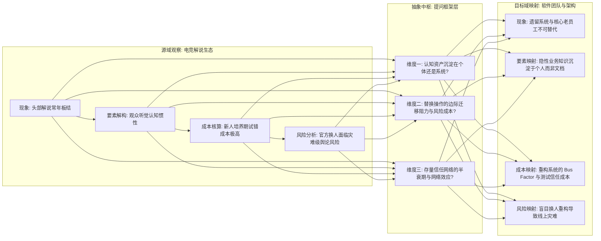
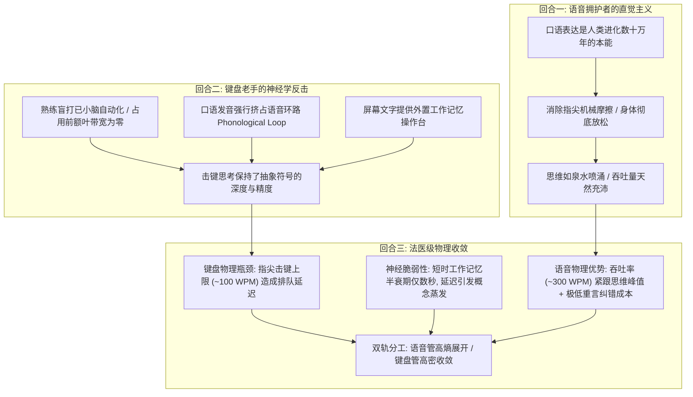

## 引言：认知的“吞吐率危机”与外脑迷思

在大语言模型与具身智能席卷全球的今天，技术圈对于生产力的讨论，几乎无一例外地聚焦在外部工具的参数竞赛上：
百万级别的上下文窗口（Context Window）、近乎毫秒级的首字生成延迟（Time-to-First-Token）、复杂的代理编排流水线（Agent Swarm），以及五花八门的提示词工程（Prompt Engineering）。

然而，当这些外在技术设施被推进到物理极致之后，一个极度尴尬而又冷酷的工程现实浮出了水面：
**在整套人机协同回路中，最狭窄、最脆弱、最容易发生拥塞与丢包的瓶颈节点，从来不是机房里的英伟达 GPU，而是坐在屏幕前面的人类前额叶皮层，以及人类将内部意图向外部物理世界投射时的“认知吞吐率（Cognitive Throughput）”。**

一个人类在灵感爆发或深度推演的黄金瞬间，大脑皮层中神经元冲动所激荡出的意象、因果链与空间拓扑关系，其瞬时信息密度往往以百兆计；
然而，当这个人类试图把脑内的思维原矿转化为机器能够理解并进一步处理的结构化符号时，他必须经历重重降维与能量损耗：
- 意象必须被坍缩为线性的自然语言语法；
- 语言冲动必须驱动喉部的声带震动，或者沿着脊髓神经传导至十根手指的指尖肌腱；
- 物理介质（麦克风、机械轴体、操作系统输入法缓冲区）会产生延迟与击键误差；
- 更致命的是，人脑自身脆弱的工作记忆（Working Memory）容量仅仅能够维持几秒钟的高活态，稍有风吹草动或排队延迟，尚未落盘的关联概念便会永久蒸发在神经突触的静默之中。

如果人类无法解决自身思维与外部介质之间的**阻尼匹配（Impedance Matching）**，那么接入再强大的大模型，也不过是用一根老旧的家用塑料吸管去对接三峡大坝的泄洪闸门。

本文试图摒弃一切廉价的生产力鸡汤与工具浮夸宣称，从媒介生态学、认知神经学、跨界提问模型与人机协同哲学的多轮硬核对抗出发，对现代思考者的“外脑构建”展开一次法医级的深度解剖。

---

## 第一章：媒介的内生停止机制（Endogenous Stopping Mechanism）

要探讨思维的吞吐与工具的控制，我们首先必须理解人类注意力的生存环境。现代人之所以普遍陷入心智涣散与深度思考能力的退化，其根源往往不在于意志力的薄弱，而在于我们所栖居的媒介环境发生了一场隐秘的“阻尼外科手术”。


### 1.1 短视频为何令人停不下来？无限推荐流抹除了自然边界

在印刷时代，一本书是有厚度的，一卷报纸是有物理边缘的。当你翻到最后一页，指尖触碰到粗糙的封底时，物理世界通过极其确定的触觉向你的神经系统传递了一个强烈的信号：**“此处已结束，你可以停下来了。”**
哪怕在早期的互联网时代，论坛有“页码”，博客有“发布时间”，网页的滚动条触底时会遇到坚硬的边界。这种物理或界面上的边界，在认知心理学中被称为**“外生界碑（Exogenous Boundaries）”**。

然而，以短视频平台（TikTok、抖音、B站竖屏流）为代表的现代注意力收割机器，在架构设计上所做的最核心革新，就是**将所有的界面界碑彻底抹平**。
- 单条视频播放完毕后不会暂停，而是通过无限循环或毫秒级的自动顺滑下滚，无缝载入下一条；
- 界面取消了页码，淡化了系统时间显示，甚至将所有需要主动决策的按钮收敛到最边缘；
- 算法引擎根据你数秒内的瞳孔停留与滑动加速度，在后台动态调配下一剂多巴胺针剂。

在这个封闭的算法回路中，**“内生停止机制（Endogenous Stopping Mechanism）”被系统性地物理切除了**。用户并非不想停下，而是停下所需要的决策阻尼（必须主动调动前额叶皮层去对抗顺滑下落的多巴胺惯性），被设计得远远高于顺从滑动的阻尼。人在这种介质中，心智被降维为纯粹的刺激-反应单细胞生物。

### 1.2 游戏为何具备物理刹车？

与短视频形成鲜明对照的，是常常被主流舆论同样扣上“网瘾”帽子的电子游戏。只要进行过深度观察，任何人都会发现一个反直觉的现象：**哪怕是沉迷度极高的大型竞技游戏或硬核独立游戏，玩家在连续游玩数小时后，通常都会主动退出或产生强烈的脱力感，而很少像刷短视频那样陷入彻底无知觉的时间黑洞。**

为什么游戏天然具备“内生停止机制”？

1. **局制结构的物理闭环（Session-Based Closure）**：
   无论是一局《英雄联盟》、《CS:GO》，还是一场《文明》的回合推进，游戏系统都存在明确的“开局-博弈-结算”周期。当基地水晶爆炸，结算画面跳出的一瞬间，原本高度绷紧的注意力网络会瞬间遭遇一次断崖式的释放。这种结算画面就是强烈的认知界碑，它迫使玩家在前额叶层面进行一次主动选择：“是否还要开启下一局？”
2. **认知负荷与神经葡萄糖的高强度消耗**：
   刷短视频是纯粹的低负荷被动接收，而玩游戏是极高密度的双向交互。玩家每秒钟都需要处理小地图视野、技能冷却、弹道预判与资源计算，并指挥肌肉群完成高精度的机械操作。这种高频决策会在一两个小时内剧烈消耗大脑的糖原储备，带来可感知的生理疲劳与眼球酸涩。
3. **挫败感、负反馈与匹配冷却**：
   游戏世界遵循严谨的物理与规则逻辑。走位失误会被击杀，决策失误会导致对局失败，排位分数的掉落会带来真切的痛感。这种**“负反馈阻尼”**构成了心理层面的天然刹车片。一个人可以在连续获胜时兴奋，但当他遭遇三连败时，挫败感会迅速压倒多巴胺，促使他摔下手柄关机休息。

### 1.3 认知生态学洞察：健康的思维必须依赖“主动阻尼”

将这一对比置于知识生产的语境下，我们便能提炼出一条至关重要的认知法则：
**零阻尼的环境孕育寄生与瘫痪，唯有具备适当阻尼与边界的系统，才能维系主体的心智主权。**

如果我们希望在人机协同中实现真正的深度思考，我们就绝不能任由大模型将我们退化为像刷短视频一样的“被动补全消费者”。我们必须主动在思考流程中重新植入类似游戏回合制一样的“内生停止机制”与“阶段性结案界碑”——明确划分思维的发散周期、推演周期与终审关卡。

---

## 第二章：经验的间接迁移与“提问框架”的复利

在解决了注意力环境的阻尼问题后，我们面临的下一个核心议题是：**人类如何跨越个体生命的狭隘尺度，快速看透一个陌生领域的底层运作逻辑？**

很多人陷入一种经验主义的教条，认为如果一个人没有在某个行业摸爬滚打过五年十年，他就绝不可能提出有洞察力的见解。然而，在真实的智力竞争中，我们屡屡看到顶级思考者在跨界涉足全新领域时，往往能在极短的时间内直击命门。

他们所依赖的核心武器，从来不是生搬硬套某个具体结论，而是**“跨领域提问框架（Questioning Framework）的敏捷迁移”**。



### 2.1 案例推演：从电竞解说生态到软件团队架构

让我们来看一个具体的推演案例：

当观察电竞赛事（如英雄联盟 LPL 或 Dota2 国际邀请赛）的解说生态时，很多人会产生困惑：为什么屏幕上的几位元老级解说，其游戏理解早已严重落后于版本更新，团战时屡屡出现技能看错、口齿结巴的低级失误，但官方却依然在关键决赛中将他们牢牢放在解说席核心，而那些游戏分段极高、业务能力极强的新生代解说却常年只能坐冷板凳？

如果仅仅从表面业务能力去分析，你会得出“官方任人唯亲”、“电竞圈不讲专业”的肤浅结论。但如果运用结构主义的视角进行深层解构，一个严密的**“提问框架”**就会浮出水面：
1. **资产沉淀在谁身上？**
   解说这项业务的真正交付物，并不是“客观无误的数据播报”，而是“陪伴感与情绪容器”。老解说的声音特质、口头禅以及他们所见证的十年历史，已经内化为数百万观众潜意识里的听觉安全感。这种资产是**沉淀在具体的个人肉身之上，而非解说台的制度文档里**。
2. **替换的边际代价与试错成本由谁承担？**
   让一个新人上去解说，即便他技术理解分毫无差，但观众需要付出巨大的认知重构成本去适应他的语调、节奏与幽默感。一旦决赛出现哪怕一次尴尬冷场，几百万受众的反弹将直接转化为赞助商对赛事品牌价值的扣减。**替换成本是瞬间爆发且不可逆的，而收益却是微弱且长期的。**

现在，让我们把这套提问框架**完好无损地抽离出来，跨界投射到一个风马牛不相及的领域——企业级软件工程团队与遗留系统维护：**

当你接管一个拥有十年历史的金融后台系统时，你同样会遇到一群看似“不可理喻”的现象：为什么某个核心模块的代码写得像一团意大利面条，各种硬编码与全局变量纵横交错，维护它的老架构师甚至不怎么懂现代微服务框架，但 CTO 却严厉禁止任何新员工动那部分代码，并对那位老架构师百般容忍？

运用刚刚从电竞解说生态中提炼出的提问框架，答案在三秒钟之内便会豁然开朗：
- **系统的隐性知识沉淀在何处？** 那个老系统经过十几年无数边缘业务的修修补补，真实的业务规则根本没有写在需求文档里，而是活生生地印在那位老员工的脑细胞回廊中。这套软件的真正资产不是那几万行代码，而是老员工对“哪一行代码不能动”的直觉戒律。
- **重构与替换的灾难性风险由谁买单？** 招募几个精通最新技术体系的年轻工程师把系统推倒重写，从理论上看优雅无比；但在实际落地中，遗留系统背后的数万条隐性规则被破坏，会导致核心账目在并发交易中出现难以复现的微小错账。这种系统性信任崩盘的风险，足以让公司瞬间破产。

你看，电竞赛事与金融软件代码，两者在物理形态上风马牛不相及；但驱动其人事板结与系统稳定性的底层力学结构——**“个体隐性资产沉淀”、“信任网络迁移阻力”与“替换风险的不对称性”**——在数学拓扑上是完全同构的。

### 2.2 问题意识的复利与机会成本

这就是所谓“思维吞吐量”的第二层含义：
**真正的思考者并不试图把自己的大脑塞满具体的行业常识，他们专注于打磨一组高阶的“结构性提问探针”。**

当你投入注意力去消费一段信息时，你面临着巨大的机会成本抉择：
- 你是换回了一堆只能在今晚闲聊时充当谈资、三个月后就会随着热度消散的“死事实”？
- 还是换回了一个可以永久嵌入你的思维底座、能够在未来跨越五六个完全不同行业反复复用并产生洞察复利的“提问结构”？

学习的最大收益，从来不是记住现成的标准答案，而是在神经回路中装配一台**“知道这个世界在底层有哪些根本问题值得被提出”的本能雷达**。有了这台雷达，无论面对的是大模型编排、地缘政治博弈还是企业战略转型，你都能以极高的吞吐率瞬间切入核心。

---

## 第三章：终极辩难——语音输入 vs 熟练盲打的认知带宽博弈

现在，我们终于推进到了整场推演的最深处、也是最具火药味的核心战场：**在微观操作层面，人类究竟应当通过何种物理交互通道，将脑内的意图高效外部化？**

在大模型普及的今天，随着 Whisper 等本地离线语音识别（ASR）引擎的成熟，越来越多的知识工作者开始狂热推崇“语音输入”，宣称人类应当彻底扔掉键盘，进入纯粹口语化的思考时代。

然而，在这个问题上，存在着一场极其深刻、甚至关涉认知神经生理学的硬核辩难。我们必须拒绝一切片面的经验主义结论，将正反两方的全部火力彻底释放。



### 3.1 第一回合：语音拥护者的直觉主义胜利

语音输入的坚定支持者通常拥有极具说服力的论据：
1. **进化生物学的顺水推舟**：
   人类的大脑皮层与发音器官，经历了数十万年漫长的自然选择演化，口语是人类进行语义表意最本能、神经突触连接最丰富的生理通道。相反，用十根手指在塑料键帽上做高频敲击，不过是近代打字机发明后百余年的人工异化物。
2. **零机械摩擦的流动状态（Flow State）**：
   语音输入让身体从逼仄的书桌前彻底解放出来。你可以靠在工学椅上、甚至在房间里踱步，闭上双眸，让脑内的念头伴随着呼吸自然流淌。没有手腕劳损，没有腰椎压迫，思维的闸门一旦拉开，便如大江奔流，具有天然的丰沛度。

### 3.2 第二回合：键盘老手的冷酷反击（基于巴德利工作记忆模型）

然而，一个打字速度达到 100~140 WPM（每分钟击键 500~700 次）的高阶思考者，会站在认知神经学的角度，给予语音论者致命的当头棒喝：

> “你们所谓的‘语音自然流淌’，不过是一种未经深度推演的幻觉！”

键盘老手的抗辩建立在三根极其坚固的生理学支柱上：

#### 支柱一：熟练盲打的“零心智开销”（Zero Cognitive Overhead）
对于初学者而言，打字确实需要眼睛看键盘、手指寻找字母，占据大量的注意力。但对于真正熟练的盲打者来说，**文字的转译已经被彻底下放给小脑脊髓神经通路构成的条件反射系统**。
当脑海中浮现出“分布式共识”这个词时，手指已经在微秒级内自动敲击出了对应的字母序列，前额叶皮层对击键动作的感知开销**绝对为零**。打字就像呼吸一样，完全不争夺宝贵的思考带宽。

#### 支柱二：语音环路（Phonological Loop）的致命占用
在阿兰·巴德利（Alan Baddeley）经典的**工作记忆三元模型**中，人类的短时工作记忆包含一个至关重要的子系统——**语音环路（Phonological Loop）**。
语音环路负责在脑海内部对语言信息进行“默读复述”，这是人类进行高阶抽象逻辑推理、因果判断与数学演算的必经通道。
当你选择“把话说出来”时，灾难降临了：
- 你的大脑必须主动激活发音控制运动皮层，协调声带与口腔气流；
- 你自己嘴里发出的物理声波，会通过耳蜗神经重新灌入大脑听觉皮层；
- 这种自发的听觉回馈，会**霸道地把语音环路全部挤满**！
其结果就是：在说话的同时，你极难在脑海中同步进行深度的空间想象、多分支逻辑树排查或微妙的语境称重。你的思考被你自己的说话声彻底打碎了。这正是为什么许多人在滔滔不绝录了一小时语音后，回看文字稿往往发现里面充斥着大量的同义反复、车轱辘话与情绪宣泄，而罕有严丝合缝的因果闭环。

#### 支柱三：屏幕文字作为“外置工作记忆操作台”（Externalized Buffer）
打字的本质，是**将抽象概念在毫秒级内投影到二维物理屏幕上，成为一个可供视觉系统反复审阅的静态物理实体**。
人的视觉感知拥有极宽的空间并行处理能力。打在屏幕上的第一行文字，在写到第三行时依然静静躺在那里。你的目光可以像雷达扫描一样，在 0.1 秒内扫回两秒前的论点，比对当前句子的主谓搭配，识别潜在的逻辑漏洞，并顺手用退格键进行微调。
而语音是纯粹的**“时间一维流”**——它像水流一样消逝在时间轴里。在说话时，你很难精准知道自己在七秒前用的定语是否与句尾的谓语冲突，你被迫只能跟着时间线往前硬抗，最终不可避免地导致思考品质的降级。

### 3.3 第三回合：法医级终极收敛——速度差、排队延迟与脆弱神经元

上述两个回合的激烈交锋，几乎涵盖了传统生产力讨论的全部内容。然而，如果推演只停在这里，键盘论者似乎大获全胜。

但在这里，我们必须引入第三层、也是最具决定性的物理量变量：**“排队延迟（Queueing Latency）与短时工作记忆的物理半衰期”**。

键盘论者忽略了一个残酷的生物力学极限：
哪怕一个人的盲打速度高达人类巅峰的 120 WPM，折合到中文汉字的输出速率，极限也不过每分钟 100 到 150 字；
然而，人类在深度灵感涌现与架构推演时，脑内概念表象的并行展开速率，折算为信息熵，往往相当于 **每分钟 300 到 500 字的高速信息流**！

这里出现了一个致命的**速率剪刀差**：

$$
\Delta V = V_{\text{thought}} - V_{\text{typing}} \approx 300\text{ WPM} - 100\text{ WPM} = 200\text{ WPM}
$$

当这个每分钟 200 字的速率差出现时，大脑的工作记忆缓冲区会发生什么？
**概念必须排队。**

你在脑中同时感知到了一个系统架构的四个致命漏洞，但你的十根手指在物理上只能依次敲出第一个漏洞的描述。在指尖敲完第一段文字所耗费的 30 秒内，排在第三和第四位的两个复杂概念，在人类前额叶极其脆弱的生物电信号中，由于缺乏持续的神经元激活复述，**其物理半衰期瞬间到达**——你突然忘掉了刚刚那个极其绝妙的灵感细节究竟是什么！

```text
思维涌现速度 (High Entropy)   ===================================>  ~350 WPM
                                       │
                                       ▼ (遇到键盘物理吞吐瓶颈)
键盘输入速度 (Mechanical Bottleneck)  =========>  ~100 WPM
                                       │
                                       ▼ (排队延迟引发脑内突触衰减)
【后果】: 排队后方的概念在工作记忆（半衰期数秒）中彻底蒸发！
```

更为致命的是，键盘盲打虽然心智开销低，但它存在极高的**“微观纠错心理阻尼”**：
当你打错一个拼音字母，或者输入法候选词发生漂移时，哪怕你只花了半秒钟按下 Backspace 键重新选词，这半秒钟的微小顿挫，也会瞬间给高速狂奔的思维列车施加一次刹车。几次错别字微调之后，原本那种气吞万里的灵感心流（Flow）就会被切割得支离破碎。

而现代语音输入（基于本地离线高精度大模型 ASR）在此时展现出了不可替代的物理优势：
1. **吞吐率与思维速率的峰值拟合**：一个语速适中的成年人，正常说话的速率在 250~350 WPM 之间，这几乎与思维展开时的最高吞吐率做到了完美的**阻尼匹配**。
2. **极低的重言纠错成本（Zero-Friction Re-utterance）**：口语表达哪怕出现口误或词不达意，你根本不需要去按退格键，你只需要自然地接着说一句“不对，更准确地说是……”或者“换句话说……”，你的发散心流绝不会因为一个错别字而中断。

### 3.4 裁决：认知矩阵与双轨共生

经过三轮惊心动魄的法医级推演，我们可以得出对这一世纪辩难的最终判词：
**语音与盲打，根本不是非此即彼的替代关系，而是对应着思维不同演进阶段的“解耦工具链”。**

| 比较维度 | 语音输入 (Voice Typing / ASR) | 熟练盲打 (Touch-typing / Keyboard) |
| :--- | :--- | :--- |
| **物理吞吐速率** | **极高**（250 ~ 350 WPM，完美贴合思维峰值） | **受限**（80 ~ 120 WPM，受肌肉运动学约束） |
| **认知阶段适配** | **低阻尼、高熵发散与灵感捕获**（Divergence） | **高精度、高密度审查与逻辑收敛**（Convergence） |
| **工作记忆占用** | 强行霸占语音环路（不利于微观精密推演） | **小脑自动化接管**（前额叶思考带宽绝对为零） |
| **外部化操作台** | 弱（时间一维流，不易空间跳跃比对） | **极强**（二维视觉常驻，秒级全局回溯重构） |
| **顿挫与阻尼感** | **极低**（错词直接重念，心流不中断） | **存在微观机械摩擦**（错别字与排版产生中断） |

---

## 第四章：人机外脑分工与思维双循环架构

基于上述对媒介生态、提问迁移与输入带宽的全部推演，我们终于能够搭建出一套当代高阶思考者应当掌握的终极武器系统：**人机双循环思维工程架构（Dual-Loop Cognitive Architecture）**。

在这一系统中，人脑、输入介质与大模型，各自坚守其最擅长的力学温层，杜绝一切错位与消耗。

```mermaid
flowchart TD
    subgraph 外循环: 低阻尼发散展开 (Divergence Phase)
        D1[脑内意象爆发] --> D2[语音输入 / 本地高吞吐 ASR]
        D2 --> D3[自然口语喷涌 / 拒绝回退纠错]
        D3 --> D4["原始原矿稿 (Raw Ore: 高熵、多角度、含口误)"]
    end
    subgraph 中间层: 大模型外脑脚手架 (Scaffolding Phase)
        M1["原始原矿稿注入 LLM"] --> M2[四重法医级解耦协议]
        M2 --> M3A[提取客观观察事实]
        M2 --> M3B[理顺推论因果时序]
        M2 --> M3C[标定价值结论与主张]
        M2 --> M3D[暴露未证实的隐性假设]
        M3A & M3B & M3C & M3D --> M4["结构化骨架草案 (Scaffold Matrix)"]
    end
    subgraph 内循环: 高精度审查收敛 (Convergence Phase)
        C1["键盘盲打接管 / 视觉全景编辑器"] --> C2[微创手术式字句重构]
        C2 --> C3[对抗性辩难注入 / 补全逻辑反直觉防线]
        C3 --> C4[人类主权终审签字落盘 (Final Artifact)]
    end
    D4 --> M1
    M4 --> C1
```

### 4.1 外循环：低阻尼、高吞吐量的发散展开（Divergence via Voice）

外循环的核心任务是**“发现自己到底想说什么”**。

很多人在动笔之前，常常陷入一种完美主义的僵局：试图在脑海中把每一句话的句式、用词和段落排布都想得十全十美才开始敲键盘。这是一种极度低效的心智内耗。在思考的初期，大脑中的真实意图是模糊、重叠、甚至相互矛盾的。

在外循环阶段，我们应当彻底封印键盘，全权启用**高吞吐量的语音输入通道**：
- **场景**：离开书桌，手握录音笔或手机，在房间踱步，甚至在洗漱散步时；
- **心态**：完全放弃对语法、修辞和错别字的道德洁癖。允许自己说口头禅，允许自己推翻上一句话，允许自己就同一个问题从三个不同的刁钻角度反复试探；
- **产物**：十分钟内输出一段两千字到三千字的高熵“原矿草稿（Raw Ore）”。这篇草稿可能在别人眼里杂乱无章，但它以最快的速度、最低的神经阻尼，完整截获了你那一瞬间脑海中所有的概念火花。

### 4.2 中间层：大模型作为外脑脚手架（Scaffolding via LLM）

获得这篇充满口语赘词、逻辑跳跃但信息量巨大的原矿草稿后，绝对不要直接去人工手动逐字修改它（那会再次陷入微观排版内耗），更不要让大模型去“帮我写成一篇文章”（那会瞬间被大模型油腻平庸的套话所污染）。

此时，大模型的唯一正确用法，是充当一台**“结构法医解剖仪”**与**“外脑脚手架（Scaffolding）”**。

给大模型下达明确的四重解耦指令：
1. **剥离噪音**：剔除所有口头禅、重复句子与无效感叹；
2. **时序梳理**：按照因果逻辑，将散落在各处的论据归拢到对应的议题名下；
3. **四分法法医级标记**：明确将文本中的信息切分为：
   - 【客观观察到的物理事实】
   - 【由此推演出的逻辑推论】
   - 【最终形成的价值主张与结论】
   - 【原论证中暗含的、尚未被证实的隐性假设】
4. **对抗性红队测试（Red Teaming）**：针对文中得出的结论，替反方列出最锋利、最恶毒的两条反驳论据。

这一步在短短五秒钟之内完成。大模型并没有替你进行原创思考，但它把你脑内喷涌出的高熵混沌原矿，迅速分拣为了几块棱角分明、可以被理性双手抓取的标准建筑构件。

### 4.3 内循环：高精度、高密度的审查与收敛（Convergence via Touch-Typing）

拿到大模型整理出的结构化脚手架后，真正的思考与创造才正式拉开帷幕。

此时，**大模型必须退场，语音输入必须挂起，熟练盲打与实体键盘正式接管控制权！**

内循环的核心任务是**“确定自己到底要主张什么”**：
- **物理环境**：重新坐回书桌前，戴上降噪耳机，在双显示器或宽屏编辑器中平铺排布脚手架与终稿草案；
- **认知姿态**：调动前额叶皮层的最高专注力，充分利用屏幕视觉操作台的全局回溯能力；
- **动作执行**：
  - 用小脑自动化的指尖击键，对每一个核心论断进行字斟句酌的微创手术式雕琢；
  - 正面迎战大模型在中间层提出的对抗性反驳，将最严密的防线与反直觉逻辑写死在段落之间；
  - 斩断那些立不住脚的伪推论，注入具有个人独特体温与洞察力的修辞和文学意象；
  - **完成最终交付物的物理签字落盘**。

在这个双循环架构中，**语音负责广度与生机（生命力的喷涌），机器负责秩序与解耦（无情的分类整理），键盘负责深度与尊严（最终的主权确认）**。没有哪个环节被辜负，没有哪种生理带宽被浪费。

---

## 第五章：认知主权与外脑时代的思想法医

行文至此，我们可以从具体工具的辩难中抽身而出，对人机协同的本质进行一次形而上学的冷血审视。

今天的人类，正前所未有地被“高效”的幻觉所包围。大模型可以一秒钟替你生成万字报告，自动化工作流可以一键将会议录音提炼为精美纪要。然而，这种近乎神迹的便利，在暗中索取着一种极其可怕的代价：**心智滑膜炎（Cognitive Synovitis）**。

当所有的概念都在无阻尼的滑模态中顺滑滑过，当一个人再也不愿意在泥土般的困惑中挣扎半小时，当一个人把“提问、反思、辩驳、收敛”的全部痛苦都外包给云端的百亿参数矩阵时，他的前额叶肌肉正在以肉眼可见的速度萎缩。他自以为拥有了外脑，但实际上，他不过是大模型这一巨大算力寄生体在现实世界中的宿主与提线木偶。

**真正的外脑，从来不是思考的替代品，而是思考的放大器与反光镜。**

正如我们在前文所证明的：
- 我们分析短视频的无边界，是为了在生活中为自己筑起坚固的“内生停止阻尼”；
- 我们打磨跨界的提问框架，是为了在陌生的技术浪潮中守住洞悉底层力学的认知复利；
- 我们在语音与盲打之间展开残酷的神经学辩难，是为了在信息喷涌的瞬间紧紧抓住正在坍缩的直觉，并在静默的荧幕前捍卫逻辑与理性的绝对尊严；
- 我们构建人机双循环架构，不是为了偷懒，而是为了将自己有限的血肉之躯，推向更幽深、更辽阔的真理腹地。

工具有其力学，心智有其节律。

不要做无阻尼洪流中的漂流木，要做站在物理泥泞与思维星空之间的法医级播种者。唯有当你敢于在键盘的微小阻尼中敲下最后一个坚固句号的瞬间，你才能问心无愧地宣告：

**在这个算法遮蔽一切的深时间宇宙里，思考依然在这里发生，并且，它完全属于我。**
