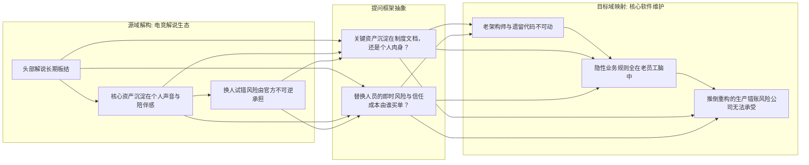
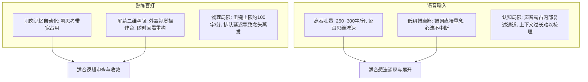

## 引言：认知的“吞吐率危机”与外脑迷思

在大语言模型与具身智能席卷全球的今天，技术圈对于生产力的讨论，几乎无一例外地聚焦在外部工具的参数竞赛上：
百万级别的上下文窗口（Context Window）、近乎毫秒级的首字生成延迟（Time-to-First-Token）、复杂的代理编排流水线（Agent Swarm），以及五花八门的提示词工程（Prompt Engineering）。

然而，当这些外在技术设施被推进到物理极致之后，一个极度尴尬而又冷酷的工程现实浮出了水面：
**在整套人机协同回路中，最狭窄、最脆弱、最容易发生拥塞与丢包的瓶颈节点，从来不是机房里的英伟达 GPU，而是坐在屏幕前面的人类前额叶皮层，以及人类将内部意图向外部物理世界投射时的“认知吞吐率（Cognitive Throughput）”。**

一个人类在灵感爆发或深度推演的黄金瞬间，大脑皮层中神经元冲动所激荡出的意象、因果链与空间拓扑关系，其瞬时信息密度往往以百兆计；
然而，当这个人类试图把脑内的思维原矿转化为机器能够理解并进一步处理的结构化符号时，他必须经历重重降维与能量损耗：
- 意象必须被坍缩为线性的自然语言语法；
- 语言冲动必须驱动喉部的声带震动，或者沿着脊髓神经传导至十根手指的指尖肌腱；
- 物理介质（麦克风、机械轴体、操作系统输入法缓冲区）会产生延迟与击键误差；
- 更致命的是，人脑自身脆弱的工作记忆（Working Memory）容量仅仅能够维持几秒钟的高活态，稍有风吹草动或排队延迟，尚未落盘的关联概念便会永久蒸发在神经突触的静默之中。

如果人类无法解决自身思维与外部介质之间的**阻尼匹配（Impedance Matching）**，那么接入再强大的大模型，也不过是用一根老旧的家用塑料吸管去对接三峡大坝的泄洪闸门。

本文试图摒弃一切廉价的生产力鸡汤与工具浮夸宣称，从媒介生态学、认知神经学、跨界提问模型与人机协同哲学的多轮硬核对抗出发，对现代思考者的“外脑构建”展开一次法医级的深度解剖。

---

## 第一章：媒介的内生停止机制（Endogenous Stopping Mechanism）

要探讨思维的吞吐与工具的控制，我们首先必须理解人类注意力的生存环境。现代人之所以普遍陷入心智涣散与深度思考能力的退化，其根源往往不在于意志力的薄弱，而在于我们所栖居的媒介环境发生了一场隐秘的“阻尼外科手术”。

### 1.1 短视频为何令人停不下来？无限推荐流抹除了自然边界

在印刷时代，一本书是有厚度的，一卷报纸是有物理边缘的。当你翻到最后一页，指尖触碰到粗糙的封底时，物理世界通过极其确定的触觉向你的神经系统传递了一个强烈的信号：**“此处已结束，你可以停下来了。”**
哪怕在早期的互联网时代，论坛有“页码”，博客有“发布时间”，网页的滚动条触底时会遇到坚硬的边界。这种物理或界面上的边界，在认知心理学中被称为**“外生界碑（Exogenous Boundaries）”**。

然而，以短视频平台（TikTok、抖音、B站竖屏流）为代表的现代注意力收割机器，在架构设计上所做的最核心革新，就是**将所有的界面界碑彻底抹平**。
- 单条视频播放完毕后不会暂停，而是通过无限循环或毫秒级的自动顺滑下滚，无缝载入下一条；
- 界面取消了页码，淡化了系统时间显示，甚至将所有需要主动决策的按钮收敛到最边缘；
- 算法引擎根据你数秒内的瞳孔停留与滑动加速度，在后台动态调配下一剂多巴胺针剂。

在这个封闭的算法回路中，**“内生停止机制（Endogenous Stopping Mechanism）”被系统性地物理切除了**。用户并非不想停下，而是停下所需要的决策阻尼（必须主动调动前额叶皮层去对抗顺滑下落的多巴胺惯性），被设计得远远高于顺从滑动的阻尼。人在这种介质中，心智被降维为纯粹的刺激-反应单细胞生物。

### 1.2 游戏为何具备物理刹车？

与短视频形成鲜明对照的，是常常被主流舆论同样扣上“网瘾”帽子的电子游戏。只要进行过深度观察，任何人都会发现一个反直觉的现象：**哪怕是沉迷度极高的大型竞技游戏或硬核独立游戏，玩家在连续游玩数小时后，通常都会主动退出或产生强烈的脱力感，而很少像刷短视频那样陷入彻底无知觉的时间黑洞。**

为什么游戏天然具备“内生停止机制”？

1. **局制结构的物理闭环（Session-Based Closure）**：
   无论是一局《英雄联盟》、《CS:GO》，还是一场《文明》的回合推进，游戏系统都存在明确的“开局-博弈-结算”周期。当基地水晶爆炸，结算画面跳出的一瞬间，原本高度绷紧的注意力网络会瞬间遭遇一次断崖式的释放。这种结算画面就是强烈的认知界碑，它迫使玩家在前额叶层面进行一次主动选择：“是否还要开启下一局？”
2. **认知负荷与神经葡萄糖的高强度消耗**：
   刷短视频是纯粹的低负荷被动接收，而玩游戏是极高密度的双向交互。玩家每秒钟都需要处理小地图视野、技能冷却、弹道预判与资源计算，并指挥肌肉群完成高精度的机械操作。这种高频决策会在一两个小时内剧烈消耗大脑的糖原储备，带来可感知的生理疲劳与眼球酸涩。
3. **挫败感、负反馈与匹配冷却**：
   游戏世界遵循严谨的物理与规则逻辑。走位失误会被击杀，决策失误会导致对局失败，排位分数的掉落会带来真切的痛感。这种**“负反馈阻尼”**构成了心理层面的天然刹车片。一个人可以在连续获胜时兴奋，但当他遭遇三连败时，挫败感会迅速压倒多巴胺，促使他摔下手柄关机休息。

### 1.3 认知生态学洞察：健康的思维必须依赖“主动阻尼”

将这一对比置于知识生产的语境下，我们便能提炼出一条至关重要的认知法则：
**零阻尼的环境孕育寄生与瘫痪，唯有具备适当阻尼与边界的系统，才能维系主体的心智主权。**

如果我们希望在人机协同中实现真正的深度思考，我们就绝不能任由大模型将我们退化为像刷短视频一样的“被动补全消费者”。我们必须主动在思考流程中重新植入类似游戏回合制一样的“内生停止机制”与“阶段性结案界碑”——明确划分思维的发散周期、推演周期与终审关卡。

---

## 第二章：经验的间接迁移与“提问框架”

在解决了注意力环境的阻尼之后，下一个核心问题是：**我们如何不必亲身经历每一个行业，就能迅速理解其底层运转规律？**

人类的学习高度依赖间接经验。很多人误以为不进入一个行业摸爬滚打几年就无法产生洞察，但真正决定理解深度的，从来不是死记硬背行业常识，而是**“分析维度的提问框架能否跨界迁移”**。

### 2.1 结构类比：电竞解说生态与企业遗留系统

以一个具体的跨界案例为例：

在观察电竞赛事（如 Dota 2 或英雄联盟）时，常有人困惑：为什么某些元老解说的游戏理解早已跟不上版本，团战也屡屡看错技能，但重大决赛依然由他们稳坐主舞台，而分段极高的新生代解说却常年坐冷板凳？

如果只看表面的操作技能，容易得出“圈子封闭、不讲专业”的结论。但只要抽象出分析维度，就会发现底层逻辑：
1. **资产沉淀在谁身上？** 解说的真正产品不是数据播报，而是观众熟悉的声线特质与情绪记忆。这种资产沉淀在具体的人身上，无法被文档化。
2. **替换的风险由谁承担？** 换一个技术更强的新人，观众需要漫长的适应期。一旦关键场次冷场，赛事方承担的是即时、不可逆的品牌舆论受损。

把这套“提问框架”原样套入完全不同的领域——**企业老旧系统维护**：
为什么核心模块代码混乱、各种硬编码，维护它的老员工也不懂最新框架，CTO 却严禁任何人碰那套系统，并对老员工百般依仗？
- **资产沉淀在哪？** 系统的业务规则根本没有写在需求文档里，全在那位老员工的脑子里；
- **替换风险谁买单？** 招新人推倒重写的理论方案很漂亮，但只要并发交易中出现一笔难以复现的错账，公司承担的业务停摆风险是致命的。

两个领域物理形态完全不同，但驱动其组织稳定性的底层机制是一致的：**隐性资产沉淀在个人、替换风险不对称、存量信任网络具备强粘性**。

这就是提问框架的价值：**它迁移的不是现成结论，而是分析问题的探针。** 面对陌生事物时，最大收益不是“知道答案”，而是“知道应该观察哪几个关键变量”。

---

## 第三章：语音输入 vs 熟练盲打的力学对抗

在微观操作层面，人类通过何种物理介质将脑内思维外部化，直接决定了思考的密度与连贯性。语音识别（ASR）的普及让很多人宣称键盘已死，但这两种输入方式在认知力学上存在不可替代的本质差异。

### 3.1 熟练盲打的核心价值与物理短板

1. **小脑自动化（零心智开销）**：
   对于形成肌肉记忆的盲打者，击键动作已退化为本能反射，前额叶思考带宽占用接近于零。
2. **屏幕作为外置工作记忆台**：
   打字把思维投射为屏幕上的静态文本。人类视觉系统具备空间并行扫描能力，目光在 0.1 秒内就能回看三行前的定语，比对前后主谓是否矛盾，或者直接删除整段推倒前提。这是纯线性的一维语音所无法提供的。
3. **盲打的致命物理短板（思维排队延迟）**：
   无论盲打多快，手指敲击的物理上限通常在每分钟 80～120 字；但人在思考爆发时，脑内概念的展开速度折合文本可达每分钟 300 字以上。
   **当输入速度跟不上思维速度时，想法必须排队。** 而人类的短时工作记忆极为脆弱，排在后方的几个关联推论，在等待手指敲完上一句话的几十秒里，极容易彻底遗忘。同时，打错拼音选错词时的微观顿挫，会反复给思维列车施加微小刹车。

### 3.2 语音输入的核心优势与认知死穴

1. **高吞吐量紧贴思维峰值**：
   正常口语语速在每分钟 250～300 字，能够极好地追赶思考的流速，最大程度减少“思维等待手指”的滞纳遗忘。
2. **极低的纠错阻尼**：
   口语出现口误或词不达意时，不需要按退格键，直接说一句“不对，更准确地讲是……”即可继续往前推。心流不会被错字打断。
3. **语音输入的致命死穴**：
   - **声音干扰内部思维**：说话发声会霸占大脑的“语音环路”（负责内部默读复述的通道），不利于进行多层嵌套的严密数学或逻辑演算；
   - **长文本上下文混乱**：语音如果用来做复杂的步步推演，前后反复推翻修正，会导致整篇转录稿冗长臃肿、泥沙俱下，事后光是理清“哪句结论被推翻、哪句依然成立”就需要耗费巨大精力。

---

## 第四章：有效分工——思维双循环与大模型脚手架

既然两种介质优缺点分明，最有效的解法从来不是单选，而是**建立明确的认知分工**：

### 4.1 发散阶段：用语音“发现自己想说什么”
在思考初期，脑中概念往往是模糊、重叠、不成型的。此时强行坐直敲键盘，容易陷入“每句话怎么开头”的微观辞藻内耗。
- **操作**：使用语音输入，完全放弃语法和错字洁癖；
- **目标**：在五到十分钟内连续倾倒出一千到两千字的高熵原矿，把脑内闪现的所有角度、反例和直觉一次性捕获下来。

### 4.2 整理阶段：用大模型充当“解耦脚手架”
不要让大模型去代写文章，那只会产出油腻平庸的套话。大模型唯一高效的用法是充当**结构分拣器**：
- 把语音转录的原矿输入大模型，要求它：
  1. 剔除口头禅与重复废话；
  2. 理清前后因果时序；
  3. **四分法标记**：分清哪些是【观察到的事实】、哪些是【逻辑推论】、哪些是【个人主张】、哪些是【未证实的假设】；
  4. 给出两条反向质疑，充当红队陪练。

### 4.3 收敛阶段：用键盘“确定自己要主张什么”
拿到结构化骨架后，语音和大模型退场，人回到屏幕前用键盘接管：
- **操作**：面对静态文本，调动视觉全局扫描，正面迎战反驳；
- **动作**：逐段审查逻辑自洽性，删掉立不住的推论，修改核心前提，用键盘打磨出最高信息密度的定稿。

---

## 结语：在低阻尼时代重塑思考

工具永远服从于思考的节律。

- 面对短视频的无限流，我们主动建立回合制的**内生停止机制**；
- 面对庞杂陌生的行业，我们提炼能够跨界复用的**提问框架**；
- 面对思维与物理介质的摩擦，我们用**语音展开广度**，用**键盘收敛深度**。

在算法试图把一切都变得顺滑无阻的时代，真正的思考能力，恰恰建立在知道何时放开闸门让灵感奔流、又在何时踩下物理刹车字斟句酌的控制力之中。
