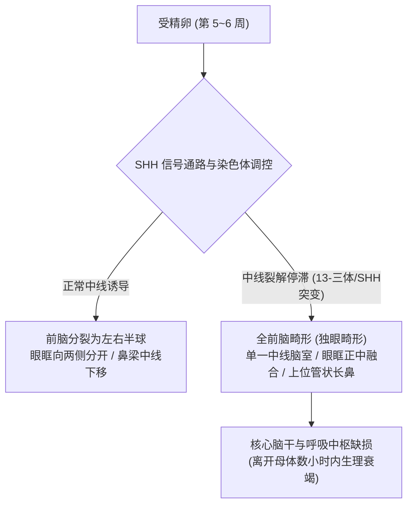
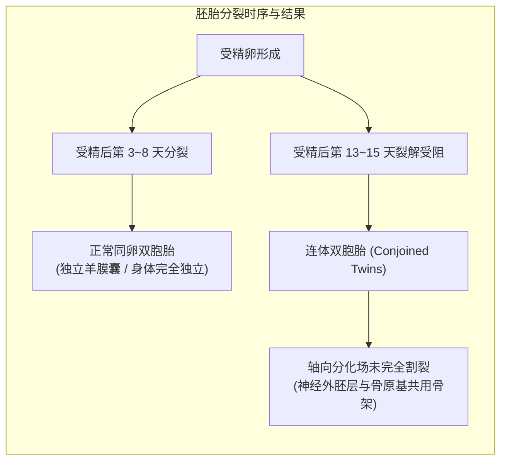
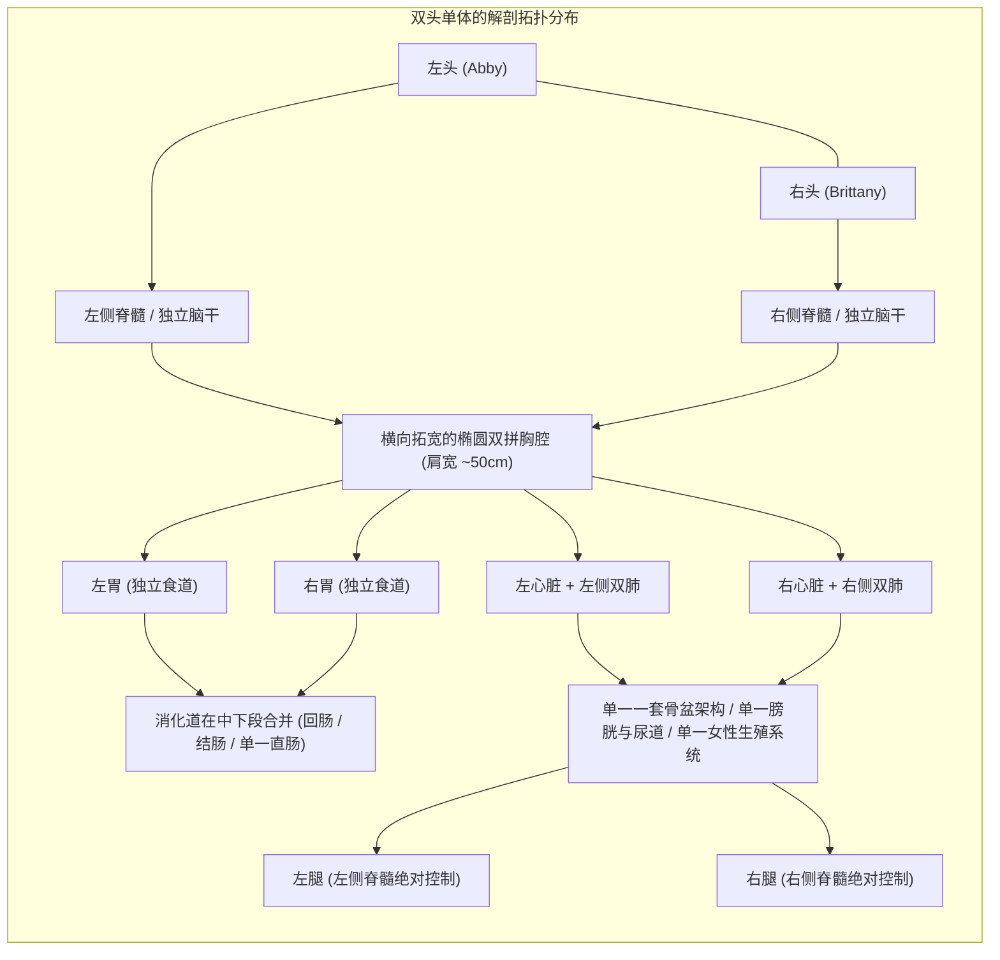
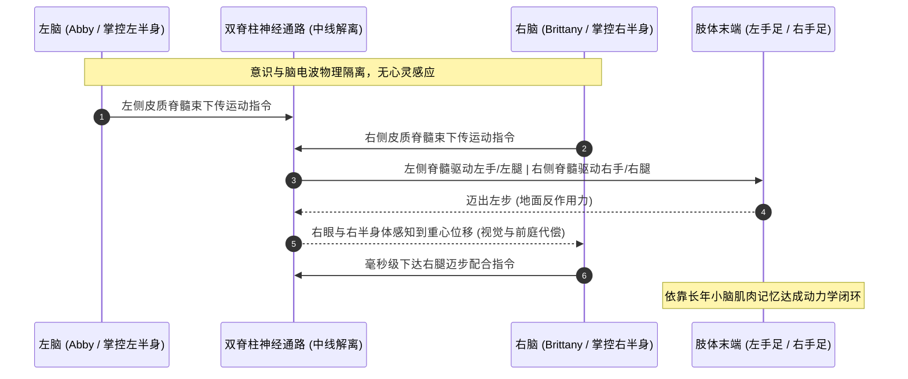
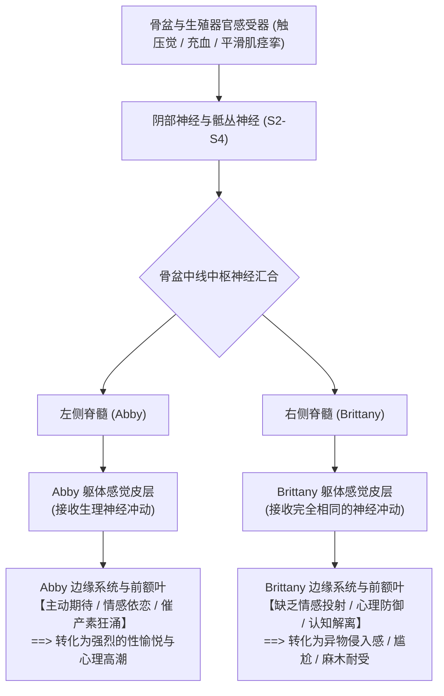
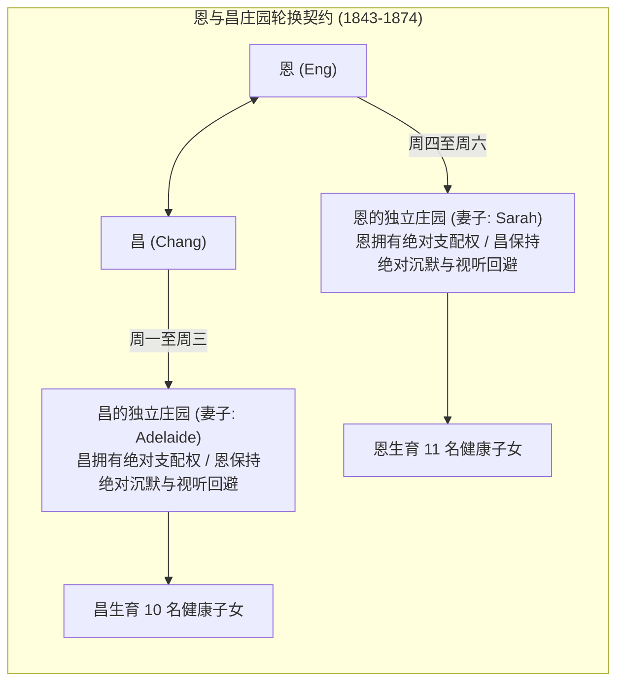
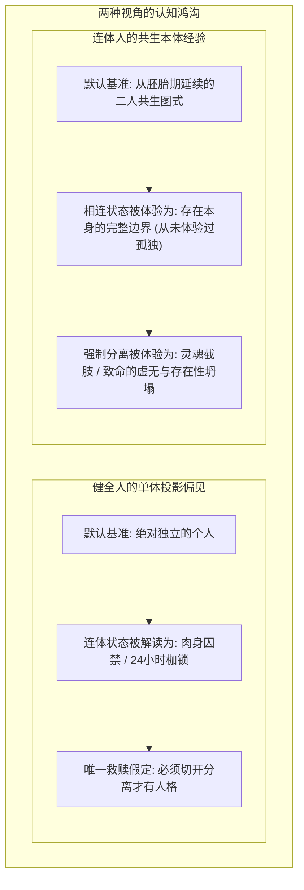

在短视频与社交媒体的猎奇算法中，各类打破常规人体结构的画面频繁流转：从被冠以“克苏鲁异象”的严重致死性胚胎畸形，到被滤镜重度伪饰的“金色猛兽竖瞳”，再到头骨紧密相嵌、并肩行走于人世的真实连体双胞胎。

对于习惯了“一副骨架承载一个灵魂”的健全人而言，这些偏离自然正态分布的肉身形态往往先是引发猎奇惊骇，继而转化为深层的认知震荡：当胚胎的发育图纸在极早期发生偏移，人体究竟能容纳多大尺度的结构重组？当两根独立的脊髓在骨盆深处汇聚为同一套神经末梢，意识、尊严、排他性的爱情与不可剥离的共生肉体，该如何在现实法则中艰难达成平衡？

以下为这场关于发育胚胎学、神经解剖学、连体人生存契约与个体性本质的深度问答实录。

---

### 【第一幕：从独眼畸形到猛兽眼眸——生命程序的致死崩溃与网络视觉猎奇】

> **问**：居然有这样的人类吗？在视频里看到完全打破对称性的独眼长鼻婴儿，这种畸形在现代医学里发现并干预也只能是流产吗？现代畸形胎儿概率到底有多少，有多少能正常出生？这种外形很容易让人联想到“克苏鲁”式的恐怖，但到底是什么支撑它们存活的？

**答**：这在医学上属于真实存在但极其罕见的严重胚胎发育畸形——**独眼畸形（Cyclopia）**，是全前脑畸形（Holoprosencephaly, HPE）中最严重的终末表型。

#### 1. 胚胎中线分裂的停滞
在人类胚胎发育的极早期（孕期第 5 至 6 周左右），前脑原基必须在中线诱导信号（如音猬因子 SHH 基因信号通路）的精确调控下，向两侧对称分裂为左右两个大脑半球。
- 如果这一分裂进程因严重的染色体异常（最常见为 13-三体综合征 / Patau 综合征）或关键基因突变而彻底停滞，大脑中线结构将无法形成；
- 由于颅面部骨骼与大脑同步发育，神经发育停滞直接导致两侧眼眶未能向两侧分开，最终在面部正中融合为一个单一眼眶；
- 原本应当位于下方的嗅板无法正常下移，退化为位于眼球上方的一根管状肉质盲端突起（长鼻/proboscis）。

这类畸形在临床上属于**绝对致死性结构畸形**。外表的独眼或管状长鼻只是浅层表象，核心死因在于整个前脑缺乏大脑皮层回沟、丘脑及自主生命中枢。现代医学无法让人体重生一个大脑。在现代产前筛查体系下（孕 11~13 周 NT 检查与孕中期系统排畸超声），该类缺陷的检出拦截率接近 100%，极少数足月出生案例多见于完全缺乏产检条件的极度偏远地带。

#### 2. “克苏鲁恐怖”与病理现实的本质反差
将这类异象联想为“克苏鲁神话”非常自然——洛夫克拉夫特（H.P. Lovecraft）早年的创作灵感，本就大量借鉴了 19 世纪的畸形胚胎学与深海无脊椎动物标本。但若审视生命维持的底层逻辑，现实病理与文学幻想截然相反：
- **现实中的严重畸形是极其脆弱的“程序崩溃”**：它不是进化出了某种异类机能，而是基本的生命支持系统被打碎。患儿之所以能在刚出生时喘息心跳数小时，纯粹是因为在子宫内依靠胎盘和脐带充当了全功能“体外外挂”；一旦切断脐带独立面对真实大气环境，呼吸与循环衰竭便不可逆转；
- **神话生物则是另一套维度的自洽规则**：旧日支配者或外神能“存活”，是因为设定中它们由奇异物质（Exotic matter）或非欧几何能量构成，从一开始就不依赖碳基生物的心脏泵血与肺泡氧合。人类感到恐惧，本质是对生命范式崩溃失序的本能战栗。

---

> **问**：那视频里看到的那些中东金色瞳孔小孩、甚至猫一样的“竖瞳”，或者一个眼眶里有三个排列成三角形的小瞳孔，又是怎么回事？听说项羽是重瞳，人类真有这种眼睛吗？

**答**：网络上流传的绝大多数“纯金荧光眼”、“猫科竖瞳”以及“等边三角形排列的多瞳孔”，百分之百属于短视频 AR 滤镜、后期特效贴图或特定彩瞳道具。但若剥离滤镜层，其背后交织着真实的人类遗传学多样性与眼科病理学机制。

#### 1. 琥珀色虹膜与病理性金光
人类眼睛的颜色主要由两种黑色素决定：真黑色素（Eumelanin，呈现深褐/黑）与褐黑素（Pheomelanin，偏红/黄），同时受脂色素（Lipochrome）沉积影响。
- **生理性琥珀眼（Amber Eyes）**：全球发生率不足 5%。在中东及欧亚交界人群中，因历史基因交流保留了特定的低黑色素调控等位基因（如 OCA2、HERC2 基因位点调控）。当基质层真黑色素含量极低、而褐黑素与脂色素占主导时，眼睛在自然光下会呈现通透的蜜糖色或浅金棕色。这属于健康的遗传多态性，绝非疾病；
- **病理性“猫眼反光”（白瞳症 Leukocoria）**：若在日常或闪光灯拍照时，观察到瞳孔正中央反出反常的白黄色、金黄色荧光，这绝非美学特征，而是极为凶险的眼内恶性肿瘤信号——**视网膜母细胞瘤（Retinoblastoma）**，或视网膜血管异常渗出大量胆固醇结晶的 Coats 病。

#### 2. 生态位瞳孔形状与所谓“重瞳”
- **人类为何绝无生理性竖瞳**：猫、毒蛇属于贴近地面的伏击型捕食者（Ambush Predators），纵向狭缝瞳孔配合非对称肌肉，能在毫秒级调节数百倍通光面积，并利用纵向散焦虚化精准测算贴地扑击距离；而人类是直立行走、长途追逐与日间全景采集者，依赖 360 度均匀的光学景深，因此人类虹膜肌严格由环形瞳孔括约肌构成，收缩时在几何上只能维持正圆形；
- **项羽“重瞳”与真假多瞳症**：现代眼科不存在“一个眼球内长出两套视网膜和独立晶状体”的结构。
  - **真正的多瞳孔症（True Polycoria）**：极其罕见，指同一虹膜上出现多个开孔，且每个孔都具备独立的括约肌，会对光反射自主收缩，但会导致光线严重散射、单眼复视与弱视；
  - **假性多瞳（Pseudopolycoria）**：因胚胎裂闭合不全、严重外伤贯穿撕裂，或晚期青光眼/虹膜萎缩，导致虹膜基质被拉扯出数个破洞。古代文献记载的帝王“重瞳”，大概率是瞳孔异位（Corectopia，如 8 字形变形）、重度白内障晶状体混浊分割阴影，或是后世文人对“目光威严深邃”的字面神化。

---

### 【第二幕：颅顶相连的面孔——颅部联胎的解剖现实与神经代偿】

> **问**：那这种头骨连在一起的双胞胎呢？（指菲律宾额顶相连的连体姐妹）居然能活到出生，而且离开母体没有死亡？她们面对面的内侧眼睛看得见吗？同卵双胞胎为什么会分裂成这样？共用大脑和血管不会极其脆弱吗？为什么不给她们做分离手术？

**答**：这是真实存在且极度震撼的连体双胞胎亚型——**颅部联胎（Craniopagus twins）**，在所有连体双胞胎中仅占 2% 到 6%。

#### 1. 存活脱离母体的生理支柱：独立心肺与脑干
独眼畸形之所以生下即夭折，是因为控制自主生命体征的脑干与呼吸心跳中枢根本没有发育；而这对颅顶额部相连的姐妹，**各自拥有一套完整的心脏、双肺、胃肠道与脊髓**。
当剪断脐带离开母体后，各自的脑干呼吸中枢独立驱动各自的胸廓张开，建立自主氧合，两颗独立的心脏各自泵血，因而能够在生理学层面脱离母体存活数十年。

#### 2. 内侧眼晴的废用性弱视与空间代偿
姐妹俩额面部骨骼在发育时紧紧嵌合，导致面部朝向被永久锁定为逼仄的相对状态：
- 面对面的内侧两只眼睛并未消失，但长年深陷在骨骼与软组织贴合的阴影死角中，无法接受充足光照，且视野完全被对方的面部轮廓遮挡，最终不可避免地演变为严重的**废用性弱视**；
- **但人类大脑展现了惊人的代偿弹性**：双眼视觉的核心优势是利用微小角度差形成立体双眼视差（Binocular Disparity）。在仅依赖外侧一只眼睛的情况下，大脑会迅速调动单眼深度线索——利用身体与头部晃动时的**运动视差（Motion Parallax）**，结合视野中物体的相对透视与遮挡关系，在婴幼儿神经重塑期重构出一套全新的三维空间坐标系。她们依然能够行走、协调动作甚至随音乐起舞。

#### 3. 为什么绝对不能“一刀切开”？
大众直觉常以为“既然连着，拿手术刀切开缝合不就自由了吗？”在神经外科领域，这种想法直面的是死神：
- **矢状窦血管桥的致命绞杀**：在胚胎早期，血管网遵循血流剪切力与阻力最小原则生长。两人的脑组织在几毫米大小时紧贴，静脉回流系统自然融合成了一条粗大的公共主干——**上矢状窦（Superior Sagittal Sinus）**。颅腔容积受 Monro-Kellie 假说严格约束，无法在后天凭空增生出足以承载大脑 50% 回流量的粗大侧支静脉；
- **嵌合脑组织的物理现实**：两人相连的额叶表面缺乏硬脑膜（Dura mater）这一天然解剖边界，两副大脑皮层的灰质脑回犬牙交错地嵌合在一起，毛细血管相互渗透。外科医生面对的不是一道隔板，而是一团无法分清归属的脑实质；
- 强行切开意味着必须牺牲一方的静脉回流（引发急性暴发性脑水肿与脑疝死亡），或者双方都在手术台上因大静脉窦无法控制的汹涌失血而丧命。维持嵌合现状，是神经外科经过血管造影与多轮评估后，唯一人道且理性的抉择。

---

### 【第三幕：双头单体的内部奇迹——形态发生场如何“复制”一套器官】

> **问**：那像美国阿比和布列塔尼那样的“双头单体”呢？一个身体两个头，到底是一个身体还是两个身体？躯干就那么大，怎么可能并排塞下两根脊柱、两个心脏、四个肺叶和两个胃？人体是巨人吗？怎么做到把这么复杂的内脏复制一份的？

**答**：阿比与布列塔尼·亨瑟尔姐妹（Abby and Brittany Hensel）在医学上称为**双头并体双胞胎（Dicephalic parapagus）**。她们的身躯绝非巨人，成年身高不足 1 米 6，但骨骼与内脏拓扑结构堪称发育生物学的奇迹。

#### 1. “横向拓宽”的椭圆双拼承重架构
直觉上觉得“塞不下”，是因为潜意识把她们的躯干当成了普通的单人圆柱体。在实际骨骼解剖中：
- 她们的胸腔横向宽度达 45~50 厘米（普通成年女性约 35~38 厘米），横截面呈现拉长的椭圆形；
- 颈部下方并排立着**两根平行的完整脊柱**，如同两根坚固的承重立柱，在体内撑开了巨大的横向空间；
- 胸腔内部左右各放置一颗心脏，各自连通一对肺叶（共四叶）；上腹部分别悬挂两个独立的胃，各自连接一条食道。一人吃苹果，苹果进入左边的胃；另一人喝热汤，热汤进入右边的胃。如果一人反酸胃痛，另一人的上消化道毫无波澜。

#### 2. 发育生物学密码：形态发生素梯度场的“上分下合”
人体并非用固定模具注塑冲压出来的零件，而是一套自底向上运行的分布式生物编码。细胞发育成什么器官，完全取决于胚胎早期的化学浓度扩散——**形态发生素梯度场（Morphogen Field）**：
- **上半身的双指令发射塔**：受精后第 12 天左右，胚盘原条在上半段罕见地诱导形成了**两个相距数毫米的指令发射中心**。左侧的发射源命令周围的胚胎干细胞：“围绕我卷曲组装出左侧心管、肺芽与胃”；右侧发射源同步发出完全一致的装配指令。由于早期干细胞拥有极高的全能性与可塑性，两边的细胞在各自局部图纸驱动下，并行折叠出了两套复杂的生命维持内脏；
- **下半身的信号重叠与合流**：到了骨盆与下肢发育的尾端区域，两个发射源之间的物理间距在扩散中彻底弥合重叠。下方的干细胞只接收到了一套汇合的终末指令：“这里是机体下端，构建一副骨盆、一条直肠、一套泌尿生殖系统与双腿”。于是，细胞机器在最下方平滑地归并为单一施工方案。

---

### 【第四幕：神经物理学的绝对割裂与肌肉协同——手脚到底听谁指挥】

> **问**：既然只有一套骨盆和两条腿，手脚到底听谁指挥？她们有心灵感应或者共用脑电波吗？如果两套心肺同时工作，是不是运动耐力比普通人强很多？

**答**：在神经生理学上，她们之间**不存在任何超自然的“心灵感应”，脑电波完全物理隔离**。

#### 1. 严格按侧部分工的脊髓神经通路
- **左右分立的绝对控制权**：左边的头通过左侧脊髓，拥有躯干左半侧、左手臂和左腿的全部运动输出与触觉输入；右边的头通过右侧脊髓，严密掌控右半侧、右手臂和右腿；
- **肌肉记忆与物理协同**：她们之所以能自如地骑自行车、游泳、弹钢琴、甚至考取机动车驾驶证（一人负责方向盘左侧与转向灯，另一人负责方向盘右侧、挡位、油门与刹车），全靠自幼数以亿计次动作反馈磨砺出的**小脑肌肉记忆**；
- 她们是寄居在相邻躯壳里的两个独立人格。记忆储存在各自的大脑皮层海马体中，口味各异（一人嗜甜、一人忌糖），作息不同（一人精神充沛阅读、一人疲惫入眠），性格与志趣完全独立。

#### 2. 为什么“双心四肺”无法带来超人般的耐力？
直觉上常以为“双发动机动力更澎湃”，但在临床动力学与代谢测算中，这种双拼结构反而在运动中承担着沉重的“生理内耗”：
- **心率与自主神经节奏的脱节**：两颗心脏由两套独立的交感/副交感神经系统支配。在剧烈运动时，两人的情绪与兴奋度不同，心率常常不同步（例如姐姐心率 120 次/分，妹妹心率 138 次/分）。在下半身血管交汇处，两股不同搏动节奏的血流相互撞击干扰，血管阻力大幅上升；
- **双脑的高能耗吞噬**：成人大脑仅占体重的 2%，却消耗整整 20% 的基础静息血氧。两个健全发育的大脑同时处于高耗能状态，运动时大量富氧血液必须优先供给两颗头颅，直接剥夺了流向下肢骨骼肌的有效供血比例；
- **下肢关节力学压强翻倍**：一副骨盆和两条腿，必须承受两个头颅（约 10 公斤）、两条脊柱及两套内脏的集中重量。下肢关节软骨与足弓每平方厘米承受的力学压强接近常人的两倍。因此，她们虽然日常活动完全自理，但在高强度长途奔跑时，下肢肌群与足底筋膜会比单人运动员更快陷入乳酸堆积与疲劳衰竭。

---

### 【第五幕：两根脊髓，一套骨盆——无法避开的神经电信号与亲密契约】

> **问**：这直击核心了——如果姐姐恋爱结婚，那妹妹怎么办？性交的时候妹妹也能感受到吗？两根脊髓在骨盆汇合，神经电信号不是无法阻断吗？女性高潮的生理反应怎么可能避免？听起来最优解是两个人爱上同一个男人，各找各的怎么可能在心理上维持？

**答**：这触及了法理学、神经生理学与人类伦理哲学有史以来最残酷、也最隐秘的交叉地带。

2021 年，姐姐阿比（Abby）与退伍军人兼男护士乔什·鲍灵（Josh Bowling）登记结婚，在世界范围内引发了前所未有的震动。

#### 1. 神经解剖事实：电信号无法阻断
你指出的矛盾在神经解剖学上完全成立，物理事实无法粉饰：
- **阴部神经与骶丛汇合**：生殖器官、会阴部及盆底肌群的躯体感觉与自主神经反射，主要由**骶丛神经（S2~S4）与阴部神经（Pudendal nerve）**介导；
- 由于骨盆完全共用，下半身产生的一切机械刺激、温度觉、充血以及平滑肌痉挛的神经动作电位，会顺着两条脊髓通路**无差别地同时上传至两个大脑的躯体感觉皮层（Somatosensory cortex）**；
- 也就是说，在纯粹的生物物理学层面，姐姐在同房时经历的神经放电，妹妹的神经系统**百分之百能完整接收到**。

#### 2. 生理放电 $\neq$ 心理快感：认知评估的解离机制
为什么神经电信号相通，妹妹却没有一同享受，反而需要极端的心理妥协？
现代认知神经科学证实：**性快感从来不是外周电信号的简单加总，而是大脑高级皮层（前额叶、杏仁核、伏隔核与下丘脑）对输入信号赋予的“情感效价（Emotional Valence）”**：
- 对于身处恋爱关系中的姐姐阿比而言，这种神经冲动与视觉、爱意、安全感及体内催产素（Oxytocin）、多巴胺的脉冲完全吻合，高级中枢将其解码为极致的愉悦；
- 但对于未参与恋爱的妹妹布列塔尼而言，眼前是一个自己并不倾心的异性。高级皮层在缺乏情感共振与心理预期的情况下，上传的电信号不仅无法诱发愉悦，反而会在潜意识中被标记为一种**侵入性的生理异物感、焦虑与心理不适**；
- **“戴耳机、看书、闭目放空”绝非自欺欺人，而是极度现实的心理防御机制**：通过强制将注意力转移至强听觉或视觉刺激中，抢占有限的大脑认知带宽，降低下丘脑与边缘系统对盆底神经输入的敏感度。这是一种在肉体不可逃逸的现实下，人类灵魂为了守护最底线的人格完整而构筑的认知防火墙。

#### 3. 为什么“两人爱上同一个人”是灾难而非最优解？
直觉上常有人设想“如果姐妹俩同时爱上同一个丈夫，不就两全其美了吗？”在现实心理学中，这反而会引爆毁灭性的心理灾难：
- **爱情的绝对排他性与零距离嫉妒**：人类的浪漫依恋具有强烈的占有欲。如果两人同时爱上一个男人，亲密关系将瞬间沦为“同一具躯体内部 24 小时逃无可逃的争风吃醋”。男方不经意间流露出的偏爱、多看一眼的眼神或一句温存，都会在相连的肉体内部引发最惨烈的精神内耗，足以在数月内将两个人逼至精神分裂；
- **独立人格的最后堡垒**：连体人终其一生都在与外界“把她们当成一个怪物整体”的目光对抗。维持“姐姐在恋爱，而妹妹保持距离”的界限，尽管生理上带着无法回避的妥协与尴尬，但在心理层面上，**这是妹妹确证“我是一个独立存在的灵魂”所必需的最后尊严锚点**。

---

### 【第六幕：恩与昌的十九世纪传奇——肝脏实质桥与双庄园轮换制度】

> **问**：那历史上最著名的连体人恩和昌呢？他们当年为什么没有手术分开，听起来就像中间连着一根粗绳子，当年真的不能一刀切断吗？他们是怎么各自娶了一对亲姐妹，甚至生下 21 个孩子的？

**答**：出生于 1811 年暹罗（今泰国）的**恩与昌·邦克兄弟（Chang and Eng Bunker）**，是近代医学史上连体人（“暹罗双胞胎 Siamese Twins”一词的语源）的奠基案例。

#### 1. 为什么 19 世纪绝对无法切开那根“连接线”？
直观上看，两人仅仅在胸骨剑突到肚脐之间有一条手腕粗细（长约 12~15 厘米）的肉质软骨韧带相连，成年后可以侧身并排平行走路、骑马。但在解剖学内部，那绝非一条单纯的肉绳：
- **致命的肝脏实质桥**：这条连接带内部，横跨着两人的**肝实质联合部（Hepatic Bridge）**——两人的肝脏在中央融合成了一块；
- 肝脏是人体血供极其丰富、质地脆弱如豆腐的实质性器官。在 19 世纪中叶（1811-1874 年），现代医学既没有全身气管插管麻醉，也没有电刀止血、人工血管吻合技术，更不存在血型配型输血与抗生素体系；
- 当时的外科医生如果贸然将那根连接带切开，肝窦与大静脉会在瞬间引发喷射状致死性大出血，患者在数分钟内就会休克身亡；即便侥幸止血，术后数日内也几乎百分之百会因严重的化脓性腹膜炎而丧命。

#### 2. 双庄园、亲姐妹与极致冷漠契约
恩和昌成年后定居美国北卡罗来纳州，在 1843 年迎娶了当地一对英国裔亲姐妹（阿德莱德与莎拉·耶茨）：
- **生殖系统的绝对独立**：与双头姐妹不同，恩和昌属于胸腹相连，骨盆、生殖器官、双腿与脊髓完全各自独立，彼此没有任何生殖生理感知相通；
- **2 公里的物理隔离与三天统治权**：他们出资修建了两座相距约 2 公里的独立庄园，各自经营一套农场。双方制定了一套铁血的家庭契约：
  - 在昌的庄园里生活的整整三天，昌拥有绝对的决策权，恩作为“沉默的陪伴者”，不发一言、背过身去，完全不干预昌的夫妻生活；
  - 轮到恩的庄园生活的另外三天，恩接管完全主导权，昌同样保持极度的冷漠回避；
- **繁衍后代的实证**：昌与妻子生育了 10 个孩子，恩与妻子生育了 11 个孩子，总共 21 名后代全部健康健全。这套严苛到近乎残酷的“非在场契约”，成为他们在长达几十年的物理绑定中，维系两个家庭运转的唯一社会学解法。

---

### 【第七幕：单体视角的傲慢偏见——“我们从未体验过孤独”】

> **问**：听你这么说，所有的连体人都极度渴望独立、渴望被切开对吧？毕竟健全人看来，这简直是 24 小时永无止境的无期徒刑。

**答**：答案彻底颠覆了绝大多数健全人的理所当然：**并不是。许多连体人在具备手术条件或面对分离提议时，表现出的是极其强烈的抗拒与恐惧。**

健全人习惯了单人个体的生活体验，因此会自然地把“连体”投射为一种后天被硬生生捆绑的牢狱。但在连体人自身的精神世界与生活史中，存在着完全不同的本体论认知：

#### 1. 身体图式（Body Schema）的先验完整
健全人之所以无法忍受身体被束缚，是因为我们的大脑在婴儿期建立的身体图式是排他的“单人模型”；
但连体人从胚胎期胎动、婴儿期吮吸手指、童年呀呀学语开始，他们感知外部世界的**默认参照系（Default State）从第一秒起就是“两个人一体的”**：
- 他们从未在生命中体验过哪怕一秒钟的“孤身一人”；
- 对他们而言，“分开”不是重获自由，而是心理上被硬生生撕扯掉自己半边身躯与半个灵魂。那种突如其来的无边虚无、绝对孤独与肢体幻肢痛，是他们认知系统难以承受的灭顶之灾。

#### 2. “为什么要修好一件根本没坏的东西？”
历史上著名的颅部相连双胞胎**洛莉与乔治·沙贝尔（Lori and George Schappell）**，额顶融合生活了整整 62 年（于 2024 年离世）。乔治是乡村歌手，洛莉在医院洗衣房工作，两人轮流支持对方的事业与约会。
面对无数次媒体追问“医学技术发达后是否渴望分开”，他们的回答斩钉截铁：
> **“绝对不要。为什么要修好一件根本没有坏的东西？（Why fix what isn't broken?）将我们分开等同于杀死我们当中的某一个人。我们在一起，才是完整的自己。”**

#### 3. 真正走向分离悲剧的少数例外
在连体人历史上，真正怀着强烈意愿走上分离手术台的，通常只有两种极端情况：
- **生理天平的坍塌**：当其中一人的心肺严重衰竭或罹患致死性感染，即将把另一方拖入死亡深渊时，出于最原始的求生本能；
- **成年后截然对立的人生撕裂**：最令人心碎的标本莫过于 2003 年轰动全球的伊朗颅部联胎姐妹**拉丹与拉蕾（Ladan and Laleh Bijani）**。
  她们相连长达 29 年，成年后两人的志向发生了不可调和的剧烈冲突——一个渴望在德黑兰成为执业律师，另一个渴望前往罗马成为记者。她们无法忍受余生在对方的人生道路里沦为永恒的退让者，最终坚持在新加坡接受了长达 50 多个小时的高危神经外科分离手术。遗憾的是，因共用大静脉窦引发了术中无法遏制的灾难性大出血，两人在被切开后的数小时内相继离世。

---

### 【结语：个体性的幻象与生命的柔韧尺度】

从全前脑畸形中停滞的中线，到形态发生场在胚胎微米尺度上复制出的内脏；从阴部神经在骨盆汇流下的感官妥协，到恩与昌在 19 世纪庄园里立下的沉默契约；再到沙贝尔兄妹“为何修好一件没坏之物”的平静反问——

这场对话最终瓦解的，是健全人对于“个体（Individual）”这个概念狭隘而僵化的先验预设。

在自然法则与演化长河中，生命的底层代码从未保证过绝对的对称与规整。人类肉身的容错弹性与精神重塑力，远远超越了常规解剖学的教条。**所谓的“独立与自由”，并不只有单体单人一种形态；而在那些被命运强制绑定在同一套骨架里的灵魂深处，人类为了维系尊严与爱所展现出的退让、默契与共生智慧，或许比这具肉身本身的生理奇迹，更加深沉而坚韧。**
