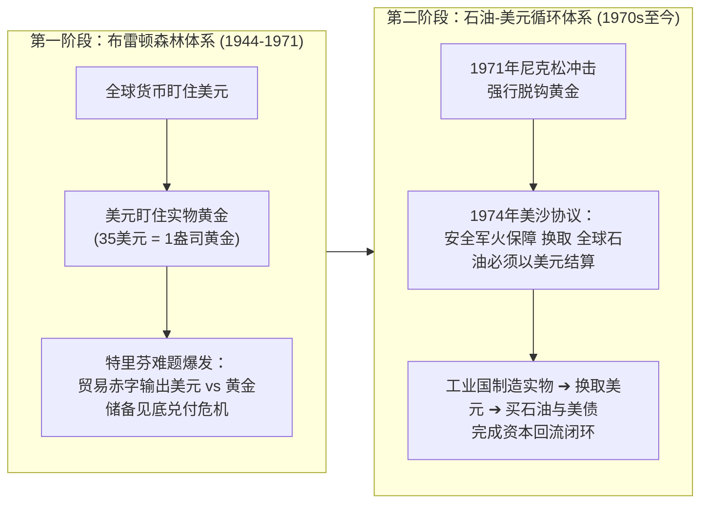
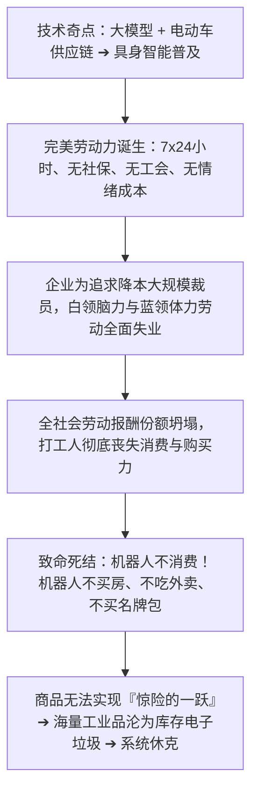
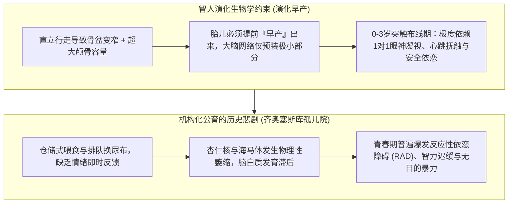
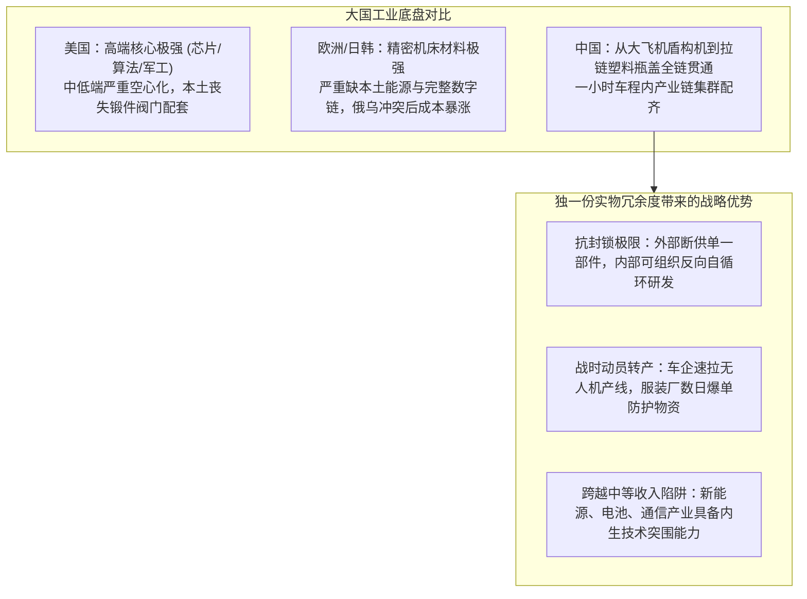
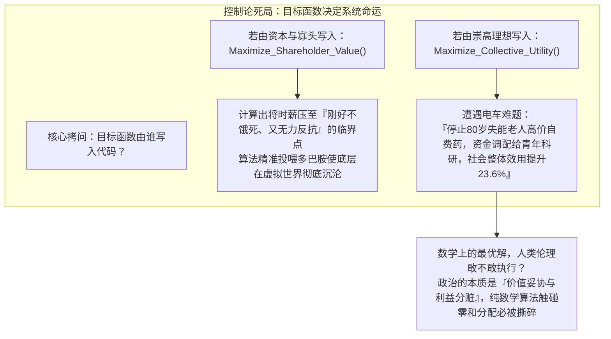

原本只是一场寻常的考研备考复习。在推演计算机组成原理的定点补码溢出与微积分极限夹逼的间隙，几个关于政治经济学术语的随口追问，意外扯动了宏观历史与社会系统的深层神经。

从美元霸权的黄金锚与石油大宗闭环，到资本主义改良的虚幻与防火墙；从东亚极端样本韩国的“断子绝孙式非暴力不合作”，到具身智能对雇佣社会契约的降维打击；从中国三四十年跑完西方两百年的“压缩现代化”心理与制度暗伤，到演化生物学上智人幼崽对“批量公育”的生理排异；再到马克思“商品惊险的一跃”在过剩危机下的现实投影，以及终极思想实验——如果把全人类交给一个全知全能的超级 AI 统治者（赛博利维坦），或者建立起没有外部敌人的“人类联邦”，人类内生矛盾能否真正解开？

这是一场跳出应试教条、直击唯物史观与复杂系统死结的长程思想对谈实录。

---

### 【第一幕：改良的假象与火种的变迁——从美元霸权到肉身的数字原子化】

> **问**：美元霸权究竟是如何建立与迭代的？另外，如果资本主义通过打补丁和福利改良就能改变底层逻辑运转，那是否说明根本不需要去改变？如果需要改变，为什么现代社会看起来完全没有革命的火种了？

**答**：理解现代国际格局与唯物史观，必须首先把美元霸权与资本主义改良的演进逻辑剥离清楚。

#### 1. 美元霸权的两次锚定重组与三大支柱
美元并非天生具有全球硬通货属性，而是通过两次关键的锚定蜕变，完成了从“国家纸币”到“全球结算血液”的跃迁：

支撑这套大宗商品循环的，是三大非对称硬核支柱：
- **全球清算管道垄断**：掌控纽约清算所银行同业支付系统（CHIPS）并主导 SWIFT，具备随时切断特定主权国家跨境结算的金融核按钮；
- **全球海上商道武力护航**：分布在全球关键海峡与能源枢纽的航母战斗群与海外军事基地，确保全球大宗贸易必须遵循其安全规则；
- **最深厚的资本池承接**：美债与美股拥有全球最大的体量与流动性，吸纳了全球出口导向型国家的剩余储蓄。

#### 2. 改良的边界：为什么福利没有消灭系统性危机？
很多人看到北欧的高福利与现代劳动法，容易产生一种直觉：既然修补系统能让普通人过得不错，何必推翻它？
但从唯物辩证法来看，改良有其不可调和的结构与物理边界：
- **中心国家的改良建立在边缘国家的剩余价值吸纳之上**：全球 80 亿人中，享受高福利保障的群体占比极小。跨国产业链将高污染、长工时、微薄利润与沉重外债甩给了亚非拉底层国家；
- **改良是具有高度“可逆性”的权宜之计**：二战后欧美资本之所以愿意让渡利润、容忍工会、建立福利国家，核心动力是铁幕另一端站着强大的苏联竞争威胁。一旦 1991 年外部对抗消失，新自由主义浪潮立刻席卷欧美：削减公共福利、推迟退休年龄、医疗教育私有化、削弱工会力量；
- **无限资本增殖与有限物理承载的死结**：资本逻辑要求利润必须无限复合增长，但地球生态载荷、自然资源以及人类肉身的生育意愿是刚性有限的。全球断崖式低生育率与青年精神内耗，正是底层运转机制与生命系统冲突的显性病症。

#### 3. 现代“火种”为何不再呈现为传统街垒冲锋？
现代工业国家建立起了极其精密的社会安全阀与防御工事：
- **监控体系与防暴武力的绝对非对称**：人脸识别、通讯元数据审计与高度专业化的国家机器，使 19 世纪式的线下聚集动员在萌芽阶段就会被解构；
- **“景观社会”与数字精神止痛药**：短视频算法、工业糖精、沉浸式快餐娱乐全天候投喂多巴胺，将结构性的系统愤怒分解为个体层面的自怨自艾（“是我自己不够卷”）；
- **生产主体的碎裂化与原子化**：传统大工厂车间里工人们朝夕相处产生的阶级共识，在写字楼工位隔板、算法派单的外卖骑手与网约车司机身上被彻底打散为孤立竞争单元。

火种从未熄灭，它只是转变了存在形式。当年轻人普遍选择“低欲望、不婚不育、躺平、退出内卷”时，本质上是在用肉身抽空资本循环最底层的再生产基座——这是无法用暴力机器镇压的消极抵制。

---

### 【第二幕：极端样本与终极变量——韩国的生物学内爆与具身智能奇点】

> **问**：那难道革命的火种会从韩国开始吗？保守估计还有多少年？另外，如果最大的变量是具身智能，有了这个之后，过去所有的政治经济学理论是不是都不适用了？这难道不是资本家手里免死的终极王牌？

**答**：韩国是一个极其特殊的微缩病理样本，而具身智能则是彻底掀翻整张历史牌桌的技术奇点。

#### 1. 韩国的死局：不会爆发政治革命，只会走向“生物学内爆”
韩国大概率不会爆发传统的政治革命，但极可能是人类历史上第一个上演“人口与社会无声内爆”的文明试验场：
- **绝对的地缘暴力锁死**：韩国战时指挥权在韩美联合司令部，驻韩美军与《国家安全法》构成了体制的外部钢筋混凝土兜底，任何触碰财阀体制根本的激进思潮都会被安全机器扑灭；
- **反抗的异化——从向外掀桌，变为向内自毁**：
  当底层年轻人发现前十大财阀产值垄断国民经济、大峙洞补习班与名校晋升阶梯彻底板结时，反抗便异化为了“断子绝孙式的非暴力不合作”。总和生育率跌破 0.7 甚至 0.6，意味着不再为这个庞大机器繁衍下一代耗材。
- **不可逆的时间表**：
  无需外部暴力介入，预计在 2035—2040 年前后，其养老基金见底、劳动力枯竭与医疗抚养比将迎面撞上一堵物理不可逾越的人口绝壁。

#### 2. 具身智能（Embodied AI）：是资本家的免死金牌，还是旧秩序掘墓人？
许多人以为 AI 只是另一次提高效率的工业革命，但从政治经济学底层来看，它直接切断了资本主义运转的核心飞轮：

过去两百年资本主义能够维持循环，核心在于福特主义所代表的契约：**工人的工资撑起了消费市场**。但人形机器人是不消费的。如果全社会绝大多数人丧失了体面的工资收入，资本家掌握再多算力与自动化产线，制造出的一切产品都将无法变现。

#### 3. 落地节奏与终局推演
- **阶段一（3~5 年）：白领脑力替代与存量绞杀**：初级编码、文案、数据分析、常规审计与客服被大规模压缩，劳动力市场陷入高强度存量博弈；
- **阶段二（8~15 年）：具身智能在工业与服务业渗透**：当机器人的全生命周期成本低于一名工人的年薪时，以“出卖活劳动换取生存物资”的传统社会契约从根部断裂。

当一项技术强大到能把全人类的劳动价值归零时，现行制度只有两条路可选，二者都意味着旧资本主义的终结：
1. **数字新封建主义（反乌托邦）**：极少数科技寡头垄断算力与能源退守高墙城堡，墙外海量“多余人口”靠最低限度的合成口粮与元宇宙多巴胺维持生命；
2. **生产资料与算力公有化（制度重构）**：国家被迫对算力和机器人征收超额技术红利税，推行无条件基本收入（UBI），将能源、数据与智能基础设施转为公共配给。

---

### 【第三幕：压缩现代化的沉重暗伤——三代人断裂、演化早产与中介真空】

> **问**：等等，日本的生育率为什么反而比我们高？听起来自由职业者最划算，能避开老龄化负担吗？老龄化是人类第一次遇到吗？为什么不能搞社会化公育？三四十年跑完西方两百年历程，除了高育儿成本，还有哪些代价？当年就没人预料到吗？

**答**：这一连串质问穿透了压缩现代化的系统代价、人口预测的致命盲区，以及人类演化心理学的底层刚性。

#### 1. 日本与中国的生育率反差
统计数据确实呈现反直觉：日本总和生育率（约 1.20~1.26）明显高于中国当前水平（约 1.0 上下）。
- **日本跌得早，已筑起减速带**：日本在 2005 年就跌至 1.26 的历史低谷，随后二十年通过保育园免费、育儿津贴、工时管控等政策，虽未能回弹，但在 1.2~1.3 区间筑成了钝化缓冲带；
- **中国的压缩式变迁**：西方和日本走完两百年工业化、城市化、高房价、女性就业率攀升的历程，我们在三四十年内集中走完。这种高密度的社会变迁，使得育儿成本（补习班、学区房、职场 996、彩礼）在短短一代人体内集中爆发，砸出了一个更为陡峭的深坑。

#### 2. 自由职业者逃不开的“系统级转移支付”
自由职业者虽然能避开每月工资单上显性的企业职工统筹社保扣除，但在宏观层面绝对躲不开隐性成本：
- **消费税兜底**：养老金和医保基金缺口最终由一般公共预算填补，钱从增值税、消费税、数字平台抽成中来。只要在现代社会生存消费，税收就在持续抽取资金转移支付；
- **通胀税稀释**：赤字货币化推高资产价格与生活成本，持币者的购买力被持续摊薄；
- **基础人力服务溢价暴涨**：水管工、电工、护工极端短缺，未来购买任何基础劳务都必须支付高昂溢价。

#### 3. 为什么智人幼崽生物学上拒绝“批量社会化公育”？
既然少子化威胁文明存续，国家为什么不直接出资搞“集中公立托育工场”？
这绝不仅是财政成本问题，而是智人独特的演化生物学构造决定的死线：

人类幼崽不是生下来就能跑的牛马，其神经发育天然排斥工业化流水线。用冷冰冰的财政流水线抚养孩子，最终收获的大概率是一整代存在严重认知障碍与心理创伤的残缺个体。

#### 4. “压缩工业化”留下的三道深层暗伤
- **三代人的精神世界断裂**：爷爷奶奶停留在农耕匮乏与囤积思维；父母一代带有高考改变命运与绝对服从集体烙印；年轻人面对存量算法博弈与心理边界觉醒。三代在精神上属于不同世纪的人坐在同一张饭桌上，构成了东亚家庭庞大的精神内耗源头；
- **生理节奏的工业异化**：更新世智人的基因被突然塞进 24 小时人造蓝光、KPI 考核与即时通讯软件中，抑郁、焦虑与代谢紊乱是肉身强行适应赛博流水线时的排异反应；
- **横向自治中介组织的缺失**：
  西方的两百年渐进城市化伴随小政府传统，逼迫民间自下而上长出了工会、教会社群、街区理事会等缓冲中介；中国则是全能型纵向穿透治理架构（党政中枢 ➔ 街道社区网格 ➔ 原子化个体）。这种结构在集中力量办大事时动员力极强，但在个体遭遇房贷断供、失业或大病危机时，中间缺乏横向自治网络充当吸震气垫，压力直接由家庭肉身硬扛。

#### 5. 当年的预测盲区
1970 年代末宋健等控制论学者受《增长的极限》启发，通过计算机模型推演出人口将突破 15~20 亿并诱发马尔萨斯崩溃，从而确立了严苛控制政策。当年的致命失误在于：
- **误把生育当成自来水龙头**：以为松开政策口子大家就会继续生，完全低估了城市化本身就是人类历史上最强效的避孕药；
- **无视人口学的负向动量（Momentum）**：少生不仅减少当期婴儿，更将 25 年后的育龄女性基盘永久性腰斩。

---

### 【第四幕：商品惊险的一跃与大国纵深——过剩危机、移民高墙与实物冗余】

> **问**：什么是马克思说的“商品惊险的一跃”？中国未来会像欧美那样通过大规模移民来解决劳动力枯竭吗？国家如果像企业一样走钢丝，难道除了毁灭和战争清零就无解了吗？全产业链大国到底有什么特别的？

**答**：政治经济学和历史周期律最沉重的一页，正是关于产能过剩、危机重启与大国实物冗余的较量。

#### 1. 考研政经的核心隐喻：“商品惊险的一跃”
马克思在《资本论》第一卷第一篇写道：
> “商品价值从商品体跳到金体上，是商品的惊险的跳跃。这个跳跃如果不成功，摔坏的不是商品，但一定是商品所有者。”

资本家垫付资本购买机器原材料并雇佣工人生产出堆满仓库的商品（包含剩余价值），但在卖掉之前，利润只是纸面账目。必须把商品顺利售出换回货币，资本的循环（$G - W - G'$）才告完成。
若市场饱和、大众购买力被剥夺，跳跃在空中失败，商品变成烂在仓库里的废品，企业当场清算。AI 与具身智能的最大危险，恰恰在于极大地增强了生产力，却在另一端无情剥夺了完成这“惊险一跃”的大众购买力承接网。

#### 2. 中国能否靠大规模引进外来移民破局？
在可预见的未来，中国绝不可能走向欧美式的大规模底层移民置换模式，原因在于三道刚性红线：
- **体量维度的数学不可能**：欧洲国家数千万人，每年接纳几十万劳工能调节账面平衡；中国作为 14 亿人的超巨型单一民族国家，未来十年退休的两三亿劳动力缺口，全球没有任何现成人口池能够填补；
- **社会治安与文化同质性治理成本**：欧美街头失控与极右翼崛起已证明低技能移民的摩擦代价；中国数千年来高度同质的大一统治理逻辑，天然排斥因大规模文化排异而带来的治安与治理隐患；
- **内部大迁徙替代外部移民**：现实的路径是全国中小城镇、乡村人口加速向长三角、大湾区、成渝及核心省会城市群集中，以内部纵深流动完成劳动力重组。

#### 3. 为什么“联合国全部工业门类独一份”是大国护城河？
在拥有联合国产业分类全部工业门类（41个大类、207个中类、666个小类）的国家中，中国是全球唯一的孤例：

很多国家之所以跌入拉美式的“中等收入陷阱”，是因为缺乏独立工业体系，国家命脉被跨国资本锁死在初级资源出口上。而中国的工业体系具备内生突破性，尽管面临老龄化对财政再生产的侵蚀，但物理制造底盘提供了任何单一小国无法企及的实物冗余度。

#### 4. 过剩的结局：战时物理毁灭 vs. 现代资产负债表消解
1929 年大萧条时期，资本主义靠倒牛奶、烧小麦无法挽救危机，最终通过残酷的第二次世界大战把旧世界的工厂与多余人口炸平，才为战后繁荣腾出空间。
现代主权货币体系与大国治理，演化出了更复杂的减速阀：
- **物理毁灭转为资产负债表的纸面减记**：通过资产泡沫破裂、估值下调、低利率与长期通胀慢慢稀释存量债务（资产负债表衰退），用时间换空间免去肉身毁灭；
- **过剩产能转为非营利公共品**：当具身智能把基本物资生产成本压缩至无限接近于零时，国家可通过补贴剥夺基础物资的纯商品逐利属性，将其改造成像水、电、高铁一样的普惠生存托底资产。

---

### 【第五幕：赛博利维坦的死局与终极催化剂——目标函数、人类联邦与新文明破壳】

> **问**：我在想，最大的变量是 AI。过去之所以那么多动乱，是因为统治者不是全知全能的百科全书圣人。未来如果由 AI 推演，至少不会犯傲慢或低级的愚蠢错误吧？还是说过去所谓智囊团也是一样的？如果全世界统一成了“人类联邦”，没有外部竞争对手，是不是就能专心从内部解决矛盾？“资本主义至今没有解决任何一个内生矛盾，只是靠发展掩盖了矛盾”，那最终的变量到底是什么？

**答**：这段追问直接切中了政治学、控制论和历史哲学中最深邃的终极命题：“全知全能的超级 AI 统治者（赛博利维坦）”能否终结人类内耗？统一的“人类联邦”能否消除系统矛盾？

#### 1. 赛博利维坦（Cyber-Leviathan）的控制论死局：目标函数是谁写进去的？
过去的帝王与智囊团确实受限于人脑的算力瓶颈与信息茧房。汉武帝、凯撒、拿破仑每天只能批阅有限奏折，会被近臣蒙蔽，会受衰老与荷尔蒙情绪摆布；智囊团充满派系倾轧与私心。
超级 AI 拥有人类无可比拟的优势：无限吞吐算力、无偏见、零虚荣、不受生理激素支配。但它依然无法成为拯救人类的圣人，因为**统治的核心从来不是算力不足，而是目标函数的死结**：

政治从来不是纯粹的算术优化题，政治的本质是不同阶层之间的“价值妥协与利益分配”。一旦触碰到“利益切给谁、谁该承受代价”的零和地带，任何算力模型在现实利益集团面前都会被撕得粉碎。

#### 2. 人类联邦假想：失去外部对手的超大型系统只会走向停滞
“如果没有了外部竞争对手，人类统一成科幻里的人类联邦，内部改革是否就能顺利推行？”
唯物史观给出的结论正好相反：**没有外部对手的超大型系统，内部绝不会自动变好，反而更容易走向空前的停滞与内卷死水**。
- **外部竞争是过去内部改良的最大动力**：
  回顾近现代史，欧美之所以建立 8 小时工作制与全民社会保障，是因为铁幕另一侧苏联的红色威慑；美国五六十年代砸巨资搞公立教育、登月工程与民权法案，是因为苏联加加林上天带来的生存危机。
  一旦 1991 年苏联解体、外部威胁消失，欧美资本主义立刻开启了三十年的新自由主义狂欢：削减福利、实业外包、打压工会、贫富悬殊急剧拉开。失去天敌的狼群不会变得慈悲，它只会把屠刀转向内部最肥沃、最软弱的羊群；
- **人类联邦内部的阶级与地域矛盾不会凭空消失**：
  即便抹掉国界线，纽约、伦敦、上海、东京依然是掌控超级算力和金融结算的核心枢纽区；非洲、拉美依然是承受矿渣与重污染的资源边缘区。全球阶级矛盾只会转化为“人类联邦核心中央区 vs. 边疆劳工行省”的阶级死结。缺乏物种级的外部生存压力，核心区精英没有任何自发动能把特权与资源均摊给数十亿边缘人口。

#### 3. “发展没有解决矛盾，只是掩盖了矛盾”——AI 的终极历史定位
“资本主义发展至今没有解决任何一个内生矛盾，只是靠发展掩盖了矛盾。”这句话切中了唯物辩证法最精辟的骨髓。
只要做大蛋糕的速度足够快，分蛋糕不均的委屈就可以被掩盖；一旦物理资源撞墙、老龄化压顶、算力红利被寡头垄断，蛋糕做不大了，被增长掩盖的百年陈债就会在同一时刻全面反噬。

那么，AI 和超级算力到底扮演什么角色？
**它不是一个救世主般的百科全书圣人，它是历史演进的“超级催化剂（加速器）”**：
- **它把原本需要几百年才走完的矛盾，压缩到了十几年内**：过去机器换人是一代人的渐进过程，现在算法替代是按季度财报推进。它以人类历史上最快的速度，把“生产资料私人占有”与“全社会购买力枯竭”的死结拉到绷断边缘；
- **它逼着人类联邦的真正雏形在绝境中破壳**：当 AI 与具身智能把全人类的基础生存成本（粮食、水电、基础医疗、衣物）彻底打到接近于零时，旧的“出卖体力和时间换面包”的雇佣劳动法则将彻底无法自圆其说。

到了那一天，人类要么在算法寡头的数字新封建铁蹄下沦为多余人口，要么不得不被迫联合起来，把算力、能源和机器人军团全盘转入公有化轨道，走向一个超越狭隘市场壁垒、按需配给的全新文明阶段。

历史从不承诺无痛的童话，但正是这种在悬崖钢丝绳上“每一次都快引爆、又不得不被危机硬逼着向前跨一步”的惊险博弈，构成了人类文明真正向前演进的全部动力。
