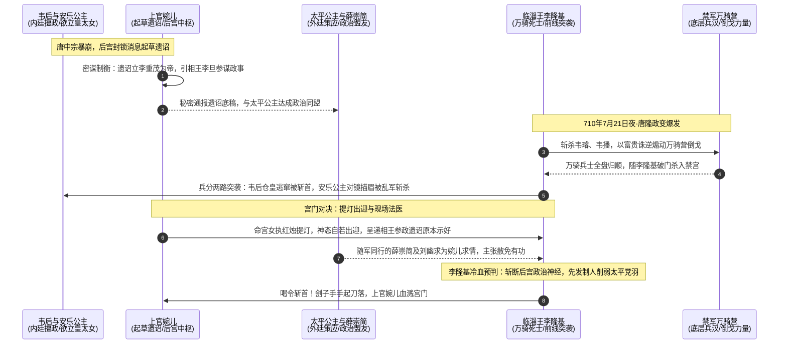
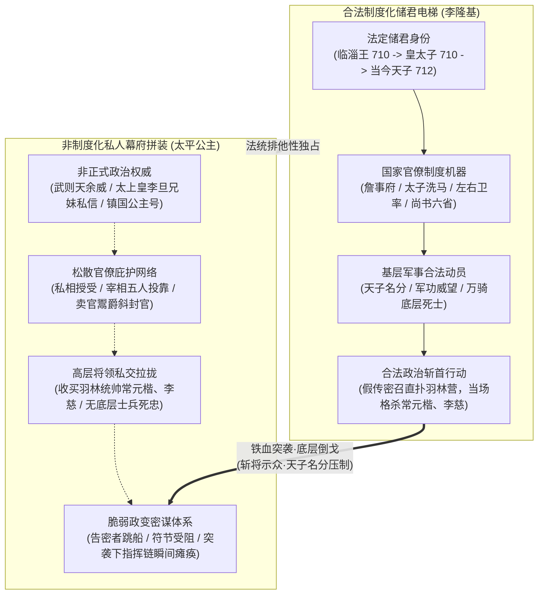
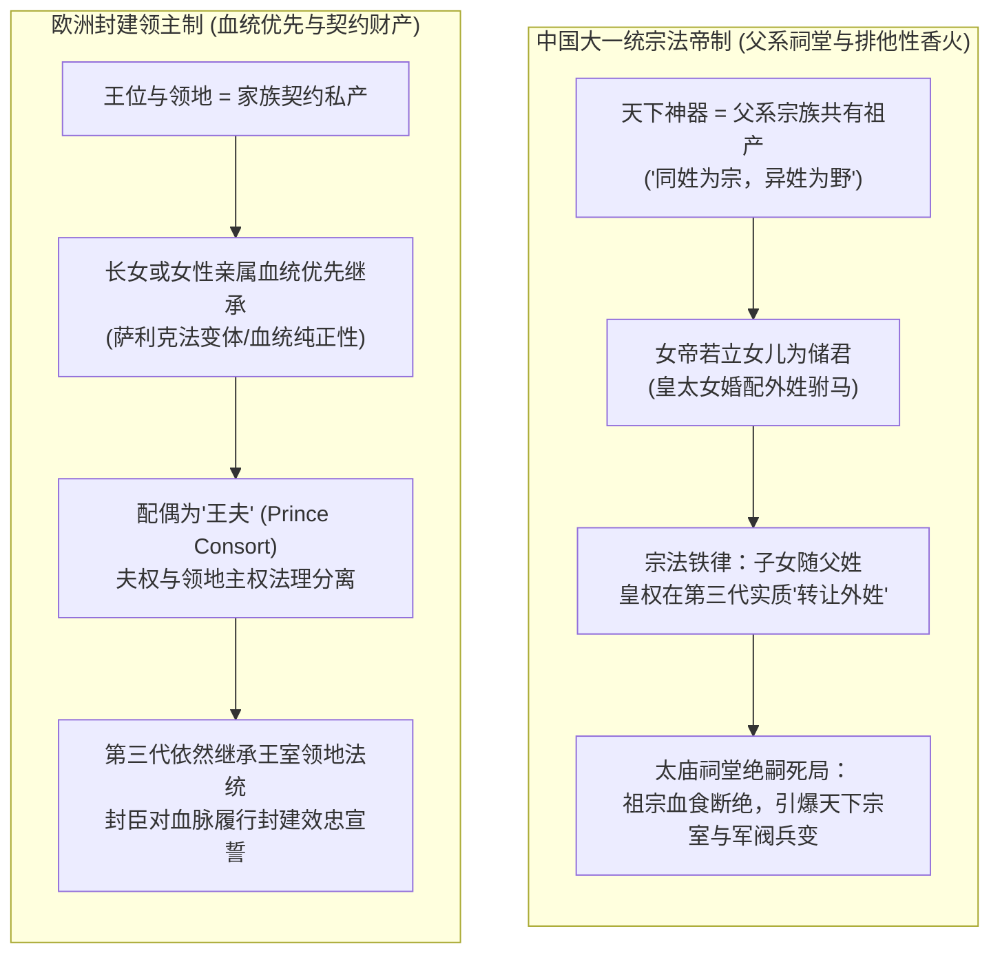

## 引言：宫门夜火与提灯女官的鲜血

在通俗历史叙事与大众影视剧的浪漫化滤镜下，唐代的武周至后武周时期（公元7世纪末至8世纪初）常被赋予一层近乎神话色彩的“女性参政黄金时代”光晕：前有一代女皇武则天打破两千年性别铁律登基称帝，后有“巾帼宰相”上官婉儿以弱冠之身掌管中枢机要二十载；安乐公主骄奢狂悖索要“皇太女”之位，太平公主权倾朝野、七位宰相有五人附逆门下。

然而，剥开影视戏说的温情脉脉与浮华服饰，真实的历史法医现场远比任何小说更加冷酷、血腥与绝望。从公元705年“神龙政变”逼迫武则天退位，到710年“唐隆政变”诛杀韦后与安乐公主，再到713年“先天政变”彻底赐死太平公主，在短短八年的时间切片内，李唐皇室完成了一次针对女性参政势力的饱和式物理清洗。

在这场惨烈至极的宫廷洗牌中，最为震撼且极具象征意味的定格，发生在公元710年7月21日（唐隆元年六月二十日）的深夜。

当二十五岁的临淄王李隆基率领反水倒戈的北衙万骑禁军破门而入、血洗深宫时，四十六岁的一品昭容上官婉儿并未惊慌逃窜。相反，她让宫女点亮烛火，自己手执一盏红烛宫灯，神态自若地在宫门前迎接带血的兵刃。她手中紧握着一份至关重要的底牌——唐中宗暴崩后由她亲手起草的绝密遗诏原本，上面白纸黑字写着立李重茂为帝，同时特设相王李旦（李隆基之父）参谋政事。

在她的政治精算中，这份文件是无可辩驳的“免死金牌”与“政治盟约”。她以为自己凭借翻云覆雨三十年的机巧权谋，已然在韦后与李唐宗室之间架设了最精巧的平衡桥梁。在场协助兵变的刘幽求与太平公主之子薛崇简见状，亦纷纷劝谏李隆基将其赦免收用。

然而，年轻的李隆基甚至没有多看遗诏一眼，仅从牙缝中吐出一个冰冷的字：

> “斩！”

手起刀落，提灯女官的人头滚落在禁苑冰冷的青石板上，鲜血浸透了墨迹未干的诏书。

上官婉儿为什么必须死？太平公主为何在手握朝堂五位宰相与禁军高层将领的绝对优势下，依然被李隆基数十分钟内一网打尽？为什么在西欧封建史上屡见不鲜的女王、女皇，在古代中国的大一统宗法社会中却是一个不可调和的制度死结？

这是一场关于肉体暴力、官僚机器、储君法统与父系宗族文明底座的深度法医解剖。

---

## 现场法医：唐隆政变那夜的时序博弈与不对称斩杀

要理解上官婉儿之死，首先必须将手术刀切入公元710年唐隆政变发生时的微观政治生态与物理现场。

### 1. 权力的绝对真空与病态狂妄

公元710年6月，唐中宗李显在神龙政变复位仅五年后突然暴崩。史料多记载其为韦皇后与幼女安乐公主（李裹儿）合谋毒杀。虽然现代史学界对李显是否死于毒饼仍有病理学争议，但韦后与安乐公主企图复制武则天称帝神话的野心，早已昭然若揭。

安乐公主是古代中国历史上野心最狂妄、行事最骄横的公主。她出生于李显被废流放房州的逃亡途中，当时李显甚至解下身上旧衣权充襁褓，故取乳名“李裹儿”。李显复位后，出于对患难岁月的极端补偿心理，对其纵容到了毫无底线的地步。安乐公主不仅大肆卖官鬻爵（只要交纳钱财即可由内廷直接颁发不经门下省盖印的“斜封官”），强拆民宅修建豪奢无度的定昆池，甚至曾公然坐上龙椅撒娇向李显索要天下权柄：

> “阿武以一女子犹得为天子，我乃帝女，为何不能作皇太女？”

安乐公主的第二任丈夫武延秀（武三思之子，年轻英俊，善跳粟特胡旋舞），更是满朝文武侧目的内廷权贵。

李显死后，韦后秘不发丧，封锁禁宫，将十六岁的温王李重茂推上皇位作为傀儡（唐少帝），自己则以皇太后身份临朝称制，同时任命韦氏族人韦璿、韦播统领北衙羽林禁军，企图在数日内完成改朝换代。

在韦后与安乐公主的沙盘推演中，天下早已是囊中之物。政变发生当夜，兵刃交击之声已逼近寝殿，安乐公主竟然仍在铜镜前精心描眉画鬓、对镜自赏——她甚至以为门外不过是一场微不足道的奴仆喧闹，完全沉浸在天明之后临朝加冕的幻觉之中。乱军破门而入时，战刀直接劈碎了她手中的眉笔与头颅。

### 2. 上官婉儿的算盘与李隆基的绝对冷血

上官婉儿不同于安乐公主这种不学无术的骄横蠢物。她是整个后武周时代最精明、手腕最老辣的中枢政客。

早在中宗病危之际，上官婉儿便敏锐地觉察到了韦氏集团的倾覆风险。她并未彻底倒向韦后，而是私下联络了镇国太平公主，两人密谋草拟了一份极具平衡手腕的遗诏：
- 名义上立温王李重茂为皇太子即位；
- 实际上白纸黑字确立了相王李旦（李隆基的生父）“参谋政事”，以李唐宗室的核心亲王牵制韦后临朝称制。

当李隆基带着反水的万骑禁军冲入内宫时，上官婉儿根本没有隐匿。她整理宫服，率领宫女执灯出迎，当场向李隆基展示遗诏草稿。她的潜台词清晰至极：“我是相王李旦的同盟，是我冒死在遗诏中给你们李家争取到了法定辅政权，我是立下大功的自己人。”

在场参与政变的重臣刘幽求被说服了，甚至连太平公主的亲生儿子、李隆基的表弟薛崇简也出面力保。

然而，李隆基下达斩首令时，甚至没有半分犹豫。其决策逻辑在历史法医学上具备极高的一致性：

第一，彻底拔除后宫干政的神经中枢。
上官婉儿在内廷服务近三十年，上承武则天，中连武三思，下通唐中宗与韦后。她是内廷诏令体系与外廷官僚集团之间唯一的活地图与路由器。李隆基发动政变的核心纲领是“光复李唐神器，断绝妇人乱政”。留着这样一个权谋通天、人脉密布的政治老手在后宫，等于在卧榻之侧留下随时可能复燃的引信。

第二，斩断机巧善变者，立下不可逆的流血门禁。
李隆基深知上官婉儿“机巧百端、狡诈善变”。她在武则天、武三思、中宗、韦后之间多方下注、反复横跳却始终屹立不倒。政治斗争到了物理歼灭的临界点，最不可信赖的便是没有绝对忠诚底线的精致利己主义者。

第三，先发制人，精准断除太平公主的内廷耳目。
这是最隐秘却最关键的战略预判。唐隆政变虽然是李隆基与姑母太平公主的联手行动，但李隆基早已将这位野心勃勃的姑母视作下一个终极对手。上官婉儿与太平公主私交极深，情同闺友，二人合谋起草遗诏本身就是太平公主渗透内廷的关键抓手。李隆基当着薛崇简的面断然斩杀婉儿，不仅是立威，更是一记隔山打牛的重拳——在权力的最深处，瞬间废掉了太平公主埋在后宫里最重要的眼睛与耳朵。

---

## 组织代际降维：文官官僚操盘手与底层暴力斩首者的生死决

唐隆政变不仅清除了韦后与上官婉儿，更揭开了一场持续三年（公元710—713年）的姑侄终极死决：镇国太平公主 vs 临淄王（后为太子、皇帝）李隆基。

这场对决最终以公元713年的“先天政变”告终。而太平公主的败亡，提供了一个经典的组织学悲剧样本：一个将上层官僚权术推向顶峰的政客，是如何被手握底层枪杆子的特种斩首战降维碾碎的。

### 1. 太平公主的“全赢”错觉：文官网络与纸面兵权

上官婉儿的惨死，在当时彻底惊醒了太平公主。她血淋淋地意识到：侄子李隆基是一个根本不讲官场潜规则、敢于直接动刀的亡命军阀。在随后的三年里，太平公主以惊人的速度疯狂组装自己的权力机器：

- 操纵中枢文官集团：朝廷内阁的七位宰相中，有五位（窦怀贞、萧至忠、岑羲、崔湜、陆象先）彻底倒向太平公主门下；
- 挟持最高君权意志：其同母四兄唐睿宗李旦生性厌倦政斗，崇尚无为避祸，对这个在武周恐怖统治中相依为命的亲妹妹言听计从。朝廷凡有奏章，李旦的第一反应永远是：“此事可曾与太平议过？”只要太平点头，政令立刻通达；
- 渗透北衙禁军高层指挥权：太平公主吸取教训，全力拉拢掌握宫城防卫的北衙禁军核心将领。左羽林大将军常元楷、知右羽林卫事李慈两位禁军最高司令官，全被太平公主收买成为死党；甚至连掌管宫门钥匙的监门将军也归顺了她。

在公元713年的夏天，太平公主的沙盘极其完美：七月四日，由常元楷、李慈直接率领羽林禁军冲入朝堂诛杀李隆基；五位宰相负责在金銮殿宣布废帝；太上皇李旦出面收拾残局。在纸面力量上，太平公主掌握了从国家立法、行政司法到皇城卫戍司令官的全部顶层节点。

### 2. 李隆基的兵权认知：基层军汉与外科手术式斩首

然而，李隆基对“暴力”的理解，整整高出了太平公主一个维度。

太平公主的思维是“官僚式的”——她以为收买了掌控印信的将军，就等于拥有了军队；而李隆基的思维是“职业军阀式的”——他深知在极端兵变时刻，抽象的指挥链会瞬间熔断，士兵绝不会为了一纸官文去冒灭门之祸，士兵只听从活着的长官与最直接的利益裁决。

早在唐隆政变前，当时还只是边防闲职“潞州别驾”的李隆基，没有一兵一卒的正规兵权。但他掏空私囊，变卖产业，深入驻扎在宫城北门泥地里的“万骑营”，与最底层的果毅都尉、长上折冲以及普通兵士（葛福顺、李仙凫、陈玄礼等）称兄道弟、同吃同住。这些出身关陇破落军户的士卒，根本不知道也不在乎高高在上的长公主是谁，他们只认带他们搏命发财的大哥李隆基。

公元713年7月3日，太平党羽中的关键文官魏知古判定太平夺权必败，冒灭族之险向李隆基密告政变计划。李隆基根本没有走繁琐的调兵程序（当时兵符还被太上皇李旦把持），他只带领高力士、郭元振、王毛仲等数十名贴身死士，实施了一场人类宫廷政变史上教科书级的外科手术：

1. 斩断神经末梢：李隆基假传圣旨，诱召羽林军最高统帅常元楷、李慈入见。二人刚一露面，伏兵手起刀落，两位大将军的人头瞬间落地。
2. 基层心理爆破：李隆基手提主将血淋淋的人头，纵马跃入羽林军营房，振臂高呼：“大唐天子在此！常元楷谋反已伏诛，从贼者灭族，随朕者封侯！”本就视李隆基为偶像的底层羽林禁军轰然倒戈，山呼万岁。
3. 扫荡纸面文官：李隆基调转马头，直接指挥倒戈的精锐禁军扑向宰相府与中书省。那些白日里在朝堂上呼风唤雨的当朝宰相（窦怀贞自缢，萧至忠、岑羲被擒斩），在寒光闪闪的禁军钢刀面前连三分钟都没能支撑，便被全盘屠戮。

### 3. 项羽之悲的镜像倒错

大众往往叹息西楚霸王项羽“自矜功伐，非战之罪”，而太平公主的覆灭，则构成了项羽悲剧的另一种惊人镜像：

- 项羽是“战场维度的神”，个人武勇与战术冲锋举世无双，却被刘邦、萧何在后方构建的冷血官僚户籍、粮草后勤与制度天网活活勒死在乌江边；
- 太平公主是“官场维度的棋圣”，把奏章调配、朋党结纳、太上皇意志与文官体系玩弄到了极致，却被李隆基在最底层泥潭中淬炼出的物理钢刀在几十分钟内连根拔起。

任何精妙的官僚制度大厦，在合法性被撕碎的极端危机时刻，都必须依附于“谁能直接掌控基层物理杀戮权”这一根最原始的粗木桩。当太平公主试图用官僚政客去遥控职业军人时，她已经单向踏入了李隆基的绝对斩杀线。

---

## 制度性空壳与合法性电梯：为什么女性不能光明正大“建班子”？

在探究太平公主与安乐公主的狂热夺权时，现代读者常产生一个朴素的困惑：既然她们具备如此庞大的政治能量，为什么不能像寻常皇太子那样，光明正大地组建自己的领导班子、建立制度化的接班序列？

答案是极其残酷的：古代中华帝制国家的政治架构，从顶层设计到底层执行代码，从未给女性预留过哪怕一毫米合法的制度接班通道。

### 1. 东宫体系：男权继承的制度化扶梯

在宗法制度下，男性皇嗣拥有一个庞大、合法且完全公开的国家级接班培训流水线——东宫体系（太子宫）：

- 官僚培养机构：设有詹事府、左右春坊、司经局；配置太子太师、少师、少保、太子洗马、中舍人等全套文官班子。全天下的名儒能臣被理所当然地委任给太子，这是合法的政治孵化；
- 独立禁卫军队：拥有独立的“左右卫率府”，享有专属编制的武装私军，拥有正规的宫防巡逻权限与合法的调兵勘合符节；
- 权力过渡契约：皇帝衰老或病重时，太子可以名正言顺地奉诏“监国”。百官向太子汇报政务不是朋党作乱，而是神圣的国家礼制。

对于李隆基而言，唐隆政变后被立为太子，他便踏上了这部精密运转了上千年的“合法性电梯”。712年李旦禅让，他顺理成章登基为帝。到了713年先天政变爆发时，李隆基早已是全天下在法统上唯一合法的大唐天子。任何反抗他的行动，无论理由多么冠冕堂皇，在国家律法与儒家伦理中都被天然定义为“大逆不道的谋反”。

### 2. 制度真空下的畸形拼装：只能走向“阴谋与私通”

相比之下，太平公主无论多么雄才大略，在帝制宪政上都只拥有一种身份——“长公主”（内眷皇亲）。

朝廷没有为“皇太女”或“摄政公主”设立过任何一个编制。没有公主洗马，没有公主卫率，没有合法的参政公署。这就导致了极为荒谬的制度死穴：

- 无法合法吸纳名臣：如果一个刚直不阿的正统士大夫（如魏知古）投靠太子，叫“辅佐储君、效忠国家”；如果他投靠太平公主，在礼制上立刻沦为“交通内闱、谄媚妇人”的无耻奸佞；
- 组织工具的必然下流化：因为不能公开建制，女性野心家想要汇聚力量，就只能被迫依赖非正式的畸形手段——卖官鬻爵（斜封官）、私产贿赂、认干儿子、包养男宠、内廷私通。太平公主将薛绍、武攸暨作为政治婚姻跳板，在府中圈养男宠，甚至将张昌宗推举给母亲武则天；安乐公主与其夫武延秀在朝野呼风唤雨。这些在后世史官笔下被痛批为“淫乱宫闱”的黑历史，其深层动力本质上是女性在制度通道全盘焊死之后，唯一能够撬动权力的原始杠杆。

这是一场完全不对等的降维竞争。李隆基坐在阳光下的太极殿上，手握全套合法的国家机器与三军符印；而太平公主只能蜷缩在阴暗的私邸中，靠利益勾兑与秘密盟约组装一部脆弱的拼装车。停下来是被屠宰，往前走是万丈深渊——制度性的死胡同，注定了她只能在焦虑与狂妄中一条路走到黑。

---

## 文明底座的断层：欧洲王位契约 vs 中国宗法祠堂绝嗣死局

进一步拉开全球文明史的比较视野，一个更加震撼的结构性断裂浮出水面：

在欧洲中世纪及近现代史上，女性君主（Queen Regnant）屡见不鲜，甚至铸就了诸多帝国的黄金时代：英国的玛丽一世、伊丽莎白一世、安妮女王、维多利亚女王；俄国的叶卡捷琳娜一世、叶卡捷琳娜大帝；奥地利的玛丽亚·特蕾西亚；西班牙的伊莎贝拉一世。

然而，在拥有五千年文明史的中国，武则天却成为了前无古人、后无来者的两千年绝版孤例。为什么西方的封建体系能够从容容纳女性统治者，而古代中国的大一统宗法大厦，却会将任何女性继承者视为必须彻底碾碎的系统性病毒？

### 1. 欧洲领地契约制：血统纯度超越生理性别

欧洲封建体系的底层基石是“封建契约与采邑法权”。

在中世纪欧洲，王位、城堡与领地在法律本质上是王室家族的“私有财产与封建特权”。根据各王国的继承法习惯（如英格兰采用的半萨利克法或男性偏好长子继承制）：
- 血统优先性：领地与王冠属于家族的“神圣基因”。如果国王没有男性子嗣，按照血缘最近原则，第一顺位的大女儿拥有超越远房堂叔的合法财产权。贵族封臣宣誓效忠的是“某某王室的合法骨血”；
- 夫权与主权的法理隔离：女王结婚，其丈夫通常在法律上仅获得“王夫”（Prince Consort）或名誉头衔，而无法直接吞并王国的最高统治主权（如维多利亚女王与阿尔伯特亲王，西班牙女王伊莎贝拉与阿拉贡国王斐迪南的共治协议）。即使通过婚姻促成王朝更迭（如都铎王朝转向斯图亚特王朝、汉诺威王朝），领地贵族效忠的契约内核与神权加冕仪式依然完好无损。

### 2. 中国父系宗法制：太庙祭祀与“第三代改姓”绝灭死局

然而，中国大一统帝国的底层操作系统，从来不是贵族契约，而是森严运转了两千余年的“西周父系宗法制”与“宗庙排他性祭祀”。

宗法制的核心公理极其冰冷：
> “同姓为宗，异姓为野。”

天下不是某一个人的私人财产，而是整个男性李唐宗族的“祖先共有基业”。坐在龙椅上的天子，其权力合法性来自于太庙中历代先祖的血脉香火传承。皇帝不仅是世俗的最高行政长官，更是全天下同姓宗族向祖宗牌位献祭的“大宗之长”。

一旦女性登基并企图将皇位传承下去，就会在遗传与礼法逻辑上撞上一堵无法突破的死墙：

【第一代：女皇登基】（武则天称帝，国号改周）  
　　↓  
【第二代：立皇女为嗣】（传位给太平公主或安乐公主）  
　　↓ （公主出嫁，与外姓驸马婚配，如薛绍、武延秀、某外姓世家）  
【第三代：皇孙即位】  
　　↓  
【宗法灾难爆发：第三代必然随父姓！】

在中国传统宗法社会的定义中，出嫁女子必须“从夫”。子女随父姓不是单纯的称谓问题，而是整个祭祀资格、宗族归属的根本转移。如果皇女的儿子继承皇位，到了第三代，皇帝的姓氏将变成薛、变成武、变成任何外姓。

对于满朝信奉儒家纲常的文官集团、驻扎边陲手握重兵的李唐男性宗室诸王而言，这是无法承受的文明灭顶之灾：

> 李唐列祖列宗在太庙里的香火，彻底被外姓之鬼玷污；大唐的万世江山，在没有任何外敌入侵的情况下，以一种最荒诞的方式“断子绝孙、绝嗣转让”。

狄仁杰当年劝谏武则天放弃立武家侄子（武三思、武承嗣）为储君、必须复立亲生儿子李显时，所用的正是这一柄直插心脏的宗法杀手锏：

> “姑侄与母子孰亲？陛下立子，则千秋万岁后，配食太庙，承继无穷；立侄，则未闻侄为天子而祔姑于庙者也。”

狄仁杰的话彻底道破了宗法社会的冷血真相：在父系祖先崇拜的逻辑闭环里，只有儿子才会把母亲供奉在宗庙里祭祀；如果是侄子当皇帝，宗庙里供奉的是侄子自己的父母，身为姑母的武则天死后连一块冷猪肉都吃不上。

连一代枭雄武则天，在面临死亡与身后祭祀的大考时，也不得不向这堵宗法高墙低头。武则天尚且只能传位给儿子李显，回归李唐；而妄图以“皇女”之身开辟女性世袭统治的太平公主与安乐公主，从一开始就是在与整个华夏文明深层的宗法代码进行绝望的困兽之斗。

### 3. “皇室入赘”的思想实验：民法逻辑在国家暴力面前的破灭

曾有现代学者提出思想实验：既然民间有“招赘上门”让孩子随母姓的习俗，女皇为什么不能挑选一个低微男子入赘皇室，强行规定第三代随皇姓？

这个在民间私法层面可行的妥协，一旦放入国家权力的绞肉机中，会在瞬息之间化为齑粉：

- 方案一：招赘贫寒无能之辈。
  如果驸马毫无政治家世背景，他在朝廷中根本没有任何发言权。边疆手握数十万雄兵的宗室叔伯、关陇军阀，绝不可能承认一个由社会底层赘婿所生的血脉统领天下。他们会以“皇族神圣血脉遭贱民玷污、牝鸡司晨败坏宗纲”为大义名分，立刻举兵清君侧，屠灭京师。
- 方案二：招赘顶级世家阀阅之子。
  如果挑选崔、卢、李、郑等顶级门阀或手握重兵的武将子弟，那根本不可能维持“入赘”的虚假和平。驸马背后的庞大家族会在女皇妊娠、哺乳或政治虚弱期，以最快速度发动宫廷政变，把女皇软禁，将天下彻底变为驸马家族的战利品——这便是中国古代史上反复上演、令人谈之色变的外戚篡位（如西汉王莽篡汉、北周杨坚篡周）。

民间入赘依靠的是乡规民约与宗族绝户时的财产怜悯；而帝国传承依靠的是天下数十万军队的生死效忠与刀剑威慑。在没有一整套父系武装力量背书的前提下，任何形式的“女帝招赘”，在手握长柄马槊的职业军阀眼里，不过是一场不堪一击的滑稽戏剧。

---

## 唯物史观的物理死结：为什么潜移默化的制度改良在公元8世纪注定失效？

如果断崖式的武装夺权是死路一条，那么，手握天下最高权力长达四十年之久的武则天，能否效仿后世某些渐进式改革，通过漫长的政策润物细无声，潜移默化地重塑社会意识形态，为女性接班铺平道路？

从历史唯物主义与系统动力学的底层逻辑审视，在公元8世纪的东亚大陆农耕生产力条件下，这一设想在科学机制上是被彻底锁死的。

### 1. 个人寿命与制度半衰期的时间尺度绝境

任何涉及人类亲族组织、性别分工与宗族伦理的根本改变，其演化半衰期必须以百年甚至数百年（数代人）为最小计量单位。

- 武则天正式改唐为周称帝时，已是六十七岁高龄的耄耋老人；纵使她享寿八十二岁，属于帝王寿命的极致罕见案例，其在位执政的时间窗口也极为有限；
- 秦国的商鞅变法之所以能历经风雨最终统一天下，是因为在商鞅被车裂处死后，秦惠文王、秦昭襄王等连续六代男性国君，在国家根本利益上高度一致，持续坚定地推行法家耕战体系；
- 然而，武则天面临的接班死局在于：她身后根本不存在一个可以承接“女性继承制度”的政治实体。她的儿子（李显、李旦）、她的侄子（武三思、武承嗣），全都是这套两千年父系继承制度的最直接受益者。一旦女皇咽气闭眼，无论是儿子还是侄子上位，为了证明自身君权神授的合法性，第一件事必定是以最快速度全盘清洗武周时期的女性政治遗产，彻底回退至父系正统轨道。

### 2. 精耕农业的水利底座与绝对肌肉力量约束

思想意识形态从来不是悬在半空的道德选择，它是社会底层物质生产方式的精确投影。

为什么古代中国的大一统集权与父系宗族结合得如此严密，远超欧洲封建庄园？
正如跨流域治水文明的地理密码所揭示的：东亚大一统帝国的物质根基是极度依赖大规模群体协作的精耕细作农业。开凿大运河、修筑黄河百里防汛长堤、治理淮河与都江堰水网，乃至关中平原与中原大地年复一年的深翻重耕，高度依赖极端高强度的男性绝对肌肉力量与长周期耐力。

在化肥、农药、蒸汽机与内燃机被发明之前的漫长冷兵器时代，人类文明根本无法挣脱生理体能的物理桎梏。以男性为核心的父系血脉宗族，是古代农耕社会在极端恶劣的自然灾害与战乱冲击下，唯一能够维持低成本协作、保障赋税征收与组织乡勇自卫的最低核算单元。

你无法在一个底层硬件完全由“男耕女织、宗族治水”构筑的农业社会机体上，强行运行一套颠覆父系血缘的超前操作系统。这种生产力维度的绝对锁死，决定了任何局限于皇宫禁苑内的性别政治探索，都只能是一场悬浮于社会肌理之上的畸形政治泡沫。

### 3. 官僚系统的免疫排异反应

武则天在其执政生涯中，实际上已经将个人意志与制度工具压榨到了极限：
- 她大力推行科举殿试，提拔了大量寒门文臣以瓦解关陇军事门阀对朝政的垄断；
- 她借助佛经《大云经》神话，制造“弥勒下生为女身”的谶纬神迹；
- 她亲自造出十二个新汉字（包括象征“日月当空”的“曌”），试图在文字学与哲学宇宙观上洗脑臣民；
- 她破天荒地重用上官婉儿，设立内作使、宫廷女官，让女性实际代拟诏书、裁判天下诗赋。

然而，整个帝国官僚体系的深层“免疫排异反应”却从未停止。
哪怕是武则天一手拔擢、对其忠心耿耿的贤相能臣（如狄仁杰、姚崇、宋璟），在涉及国家皇位继承的根本原则上，其内心底层运行的代码依然百分之百是儒家父宗纲常。文官集团可以容忍武则天在特殊历史时期以女身临朝称制（视其为代行天命的过渡），但绝不容忍皇统脱离父系宗庙。

当神龙政变五王（张柬之、崔玄暐等）带着羽林军冲入迎仙宫诛杀张易之、张昌宗兄弟、迫使重病中的女皇退位时，这个由数万名儒家文官、禁军将领与宗室血脉组成的庞大免疫系统，终于彻底杀死了侵入机体三十余年的“异体细胞”。

---

## 现代反思：权力代际与生殖器寄生文明的终结

将目光从公元8世纪的唐宫血雨腥风中收回，审视整个人类政治文明的演进史，我们才能真正读懂这段惨烈历史留给后世的终极镜鉴。

古代君主专制制度最大的系统性悲剧与制度癌症，在于：

> 最高国家权力的平稳交接与数千万国民的命运安危，被极其荒唐、脆弱地完全寄生在了一家一姓的肉体生殖器上。

这种“生殖器合法性决定论”为古代文明注入了永无止境的血腥震荡周期律：
- 皇帝生不出儿子，国家立刻陷入绝嗣动荡与宗室王爷的血腥火并；
- 皇帝生了个痴呆弱智的儿子（如晋惠帝司马衷），直接引爆八王之乱与五胡乱华的数百年浩劫；
- 皇帝英年早逝留下襁褓中的孤儿寡母，立刻引来外戚与权臣的断头台清洗（如赵匡胤陈桥兵变黄袍加身、杨坚受禅灭周）；
- 一旦宫廷内部出现武则天、上官婉儿、太平公主这般具备超凡政治雄心与手腕的女性，为了在一个没有合法出口的父权铁笼中求生与争权，又必然卷入数十年惨绝人寰的告密酷吏与宫门屠戮。

现代共和宪政制度对人类社会最伟大的拯救，不是消灭了政治斗争与贪婪，而是：

彻底斩断了“国家最高公权力”与“家族私人生殖血统”的寄生脐带。

- 领导人不再是这块土地的“产权所有者”，其身份仅仅是一个具有明确法定任期与权责边界的“公职岗位（Office）”；
- 权力的轮替与交接，完全交由成文宪法、代议选举、政党竞争或程序性法度来裁决，而不再看谁是谁的嫡长子、谁随了谁的父姓、谁在床榻之间讨取了欢心；
- 政治失败者的代价从“满门抄斩、株连九族、人头滚落宫门”，被断崖式拉低到了“下野退休、出书演讲、领受养老金”的非物理消灭范畴。

诚然，现代政治文明远非完美的天堂，它依然滋生着资本游说对民主议程的隐蔽劫持、社交媒体算法导致的情绪极化与信息部落主义，以及选举周期绑架下的财政短视债务危机。但至少，人类终于告别了那个每隔几十年就必须用千万颗头颅为一家一姓的生殖死结买单的野蛮深渊。

---

## 结语：被撕碎的遗诏与青石板上的血痕

2013年9月，在陕西省西咸新区空港新城的考古工地上，一座带有五处天井的高等级唐代墓葬被发掘出土。

考古队员拂去千年尘土，在残破阴冷的墓道中发现，墓室顶部遭遇过极其彻底的暴力毁坏，棺椁被砸碎无存，骸骨荡然无存。然而，在墓道深处，静静矗立着一方完好的青石墓志。

墓志的主人，正是上官婉儿。

这方近千字的墓志铭，详尽记录了上官婉儿在中宗朝“拼死进谏、吞毒抗争以阻立安乐公主为皇太女”的惨烈内幕。而这方墓志的撰写者与出资厚葬者，正是当年在唐隆政变后悲痛欲绝的闺蜜兼政治盟友——镇国太平公主。

太平公主在墓志中用极尽华美哀伤的骈文，盛赞婉儿“潇湘水断，宛委山倾”的盖世才情。然而历史留下的最大黑色幽默在于：为上官婉儿修建这方体面墓地仅仅三年之后，太平公主自己也在李隆基冰冷的白绫面前悬梁自尽，她的四个儿子亦被尽数诛杀。

那盏在公元710年唐隆政变的深夜被李隆基长刀劈落的红烛宫灯，是古代中国历史上女性政治家试图向最高皇权伸手的最后一抹微光。

当上官婉儿手持遗诏、提灯出迎的那一刻，她以为自己是在与一位年轻的宗室王子进行一场关于权力制衡的理性谈判；然而她未曾看清的是，站在黑夜对面的，不是哪一个具体的男人，而是由数千年精耕农业的泥土、宗族祠堂的牌位与绝对物理暴力共同浇筑而成的父权巨兽。

在呼啸而来的历史宿命与文明铁律面前，那张精心起草的遗诏被撕得粉碎，连同那盏摇曳的宫灯，彻底熄灭在了长安城破晓前最寒冷的血色深渊之中。
