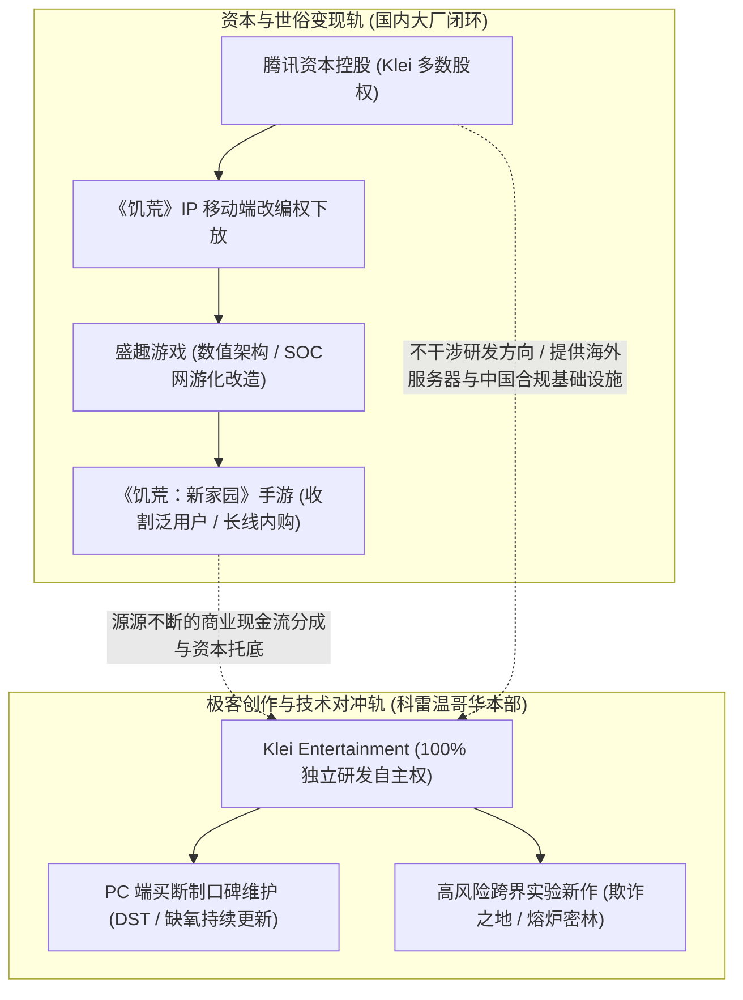

## 现象与违和：被切割的荒野大世界

当《饥荒：新家园》（曾用名《饥困荒野》）正式上线时，任何一位体验过 PC 端原版《饥荒》（Don't Starve）的玩家都会感受到一种剧烈的结构性错位。

原版《饥荒》的底层魅力建立在一个高度统一、无缝生成且残酷自洽的单一存档大世界中。玩家在其中面临的是绝对的孤立无援：没有安全区，没有暂停键，没有社交频道，更没有容错的数值垫子。所有的资源规划、科技攀爬与季节应对（秋季囤粮防冻、冬季追鹿取暖），都处在一根紧绷的倒计时绞索之下。

然而在移动端商业化网游的语境里，这种“纯粹的探索与生存”被整齐划一地切成了两半：

1. **私有永久安全家园（营地）**：一块脱离严苛气候压迫、绝对不会被 Boss 拆毁、支持深度装修与外观摆放的私人领地。这里是长线留存的“自留地”，更是面子消费与装扮沉淀的展示场。
2. **公共/限时资源副本（野外探索）**：原本完整的开放世界被按生态与难度切割为草原、沼泽、雪地、矿区等独立关卡，并挂接了严格的刷新周期、准入门槛与战力/抗性要求。

这种“沙盒副本化”并非独创，而是国内手游工业极度成熟的 SOC（Survival Open-world Crafting）标配架构（以《明日之后》、《黎明觉醒》为典型代表）。在商业化网游中，策划绝不可能允许玩家在一个自给自足的本地存档中永久躺平——唯有把大世界碎裂为副本，才能从底层掐住材料产出的水龙头，制造资源缺口，进而将“采集减负”与“体力/背包扩充”包装为付费解药。

---

## 机制异化：轻度MMO化与老玩家的受众错位

原版《饥荒》本质上是一款纯粹的 PVE 游戏。但在商业手游中，世界聊天频道、全服广播与组队大厅却占据了极核心的界面权重。

这直接触及了手游策划最具性价比的内生营销逻辑：**聊天频道的开发成本几乎为零，但它能以最低代价制造“在场感”与错失恐惧（FOMO）。** 只要世界频道里充斥着组队喊话、求带巨鹿与抽中稀有外观的滚屏播报，游戏生态就会形成自发的人肉气氛组。而在缺乏 PVP 冲突的生存环境里，付费动力被精准平移为“在 PVE 中的社交炫耀”——氪金玩家通过高阶宠物、强化武器专精与数值免伤，在组队攻坚时充当队伍核心，收获白嫖玩家的崇拜感。

为支撑这套“组队刷本”的闭环，游戏甚至强行植入了原创的“奇遇职业”：

- **药剂师**：投掷药水为队友群体回血、驱散异常状态、提供护盾。
- **机械师 / 驯兽师**：制造防御工事、驱使高阶随从分摊仇恨与辅助输出。

原版《饥荒》中的角色（威尔逊、薇洛、沃尔夫冈等）虽然各具被动特性，但本质上都是荒野受难者，人人都能砍树生火，人人都在对抗死亡。而手游引入“药剂师”这类标准网游角色，本质上是在用“战法牧铁三角”强行重构合作规则——若不带治疗与坦克，高层暗影裂隙与数值化季节 Boss 将变得极其折磨。

伴随这一改动的，是核心生存机制的全面退化：
- **永久死亡惩罚被彻底剥离**：角色死亡仅损失装备耐久或回营地复活，几十小时的心血不会归零。
- **生存紧迫感被日常打卡取代**：从防冻防饿的生存压力，异化为清体力、刷日常材料本、提交家园订单、打世界 Boss 的手游流水线。

| 机制维度 | 端游原版《饥荒》/《联机版》 | 商业手游《饥荒：新家园》 | 异化背后的商业逻辑 |
| :--- | :--- | :--- | :--- |
| **世界架构** | 无缝随机大世界，单一存档全局生态互锁 | 永久安全家园 + 离散限时野外副本 | 控制资源流速，搭建外观与虚荣心陈列室 |
| **角色定位** | 单人全能求生，带有性格缺陷的手绘个体 | 引入战法牧职业（药剂师/机械师等专精） | 制造不可或缺的组队分工，拉升养成线深度 |
| **死亡惩罚** | 严苛永久死亡（Permadeath）或高代价复活 | 掉落耐久/营地复活，进度永久保全 | 消除挫败感，保障长线沉没成本不流失 |
| **核心驱动** | 对抗未知自然、时间紧迫感与建造自动化 | 数值达标、宠物养成、家园装扮与日常清空 | 将生存压力转化为日常打卡与数值卡点 |
| **社交形态** | 极度纯粹的熟人联机或离线单机 | 世界频道、全服广播、临时摇人与公会 | 零成本制造繁荣假象，通过在场感促成攀比消费 |

这场魔改彻底印证了一个残酷的商业现实：**商业大厂在立项《饥荒：新家园》的第一天，目标用户就根本不是《饥荒》的核心老玩家。** 

核心老玩家习惯了 Steam 几十块钱买断制与创意工坊海量免费 MOD，对数值内购与战力抽卡具备天然的免疫与排斥；在商业账本里，核心粉丝的最大价值是公测前期的“免费宣发自来水”。游戏真正要收割的，是那些听说过《饥荒》暗黑童话画风、却被端游硬核难度劝退的泛大众休闲群体，以及热衷于建房社交的轻度手游用户。

---

## 资本底牌：自家“左手倒右手”的流量套利

为什么一家国内手游厂商能够拿到全球顶级独立游戏神作的正版授权？

答案并不涉及激烈的版权抢夺，而是一场水到渠成的资本内部运作：

1. **腾讯对科雷的控股**：早在 2021 年 1 月，加拿大开发商 Klei Entertainment 创始人 Jamie Cheng（郑志明）便在官方论坛公开宣布，腾讯已正式完成对科雷娱乐多数股权的收购。
2. **研发方的战略协同**：该手游的实际研发商为盛趣游戏（世纪华通），而腾讯正是世纪华通的重要战略股东与长线发行伙伴。整个项目的实质，是腾讯拿出旗下的海外顶级 IP 资产，交给深谙中国网游数值化研发的盛趣进行系统搭建，最后通过腾讯庞大的社交渠道分发上线。

这背后是一笔极其理性的流量经济账：
- **2500 万套销量的超级认知度**：《饥荒》在全球全平台累计销量超过 2500 万套，中国市场更是其中最重要的基本盘（当年 WeGame 引进《联机版》首月即破百万）。即使没买过端游的玩家，也对标志性的哥特手绘暗黑风格了如指掌。
- **对冲高昂的买量成本**：在当前手游存量竞争阶段，新创原创 IP 的单用户获取成本（CPA）极其高昂。直接挂上《饥荒》正版招牌，全网预约量无需重金买量即可自然冲破千万级。
- **抢占成熟的 SOC 赛道**：网易《明日之后》验证了生存建造网游长盛不衰的吸金能力，但在同品类中长期缺乏强号召力的竞品。腾讯以《饥荒》作为高辨识度外壳填补该赛道，是标准的大厂资本算式。

---

## 极客与现实：2500万销量为何在巅峰期“卖身”？

许多玩家难以理解：科雷手握《饥荒》2500 万销量，以及《缺氧》（Oxygen Not Included）数百万套的白金级口碑，累计总营收逼近 3 亿美元。它既不是需要四处化缘的初创团队，也没有陷入揭不开锅的绝境，为何在最辉煌的顶峰出让控股权？

翻开独立游戏工业的真实账本，这一决策不仅毫无败相，反而是极具远见的商业避险：

### 1. 独立单机的“一锤子买卖”与高位套现（Exit）
商业网游依赖月流水，而单机独立游戏本质上是长周期赌博。一款新作往往需要研发 3 至 5 年，期间只有纯支出没有进项；一旦连续两部作品在市场上遇冷，账面资金很快会被高昂的研发人力吞噬。
科雷立足于温哥华，养着数十名北美高薪工程师与资深艺术家，年化刚性成本上千万美元。创始人 Jamie Cheng 在 24 岁创立科雷后曾两度濒临倒闭，甚至一度抵押个人房产贷款给员工发薪。在《饥荒》与《缺氧》将公司估值推向历史最高峰时出让多数股权，是在商业周期顶峰将未来的不确定性兑现为确定的资金储备，使团队核心成员彻底实现财务自由。

在北美游戏工业体系中，巅峰期出售股份是非常通行的“资本退出”范式（如《Minecraft》之于微软、《英雄联盟》与《流放之路》之于腾讯），远非传统叙事中“走投无路卖祖产”的悲情色彩。

### 2. 中国市场的“运维黑洞”
《饥荒》与《缺氧》的爆发性增量有半数以上依赖中国大陆玩家。然而，一个偏安温哥华的几十人小作坊，在物理上根本无力处理中国复杂的网络环境：跨境低延迟联机服务器搭建、版号申报合规、实名防沉迷中台、安卓数十个应用商店的 SDK 适配，以及防盗版维权。
与腾讯深度绑定后，科雷将这套沉重且繁琐的底层脏活彻底甩脱，换取了中国市场长期稳定的联机服务基础设施与衍生版权收益。

### 3. “给钱不管事”的创作隔离
腾讯在海外核心游戏圈长期遵循极度克制的财务投资风格：只占股分红与获得改编授权，不向被投工作室派遣管理人员干涉创意。
被收购数年以来，科雷在 Steam 平台上的《饥荒：联机版》与《缺氧》依然保持着纯粹的高频良心更新，没有任何外生氪金系统侵入端游本体。

---

## 终极思辨：工业化深耕 vs 艺术家猎奇

在此过程中，一个极为敏锐的商业反思随之浮现：

> “为什么科雷不能像席德·梅尔的《文明》系列，或者 Paradox（P社）的《群星》《钢铁雄心》那样，在一套成熟的技术框架与设计经验里深耕？既能吃老本，又能持续做微创新。为什么非要像‘写科幻的非要跑去写言情’一样，做完生存做卡牌，做完卡牌做动作肉鸽，强行跨界试错？”

这个追问直指游戏设计界的两种底层哲学分野：

### 1. “工业化匠人”与“猎奇艺术家”的基因对立
- **P社与席德·梅尔是工业化匠人**：它们的核心壁垒是一套高度通用的底层引擎与数值框架（如 P社克劳塞维茨引擎的地图填色、事件弹窗与外交矩阵）。其新项目有 70%~80% 的底层代码、UI 逻辑与数值经验可以直接复用。从《欧陆风云》到《十字军之王》，再到换上太空皮的《群星》，本质上是在极其稳固的工业底座上叠加新规则，研发成本可控，商业回报极其确定。
- **科雷是一群有表达欲强迫症的极客**：在科雷团队眼中，做游戏的核心驱动力不是“运营一门资产”，而是“攻克一个从未有人解决过的机制难题”。做《忍者之印》时攻克潜行视觉化；做《饥荒》时攻克荒野孤独感与非线性生存；一旦这个命题被彻底解决，继续做换皮在他们看来等同于“创作死亡”。于是他们转头去攻克微观热力学与流体模拟（《缺氧》），攻克把口才辩论转化为双卡组战斗（《欺诈之地》）。

| 维度对比 | 工业化深耕路线（席德·梅尔 / Paradox P社） | 极客艺术家跨界路线（Klei Entertainment 科雷） |
| :--- | :--- | :--- |
| **底层核心资产** | 通用引擎与成熟数值底座（代码复用率 $\ge 80\%$） | 独特美术风格（暗黑手绘纸片风）与底层物理模拟算法 |
| **品类赛道选择** | 聚焦大战略（4X / Grand Strategy）长青耐玩品类 | 频繁跨界（潜行 $\to$ 荒野生存 $\to$ 太空模拟 $\to$ 卡牌叙事） |
| **玩家留存逻辑** | 系统深度极高，靠海量 DLC 持续挖掘同一批核心受众 | 单作体验惊艳，但玩家易产生消耗疲劳，续作面临边际递减 |
| **商业风险模型** | 研发风险低，边际成本递减，收益高度可预期 | 跨界试错成本极高，缺乏复用经验，失败率居高不下 |
| **资本依赖形态** | 能够自循环完成工业化滚动再投资 | 必须依赖资本巨头（如腾讯）注资兜底以对抗暴死风险 |

### 2. 为什么科雷死活不出《饥荒2》？
从外部看，制作《饥荒2》似乎是最稳妥的商业策略。但科雷陷入了自身创造的“更新绞索”：
2016 年推出的《饥荒：联机版》（DST）走上了服务型长线更新路线。十年间，航海、地下远古、月岛神话、全角色天赋技能树接连上线。当下的 DST 体量实际上已经超越了所谓的《饥荒2》甚至《饥荒3》。如果另起炉灶发售《饥荒2》，新游戏初期的内容厚度绝不可能对抗更新了十年的本体，且会彻底摧毁玩家积累的皮肤资产与庞大的创意工坊生态。

### 3. 为什么不做“科幻版单人动作生存”？
如果说《缺氧》将视角拉升为上帝视角的殖民地管理（类似《环世界》RimWorld），那么为什么科雷不复用单人操控、动作探索的模式，做一款科幻题材的单人求生游戏？

这背后有着极其严酷的工程与市场现实：
- **2D 手绘纸片风的技术与审美牢笼**：原版《饥荒》采用“3D 地面网格 + 斜 45 度 2D 手绘纸片人”结构，这种蒂姆·伯顿式的荒诞暗黑美学在荒野奇幻中具备极高的辨识度。一旦将题材换成冷峻硬核的太空科幻，纸片人质感极易产生廉价滑稽感；而如果转型全 3D 制作，科雷完全不具备与一线大厂对抗的 3D 工业化资产管线。
- **Steam 创意工坊的生态反噬**：在《饥荒》极度繁荣的 MOD 生态里，玩家自制的科幻外星、末日废土、中世纪求生 MOD 早已汗牛充栋。官方亲自下场制作换皮版本，在可玩性与更新速度上甚至很难跑赢免费社区。
- **动作生存赛道的 3D 红海碾压**：2013 年《饥荒》问世时，俯视角动作生存几乎是一片蓝海；而今天的生存赛道已被《英灵神殿》、《雾锁王国》、《夜族崛起》乃至《幻兽帕鲁》全面占领。这些基于虚幻引擎打造的 3D 大世界作品将画质与建造体量推向了极致，科雷若在此刻重回单人动作生存战场，将陷入胜算极低的消耗战。

---

## 结语：一场各取所需的宿命契约

将所有拼图拼接完整后，《饥荒：新家园》手游的魔改与科雷娱乐的退居幕后，形成了一幅极具代表性的现代游戏工业切片：

科雷的核心团队深知自身只擅长“解决未被探索的设计命题”，骨子里抗拒沦为换皮流水线工匠；但这种任性的极客猎奇，必须以极度昂贵的试错成本为代价。

于是，科雷将《饥荒》这块最值钱的黄金招牌交予腾讯与盛趣，任由资本用最世俗、最成熟的网游数值套路，在移动端去收割泛大众市场的商业红利；与此同时，科雷拿到了充裕的资金安全垫与中国市场的运维兜底，得以在温哥华的独立工坊中，毫无生存顾虑地投入下一个可能面临商业暴死、但足够好玩的创意脑洞中。

这绝非情怀受辱的受害者叙事，而是一场冷酷而理性的双轨契约：**世俗的归世俗，艺术的归艺术。** 至于老玩家，只要认清这款手游本就不是为自己而做，关掉下载页面，回到那个寒风刺骨的秋夜营火旁，便已足够。
