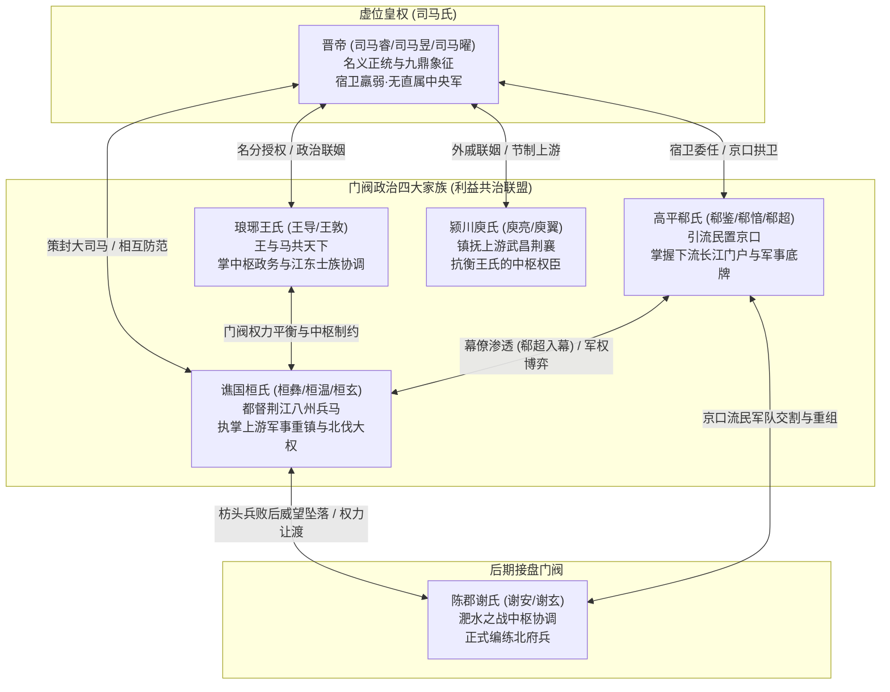
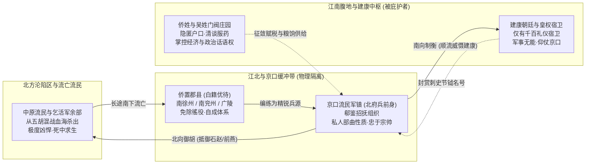
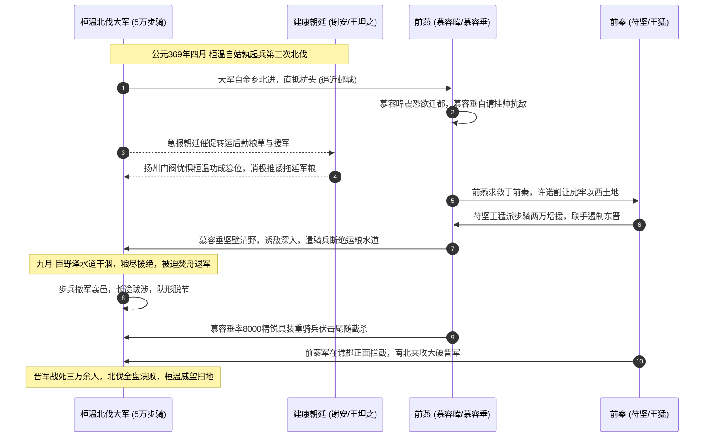

## 引言：华夏两千年组织形态的深水断裂带

在通俗历史叙事与文艺作品中，两晋南北朝往往被裹上了一层浪漫主义的薄纱。提及东晋，大众第一时间浮现的意象多是兰亭修禊的曲水流觞、竹林名士的放诞清谈、王徽之雪夜访戴的兴尽而返，抑或是谢安在淝水前线捷报传来时折断屐齿的镇定自若。这种审美化的历史滤镜，让后世误以为这是一个充满艺术灵性与哲学解放的黄金时代。

然而，一旦剥离《世说新语》中名士风度的审美轻纱，将手术刀切入当时的土地制度、人口户籍、兵役赋税与政治博弈底层，两晋十六国实际上是华夏文明有史以来国家动员力最匮乏、阶级流动最窒息、社会结构最畸形、人命如草芥的至暗裂解期。

东晋（公元317—420年）既非秦汉帝国大一统官僚体制的延续，亦非西周宗法封建制的回光返照。在华夏文明的心脏地带——关中平原、中原腹地与齐鲁大平原全盘陷落之后，偏安江左的司马氏政权，本质上是一群仓皇南渡的北方贵族与避乱皇族，在江南水网地带搭建起来的有限责任合伙企业。在这个政权体内，皇帝是缺乏直属军事武装与财政收税能力的虚君合伙人；中枢朝政被琅琊王氏、高平郗氏、颍川庾氏、谯国桓氏与陈郡谢氏轮流坐庄垄断；而政权的军事防卫与边境开拓，则全部寄生在从北方尸山血海中逃出来的流民武装（乞活军与北府兵前身）身上。

本文试图采取历史法医的解剖路径，从一桩看似属于私德范畴的宫廷婚姻强拆案——新安公主司马道福逼迫王献之艾火灼足、休弃发妻郗道茂切入，层层下潜至高平郗氏与京口流民军的私人部曲化血缘纽带，最终穿透至桓温第三次北伐（枋头之战）背后荆扬对立、兵种代差与补给断裂的四重地缘死局。通过这组微观与宏观交织的历史切片，还原东晋这一畸形政体的运作机理与覆灭宿命。

---

## 微观切口：艾火焦足与门阀政治的婚配力场

### 案件还原：被皇权撕裂的高门夫妻

太元初年，东晋宫廷与顶级士族圈内发生了一起轰动朝野的婚姻震荡。晋简文帝司马昱的第三女、孝武帝司马曜的姐姐新安公主司马道福，看中了琅琊王氏嫡子、时任名士王献之。彼时的司马道福刚刚经历了一场政治婚变：她的前夫是权臣桓温的次子桓济，因桓温死后桓氏家族夺权内讧失败，桓济被流放，司马道福随即与之离婚。恢复单身的新安公主凭借皇室权势，要求朝廷下诏赐婚，强行指定王献之为驸马。

然而，王献之早有明媒正娶的原配妻子——高平郗氏名门闺秀郗道茂。两人既是夫妻，更是至亲表亲：郗道茂的父亲是北中郎将、徐州刺史郗昙，而郗昙正是王献之母亲郗璿的亲弟弟。换言之，王献之娶的是自己的亲舅舅之女。夫妻二人青梅竹马，成婚不到半年，王献之之父王羲之与郗道茂之父郗昙相继离世，在接连失去家族顶梁柱的低谷岁月中，夫妻二人相濡以沫，感情极笃。

面对皇室强横霸道的指婚圣旨，王献之采取了魏晋士人罕见的极端自残方式进行反抗。他用艾草堆放在自己的双脚与小腿上，点火灼烧，导致双足大面积严重烧伤溃烂，终身落下跛行残疾。在古代礼制与宫廷惯例中，身体残疾者一般不得尚公主为驸马，王献之企图用这种自毁躯体的惨烈方式逼迫皇室收回成命。

然而，司马道福的专横超出了王献之的预估。这位在皇室特权中长大的公主放言：哪怕他是个瘸子，我也非他不嫁。在皇权的强力干预下，朝廷搬出郗道茂多年未育男嗣（两人仅育有一女王玉润且早夭）作为礼法借口，下旨强令王献之休妻。

被逐出家门的郗道茂孤苦无依，因父亲早已去世，只能寄宿于大伯郗愔（郗超之父）家中。她终身未再改嫁，在无尽的屈辱与抑郁中度过余生，数年后便在悲凉中病逝。而王献之虽然被迫迎娶公主，仕途顺遂至中书令（宰相），但其后半生始终活在无尽的自责与精神创伤之中。王献之存世的著名行草法帖《奉对帖》（又名《离婚帖》），通篇字字泣血，极尽愧疚与悲凉：

> 虽奉对积年，可以为尽日之欢，常苦不尽。一朝捐弃，使人悲咏。

数年之后，年仅四十三岁的王献之病入膏肓。按照当时道教天师道的天师祭酒仪式，重病临终之人必须向神明如实坦白一生所犯下的罪衍（即所谓首过）。当道士询问其生平有何亏心之事时，王献之弥留之际神情凄怆，唯留下一句叹息：

> 不觉有余事，惟忆与郗家离婚。

这声叹息不仅成了魏晋文学史上的哀音，更在法医视角的解剖台上，留下了一串关于东晋政治力场发生深刻位移的物理证据。

### 权力天平的微观位移：为什么王羲之能坦腹，王献之只能残足

将王献之的屈辱自残，与其父王羲之当年的东床坦腹相对比，便能清晰看到东晋高门士族权力底牌在短短三四十年间的剧烈衰变。

当年太尉郗鉴欲在琅琊王氏中择婿，派遣门客前往王府相亲。王氏子弟闻讯个个正襟危坐、矜持修饰，唯独王羲之坦腹卧于东床、嚼咬烧饼神态自若。郗鉴闻之大喜，断定此子风神开阔，当即将爱女郗璿许配于他。在这桩传为千古佳话的婚姻中，主动权完全掌握在顶级士族之间，皇室根本无权亦不敢过问。彼时的琅琊王氏，正处于王导居中调和、王敦统兵于外的王与马共天下巅峰期，司马氏皇权只是挂在建康城头的一面旗帜。

但到了王献之被迫休妻的太元时代，政治力场的天平发生了根本性倾斜：

1. **琅琊王氏中枢军政实权的全面退化**：自王导、王敦去世后，琅琊王氏子弟逐渐失去了直属军队的统帅权。王羲之辞官归隐，次子王凝之迂腐迷信五斗米道，五子王徽之放浪山林乘兴访戴。王家虽享有极高的门第社会声望与书法美学垄断权，但手中既无刀把子，亦缺直接掌控尚书台的铁腕人物，蜕化为缺乏自卫能力的文化图腾。
2. **高平郗氏政治庇护伞的瞬间坍塌**：郗道茂敢于被王府休弃，其娘家势力的断崖式衰退是直接诱因。郗鉴一手开创的军政声望，至第二代已显疲态。郗道茂之父郗昙英年早逝（三十二岁病死）；而家族中最富政治手腕与权谋的堂兄郗超（郗愔之子），作为桓温幕府的首席军师，深度卷入篡位夺权阴谋。太元二年郗超病死，高平郗氏在建康中枢的政治筹码几乎清空。面对皇室的强权逼婚，郗道茂的大伯郗愔性格怯懦退让，整个郗家根本无法为族女提供实质性的政治抗辩。
3. **后桓温时代皇室权力的反扑与寄生渗透**：桓温死后，简文帝司马昱与孝武帝司马曜父子急于摆脱大司马府长达数十年的军阀威慑。皇室一方面倚重陈郡谢氏（谢安）居中调和，另一方面迫切需要打破各大士族之间固若金汤的排他性联姻闭环。强行将皇帝之女司马道福塞入琅琊王氏核心嫡系，正是皇室利用士族权力真空期，用国家机器暴力强拆士族自治、重申皇权合法性的一次流氓式试探。

### 魏晋门阀视尚主为畏途的阶级心理

在唐宋乃至明清以降的大一统皇权社会中，能够尚公主成为驸马都尉，往往是臣下家族平步青云、光宗耀祖的极高恩宠。但在两晋南北朝，顶级门阀（王、谢、袁、萧）的公子对于娶公主普遍怀有深刻的排斥与恐惧，甚至视之为奇耻大辱。

这种反常心理的根源在于：魏晋门阀追求的是士族阶层内部平等的血统纯粹性与自治权。高门之间世代通婚，家庭内部维持着士族的礼法规训与文化优越感。一旦娶了皇室公主，在礼制上便破坏了士族家庭内部的尊卑次序——公主是君，公婆与丈夫反成臣下。在日常生活中，驸马不得纳妾，出入起居需受宫廷宦官与女官的严苛检视，甚至家庭内部动辄得咎。对于自诩门第高过皇室（时人甚至认为司马氏出身小族、得国不正）的高门士族而言，尚主不仅不是恩赏，反而相当于在自家后院请进了一尊需要天天跪拜供奉的特务监军。

更具讽刺意味的是司马道福的再婚履历。这位公主的前夫是桓温之子桓济，后夫是王羲之之子王献之。一个人在短短数年间，横跨东晋实力最盛的军阀家族与声望最高的名士家族，其婚姻的每一次缔结与断裂，皆与政局高层的喋血政变丝丝相扣。王献之焦黑的双足，正是东晋门阀政治在微观肉体上烙下的一道权力耻辱印记。

---

## 门阀共治与虚君拓扑：王与马共天下的契约底层

### 虚君合伙制：司马睿的法统贫血

东晋政权的建立，本身就是一场历史的机缘凑泊与权力妥协。

西晋建兴四年（公元316年），匈奴汉赵军队攻陷长安，晋愍帝肉袒出降，西晋宗室在中原被屠戮殆尽。偏安建康（建邺）的琅琊王司马睿，在血统谱系上不过是西晋宣帝司马懿之子琅琊王司马伷的孙子，属于偏远小宗，在洛阳朝廷原本毫无威望与号召力。司马睿之所以能够在江南登基称帝，全赖琅琊王氏的核心领袖王导与王敦兄弟的鼎力拥戴。

王导南下后，深刻洞察到了江左政治的死穴：北方流亡士族（侨姓）与江南本土豪强（吴姓顾、陆、朱、张）势同水火，而朝廷既无中央税收，亦无嫡系精锐禁军。王导遂提出镇之以静，群情自安的执政方针，以极低姿态拉拢吴姓豪强，将中央官职大举分肥给南北士族。

即位大典之日，晋元帝司马睿甚至当众拉着王导的手，邀请他与自己一同升上天子御座接受群臣朝贺，史称王与马，共天下。这并非帝王的谦逊，而是对当时政治物理现实的坦白承认：司马氏不过是这间合伙公司的名誉董事长，而王氏家族才是掌握实际控股权与运营权的执行总裁。

### 政治规则的弹性：为什么东晋政争只降级而不灭门

若将视野从东晋平移至汉代诛九族、明代诛十族（方孝孺案）、清代文字狱抄没连坐的政治刑罚谱系，便会发现东晋高层政争存在着一种极其奇特的温和性：权臣谋反败露或军阀内战失利，极少被施加全族肉体消灭。

王敦两次起兵直逼建康，攻破京师、杀戮重臣，兵败身死后，王导及琅琊王氏不仅未被株连，反而继续稳坐宰辅高位；苏峻之乱引胡骑焚烧宫阙、残害士女，乱平之后朝廷惩处范围依然严格受限；桓温之子桓济、桓歆密谋刺杀叔父桓冲、夺取兵权，朝廷仅仅是将其流放至长沙，其弟桓玄日后依然能官至荆州刺史、甚至代晋建楚。

这种异乎寻常的政治弹性，在郗超的密箱之谜中展现得淋漓尽致：

郗超作为高平郗氏的核心嫡系，在明面上是建康天子身边的中书侍郎、散骑常侍，暗地里却是荆州大司马桓温的头号智囊（世称入幕之宾）。桓温废黜海西公、谋划篡位登基的全套方案，几乎全部出自郗超的精密策划。

然而，郗超的生父郗愔却是一位性情谨饬、信奉天师道、对司马氏朝廷忠心耿耿的老臣。郗超生前将所有密谋策划对父亲隐瞒得天衣无缝。太元七年，年仅四十二岁的郗超病危，他取出一个装满机密文件的木箱交给亲信门生，并郑重叮嘱：

> 我死之后，若我父亲因悲伤过度、不能自已，方可将此箱呈交于他。

郗超死后，郗愔果然哀痛绝食、几近丧命。门生遵嘱呈上木箱。郗愔启封阅览，箱内竟全是郗超与桓温往还密谋废立皇帝、诛除朝臣、颠覆司马氏江山的亲笔手札。郗愔阅毕，由悲转怒，拍案厉斥：这逆子死得还是太晚了！遂将全箱反叛书信原封不动呈缴孝武帝，表明家族绝不与叛逆同谋。孝武帝不仅未降罪于郗家，反而嘉奖郗愔忠勇大度。

这种父子切割在皇权高度集中的朝代是不可想象的诛九族重罪，在东晋却得以平安落地。其背后的制度根源在于：

1. **国家机器的非私有化与专政工具缺失**：东晋皇帝缺乏一支超越所有门阀的绝对暴力机器。既没有汉代的执金吾与南北军，也没有明代的锦衣卫与东西厂。朝廷要对一个顶级门阀实施物理灭门，必须调动另一批门阀的军队去执行。
2. **利益共同体的互保底线**：各大门阀之间早通过错综复杂的政治联姻形成了打断骨头连着筋的利益共同体。今日谢氏若赞同诛杀郗氏，明日桓氏便可依样画葫芦诛杀谢氏。因此，大家在长期的博弈中达成了一种默契的贵族刑罚底线：政争清算只追究台前责任人个体，惩罚以削夺兵权、降职罢官、流放岭南为极刑，严禁撕毁规则滥用灭族手段。这种保留体面的规则，维系着东晋政权长达百年的表象平衡。

---

## 军事底牌与寄生宿主：流民武装、侨置郡县与北府兵前夜

### 西晋崩溃的病理学：自毁长城的人口浩劫

理解东晋畸形生态的先决条件，在于必须清醒认识到西晋的灭亡绝非寻常的王朝周期律更迭，而是一场由统治阶层自上而下引爆的文明坍塌。

西晋建立之初，武帝司马炎鉴于曹魏宗室孤立无援以致大权旁落的历史教训，开历史倒车推行大封宗室诸王政策，分封司马氏数十位宗王，并赋予其统兵实权与封国租税大权。司马炎死后，痴呆皇帝司马衷继位，贾后弄权，随即引爆了长达十六年、极度血腥的司马氏皇族大内战——八王之乱。

在这场毫无大局观与底线意识的内耗中，司马颖、司马颙、司马越等诸王为了夺取洛阳禁军控制权，竞相引入早已内迁中原的匈奴、羯、氐、羌精锐骑兵充当雇佣军参与内战。内战不仅将曹魏以来数十年积攒的农耕元气焚烧殆尽，更彻底撕下了西晋王朝羸弱不堪的画皮。胡人首领由此看破晋室虚弱，刘渊、石勒先后反叛起兵，引发了惨绝人寰的永嘉之乱。

这一场浩劫造成了华夏文明史上触目惊心的人口大腰斩与生产力大倒退：

| 评估维度 | 春秋战国晚期（前3世纪） | 秦汉盛世巅峰（2世纪） | 东晋偏安江左（4世纪中叶） |
| :--- | :--- | :--- | :--- |
| **官方户籍人口** | 估算约3000万至4000万人 | 约5500万至6000万人 | 官方编户仅 **200万至300万人**（大批人口被士族隐匿为庄园私户、荫客，南方实际总人口约1000万至1500万人） |
| **经济与货币形态** | 刀币、布币流通，商品经济初兴 | 五铢钱通用帝国，高度货币化与长途贸易 | **货币经济全面崩溃**，退化至以绢帛、谷物折算计价的以物易物原始形态 |
| **城池与聚落形态** | 咸阳、临淄、邯郸人口动辄数十万，筑有密集城郭体系 | 洛阳、长安为世界级繁华都会，郡县城池密布中原 | **北方城池大量荒废**，洛阳“白日行狼”；南方除建康、江陵外，腹地多为原始坞壁、竹笼山寨 |
| **军事动员体系** | 郡县征兵制，全民皆兵，具备数代人决战动员力 | 中央南北军与边郡骑士，职业化与常备兵制 | **国家动员力彻底归零**；军队退化为流民亡命徒与门阀私兵（部曲制） |

### 侨置郡县与白籍特权：南方土地上的国中之国

面对北方沦陷区数以百万计南逃的流民与衣冠士族，偏安建康的司马睿朝廷无力将其消化整合至原有的江东郡县体系中。一方面江东本地吴姓豪强对土地占有极其排外，另一方面北方侨民心系故土、拒绝编入吴地户籍承担赋役。

为了妥协，东晋政府发明了中国行政区划史上绝无仅有的畸形制度——**侨置郡县**与**白籍制度**：

朝廷在长江沿岸的建康、京口（今江苏镇江）、广陵（今江苏扬州）、姑孰等地，直接照搬北方原籍地名，设立虚悬无地的侨州、侨郡、侨县（如南徐州、南兖州、琅琊郡）。南逃而来的士族与百姓被登记在白色的特种户口薄上（史称白籍），享有免除国家常态租税与劳役的特权；而江南本地原住民则登记在黄色的正规户籍上（黄籍），承担着沉重繁琐的国家徭役。

这种体制事实上在江南半壁的领土之上，人为切割出了一个个享有超国民待遇的国中之国。高门士族趁机利用白籍庇护大量流亡人口，将其转变为自己私人庄园内的门生、部曲、佃客与私丁，国家财税基础被严重蚕食。

### 京口流民武装：乞活余脉与高平郗氏的军事底牌

真正替建康城中风流名士挡住北方胡骑屠刀的，从来不是什么王导的清谈智慧，也不是司马氏的皇恩浩荡，而是盘踞在京口（镇江）一带的流民乞活军。

西晋末年中原大乱之际，北方汉人为了活命，结成武装流民集团互相救助、就食四方，史称**乞活军**。这批流民战士经历了后赵石勒、石虎极其残暴的围剿与屠戮，在死人堆里摸爬滚打，磨砺出了极其悍勇坚韧、视死如归的野战搏杀意志。

东晋初年，太尉郗鉴洞察到了这支流民武装的巨大威力。他出镇京口，开府招抚北方流亡而来的乞活军余脉与流民壮勇，在京口、广陵一带建立军镇，将其编组成东晋帝国最为精锐的核心野战集团。这支部队具备极其鲜明的双重历史特征：

1. **地理要塞的地缘压制力**：京口地处长江下游南岸，北接运河咽喉广陵，南控建康门户。自京口乘战船顺流而下，数时之内即可兵临建康城下。郗鉴坐镇京口，对内足以弹压上游荆州军阀（王敦、桓温）对中枢的窥伺，对外则是阻截北方胡人骑兵渡江南侵的铁血大闸。
2. **军队性质的私人部曲化**：这支流民军队只认郗氏家族的帅旗与恩遇。流民将士的田宅、粮饷乃至白籍身份全靠郗氏宗帅庇护，皇帝的调兵虎符在京口军营中根本无法单独生效。从郗鉴到郗昙、再到郗愔，高平郗氏凭借对徐、兖二州军权及京口流民军队的长达数十年的实际垄断，稳稳位列东晋顶级门阀之林。

这也解释了为何后来桓温企图篡位称帝时，最忌惮、最渴望夺取的，正是京口这支军队。桓温曾叹道：“京口酒可饮，陵上冢可发，郗郎中书不妨买。”其首席谋士郗超为了协助桓温篡权，不惜瞒着生父郗愔，伪造家书诱使郗愔主动辞去徐、兖二州刺史之位，让桓温得以合法接管京口军权。

然而，流民军骨子里的独立性注定了门阀家族只是其暂时的寄生宿主。待桓温败亡、郗氏衰微之后，谢安、谢玄正是以京口流民武装为绝对班底，正式编练了名垂青史的**北府兵**。刘牢之、何谦、高衡等北府名将，皆是京口流民武将的直系传人。

---

## 地缘死局与战略悲剧：桓温三次北伐与枋头之战法医级复盘

### 华夏核心资产的彻底沉沦与所谓汉人二流伪命题

在后世对东晋北伐的讨论中，常有一种浅薄的种族退化论观点，认为晋朝屡战屡败是因为汉人在骑兵冲击面前退化为二流战斗力，丧失了汉唐强军的血性。这种观点在军事技术与地缘法医视角下完全站不住脚。

从祖逖击楫中流、收复黄河以南，到桓温三次北伐直捣长安、收复洛阳，再到刘裕北伐以却月阵大破数万鲜卑铁骑、克复两京灭南燕后秦，东晋与南朝汉人重步兵在正面大兵团抗击与阵地肉搏战中的交换比极其惊人。汉人步兵身披重铠、手持大刀长槊与强弓劲弩，在结阵状态下对北方骑兵具备绝对的杀伤压制力。

汉人真正失去的，不是尚武精神，而是整个文明的**地缘头部资产**与**战略操作空间**：

1. **关中与中原的战略要地全失**：秦汉赖以制霸天下的八百里秦川（关中粮仓与山川险隘）、洛阳伊洛盆地、河北平原，全部落入前赵、后赵、前燕、前秦等五胡强权之手。
2. **良马产地的彻底剥夺**：河西走廊、幽燕塞北等传统军马牧场全部切断，南方政权严重缺乏战马来源。在华北茫茫大平原上，重步兵只能结阵自保或依赖水运机动；一旦进入开阔干旱地带，面对游牧与半游牧政权的数十万机动铁骑，南军缺乏战场侦察视野、追击能力与包抄侧翼的战术手段。
3. **补给线的物理极限**：南方军队北伐高度依赖江淮运河水系。水军顺运河北上尚能保证漕粮，但一旦深入黄河流域，北方河流极易因季节性干旱、泥沙淤积或敌方人工决堤改道而断流。水运一断，南军便陷入了深入敌境、粮草断绝的绝命死地。

### 桓温北伐的宏观棋局与枋头死穴

在东晋百年偏安史上，谯国桓氏的领袖桓温是唯一一个在军事战术、动员规模与战略野心上均达到顶峰的统帅。桓温一生发动了三次大规模北伐：

- **第一次北伐（354年伐前秦）**：统步骑四万直入关中，在白鹿原大破前秦军，前锋兵临灞上。长安百姓携老扶幼夹道哭迎，慨叹“不图今日复见官军！”然而前秦君臣坚壁清野，麦收全被焚毁，桓温粮尽，被迫迁徙数千户关中人口撤退。
- **第二次北伐（356年伐姚襄）**：在伊水大败叛将姚襄，成功收复西晋故都洛阳，威震海内。
- **第三次北伐（369年伐前燕，枋头之战）**：这是桓温军事生涯的顶点，也是其一生野心与命运的断崖转折点。

公元369年四月，桓温率领水陆步骑五万精兵自姑孰起兵，大举讨伐前燕。晋军初战极其顺利，一路攻势如破竹，从淮水转入泗水，又凿通巨野泽开渠三百里引水入黄河，大军直接挺进至枋头（今河南浚县西南），兵锋距前燕国都邺城仅百余里。前燕皇帝慕容暐及太傅慕容评吓得魂飞魄散，一度准备焚烧宫殿、弃城逃亡塞外辽东故地。

然而，在这场看似胜券在握的辉煌进军背后，四重致死级的地缘与政治绳套，正在死死扼住桓温大军的咽喉。

### 枋头之战的四重法医级死因剖析

#### 死因一：黄河枯水期与巨野泽人工运河的物理断裂

南军北伐的最大阿喀琉斯之踵始终是后勤转运。桓温依赖开凿的清济水道运送粮饷，然而北方入秋之后降雨骤减，黄河与济水水位暴跌，巨野泽水深不足以浮动大型漕船。前燕将领慕容德率精骑截断了晋军的石门粮道，导致桓温五万大军在枋头前线陷入了断粮绝境。

#### 死因二：兵种代差——慕容垂与鲜卑具装重骑兵的降维打击

面对前燕内部的逃亡恐慌，吴王慕容垂挺身而出挽狂澜于既倒。慕容垂深谙中原战场的地缘物理法则：他坚决制止了迁都企图，采取坚壁清野策略，避免在正面阵地战中与斗志高昂的晋军精锐重步兵死拼。慕容垂派出轻骑兵四处劫掠、骚扰阻断晋军补给线，将桓温牢牢钉死在枋头干耗。

九月，粮尽援绝的桓温被迫下令烧毁战船、丢弃辎重重械，全军徒步南撤。步兵在缺粮、疲惫状态下的撤退，是冷兵器时代最具毁灭性的战术动作。慕容垂率领八千名东亚最为精锐的鲜卑具装重骑兵（人马皆披玄甲），不即不离地尾随晋军数日，严禁士卒贸然发动正面冲击。

待晋军撤退至襄邑（今河南睢县）时，慕容垂断定晋军以为甩脱追兵、防备懈怠，随即下令主力骑兵自侧后全线突击，同时预伏于途中的慕容德骑兵从正面横切。在开阔平原上，数万丧失阵型的南方步兵瞬间沦为机动铁骑单方面屠杀的猎物。晋军阵线全面崩溃，被斩首三万余级。

#### 死因三：地缘政治背刺——前秦苻坚与王猛的远交近攻

在枋头战局僵持之际，前燕派使臣向关中的前秦政权割地求援，许诺事成之后将虎牢关以西的土地割让予前秦。前秦君主苻坚与名相王猛深刻洞悉唇亡齿寒的均势逻辑：一旦桓温灭燕并吞华北，东晋实力暴涨，关中前秦将绝难独存。

前秦果断派出大将苟池、洛州刺史邓羌率步骑两万出关增援前燕。就在桓温大军于襄邑遭到慕容垂铁骑包抄重创之际，前秦援军恰好赶至谯郡（今安徽亳州）截断退路，对晋军残部实施迎头痛击，再度斩杀数千晋兵。南北两个异族政权的联合绞杀，彻底粉碎了东晋收复中原的最后希望。

#### 死因四：内部毒杀——荆扬对立与建康朝廷的冷血旁观

如果说慕容垂的骑兵与前秦的背刺是外在死因，那么来自建康中枢的背后抽刀，则是将桓温大军送入地狱的最深毒刃。

东晋政局贯穿百年的地缘核心矛盾，是**荆扬对立**：

- **荆州（长江上游军事集团）**：以江陵、襄阳为核心，坐拥西川之险，督统八州兵力，是帝国抵御西北敌寇的军事重镇。桓温在此经营数十年，形成了针插不进水泼不进的独立军阀王国。
- **扬州（长江下游政治中心）**：以建康为都城，以会稽为经济腹地，代表着司马氏皇权与王导、谢安等文官门阀的根本利益。

建康朝廷对于桓温北伐的真实心理，是极度病态而分裂的。朝廷既希望借助桓温的兵威震慑北方胡人、保住江南偏安残局；但更为恐惧的是——**一旦桓温真的克复邺城、荡平前燕，建立了不世奇功，其回师建康之日，便是司马氏江山禅让改姓、扬州门阀沦为阶下囚之时**。

因此，在桓温率军孤军深入北方、急需建康调拨扬州财赋漕粮与派兵牵制淮南战局时，以谢安、王坦之为代表的中枢文官集团，在后方表现出了极度冷血的怠工与拖延。朝廷运粮迟滞、援军按兵不动。对于建康门阀而言，**桓温大军的失败虽然丢掉了华北，但却保住了建康朝廷的虚位皇权与门阀分肥秩序**。

在这一层法医意义上，枋头之战非桓温一人之罪，而是东晋这一分裂内耗型政体在地缘与政治双重死锁下的必然破产。

---

## 结语：文明的降维存续与历史总账的法医定音

枋头黄河滩头的三万枯骨，彻底打碎了桓温企图以无上军功完成禅让代晋的政治构想。自枋头惨败归来后，桓温威望大跌，在谢安、王坦之等人的太极推手与政治软磨下，至死未能登基称帝。为了挽回声威，桓温只能在建康高层内部动手术——废黜海西公、改立简文帝，在垂暮之年陷入了更深沉的宫廷阴谋与猜忌之中，最终抑郁而亡。

然而，历史的因果链条并未在此中断：

桓氏荆州军阀集团的受挫，迫使建康朝廷重新寻求自身的军事立足点。谢安与谢玄借机将触角伸入京口，正式接盘了高平郗氏留下的流民武装遗产，将数万散落江淮的乞活亡命徒制度化编练为**北府兵**。正是这支汲取了枋头惨痛教训、拥有统一后勤调度与名将统领的重步兵军团，在十四年后的淝水之战中，一举击溃了苻坚前秦百万大军的崩溃洪流，为华夏文明保留了偏安江南的最后一口元气。

但这依然无法掩盖门阀政治行将就木的物理规律。士族名士们能够凭借玄谈与门第暂时驱使流民卖命，却无法阻止自身在养尊处优中丧失全部军事指挥机能。数十年后，北府兵底层的寒门军官刘裕（宋武帝）举起屠刀，彻底清洗了建康城中高高在上的贵族门阀，用物理绞杀的方式将司马氏江山送入历史灰烬，拉开了南朝寒人掌机要的序幕。

从王献之脚底焦黑溃烂的艾草焦痕，到郗道茂孤凄无依的江南荒冢；从京口流民为了一口稀粥而在尸山血海中的亡命冲杀，到枋头滩涂被具装重骑兵碾压撕碎的数万步卒——东晋所谓的风流跌宕，从来不是教科书里轻描淡写的魏晋名士风度。

那是一个丧失了中央大一统动员能力、全靠边境流民在死亡线上喋血卖命、皇权与门阀在床榻与密箱间各怀鬼胎、华夏文明为了保留一丝火种而在地缘死角中极度降维苟活的至暗时刻。唯有穿透这种法医级的残酷真相，我们才能真正理解为何华夏历史最终会选择告别门阀的畸形温床，转而走向北魏孝文帝的全面汉化，并在隋唐关陇贵族集团的浴火锻造中，重构出重新统一欧亚大陆腹地的伟大帝国。
