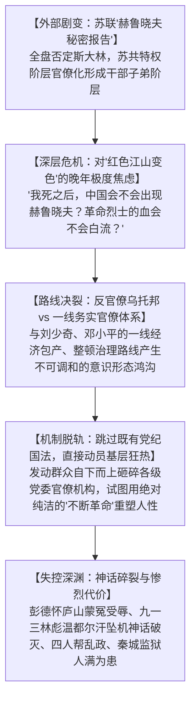
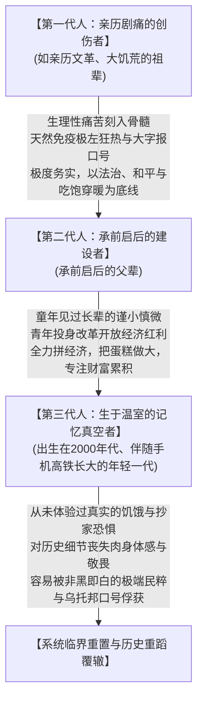
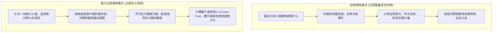
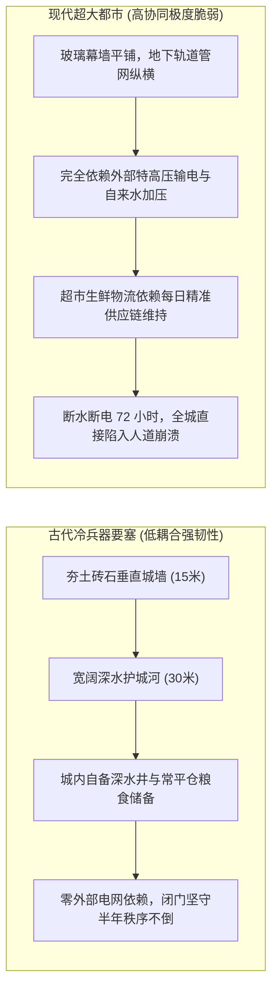

在探讨现代文明与大国兴衰的脉络时，我们往往容易产生一种平稳的“温室错觉”：

夏夜的街头挤满了吃烧烤、喝啤酒的食客，手机里的外卖半小时即可送达，高铁在平原上以时速三百公里呼啸穿梭。这种高度繁荣、富足且万籁俱寂的安宁日常，很容易让生于承平日久的年轻一代相信，文明的演进是一条永不回头的单向斜坡，动荡与饥荒只是故纸堆里的历史化石。

然而，一旦拉开长程历史的广角镜头，审视现代信息技术对政治机器的赋能、政权交接的血腥暗面、代际记忆的生理性半衰期，以及过度压制微小矛盾所蓄积的地壳应力，一个冷酷的复杂系统力学命题便会浮出水面：

**承平维持得越久、地表被压制得越平静，系统底层的可燃物载荷就堆积得越厚；当失衡不可逆转地降临时，最终释放出的震级反而越呈现毁灭性。**

本文顺着一场横跨政治哲学、代际社会学与系统力学的深层思辨，忠实还原这场讨论层层剥茧的思想推演。

---

## 一、 科技的异化：为什么现代网络没有消解压迫，反而加固了极权闭环？

思辨的原点，始于一个反常的情报标本：在高度封闭、国民经济甚至面临温饱挑战的朝鲜，何以能够培养并维持一支规模数以千计、在全球金融网络中攻城掠地的高水平国家级黑客部队（如 Lazarus Group）？

很多人基于技术乐观主义，曾预言互联网与计算机的普及将天然瓦解极权统治。然而，现实的政治社会学演进却展现了截然相反的面貌：**现代信息通信技术（ICT）非但没有天然解放个体，反而彻底填补了古代暴君在物理统治带宽上的绝对盲区。**

### 1. 填补“皇权不下县”的物理短板
在农耕封建时代，哪怕是最残暴的帝王，受制于驿站马匹的传递极限，朝廷对基层的控制颗粒度也极其粗糙。朝廷只关心收粮征税，至于村民在田间地头说了什么、家里供奉何物，在物理上既无法感知，更无力干涉，民间的物理逃亡与心理缓冲极其广阔。

而现代信息通信技术彻底扭转了这一攻防平衡：
- **从物理管辖走向意识穿透**：高频基站三角定位、移动支付轨迹、人脸识别算法与网络日志审计，使个体在物理上脱离中央数据库的自由流动成为不可能；
- **横向协同的物理扼杀**：国家机器掌握了所有主干交换机与根证书，底层两个素不相识的个体想要绕过中心节点完成组织串联，在概率论上被压制到了绝对零点。

科技并没有自发带来权力的分散，反而把专制机器武装成了古代帝王在梦中都无法想象的“数字全景敞视监狱”。这解释了为什么某些落后政权在掌握现代技术后，其统治稳固度反而远超古代王朝——因为技术消灭了所有可以微量泄洪的宗族与民间自治缓冲带。

---

## 二、 权力的暗面：东亚清算怪圈与美国的政治暗杀

当把目光从封闭国家移向当代主要大国时，权力交接的血腥程度同样颠覆了常人的童话想象。

### 1. 韩国“青瓦台魔咒”：威权转型的复仇惯性
韩国作为表面上高度发达的工业民主国家，其历任总统的下场几乎构成了一部现代政治刑罚史：
- 朴正熙在晚宴上被中央情报部部长金载圭近距离枪杀；
- 全斗焕、卢泰愚在卸任后双双被押上法庭，分别判处死刑与无期徒刑（后获特赦）；
- 卢武铉在卸任后遭遇李明博政府的司法深挖与人格羞辱，最终在峰下村后山决绝跳崖；
- 朴槿惠、李明博晚年双双锒铛入狱，身陷数十年的漫长刑期。

这种“上台即清算前任、下台即沦为阶下囚”的青瓦台怪圈，揭示了东亚社会在急剧现代化过程中，**封建家阀宗族、财阀垄断资本与现代检察官司法权力纠缠在一起的恶性博弈**。缺乏真正的宪政宽容与政治妥协传统，制度便会退化为零和博弈的你死我活。

### 2. 美国政治权力的另一面：程序防政变，但防不住孤狼刺杀
对比之下，美国建国两百余年未曾发生过正规军发动的军事政变，似乎展现了宪政体制的高度稳定。但这种稳定的代价，是**将最高权力的非正常更迭推向了极端暴力的民间暗杀**：
- 亚伯拉罕·林肯在福特剧院被南部同情者近距离射杀；
- 詹姆斯·加菲尔德在火车站被失意求官者枪杀；
- 威廉·麦金莱在世博会上遭遇无政府主义者刺杀；
- 约翰·肯尼迪在达拉斯街头众目睽睽之下被狙击枪打碎头骨；
- 罗纳德·里根在酒店门外中弹险些丧命；
- 乃至近年来唐纳德·特朗普在宾夕法尼亚集会上被子弹擦破耳廓。

美国通过分权制衡与严格文官统治，在制度上物理锁死了国防军发动军事政变的可能；但它那高度崇尚持枪权、撕裂极化的民间社会，却使得最高权力的安危时刻暴露在散点式的孤狼枪口之下。**世界上没有任何一种体制是免费的，任何表面平稳的背后，都标好了各自维度的代价值。**

---

## 三、 领袖晚年的心境困局与乌托邦失控

正是在对比了外部大国权力的残酷性之后，讨论触及了中国现代史上最为沉重的一页：

**“他是怎么想的？像毛主席这样雄才大略、带领队伍从死人堆里走出长征、打败强敌的英明领袖，难道没有办法确保自己判断的对错吗？为什么晚年还会陷入那样一场旷日持久的巨大动荡？”**

理解这段历史，绝不能用低级的“昏君奸臣”脸谱去粗暴解构，必须回到当时冷战最高潮、国际共运大分裂的宏观时空场域，去触摸那个充满悲剧色彩的晚年心境。

### 1. “反修防修”的偏执与对苏修变色的心理恐惧
建国后，苏联赫鲁晓夫在苏共二十大上发表批判斯大林的“秘密报告”，以及随后苏联内部形成的“勃列日涅夫特权阶层”（干部特供、别墅庄园、子女世袭），对毛泽东产生了毁灭性的心理震撼。

他一生最深沉的恐惧，就是**“千千万万烈士流血牺牲打下来的江山，会不会在他死后和平演变？党内的高级干部会不会蜕变为骑在工农头上的官僚资产阶级特权阶层？”** 这种对“党变修、国变色”的极度警惕，逐渐上升为一种近乎偏执的意识形态防御本能。

### 2. 浪漫主义乌托邦与冷酷行政治理的不可调和
在建国后的经济建设中，面对大跃进后的国民经济调整，主持中央一线的刘少奇、周恩来、邓小平主张务实妥协（如“三自一包”、包产到户），以恢复农业和工业生产。

但在毛泽东眼里，这种向小农经济与物质刺激的妥协，正是“走资本主义道路”的典型危险苗头。他渴望建立一个没有特权、没有官僚、工农当家作主的绝对平等乌托邦。当他发现庞大的官僚行政体系如同橡皮泥一样，温和地抵制他的激进构想时，他做出了一个在人类宪政史上极其罕见的决断：

**他放弃了自己亲手缔造的党政官僚机器，越过所有制度与法律程序，直接向数以千万计狂热而单纯的青年学生与工农群众发出号召，自下而上地砸碎各级党委与政府机关。**

### 3. 失控的代价：从理想主义狂热到秦城深宫
然而，社会的运转依托于极其复杂的秩序网络，绝非凭空涌现的革命激情所能维系：
- **彭德怀的悲剧**：在 1959 年庐山会议上，戎马一生、耿直忠诚的彭老总只因写了一封陈述民间饥苦的万言书，便被定性为反党集团，晚年受尽残酷批斗与病痛折磨；
- **九一三事件的致命一击**：被白纸黑字写进党章的“亲密战友和法定接班人”林彪，在政治斗争失败后乘飞机仓皇外逃、折戟沉沙于蒙古温都尔汗荒原。这一事件在客观上彻底击碎了“领袖永不犯错”的政治神话，让千千万万狂热的红卫兵在一夜之间陷入了信仰幻灭的政治休克；
- **秦城监狱的历史注脚**：作为专门关押党内高层与政要的特殊场所，秦城监狱见证了这场运动的荒诞循环——从起初被批斗的老干部，到后来林彪集团的黄吴李邱，再到最终受审的江青、张春桥“四人帮”。24 小时红外监视、无棱角海绵防自杀设施，成了政治运动吞噬其自身操盘手的冰冷物理见证。

这种悲剧深刻地回答了那个质问：**即便是一个动机极其纯粹、功勋盖世的旷世领袖，一旦脱离了制度的纠偏制衡、将个人对乌托邦的想象凌驾于现实生产力与法治之上，其所带来的破坏力，往往比平庸之恶更加深重百倍。**

---

## 四、 代际遗忘半衰期与文明的教育周期律

在梳理完这段历史后，一个更加震撼的现实反差摆在面前：**你的爷爷是文革的亲历者，那段惊心动魄的动乱距离今天，仅仅过去了半个世纪，满打满算不过两代人时间。**

为什么才过了短短两代人，今天的年轻人就对那段刻骨铭心的创伤感到如此陌生、甚至在网上开始浪漫化当年的狂热口号？

这揭示了文明在代际更替中一条残酷的生理学铁律：**“集体创伤记忆的半衰期”，决定了大国历史周期的震荡节律。**

### 1. 第一代人的“生理性免疫抗体”
亲历过动乱、挨饿和非正常批斗的一代人（如当下的祖辈），他们对于极左思潮、对于搞运动整人、对于上纲上线扣帽子，有一种**刻在胃部痉挛与深夜心跳里的生理性恶心**。

他们不需要读什么高深的政治哲学大部头，他们的理性和常识是靠挨饿和恐惧换来的。这代人无论掌握多大权力，其本能的第一反应永远是“千万不能再折腾”、“必须坚持以经济建设为中心”、“黑猫白猫抓住老鼠就是好猫”。只要这代人依然健康地坐在决策席上，整个国家机器哪怕遭遇惊涛骇浪，也绝不会轻易偏离务实的主航道。

### 2. 第三代人的“记忆真空”：教科书无法传递肉身痛苦
然而，文明的脆弱性在于碳基生物的生理寿命是有上限的：
- 当第一代亲历者逐渐老去、墓碑上的风霜逐渐模糊；
- 第三代年轻人出生在有空调、外卖、高铁和移动互联网的超级和平温室中；
- 对他们而言，文革的武斗抄家、大清洗的暗夜枪声、物资匮乏的粮票布票，不过是历史教科书上几句冰冷、毫无温度的抽象印刷铅字。甚至在短视频滤镜与自媒体情绪煽动下，被解构加工成了一种“那个年代没有贫富差距、只有纯粹信仰”的浪漫化幻想。

量子力学奠基人马克斯·普朗克曾揭示过一条著名的科学史法则：
> **“科学的真理并不是通过说服反对者而胜利的，而是因为反对者终于都死光了，在他们死后成长起来的新一代从一开始就接受了新的真理。”**

在人类的政治文明与制度演进中，这个法则呈现出了最悲剧的镜像翻转：
**理性的法治共识与常识底线，往往不是因为极端的观念被证明正确而瓦解，而是因为当年亲历过剧痛惩罚的那一代人全都死光了。新一代人在缺乏肉身敬畏的记忆真空中，很容易在某种崭新包装的崇高口号下，步履轻快地重新踏入那个曾经吞噬一切的历史深渊。**

---

## 五、 森林野火悖论：过度防火如何把系统推向毁灭性树冠火？

这种代际遗忘，与当前社会的运行机制产生了危险的共振，引申出了生态学与管理学上著名的**“森林野火悖论（Smokey Bear Effect）”**。

### 1. 斯莫基熊效应与可燃物载荷
在自然森林生态中，定期的轻微雷击火只燃烧地表枯萎的杂草与落叶，不仅烧不死参天大树，反而定期出清了系统的易燃杂质，释放了养分。

然而，当现代林业部门引入极其发达的消防技术，追求“五十年绝对零火灾”的平稳政绩时，悲剧的引线便被埋下：
- 每一处本该自生自灭的小火星均被以最快速度扑灭；
- 原始地表上的落叶、枯枝与枯死灌木在数十年间越积越厚，系统的**“可燃物载荷（Fuel Load）”被无限推向物理极限**；
- 当某一天，一场无论如何也无法被人工干预的干雷暴劈向林区时，它绝不再是一场地表小火，而是会瞬间引燃所有干柴，升腾为高达上千度、将整片森林生态连根拔起烧成焦炭的**毁灭性树冠火（Crown Fire）**。

### 2. 社会微量泄洪机制的丧失
在国家治理与社会结构中，这套系统力学定律同样丝毫不差地运转着：
- **健康的社会系统高度依赖“日常微量泄洪”**：允许民间存在小摩擦，允许市民通过独立的法治诉讼去争辩对错，允许劳资双方通过谈判博弈利益，允许文学创作直面政治权力的复杂与灰度（而不是在历史网文中写一段正常的官场政治勾兑就被警告“不要命了”）。这种低烈度的日常思想冲撞与制度纠偏，本质上是系统在安全排空底层的易燃应力；
- **过度维稳的致命陷阱**：如果一个系统把消除“哪怕是网络上最微小的异见与抱怨”当作绝对安全红线，把所有低烈度的矛盾强行用高压手段抹平封口，表面上看确实是一片万籁俱寂、秩序井然的“绝对平稳”；
- 但矛盾与应力并没有在物理上蒸发，它们只是被强行压进了地壳深处。推迟得越久，系统积蓄的地壳应力就呈指数级飙升。

### 3. 系统韧性的逆转：现代都市的极致脆弱性与古代要塞
一个极具启发性的工程学思想实验，是对比现代高度分工社会与古代封建要塞在面对系统性冲击（如极端的丧尸围城模型）时的抗毁弹性：

- **现代大都市是为高效流转而优化的“零防御系统”**：现代人享受着自来水、特高压电网与即时物流的极致便利，但这套精密网络的容错空间几乎为零。一旦外部电力输入切断、供水管网失压，超大都市在 72 小时内就会因断水断粮、排污系统瘫痪而陷入内部休克；
- **古代城防工程的物理降维碾压**：古代要塞是纯粹为了抵御数十万冷兵器步兵而设计的杀戮堡垒。15 米高的垂直石砌城墙、数十米宽的深水护城河，自备粮仓与水井，即便外界完全阻断，闭门坚守数月依然秩序不乱；
- **力学对“尸潮搭人梯”的终极否定**：好莱坞大片中常见的“成千上万丧尸堆叠成人肉斜坡跨越城墙”场景，在严谨的土力学与流体力学面前纯属视觉奇观。人体组织 70% 是水分与软组织，松散物体的**休止角（Angle of Repose）**决定了堆叠 15 米高的斜坡，底座宽度必须达到数十米。在数千吨自重碾压下，底层的人体会瞬间被压裂成流体泥浆发生侧向滑坡坍塌，根本无法提供攀爬所需的垂直剪切力。

这个力学对比深刻地揭示了现代文明的本质代价值：**我们用“极度精密的协同网络”换取了极高的生产力与舒适度，但代价是彻底交出了所有的底层物理韧性。系统越精密，其面对未知断裂时的休克速度就越呈现雪崩式。**

---

## 六、 终局追问：长生精灵社会的傲慢死局与文明的新陈代谢

顺着这一系列层层递进的残酷追问，讨论最终推导出了那个看似离经叛道、实则振聋发聩的核心假说：

**“如果人类像奇幻小说里的精灵一样长生不老、没有疾病、没有内乱，所有人永远生活在和平之中，难道不是一种终极乌托邦吗？”**

答案极其冷酷：**这非但不是乌托邦，反而是宇宙中能被设计出来的最绝望的“赛博停滞地狱”。**

### 1. 永生社会的“老玩家不毕业”绝境
如果碳基生物没有寿命上限、没有肉身死亡：
- 第一代开拓者、长老、资本掌控者与学术权威，将凭借永恒的生命永久垄断最核心的政治权力、最好的生产资料、最重要的知识产权与社会话语权；
- 哪怕经历了一万年，新出生的年轻个体在这些资产与人脉盘根错节的千岁老人面前，在物理上永远看不到任何向上晋升的希望；
- 上升阶梯被绝对焊死，思想范式被永恒的先贤神话所禁锢。整个文明将不可避免地退化为一个绝对傲慢、绝对僵化、彻底丧失创新与纠错活力的木乃伊社会。

### 2. 动荡与出清：文明层面的“垃圾回收机制（Garbage Collection）”
从数千年乃至万年的文明演化宏观视角审视，社会矛盾的爆发、政权的周期性更迭，固然伴随着惨烈的人间悲剧与血泪代价；但从系统演化力学来看，它在客观上扮演了**“强行粉碎深层固化利益集团、重置分配天平、为下一代幼苗腾出阳光”的残酷生理排毒机制**。

在计算机操作系统中，如果没有垃圾回收机制（GC），内存泄漏最终会导致整台机器彻底死锁崩溃。人类文明亦是如此：
每一次体制的震荡与重构，都像一场森林野火，烧尽了堆积在底层的僵化枯叶，迫使人类从废墟中总结出更具容错性的新制度法典。从秦汉郡县到近代宪政，从绝对君权到分权制约，**文明的每一次制度跃迁，从来都不是在风平浪静的请客吃饭中自发诞生的，而是在一次次撞破南墙、流尽鲜血之后，被动逼出来的制度免疫力升级。**

---

## 七、 结语：在历史周期的冷酷铁律中，守护具体的烟火

回到我们在讨论开头提出的那个困惑：既然宏观的历史周期如此冷酷，既然文明的繁荣潜藏着脆弱性，我们在街头吃着烧烤、喝着啤酒、看着周围形形色色普通人穿梭的安宁日常，究竟算是什么？

答案正是这场思辨最深沉的落脚点：

今天我们能够在和平的街道上享受一顿充满烟火气的宵夜，能够在安静的书桌前敲下这些文字、在地铁车厢里戴着降噪耳机去体味一段细腻的文字，**这绝不是什么永恒不变的自然天赐，而是我们的父辈与祖辈在穿越了漫长的饥寒、动乱与血泪之后，用整整两代人的隐忍、务实与苦干，在残酷的历史断层中为我们生生截流争取来的“奇迹时刻”**。

理解危机的不可避免，不是为了滑向虚无与恐惧，而是为了让我们在繁荣的平原上行走时，多一份对复杂常识与历史伤疤的敬畏，少一份对极端狂热与空洞口号的盲从。

唯有认识到地表平静背后的可燃物载荷，守住对具体生活的感知，守护好那条允许微小矛盾日常释放的微量泄洪通道，人类才能在这台高速运转的精密现代机器深处，让头顶哪怕微弱但温暖的日常微光，在冰冷的周期铁律中多亮起哪怕一秒。
