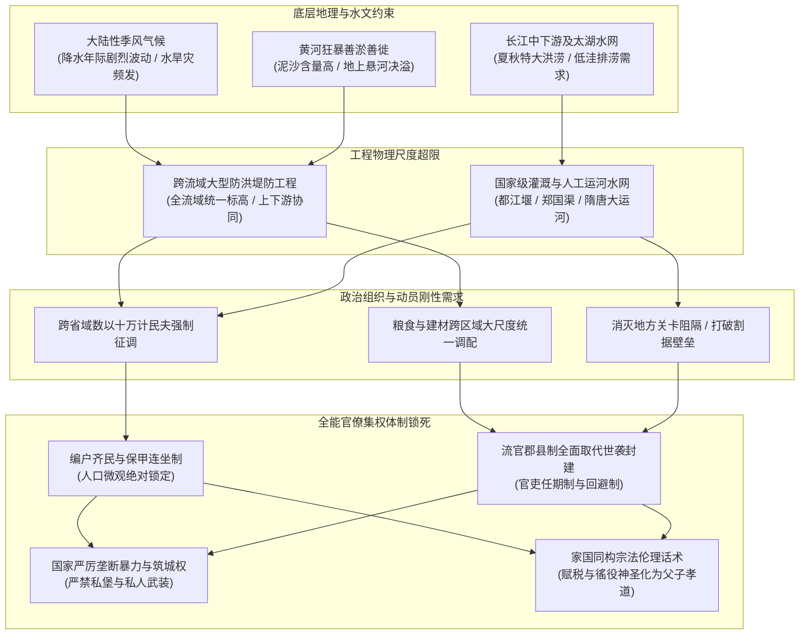
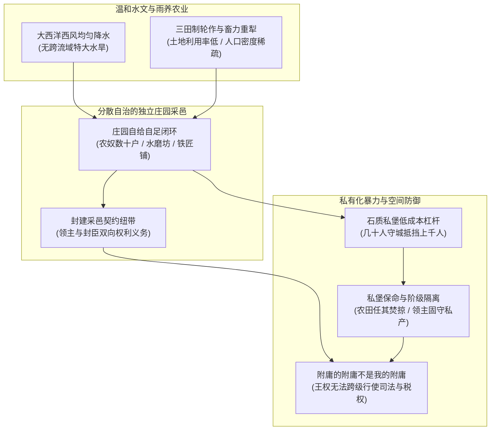
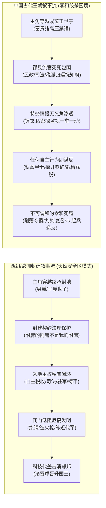
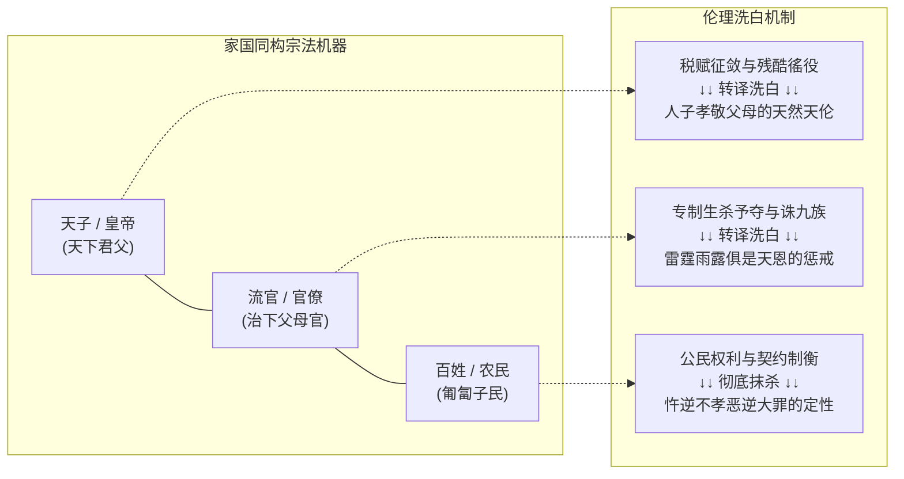

## 引言：跨文明的终极直觉悖论

在通俗文艺、史诗电影与奇幻小说中，欧洲中世纪往往呈现出一套高度标准化的符号图景：险峻悬崖上伫立的尖顶石质城堡、披挂锁子甲或全身板甲持长柄骑枪冲锋的骑士、各自闭门称雄的采邑领主，以及在领主与封臣之间维系秩序的封建契约与等级议会。

然而，将视线转向古代中国，我们会遭遇一套截然不同、甚至完全相反的空间组织形态与制度景观：放眼两千年秦汉至明清的漫长历史，华夏大地上几乎找不到遍布乡野田间的私人独立石堡，也从未长期存在一个凭借私人封邑、世代世袭、拥有独立武装采邑的专业“骑士武士阶层”。取而代之的，是占地数十平方公里、将官衙、市坊与数十万军民严密包裹在夯土包砖外墙内的大城郭；是跨越千里关山、调动数十万军民修筑的长城、关隘与大运河；是三年一任、不带一兵一卒赴任的异地流官知县；以及由黄册、鱼鳞图册、保甲连坐和宗族祠堂共同编织的全能中央集权大网。

这种强烈的文明形态反差，往往引发初学者和历史爱好者的强烈困惑：
为什么“同样是以农立国”，东亚大陆没有走向分散割据的领主采邑与骑士庄园，而是演化出了人类历史上组织度最高、动员力最彻底的大一统全能官僚帝国？
为什么中国古代没有遍地开花的私人城堡？
为什么先秦之后，个人武勇的贵族武士彻底绝迹，战场演变为十万量级的工业化军阵？
甚至在当代网络文学的创作机制中，为什么穿越到西方封建时代当领主是公认的“基建种田爽局”，而穿越成中国古代的藩王世子，却往往演变成随时面临九族抄斩的高压生存绞杀局？

对于这些疑问，最肤浅的解释往往诉诸于唯心主义的“观念选择”或“文化宿命论”——诸如“中国人自古热爱和平与统一”、“西方人天生崇尚自由与契约精神”。这种倒果为因的解释在现代历史法医学面前不堪一击。任何长期稳固的社会政治形态，绝不是先民开会投票“挑选”出来的道德观念，而是特定地理环境、气候降水分布、生态能量流动以及具体农业生产技术形态在数千年物理博弈中，层层嵌套、相互锁死所形成的刚性“路径依赖”。

本文将从水文地理与生态硬件、空间筑城哲学与暴力垄断、军事专业化演进、叙事机制透视以及意识形态反向死锁五个维度，彻底拆解东亚大陆与西欧平原分道扬镳的物理因果链。

---

## 生态底层硬件：“同样是种地”，却是两个完全不同的物理物种

很多人在探讨文明起源时，容易使用一个极其宽泛且模糊的概念——“农耕文明”。在传统认知中，仿佛只要是种小麦或水稻，社会组织的演化逻辑就该大同小异。然而，从生态动力学与微观农业技术的物理底层来看，欧洲中世纪的农业与古代东亚的季风农业，在协作尺度、能量流动与生存压力上，完全是两个截然不同的物种。

### 降水分布与跨流域工程：雨养农业 vs 灌溉农业

文明组织形态的第一个硬核分水岭，是由大气环流决定的降水时空分布规律。

欧洲中西部（英法德及低地国家）地处温带海洋性气候与地中海气候过渡区。常年盛行来自大西洋的西风气旋，降水在一年四季中分布极其均匀，几乎没有明显的雨旱季剧烈撕裂。更为重要的是，欧洲主要河流——塞纳河、莱茵河、多瑙河、易北河、泰晤士河——水流常年平缓，落差均匀，极少发生摧毁数省的周期性滔天洪涝。这种温和的水文条件，使得欧洲农业属于典型的“雨养农业（Rainfed Agriculture）”。农民开垦田地、播下麦种，主要仰仗自然的降雨润泽。农业生产的基本单元，完全可以收缩在一个方圆数里的小型庄园内部。

与此形成残酷对照的，是东亚大陆面临的暴烈自然环境。

东亚地处世界上面积最大、能量最狂暴的季风气候区。太平洋季风每年夏季北上、秋季南退，其推进速度与强弱具有极大的年际不可控性：
- 季风推进迟缓，北方中原与关中平原便发生赤地千里的大旱；
- 季风推进过快并长久滞留，长江、淮河、黄河流域便发生数省沦为泽国的毁灭性洪涝。

尤为严酷的是华夏文明早期的核心发源地——黄河流域。黄河穿越水土流失严重的黄土高原，携带巨量泥沙（年均含沙量世界第一）。一旦进入水流变缓的下游华北平原，泥沙迅速淤积抬高河床，形成高出两岸地面数米乃至十数米的“地上悬河”。黄河“善淤、善决、善徙”，平均三年两决口、百年一大徙。每一次决口改道，波及数百里，吞没良田万顷，饿殍遍野。

在这样的水文硬约束下，中国先民想要生存繁衍，就必须直面超越人类个体与单一村庄极限的工程命题：
1. **防洪治水**：黄河筑堤不是某一个村庄、某一个乡里筑起一段土坝就能解决的。上游决堤，下游数千里平原尽成泽国；下游淤堵，中游河水倒灌泛滥。全流域的防洪必须全国一盘棋、全流域协同，要求统一部署、统一标准、统一调度物料与民夫；
2. **引水灌溉**：关中平原土质肥沃但干旱少雨，战国时期秦国开凿的郑国渠长达三百余里，引泾水注入洛水，灌溉良田四万余顷；巴蜀平原李冰父子修建的都江堰，利用鱼嘴分水、飞沙堰排沙、宝瓶口引水，将狂暴的岷江驯服为灌溉天府之国的超级水网；江淮与江南水网纵横，太湖流域必须通过开凿溇港体系、修筑围堤圩田，才能实现排涝保收。

上述任何一项古代水利工程，其动员的劳动力规模都在数万人到数十万人之间，工期跨越数年乃至数十年，消耗的粮食、石材、木料以万吨计。这种物理工程尺度，从根本上剥夺了地方封建领主独立生存的物理可行性：
- 一个独立的骑士领主，绝无可能凭借自身庄园的几百名农奴开凿郑国渠或维系黄河千里长堤；
- 假若允许黄河沿岸割据出几十个互不统属的封建小邦，上游领主随意掘堤放水淹没下游，下游领主修筑高坝阻断上游泄洪，整个流域将在水旱灾害中同归于尽。

因此，季风气候与大河水文在物理层面上构成了不可逆的制度选择压：它客观上强制要求产生一个拥有绝对权威、能够打破一切地方壁垒、跨省域调动人力物力与粮食的全能型中央集权调度中枢。这就是卡尔·威特福格尔在《东方专制主义》中提出但被后世泛化讨论的“水利社会（Hydraulic Civilization）”假说背后的真实物理内核——不是专制制度创造了水利，而是跨流域大规模水利的物理刚性约束，在客观演进中倒逼并筛选出了中央集权官僚体制。

### 土地利用与劳动力密度：内卷式精耕细作 vs 粗放式轮作庄园

生态硬件的第二个根本差异，体现在土地耕作制度与微观劳动力组织形式上。

欧洲中世纪农业长期实行“二田制”或“三田制”轮作：
- 三田制将领地耕地分为三块：一块秋播冬小麦，一块春播大麦或燕麦，第三块土地必须彻底强制休耕，作为草场放牧牛羊，依靠牲畜粪便自然恢复地力；
- 欧洲庄园大量依赖重型轮犁以及牛、马等大型牲畜提供畜力。重型轮犁由六到八头牛牵引，能够翻开北方湿重黏土，但也导致耕作面积广大而浅疏；
- 这种生产模式的土地利用率极低（常年有三分之一到二分之一土地处于荒废休耕状态），单位面积土地的粮食产量上限很低，但相应地，其对单位土地上的劳动力投入密度要求也很低。

一个典型的欧洲中世纪采邑庄园，往往只需容纳数十户农奴（Serfs）。他们围绕着领主的城堡或居所聚集居住，每周为领主服两至三天的劳役，其余时间在自己的条田上耕作。庄园内部设有简陋的水磨、铁匠铺与烤面包炉，领主通过习惯法、庄园法庭与封建契约处理纠纷。这种极低人口密度、重畜力投入、低土地利用率的农业生态，天然具备高度的孤立性与去中心化特征——一个庄园就是一个自给自足的生态微循环闭环，外部即便切断与远方的联系，庄园内部依然可以运转数百年。

而古代中国走上了一条完全相反的农业进化道路——极高人口密度的“内卷式精耕细作”。

东亚季风区土地肥沃，但人均耕地资源长期处于极度紧张状态。为了在有限的土地上养活数倍于欧洲的人口，华夏农耕技术将微观精细化推向了物理极致：
- 水稻栽培讲究培育秧苗、适时抢插、精细除草、中耕松土、多重追肥（人畜粪便、绿肥、草木灰混合发酵）、精巧控水；
- 北方旱地农业讲究深耕细耙、保墒防旱、间作套种、多熟轮作；
- 这种农业生产形态对“死物资本（牲畜、铁具）”的依赖度相对较低，而对“微观活劳动（人力的极端精巧与耐劳）”的投入密度达到了近乎无限的渴求。

这种极致精耕细作的微观生态，带来了极其严酷的制度副产物：
1. **人口必须被死死锚定在土地上**：土地稍有荒芜，精细水利网络稍有破损，全家便面临饥荒横死。国家为了确保农业赋税与治水劳役，绝不允许出现大量游离于土地之外的流民或私人领主的隐匿人口；
2. **国家必须直接穿透到最小家庭单元**：欧洲封建领主只关心庄园整体交纳的租税，不介入农奴家庭内部的微观控制；而中国中央集权政府通过商鞅变法以来的“分户令”、“编户齐民”、“什伍连坐”，直接把国家度量衡、户籍黄册与丁赋税收硬生生穿透到每一个成年男丁身上。

为了维持这种极高人口密度的微观秩序，父权宗族制度被国家权术深度改造并收编。以父系血缘为骨架的家族伦理，成为了国家动员劳动力成本最低、组织结构最稳固、最不易解体的底层执行网格。

---

## 筑城保民 vs 私堡保命：军事防御与暴力垄断的制度分流

地理与农业生态决定了基层的组织密度，而这种密度直接映射到了文明的空间防御构造与暴力工具的形态上。为什么欧洲大地充斥着私家石堡，而古代中国留下的却是雄伟的城郭与关隘？

### 欧洲城堡的微观经济学与暴力杠杆

在欧洲中世纪，私有石质城堡（Castle）的出现，本质上是极度碎片化的封建政治体在技术与财力极其贫乏的约束下，所能选择的最经济的暴力投资。

一个封建公爵、伯爵乃至小小的封邑骑士，其管辖的采邑人口少则数百、多则数千，全年的粮食与货币产出极其有限。他们根本无力出资修筑周长数公里、将全领地农奴与农田全部圈护起来的大型城墙。对于领主而言，最具性价比的防御策略，是在领地内的险要制高点（如悬崖、山丘、河流转弯处），耗费数年修建一座易守难攻的石头碉堡。

城堡在微观力学与攻防博弈中具备惊人的“防御不对称杠杆”：
1. **极致的兵力放大效应**：一座设计精良的石质城堡，配备深沟、吊桥、狭窄陡峭的旋转阶梯、箭孔与外凸的悬机眼（Machicolations）。在火药重炮普及之前，内部只需驻守二三十名披甲卫士与弓弩手，便足以抵挡数百名甚至上千名围城部队数月之久；
2. **战术逃逸与阶级隔离**：城堡从来就不是为了保护底层农奴建立的。当外部敌对领主的骑兵来袭时，领主及其家族、亲兵迅速撤入城堡，拉起吊桥。敌军在城堡外践踏庄稼、焚烧农舍、掠夺牛羊，但面对坚不可摧的石墙却无可奈何。围攻者在野外缺乏后勤补给，不仅每日耗费巨额粮饷，而且极易爆发霍乱与瘟疫；
3. **僵局与谈判杠杆**：围攻往往持续数月后以谈判妥协告终。敌军退去后，领主放下吊桥走出城堡，外部的农奴重新在废墟上搭建木屋、开垦农田。城堡是领主用来保卫自身家族血脉与私人特权的终极物理屏障，是地方私人武装割据对抗上层王权削藩的物理基座。

在欧洲封建法中，领主在自己的采邑内筑堡是其受神圣契约保护的封建权利。国王若要拆毁贵族的私人城堡，必须经过冗长的法律诉讼或发动极其惨烈耗时的内战。

### 中国的城池本质：国家公共防御与“筑城保民”的大城郭

与欧洲领主的私人石堡截然相反，古代中国的筑城哲学从一开始就排斥私人化与微型碎片化，而是完全服从于国家行政垄断与区域公共防御。

中国古汉语中，“城”与“郭”是两个界限分明的概念：
- “内之为城，外之为郭”；
- “城”是政治核心，用于安放官衙、官署、太庙与驻军；
- “郭”则是宽广的外郭城墙，用于将集市、商贾工匠作坊以及成千上万的平民居民区彻底包纳进防御体系之内。

《吴越春秋》明确记载先秦时期的造城纲领：“筑城以卫君，造郭以守民”。中国古代城市的物理形态，绝不是某个贵族用于对抗外部强权的私人龟缩碉堡，而是国家政权设立的区域人口庇护中枢与税赋粮食集散枢纽。从汉唐长安、北宋汴京到明清北京，这些大型都市占地动辄数十乃至近百平方公里，城内居民达几十万乃至百万人。在城市规划上，隋唐长安城推行严格的“里坊制”，城内划分为一百零八坊，横平竖直如围棋盘。夜晚关闭坊门，宵禁严密；白日击鼓开门，市坊分离。这套空间设计既是抵御外敌的坚固堡垒，又是中央政权监视防范内部民变与私人武装聚集的行政监牢。

更为关键的是国家对暴力工程的绝对排他性垄断。

在大一统王朝的法律体系中，“私筑要塞”与“私蓄甲兵”是性质极其恶劣的重罪。
- 《唐律疏议·贼盗律》与《大明律·刑律》中，无朝廷兵部与工部明文诏谕，私自于险隘之地修筑深壕高垒、私造甲胄弩机者，直接定性为谋反大罪，一律处以凌迟极刑，株连三族；
- 帝国境内的所有城墙，上自省城府城，下至偏远县城，其规制、城高、垛口、门洞数量全部受到《工部营造法式》等国家典章的死板约束。知县、知府作为三年一任、必须回避籍贯本省的外来流官，其职责只是代表朝廷管理城防，绝无可能将县城据为己有、改造为世代割据的私人私堡。

**历史逆向法医印证：魏晋南北朝的北方坞壁**

中国历史上是否完全没有出现过类似欧洲城堡的形态？出现过，但这恰恰反向证明了中央集权的物理逻辑。

在西晋八王之乱与永嘉之乱后，北方中原陷入长达近三百年的大分裂，游牧与半游牧军阀在中原平原上相互屠戮，中央集权官僚系统彻底灰飞烟灭。在这一极端真空期，北方汉人士族为了生存，被迫退回宗族武装结寨自保，在崇山峻岭间依山傍险修筑了大量石木混构的“坞壁（坞堡）”。坞壁内部蓄积粮草，设哨塔、滚木礌石，由宗族领袖（坞主）率领部曲族人武装防守，形态与功能极其类似欧洲中世纪的封建私堡。

然而，一旦北魏孝文帝完成汉化改革、均田制确立，乃至隋唐重建大一统中央集权之后，朝廷的第一道铁律便是“平毁坞壁、拆除私堡”。数以百万计藏匿在私家坞壁中的部曲农奴，被强制剥离出来，重新登记入国家户籍黄册，分给均田，纳入租庸调制与府兵制。

这一历史反复深刻揭示了一个铁律：**在中国，私家城堡只能是国家崩溃、秩序瓦解时的畸形生存代偿；一旦大一统秩序重建，全能官僚帝国绝不可能容忍其统治疆域内存在任何不可穿透的私人暴力自治孤岛。**

---

## 武装力量的消解与重构：为什么中国告别了“骑士时代”

伴随空间防御形态分化的，是战场武装人员身份与阶层属性的彻底质变。为什么欧洲战场由贵族骑士统治了近千年，而中国早在战国时期就将贵族骑士扫进了历史垃圾堆？

### 从春秋之“士”到平民军阵：战国法家变法的降维打击

许多现代人误以为古代中国一直缺乏尚武传统，这是一种严重的后世刻板印象。实际上，在先秦西周与春秋时期，华夏大地上曾存在过一个极其纯正的“骑士时代”——“士”阶层。

春秋时期的战争，完全是贵族阶层的专属特权与名誉竞技：
- 参战主力是驾驭战车的贵族武士（士）。他们头戴青铜胄、身披皮甲，一人驾车、一人持戈矛、一人执弓矢，腰间佩带精炼双刃青铜剑；
- 战争严格遵循《司马法》所规定的贵族礼仪：战前要互派使者致敬赠礼；战场上“不加丧，不因凶”，敌国国君去世不打；交战时“不鼓不成列”，必须等对方列好阵型才能击鼓进军；追击逃敌“不过五十步”；绝不攻击已有白发的老兵（“不击二毛”）。

这种充满仪式感与贵族特权的战争形态，在战国大变法时代遭遇了灭顶之灾。

以秦国商鞅变法为代表的法家改革，彻底砸碎了西周分封制下的井田制与世卿世禄制：
1. **废除贵族血缘军职垄断**：宗室贵族无军功者，一律取消爵位与采邑特权；
2. **确立二十等军功爵制**：将爵位、田宅、奴婢与战场斩首数量直接挂钩，无论是贵族还是底层黔首，唯有斩得敌军甲首方能晋升爵位；
3. **推行平民普遍征兵制**：国家通过严密的户籍系统，将全体成年男性农民（编户齐民）编入预备兵役网格。战时一纸征召令，数月之内即可动员数十万大军。

当平民征兵制与大兵团协同战法降临战场时，讲究个人单打独斗、恪守贵族礼节的春秋之“士”瞬间被碾得粉碎。战国长平之战，秦赵两国动员兵力各自超过四十万，在长达数十里的战场上修筑百里石长城、深沟高垒，实施大规模兵团穿插合围与后勤绞杀。在动辄数十万人的工业化军阵面前，个体骑士的武勇微不足道。

### 兵器演化的冷血逻辑：双刃剑为何从战场彻底退役

与武装人员平民化、军阵化同步发生的，是兵器形态的无情技术筛选。

在流行文化中，“剑”常被赋予至高无上的浪漫色彩：西方骑士佩十字长剑，东方剑客白衣胜雪。然而，在冷兵器的法医级实战检验中，“剑”其实是一种在正规战场上极早便被淘汰的低效武器。

双刃剑的物理机械结构存在致命短板：为了实现双面开刃与重心平衡，剑身必须做得相对轻薄、截面多为菱形或扁平八面形。在面对无甲目标时，剑的刺击与挑划极其灵活致命；但两军对垒的阵地战中，士兵身披坚厚的青铜甲、铁扎甲或皮革重铠：
- 双刃剑用剑刃横向劈砍重甲时，由于缺乏厚重的脊背支撑，极易发生卷刃、崩口甚至直接折断；
- 剑身的穿透力完全依赖士兵的手臂臂力直刺，在对抗长柄武器冲锋时极度缺乏动能缓冲。

因此，早在汉代甚至战国晚期，中国军队的一线主战兵器就已经彻底抛弃了剑：
- **阵列对抗**：追求“一寸长一寸强”，全军普及两丈长的长枪、大戟与铁铍；
- **远程杀伤**：发展出机械精度极高、带有望山（瞄准刻度）的三棱穿甲强弩，成排齐射，数十步外直接穿透重铠；
- **近战破甲肉搏**：全面换装单刃、厚脊、直身的大砍刀——汉代“环首刀”与唐代“陌刀”。环首刀背部极其厚重，锻造采用百炼钢折叠夹钢工艺，挥砍时士兵可以倾注全身力气凶猛劈砍，即便砍在铁甲骨骼上亦绝不折断；唐代陌刀更是“长七尺，刃长三尺，柄长四尺”，重达十几斤，专门用于阵前斩马断骑，史称“刀枪如林，步卒并进，人马俱碎”。

双刃剑在此后两千年中，彻底从实战主力兵器序列中退役，退化为两类非战争用途：
1. **士大夫阶层的礼仪配饰**：作为君子“宁折不弯、中正平和”的道德符号，悬挂于书斋朝堂，象征文治身份；
2. **江湖游侠与平民防身**：在没有重铠防护的市井斗殴、夜间行路或短兵防身中，双刃剑因其轻便、易佩带于腰间、刺击迅速，才成为了武侠小说所描绘的“江湖武器”。

### 欧洲骑士的经济生态位与战场局限

相比之下，欧洲中世纪之所以保留了骑士阶层与重剑格斗，并非其作战理念更先进，而是其社会缺乏维持中央常备军的财政与动员能力，被迫将战争承包给职业特权武士。

一名全副武装的中世纪重骑兵，其装备与后勤成本极其高昂：
- 一匹专门培育的重型战马（Destrier）、两到三匹行军马与驮马；
- 一整套精钢打造的锁子甲或全身板金甲（Late Medieval Plate Armor）；
- 专用的骑枪（Lance）、长剑、战锤、破甲短剑；
- 至少两名随从（侍从护卫与马夫）。

这样一套武装的物理成本，折合数个村庄一整年的全部农业剩余价值。只有将土地与农奴永久分封给骑士家族，让他们免除一切体力劳动、世代专职训练骑射劈砍，才能维系这支规模极小但个体破坏力惊人的职业暴力集团。

然而，这种建立在分散采邑上的骑士制度，致命弱点在于规模极其有限。欧洲中世纪一场决定王国命运的战役（如布汶战役、阿金库尔战役），双方参战的骑士往往只有数百到数千人，总兵力破万即被称为旷世决战。当这种分散的封建特权武士面对后来由中央财政供养的瑞士长矛方阵、英国长弓齐射，特别是黑火药推动的野战加农炮与滑膛枪方阵时，其耗费巨资打造的板金甲防线瞬间化为乌有，封建骑士阶层随之彻底瓦解。

---

## 流行叙事机制透视：西幻基建流爽点 vs 中国古代世子零和绞杀困境

上述地理、生态与制度的物理分流，不仅深刻刻蚀了两大文明的历史轨迹，甚至直接投射到了两千年后的现代大众流行文化中。

在当代的网络文学、架空历史与策略游戏中，存在一个极其有趣的叙事现象：
- 为什么在“西幻领主流 / 中世纪种田流”小说中，主角穿越过去继承领地，读者会感到极其顺滑、极度舒适，各种现代科技与工业发明可以毫无阻碍地落地爆兵？
- 为什么在中国古代历史小说中，主角若是穿成一个王爷的“世子”，读者却几乎看不到关门基建、称雄一方的爽点，反而充斥着如履薄冰、稍有不慎便被削藩抄家、午门斩首的极端政治压抑？

这种截然相反的阅读心理体验，背后正是两套文明底层权力架构在网文叙事机制上的必然折射。

### 西幻领主文的“天然安全区”与低阻尼基建爽感

西幻与欧洲历史背景能够天然成为“基建种田流”的温床，关键在于欧洲封建法为主角提供了一堵法理上坚不可摧的“制度防火墙”。

在西方封建法权体系中，有一条被全社会公认的神圣法谚：**“我的附庸的附庸，不是我的附庸；领主的领主，不是我的领主。”**

这意味着权力的链条是严格层级隔离的：
- 国王分封了公爵，公爵分封了伯爵，伯爵分封了男爵；
- 国王只能向公爵发号施令，根本无权越过公爵直接向男爵或骑士征税，更无权直接管理男爵采邑内的农奴与土地；
- 领地在法理上属于贵族的“神圣私有不动产”。税收权、驻军权、司法审判权、矿产开采权乃至货币铸造权，全部内嵌于封邑本身。

这种制度为穿越者主角提供了一个近乎无敌的“叙事新手村”：
1. **法理免死金牌与合法关门**：主角穿越成一个偏远男爵或子爵的世子，只要老领主去世，主角依据长子继承权顺位接管城堡。关起城堡大门，主角在自己的一亩三分地里就是绝对的土皇帝。只要按时向上一级领主缴纳定额的封建贡赋，在领地内部，没有任何外部官吏有权插手他的施政；
2. **科技代差无阻尼释放**：主角可以在自己的城堡和作坊里肆无忌惮地搞工业革命——建高炉炼精钢、熬猪油制肥皂、晒海盐、搞颗粒黑火药、研发线膛枪、训练排队枪毙的近代步兵。邻近领主即便察觉到异常，在封建契约与教会法的约束下，只要主角没有公开撕毁誓言，任何人都无权直接跨过领地边界进来强行“抄家搜查”；
3. **阶梯式滚雪球扩张**：当主角用近代热兵器彻底武装了自己的数百名私兵后，他可以凭借绝对的科技代差，在合法防御反击中击败来犯敌对领主，顺理成章地吞并对方采邑，逐步晋升为伯爵、公爵，乃至最终加冕为王。这种“高筑墙、广积粮、关门种田、降维打击”的节奏，完全符合人类心理对掌控力与积累感的终极爽点渴望。

### 中国古代世子网文的“地狱绞杀局”：为什么主角当不了独立领主？

与西幻流的轻松基建相反，如果一部网络小说的作者试图在中国大一统王朝（如汉、唐、宋、明、清）的背景下，让主角穿越成一个藩王“世子”并在封地里搞闭门基建、私造军火、训练私兵，那么这部小说要么在三章之内逻辑彻底崩塌，要么必须立刻转入命悬一线的政治惊悚谍战。

因为在中国古代中央集权郡县制的铁拳之下，**根本不存在任何合法的“地方独立私有领地”**。

#### 1. 汉武帝“推恩令”彻底终结了诸侯割据的物理可能
在汉初，刘邦实行郡国并行制，分封同姓诸侯王，诸侯王在封国内一度拥有官吏任免权与征税权，结果迅速酿成“吴楚七国之乱”。汉武帝采纳主父偃之策颁布“推恩令”：规定诸侯王死后，除嫡长子继承王位外，必须将王国封地再次细分给所有庶子建立侯国，由中央郡县直接管辖。几代之后，庞大的诸侯王国被物理切碎为无数毫无威胁的小村镇，诸侯王沦为仅能领取田租的寄生富室。

#### 2. 明代藩王的“富贵猪”困局
网文作者最常选取的明代背景，对藩王世子而言更是一个不折不扣的人间囚笼。
朱元璋建国之初，曾分封诸子镇守边陲（如燕王、宁王、晋王），赋予兵权。然而建文帝削藩引爆“靖难之役”，燕王朱棣夺取皇位后，为了防止后世子孙效仿自己武装造反，制定了人类历史上最严密、最变态的宗室防范制度：
- **剥夺一切行政与军事权力**：王府护卫三卫尽数裁撤，兵权收归兵部。藩王所在的城市，民政归知府、司法归按察使、军务归总兵与巡抚。藩王与世子在封地城市内，连给一个盗窃犯定罪的权力都没有；
- **画地为牢与出行禁令**：明代藩王无朝廷圣旨，严禁擅自离开封地城门半步！王爷或世子若敢私自出城打猎、踏青游玩，立刻会被地方按察使与锦衣卫以“图谋不轨”飞章告发；王爷之间甚至终生不得相见（“二王不相见”）；
- **职业与生存剥夺**：宗室子弟不得考科举、不得当官、不得从商、不得务农，除了被朝廷用俸禄当成“富贵猪”圈养在深宅大院内不停生育消耗财政外，被彻底抹杀了一切社会功能；
- **私蓄武装即谋反灭门**：世子若敢在王府里暗中招揽几百名江湖游侠、私造鸟铳火药、私设高炉炼铁，锦衣卫与东厂密探数日之内便会将密折呈送御前。等待该王府的下场绝不是什么讲道理的封建诉求，而是朝廷大军直接包围封地，王爷削爵赐死，世子押解进京废为庶人、囚禁于凤阳高墙，涉案人员全数凌迟处死。

#### 3. 清代的降等封爵与京城圈禁
清代更是吸取前朝教训，推行“降等封爵”：除八大世袭罔替的“铁帽子王”外，其余王爷每传一代，爵位自动降一级（亲王降郡王，郡王降贝勒，直至沦为闲散宗室）。而且清代实行“居京制”，所有王爷世子必须集中居住在北京内城的王府里，天天在皇帝的眼皮底下早朝点卯。他们连离开北京前往外地庄园的物理机会都被彻底剥夺，遑论建立自己的私兵根据地。

因此，在中国古代背景下，世子从来不是一个拥有法理安全区的“准领主”，而是皇权高度戒备、时刻架在火口上的“潜在叛逆”。

穿越者主角一旦处于这种生态位中，权力博弈是绝对残酷的零和厮杀：
- 你搞现代发明发明肥皂玻璃，地方巡抚立刻上奏朝廷收归官营，甚至诬陷你“与民争利、收买人心”；
- 你打造火绳枪训练护卫，锦衣卫缇骑立刻破门抄家；
- 在这套全能官僚系统里，没有任何妥协与自治的缝隙。主角要么彻底放弃野心当一个醉生梦死、等待被裁撤的宗室废人；要么就必须以命相搏，在皇帝动手前发动极其凶险的宫廷政变或起兵夺门。这种高度紧张、步步惊心的窒息感，是中央集权大一统对地方势力的绝对碾压在文学心理学上的必然投射。

---

## 制度与意识形态的反向锁死：“超级大家族”与三纲五常的冷酷真相

地缘水文逼出了中央集权，空间筑城消灭了私家私堡，军事演化淘汰了贵族武士，而最终将这整套系统永久凝固、使其历经两千年风霜即便王朝崩溃亦能不断复原的，是东亚文明在思想层面完成的终极发明——**“家国同构”的宗法伦理操作系统**。

### “家国同构”的话术洗白与阶级收割本质

如果一个专制政权仅仅凭借暴力的刺刀来统治，其维稳成本将无限膨胀，政权往往极难维系超过两到三代（如秦朝暴政二世而亡）。中国古代统治精英真正绝顶的智慧，在于将西周建立的宗法血缘系统，经过战国法家的严刑峻法淬炼，最终披上了汉代董仲舒“罢黜百家，独尊儒术”的儒家伦理外衣。

这套系统的核心密码，就是**将整个国家伪装成一个“超级放大的宗族家庭”**：
- 皇帝不仅是世俗最高统治者，更是天下的“君父”；
- 地方知县不是中央派来的征税征粮官，而是爱民如子的“父母官”；
- 普天下的老百姓，则是嗷嗷待哺、应当无条件听话顺从的“子民”。

这种将政治权力与父系宗法血脉彻底重叠的“家国同构”设计，完成了极其冷酷而隐蔽的意识形态洗白：

#### 1. 将赤裸裸的阶级剥削与赋税徭役，转译为神圣的“孝道义务”
如果朝廷坦白告诉农民：“我们是军事征服者与官僚阶层，你们是生产资料，你们必须向我们交出三分之一的劳动成果供养宫廷，并替我们出苦力修宫殿、治黄河。”这叫纯粹的压迫。老百姓一旦遭遇天灾饥荒，反抗与暴动的道德心理阻力几乎为零。

但当朝廷将其包装成大家族伦理时，逻辑彻底变了：“父母含辛茹苦将尔等养大，天下岂有做儿子的不孝敬赡养父母的道理？朝廷给尔等遮风挡雨，知县官人日夜为尔等操劳，按期交纳粮赋、服役出丁，是为人子的天然孝道天伦！”
通过这种移花接木，苛捐杂税与沉重徭役被彻底剥离了剥削属性，被拔高成了不可违逆的家庭人伦准则。谁敢抗税、谁敢抗役，在法律和道德上立刻被打为“忤逆不孝、禽兽不如的大逆之罪”，直接从人格与伦理层面上遭到整个宗族乡党的共同唾弃。

#### 2. 消灭个体的权利意识与平等的契约博弈
现代文明与西欧法律的基石，是建立在独立法人与契约权利之上的博弈平衡。
但在“超级大家族模型”下，独立个体的人格被彻底抹杀。在父系宗法制中，父亲对儿子拥有绝对的惩戒权甚至是事实上的生杀裁夺权：
- 《唐律》《大明律》与《大清律例》均有极为明确的规定：若父亲失手或因教训而打死忤逆的儿子，往往只判处杖刑、徒刑，甚至在特定情况下完全免罪免于追诉；
- 反过来，儿子若敢动手打骂父亲，甚至仅仅是在言语上顶撞父母，在法律上属于“恶逆”重罪，直接判处斩立决或绞监候。

将这种父子私法逻辑平移至政治国家：“君要臣死，臣不得不死；父要子亡，子不得不亡”。皇帝下旨抄大臣的家、诛灭其九族，大臣在受刑前还要向北叩头高呼“谢主隆恩”，称“雷霆雨露，俱是天恩”。在这套逻辑闭环下，臣民面对君父，没有任何合法的谈判筹码与权利抗辩空间。你所拥有的财产、生命甚至血脉，本质上全是君父所赐予的恩泽，国家随时可以以“大局”或“家法”的名义将其无偿剥夺。

#### 3. 扼杀一切合法的体制内多元博弈
在西方封建与近代代议制中，不同利益集团（贵族、教士、市民、骑士）可以通过议会公开就税率、特权展开面对面的讨价还价与利益妥协。
但在宗法家庭逻辑中，家庭唯一的最高原则是“家和万事兴”。任何内部的利益分歧、派系制衡或公开抗辩，都会被扣上“搞乱祖宗家法、挑起骨肉相残、破坏家庭团结”的滔天大罪。公开的政治竞争被彻底非法化，导致一切体制内的利益博弈全部被迫转入阴暗、残酷、下作的地下宫斗、构陷暗杀与你死我活的零和清洗。

### 欧洲女王能继位 vs 中国绝不容忍女皇：产权法统 vs 宗法大网

这种文明底层操作系统的差异，在对待“女性最高统治者”的历史态度上，呈现出了极其戏剧化却又冰冷无情的制度镜像。

很多现代人感到不解：
欧洲中世纪乃至近现代，频繁出现合法执政的女王或女皇（如英国伊丽莎白一世、维多利亚女王，西班牙伊莎贝拉一世，奥地利玛丽亚·特蕾莎，俄国叶卡捷琳娜二世等），难道这意味着西方古代社会比中国更提倡男女平等吗？
而古代中国拥有几千年文明，为何漫长历史中唯独出了一个武则天，而且武则天称帝十四年，最终依然在男权宗法官僚的绞杀下被迫退位，死后甚至连独立帝号都不保，只能以“则天大圣皇后”的身份回到唐高宗乾陵合葬？

这一现象的本质，绝非西方人更“开明”，而是**欧洲中世纪的“财产法统”无意中给女性留了一扇侧门，而中国的“父系宗法大网”则将这扇大门在物理与形而上学层面彻底焊死**。

#### 1. 欧洲女王接班的“产权继承铁三角”
在欧洲封建法中，王位和王冠并不被视为神圣不可侵犯的宇宙天道，而是被定义为一份**“属于该王室家族的、不可分割的神圣私有不动产遗产”**：
- **罗马法与封建不动产继承法**：欧洲贵族普遍恪守长子继承制或直系血亲优先原则。当老国王去世且没有留下任何男性直系子嗣时，按照不动产继承习惯法，老国王的长女是其血统最近的直系后代。如果国王的叔叔、堂兄弟等男性旁系亲属强行抢夺王位，这就等于公然破坏了全欧洲所有贵族城堡与庄园世代遵循的“私有财产继承法”。为了维护整个贵族阶层私有财产权的合法稳定性，大贵族宁愿接受一个直系女性继位，也绝不容许旁系男性肆意破坏产权规则；
- **婚姻是两个独立领地的联合公司**：欧洲女王招赘王夫，并不意味着其王国被丈夫吞并。女王在自己的王国依然拥有独立主权，其领地与丈夫的领地只是结成了同盟或联合王国（如卡斯蒂利亚的伊莎贝拉一世与阿拉贡的斐迪南二世）；
- **罗马教廷垄断超自然法统**：国王或女王的合法性不来自家族祠堂，而来自教皇或大主教以神之名义进行的“圣油涂抹与加冕（膏立）”。教皇一旦宣布加冕，女王在神学上就成了上帝在人间的代理人，任何叛乱者都会被开除教籍（绝罚），面临全体基督徒共同讨伐的社会性死亡；
- **封建大领主的均势算盘**：大贵族们心里往往有一笔冷血算盘：支持一个缺乏军事统帅权威、缺乏强力官僚班底的女性女王继位，贵族们往往能够借机逼迫女王让渡更多的免税特权与自治特许状；反之，若让老国王战功赫赫的军阀叔叔登基，新国王必定大肆加强王权、削弱贵族封建特权。

#### 2. 中国对女皇帝的绝对排他与形而上学排异
而在古代中国，武则天的登基面临的是一整套硬件与软件完全锁死的绝境。

古代中国的皇权合法性，完全系于“受命于天、以孝治天下”的父系宗法逻辑：
- 皇帝之所以为天子，在于他作为人间大宗的族长，垄断了祭天、祭地与祭拜祖宗太庙的最高大祭司特权；
- 宗庙里的牌位，只供奉同姓父系香火。同姓为兄弟，异姓为宾客、外人；
- 如果允许一个女皇帝登基并将皇位合法传承给自己的女儿，或者传位给随母姓的后嗣，那么整套“父子相继、长幼嫡庶、祖宗家法”的底层规则将被彻底轰塌。

武则天称帝晚年，曾极力试图打破这一僵局。她一度想废黜李唐子嗣，立自己的侄子武承嗣或武三思为皇嗣，将大周王朝的天下彻底固定在武家手中。

然而，宰相狄仁杰用一句直击文明死穴的灵魂拷问，彻底粉碎了女皇的幻想：
> **“姑侄与母子，孰亲？陛下立子，则千秋万岁后，配食太庙；若立侄，臣未闻侄为天子而祔姑于庙者也！”**

这句话的杀伤力在于，它指出了宗法操作系统的绝对底层物理不兼容性：
- 武则天若传位给儿子李显或李旦，儿子是她的亲骨肉，即便恢复李唐国号，在父系宗庙中，武则天依然是新皇帝法理上的生母，新皇帝必须将母亲的牌位安放在太庙正位，岁岁祭扫、世世香火不绝；
- 武则天若传位给侄子武承嗣，侄子当了皇帝，其在太庙里供奉的必须是侄子自己的生身父亲与祖父，天下哪有当了皇帝的侄子，把出嫁的姑姑供奉在宗庙正位当祖宗的道理？武则天在死后将立刻沦为太庙里无所归依的“孤魂野鬼”！

狄仁杰并不是在讲空洞的道德，而是在宣读东亚父系宗法大网的死刑判决书。满朝文武之所以最终发动“神龙政变”逼迫武则天退位、全面迎回李唐皇室，不仅是为了效忠李唐旧臣，更是在保卫他们自己、乃至天下所有士大夫与平民赖以立足的整套“三纲五常”生存地基。

在这一套用两千年时间铸就的精密大网中，中央集权、精耕细作、户籍编制、宗法祠堂与三纲五常已经紧密咬合成了一个严丝合缝的庞大闭环。任何试图打破父系血脉传承的尝试，都会遭遇整台超级机器所有齿轮（自耕农劳动力、士绅地主、流官官僚体系）毫无保留的联合绞杀。

---

## 结语：深时间中的地缘水文刻痕与文明抉择

回望这场跨越欧亚大陆的文明形态解构，我们终于可以穿透流行文化的表面喧嚣，看清历史在深时间长河中刻下的真实因果。

为什么中国没有私人城堡？
因为狂暴的季风水旱、横亘千里的大河悬河与极高密度的精耕细作，在两千年前的物理层面上，彻底否定了微型武装割据的生存可能。跨流域治水与抗击大漠游牧的宏大生存尺度，逼出了拥有最高调配权的大一统全能官僚体制。在这套体制下，一切城郭皆为公共防御与国家行政而建，任何企图打造私人石堡、实行武装割据的企图，都被中央集权的钢铁车轮彻底碾碎。

为什么中国没有世袭独立的骑士？
因为早在战国时期，法家变法推行的军功爵制与平民普遍征兵制，就已经用工业化的大兵团军阵降维打击了贵族武士的单挑神话。两军对垒，长枪如林、强弩齐射、环首破甲，个体武勇被彻底吸纳进国家常备军与后勤动员的庞大机器之中。剑退化为文人墨客的道德象征与江湖游侠的防身配饰，而真正的暴力工具被帝国官僚牢牢垄断。

为什么西幻领主文写起来极度舒畅，而中国古代世子文却充满了死局绞杀？
因为欧洲分散温和的水文孕育了自治自足的雨养庄园，催生出“附庸的附庸不是我的附庸”的契约防火墙与私人主权城堡，为穿越者的基建爆兵提供了法理天然避难所；而中国大一统中央集权通过推恩令、流官郡县与宗人府制度，将一切地方权力收归中央，任何私蓄甲士、擅造军火的行为都被定性为谋反死罪，将世子推入了要么沦为无权废人、要么提头造反的残酷零和博弈。

历史从未给予人类凭空设计乌托邦的特权。东亚大一统全能官僚帝国用消灭地方自治、压抑个人私产契约、焊死三纲五常宗法网格的沉重代价，换取了面对跨流域特大水旱灾害时的惊人动员韧性，换取了抵御北方旷野游牧骑兵席卷时的超级生存空间，维系了一个跨越数千年未曾彻底中断的超大型文明共同体。

当我们今天在西幻小说的领地基建中体验科技跃升的爽感，或在历史古装剧的庙堂争斗中感叹皇权翻覆的无情时，我们应当清醒地意识到：在那些快意恩仇与腥风血雨的叙事表象之下，真正支配着无数英雄凡人命运走向的，始终是两千年前地理水文、生态能量与暴力组织形式在欧亚大陆地基深处敲下的那几枚冰冷而坚硬的钢铁铆钉。
