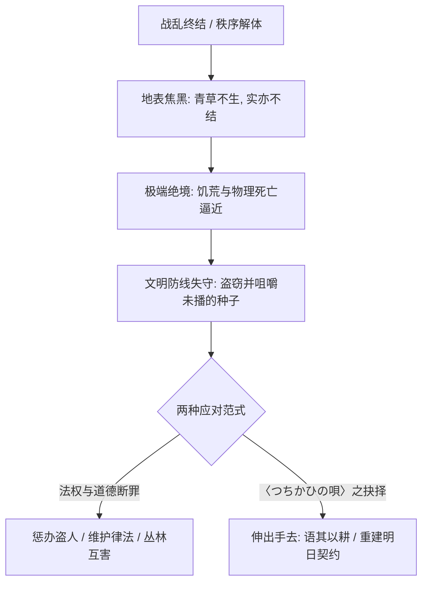
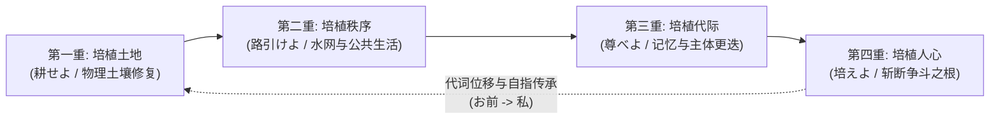
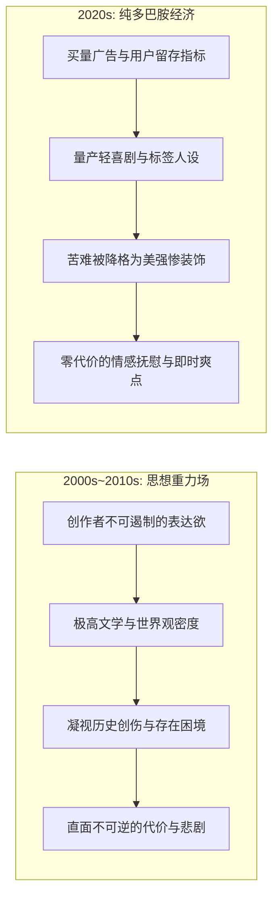
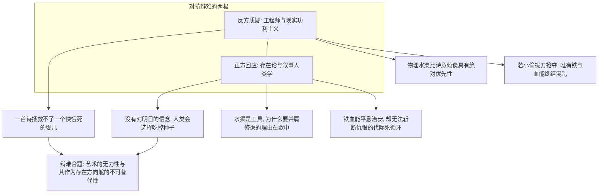

## 引子：在胜利的欢呼之后，历史留下了什么？

绝大多数通俗叙事与史诗神话，都拥有一种默契的狡黠：它们习惯在决定性的高潮处戛然而止。

恶龙被斩首，帝国的高塔在烈火中轰然倾塌，弑神的终焉一击划破苍穹，战舰穿越星际尘埃重返故土；或者在王道二次元故事里，少年少女迎着晨曦相视一笑，激昂的交响乐随着演职员名单缓缓淡出。我们作为读者与观众，在经历长达数十个小时的心智动员后，顺理成章地将这种“恶之消亡”或“危机解除”视为故事的终点。叙事的戏剧弧线闭合了，情感张力得到了宣泄，正义得到了伸张。

然而，如果我们将目光从舞台聚光灯上移开，哪怕只是稍微在决战后的地表多停留几分钟，物理世界的真实引力便会迅速砸落下来。

“胜利”在真实的地表上究竟呈现为何种面貌？

它不是加冕礼上的鲜花与礼炮，而是一具具无人收殓、在高温下迅速肿胀溃烂的尸体；是被魔法毒素或贫铀穿甲弹反复犁过、十年内无法渗水结块的焦黑死土；是被炸毁的蓄水坝、断裂的供水渠与彻底瘫痪的物流动脉；是无数失去父母、在残垣断壁中像老鼠一样扒寻发霉面皮的伤残孩童；是退役老兵空洞无光的瞳孔，以及因货币体系瓦解而迅速倒退回物物交换乃至野蛮劫掠的人际丛林。

战争结束了，英雄的故事讲完了，真正的历史才刚刚露出它狰狞的獠牙。

战后叙事最残酷的真理从来不是“正义如何战胜邪恶”，更不是“如何向战败的仇敌追索血债”，而是那个被绝大多数史诗刻意略过的微观命题：**活下来的人，究竟该如何继续生活？**

2016 年秋天，在日本同人音乐即卖会 M3 上，一个名为 stellatram 的小众同人音乐社团发布了一张名为《Kaleido Sphere ～天淵の双つ星～》的专辑。该专辑以 PS2 时代的经典奇幻科幻游戏《魔塔大陆》（Ar tonelico）世界观为土壤，衍生自同名同人长篇小说《天淵の双つ星》。在这张充溢着虚构塔语（Hymmnos）与民族风交响的唱片中，收录了一首名为〈つちかひの唄〉（Tsuchikahi no Uta，培植之歌 / 培育之歌）的合唱曲。

由ほいみん作词、aim 作曲，巫月和音、urushi、月宮瑠璃華、ほいみん、奈雪ニーカ五人合唱。这首歌既没有华丽的高音爆发，也没有救世主降临的奇迹降神，整首曲子由一台沉稳甚至略带滞涩的老式电风琴（Electric Organ）与多声部素朴的人声徐徐铺开。然而，正是这首不足四分钟、隐没在同人文化浩瀚边缘的歌曲，以一种近乎冷酷的精确与深沉的悲悯，完成了对战后生存伦理的一次法医级解剖。

它让我们不得不直面那个最令人战栗的画面：当生存的底线彻底溃败，一个人蹲在路边，偷吃本应埋进地里的种子。

---

## 第一章：歌词细读——道德降维与“盗窃种子”的生存困局

要理解〈つちかひの唄〉的重量，必须进入对其文本的第一层细读。整首歌曲共分四节，首节甫一开篇，便以白描的手法勾勒出一幅文明崩坏后的微观灾异图景：

> **戦の跡に はる根の深く**  
> （战痕残迹，盘根错节）  
> **青草育たず 実りもなし**  
> （青草不生，实亦不结）  
> **路ばたで種はむ 盗人あれば**  
> （若见路旁有盗人，正嚼食种子）  
> **お前の手をのべ 語らった**  
> （你便伸出手去，与他倾谈）  
> **倦まず弛まず耕せよ**  
> （孜孜不倦耕耘吧）  
> **今日蒔く種こそ明日の糧**  
> （今日播下的种，方为明日的口粮）  
> **ヴィオラの月の満ちる頃**  
> （待到中提琴之月盈满之时）  
> **今日蒔く種は萌すだろう**  
> （今日播下的种，必将吐露新芽）

这一段歌词中最惊心动魄的意象，莫过于第三句：**“路ばたで種はむ 盗人あれば”（若见路旁有盗人，正嚼食种子）。**

### 1. 种子的形而上学：未来的物质形态

在农业文明与人类学常识中，“种子”（種，Tane）具有一种神圣的二重性。种子在物理上固然是植物胚胎，包含淀粉与蛋白质，能够提供热量；但在符号学与生存论意义上，**种子是“明天”的具象化，是未来在当下的唯一物理锚点**。

人类之所以能够脱离游牧采摘的纯粹动物性生存，跨入定居文明的门槛，核心跃迁就在于人类学会了对冲动进行延迟满足：哪怕在漫长严酷的冬日里饿得面黄肌瘦，哪怕骨瘦如柴的母婴在一旁低声呻吟，农夫也必须把谷仓深处那一袋经过筛选的麦种死死锁住。因为一旦吃了麦种，当下的饥饿或许能够推迟十二个小时，但全家、乃至整个聚落就彻底杀死了自己的下一个秋天。吃掉种子，在文明的元隐喻中，等于“亲手吞食自己的明天”。

而歌曲开篇所揭示的，恰恰是这一神圣防线的彻底失守。战火烧尽了一切，“青草不生，实亦不结”，生存环境恶化到了物理极限。此时出现的“盗人”（盗贼），他偷窃的不是金银珠宝，甚至不是烤熟的干粮，而是干燥、坚硬、难以下咽的生种子。更致命的细节在于动词「はむ」（食む，啮咬、咀嚼）：他甚至等不及逃回窝棚将种子磨粉煮粥，就这么像野兽一般蜷缩在路边，迫不及待地将硬谷嚼碎咽下。

这种描写将人物推入了一种极端的道德困境：
- 他是一个破坏社会契约的“盗贼”，他剥夺了他人乃至集体的生产资料；
- 但他偷窃与吞咽的动作，又暴露出他已经处于饿殍边缘。他不是为了囤积居奇，而是为了让胸膛里那颗微弱的心脏多跳动半日，或者为了用咀嚼出的微薄浆液喂活怀中奄奄一息的婴儿。



在这里，传统的古典道德律完全失效了。若依律将其斩首或剁手，那是统治阶级在荒年维稳的冷酷法权，却挽救不了满地饥民化为饿殍的宿命；若任由种子被偷食殆尽，所有人将在短暂的饱腹后齐齐坠入灭绝的深渊。生存退化为了对未来的提前盗窃。

### 2. 审判者的缺席与倾谈的手

正是在这个文明悬于万丈悬崖的节骨眼上，歌曲给出了极其反常的行动：**“お前の手をのべ 語らった”（你伸出手去，与他倾谈）。**

歌中出现的第一位主体——“你”（お前），既没有挥起私力救济的柴刀去捍卫财产权，也没有以执法者的姿态将盗贼踩翻在地予以审判，甚至没有以居高临下的圣母姿态施舍他一碗热汤。他做出的动作是：**伸出手，弯下腰，与这个盗人“语”（交谈）**。

他谈了什么？
> “倦まず弛まず耕せよ，今日蒔く種こそ明日の糧”  
> （孜孜不倦耕耘吧，今日播下的种，方为明日的口粮。）

这句看似质朴的农谚，在当时的语境下无异于惊雷。它不是在做空洞的道德说教，而是在强行将一个已经退化为求生野兽的人类，重新拉回“文明的因果链”中。

歌中人明白，施舍救不了废墟。如果仅仅施舍给盗人一口饭吃，盗人依然是被动的寄生者，一旦施舍告罄，他依然只能重新沦为盗贼；如果只是惩罚他，仇恨与暴力的链条就会在废墟中继续滋生。歌中人所做的，是**将种子重新定义为希望，并将“耕耘的主体地位”交还给这个绝望的人**。

“不要偷吃它，让我们一起把这几颗种子埋进泥土里。哪怕泥土是焦黑的，哪怕等待漫长得令人心焦，但唯有今天埋下去，待到紫色的中提琴之月（ヴィオラの月）升起盈满之时，它才会从地底抽出一抹嫩绿。”

这是一种建立在极端残酷现实之上的崇高契约：它承认当下的极度痛苦，却拒绝用出卖未来来饮鸩止渴；它拒绝以暴力消灭罪人，而是邀请罪人一起成为重建大地的同盟。

---

## 第二章：动词「つちかひ（培う）」的四重演进与文明自指

如果〈つちかひの唄〉仅仅停留在第一节对农耕劳作的赞美，那么它至多是一首优秀的乡土民谣。然而，作词者ほいみん在此展现出了极为惊人的文学构思——他将日语中古风动词**「つちかひ（培う，tsuchikahi / tsuchikau，意为培植、培育、涵养）」**作为整首史诗的心脏，在接下来的四小节中完成了四次波澜壮阔的语义位移与升维。



### 1. 第一重：培植焦土（耕せよ，物理土壤的艰难复苏）
第一节的「つちかひ」落在最纯粹的物质层面。面对战争留下的焦土，“青草不生，实亦不结”，必须有人首先跪在灰烬与瓦砾中，用指甲抠出石块，翻动板结的硬土。这是文明修复的最底壳：没有物理意义上的粮食生产，任何形而上的思想与制度都是空中楼阁。

### 2. 第二重：培植秩序与公共性（路引けよ，基础设施与交往共同体）
紧接着，第二节歌词将镜头从个体劳作推向了空间维度的协同：

> **畝に連なる 芽のいとけなく**  
> （田垄绵延相接，幼芽尚自柔弱）  
> **畦より眺めるひと またひとり**  
> （自田埂旁驻足张望之人，又添一位）  
> **お前は遥々 沼の水引き**  
> （你自迢遥沼泽，掘渠引水而来）  
> **みな肩並べて それを撒く**  
> （众人并肩携手，将其倾洒播注）  
> **倦まず弛まず路引けよ**  
> （孜孜不倦拓路修渠吧）  
> **今日撒く水こそ明日の糧**  
> （今日浇洒之水，方为明日之口粮）  
> **チェロの輝き満ちる頃**  
> （待到大提琴之光辉洒满原野）  
> **今宵の苗木は育つだろう**  
> （今夜躬耕之幼木，必将蔚然成林）

这里的细节刻画极具画面感：“畦より眺めるひと またひとり”（田埂边张望的人，一个又一个地加入）。原本在战后互怀戒心、各自躲在阴暗角落窥视的难民们，看着田垄上那一星微弱的嫩芽，被一种超越戒备的本能所吸引，聚集到了田埂旁。

而“你”（お前）所做的事情从单人耕作升级为了大型公共工程：**“遥々 沼の水引き”（千里迢迢从沼泽开渠引水）**。单靠雨水无法维持聚落，必须修渠；修渠不可能由一人完成，必须“みな肩並べて”（大家肩并肩）。

在这里，「つちかひ」从单纯的“培土”演进为了**“培植道路与秩序（路引けよ）”**。在阿伦特（Hannah Arendt）关于“公共领域”（Public Realm）的定义中，共同体的建立依赖于人们为了某个超越个体生存的目标而聚集、协作并采取行动。水渠与道路的开凿，不仅是为了给幼苗灌溉，更是在早已原子化、兽性化的战后流民之间，重新编织出了一张名为“社会”的协作网络。

### 3. 第三重：培植代际记忆（尊べよ，主体的退场与遗泽）
如果故事在这里收尾，迎来一个全村欢庆的大团圆结局，那它依旧是廉价的好莱坞式童话。这首歌最具神采与宿命感的手笔，恰恰降临在第三节：

> **刈り入れ時に にぎわう子らは**  
> （秋收割谷之时，喧闹嬉戏之群童）  
> **やがて父母の おもかげ宿す**  
> （眉宇间终将渐渐映现出，昔日父母之面影）  
> **お前の姿は とうになく**  
> （而你的身影，却早已不复得见）  
> **お前の言葉を 子らがうたう**  
> （你昔年留下的话语，正被孩童们放声传唱）  
> **絶やさず忘れず尊べよ**  
> （切莫断绝、切莫遗忘，当永怀敬畏）  
> **昨日の種こそ今日の糧**  
> （昨日埋下的种子，方为今日之食粮）  
> **ソルの温もり満ちる頃**  
> （待到太阳之温煦充盈天地）  
> **明日蒔く種を結ぶだろう**  
> （明日将播之种，必将重结累累硕果）

时间轴在这里被骤然拉长。一个完整的代际跨越发生了：当年在泥水里爬行、饥肠辘辘的幼童长大了，他们成了秋收时挥舞镰刀的主力，在他们的面庞上，浮现出了已经逝去的父母的神情。

然后，歌词用极其克制、甚至不带一丝感伤叹词的一句话，宣告了第一代拓荒者的终局：  
**“お前の姿は とうになく”（你的身影，早已不在了）。**

这个在废墟中向盗贼伸手、开荒辟土、远道引水、奠定了一切秩序底座的英雄或长者，没有活到功成名就的那一天，也没有被塑成铜像供奉在广场中央接受万世瞻仰。他就像秋天烂在泥土深处的秸秆一样，悄无声息地消融进了大地。

但真正的奇迹在此刻显形：**“お前の言葉を 子らがうたう”（你的言语，正被孩子们传唱）。**

物理的肉躯死去了，但那句曾经拯救了盗贼的质朴教诲——“今日播下的种，是明天的粮食”——没有随着死亡而湮灭，它变成了一首劳作歌谣，在下一代收割粮食时脱口而出。动词的指令也由早先行动层面的“耕せよ”（去耕作）与“路引けよ”（去引路），升维为了精神层面的**“尊べよ”（当永怀尊崇与敬畏）**。

记忆成了被培植的作物。文明之所以不同于蚁穴或蜂巢，就在于它能够通过象征系统跨越肉体寿命的极限，让死者的意志在生者的喉咙里重新震颤。

### 4. 第四重：培植无垢之心（いさかいの根を断ち切りて，伦理飞跃与代词位移）
最后一节，整首歌曲在结构上完成了令人拍案叫绝的自指闭环，将叙事推向了形而上学的高潮：

> **血を分かつ者を 失へど**  
> （纵使体内同源之血亲，尽皆丧于乱世）  
> **蒼生に 水を分かちて**  
> （亦当将清泉甘霖，分与芸芸众生）  
> **日々を煩ふ みなしごあらば**  
> （若见这尘世间，仍有孤儿为日常生计所苦）  
> **私は手をのべ 語らおう**  
> （我便会伸出手去，与他倾谈）  
> **絶やさず忘れず培えよ**  
> （切莫断绝、切莫遗忘，去悉心培植吧）  
> **いさかいの根を断ち切りて**  
> （彻底斩断那纷争仇怨之根）  
> **心に大地育む限り**  
> （只要在心间，仍愿培育出一片广袤大地）  
> **明日蒔く種も実るだろう**  
> （明日播下的种子，亦必将结出丰硕之实）

请特别注意这里的代词剧变：
在前三节中，行文始终采用第二人称与第三人称的远景视角——叙述者凝视着“お前”（你），歌颂着“你”如何伸出手、“你”如何开渠引水、“你”的身影早已不在。

然而到了第四节，面对废墟依然没有彻底退散的现实，面对那些失去至亲的“苍生”（蒼生，Aohitogusa）与无依无靠的“孤儿”（みなしご），主语突然切换成了坚不可摧的第一人称单数：  
**“私は手をのべ 語らおう”（我将伸出手去，与他倾谈）！**

这一声“私”（我），标志着一个精神受惠者的真正成年。

当年那个在田垄边看着大人劳作、听着大人教诲、甚至可能就是盗贼后代的无名孤儿，在此刻接过了历史的接力棒。他没有沉溺于失去血亲的虚无主义悲叹中，也没有因为前辈的离去而陷入茫然。当他看到世界上再次出现绝望的、被生活所折磨的弱者时，他做出了与当年先驱完全相同的动作：**伸出手，把他们拉进文明的盟约中。**

终曲的动词终于给出了最纯粹的形态：**「培えよ」（去培育吧）**。这一次，它不再仅仅培育麦苗，不再仅仅修筑引水渠，而是要求人们：
**“いさかいの根を断ち切りて / 心に大地育む限り”（斩断纷争的仇怨之根，只要你的心中还能孕育出一片广袤的大地）。**

物理的种子固然重要，但若人心依然被“以眼还眼”的复仇欲与掠夺冲动所占据，那么每一次丰收都不过是下一场掠夺战争的导火索。唯有在精神的荒原上，开辟出一片能够包容仇敌、接纳孤儿、甘愿分出清泉的大地，文明才真正具备了免疫再次崩溃的抗体。

---

## 第三章：去英雄化的战后伦理——“活下来的人怎么办”

当我们把〈つちかひの唄〉放在整个现代叙事文艺的坐标系中审视时，会发现它提供了一种极为罕见的**“反英雄主义战后伦理”**。

### 1. 英雄主义叙事的黄昏与断崖

长期以来，无论是在好莱坞商业大片、日本王道动漫，还是各路畅销史诗奇幻中，流行文化所青睐的始终是“危机前线”的英雄个人叙事：
- 聚光灯永远打在拥有特殊血统、超凡力量或宿命光环的主角身上；
- 冲突的解决依赖于在万众瞩目的角斗场中彻底抹除反派（击碎魔王的心脏、引爆死星的核心）；
- 至于战后的世界，往往被处理为轻飘飘的幕间过渡——几幅表现农田复耕、市集重新开张的静止插画，或者一句简单的“从此他们过上了幸福的生活”。

这种叙事范式在潜意识里向受众灌输了一种极度危险的虚幻认知：**历史的前进是由少数特权英雄在暴力巅峰的决断所推动的；而正义只要消灭了邪恶，繁荣与和平就会像魔法一样自动降临。**

然而，二十世纪以来的真实人类史残酷地戳破了这种神话。一战后的凡尔赛体系没有带来和平，反而孕育了更恐怖的二战法西斯温床；苏联解体后的休克疗法没有让自由市场自动带来富足，反而让寡头掠夺、物价飞涨与地方割据将整整一代普通人碾入尘埃。在真实的断裂处，恶人的死从来不意味着善人的新生；旧权力的真空往往会被更原始、更野蛮的私刑与饥馐所填补。

〈つちかひの唄〉的可贵之处，正在于它**彻底驱逐了这种救世主滤镜**。在整首歌中：
- 看不见任何具名的大人物，听不见任何宏大的政治宣章；
- 没有人宣布“正义胜利了”，没有人清算战争罪责，甚至没有去追究到底是谁挑起了这场灾难；
- 镜头死死钉在泥土地里，聚焦在最微末的流民、盗贼、幼芽、水渠与孤儿身上。

它所秉持的哲学立场是冷酷而清醒的：**审判是法官与历史学家的事，而幸存者的第一天职，是在废墟上保住生命的火种。**

```mermaid
graph TD
    subgraph 英雄主义神话
        H1[天选英雄] --> H2[终极决战 / 消灭恶首]
        H2 --> H3[魔法式和平降临]
        H3 --> H4[历史自动终结]
    end
    subgraph 〈つちかひの唄〉的农夫形而上学
        N1[灾异与死土] --> N2[盗窃种子的生存困局]
        N2 --> N3[伸出双手 / 订立耕作契约]
        N3 --> N4[肉身沉入土地 / 记忆代际传承]
        N4 --> N5[斩断仇怨之根 / 心灵大地重建]
    end
```

### 2. 农夫式的形而上学：用确定性因果对抗存在虚无

在大灾大难之后，最先击垮人类的往往不是肉体的饥渴，而是精神上的**“彻底虚无化”**。当一个人亲眼目睹家园被焚毁、父母被屠戮、毕生信奉的道德与法纪在几个小时内被践踏成废纸，他极易陷入极端的虚无主义——既然一切美好事物都能在瞬间被摧毁，那我为何还要恪守善意？既然明天毫无保障，那我为何不索性化身恶棍，能抢一日便是一日？

面对这种深入骨髓的形而上学绝望，任何高谈阔论的启蒙哲学或宗教宽恕都是苍白无力的。你无法对一个饿得吃土的人讲康德的绝对命令，也无法对一个全家横死的孤儿讲天国拯救。

〈つちかひの唄〉所提供的解药，是一种极其坚固的**“农夫形而上学”**。它用大自然最底层的物理节律，重新确立因果律的存在：
- “今日蒔く種こそ明日の糧”（你今天把种子埋下去，明天才会有粮食）；
- “ヴィオラの月の満ちる頃，今日蒔く種は萌すだろう”（不要慌乱，等那颗紫色的月亮转到最圆的时候，芽一定会破土而出）；
- “チェロの輝き満ちる頃，今宵の苗木は育つだろう”（等大提琴星辰的光芒升起，今夜浇过水的小树就会长大）。

这是一种奇妙的心理锚定技术：歌中人将绝望者的注意力，从对过去灾难的沉溺与对不可控未来的恐惧中，硬生生拽回到了**“当下这一锄头”**与**“天体自然运行周期”**的绝对关联上。

四季还在流转，月亮依然会盈亏，植物在吸收水分后依然会按照细胞分裂的规律破壳。大自然没有被战争毁灭，只要你重新依附于大自然的节律，你的劳动就具有确定不移的产出。这种由肉体劳作、泥土触感与星象周期构成的确定性，是战后幸存者能够重新维持神经系统不至于崩溃发疯的唯一物理支柱。

---

## 第四章：黄金时代的思辨气质——二次元亚文化何以曾如此深沉？

在今天这个算法统治一切的时代重新审视〈つちかひの唄〉，任何一个经历过同人文化黄金期的老二次元，都很难不产生一种剧烈的时空倒错感与深深的乡愁。

这部作品诞生于 2016 年，其精神根系则深植于 2006 年诞生的 PS2 游戏《魔塔大陆》（Ar tonelico）系列。那是一个怎样的创作时代？

那是一个二次元创作者们甚至愿意为了几段旋律，从零构筑一套拥有完备发音规则、三套不同语法方言、严密情感复合时态的全新人工造语体系（Hymmnos 语）的时代；那是志方あきこ、霜月はるか、みとせのりこ以多轨人声叠唱将古诺斯神话、凯尔特民谣与歌剧合流的时代；那是 Sound Horizon 用一张 CD 谱写一个中世纪架空历史悲剧、07th Expansion 在简陋得近乎儿童画的立绘下推演《海猫鸣泣之时》关于爱与真实的终极法庭、TYPE-MOON 用几十万字文字冒险游戏探讨正义伙伴自我背叛与救赎的黄金年代。



### 1. 为什么当年的同人作品能够拥有严肃文学的厚度？

对比今天的二次元文化消费品，我们不得不面对一个触目惊心的事实：**二次元的视听工业水平以惊人的速度跃迁了，但其精神内省与思辨气质却发生了断崖式的滑坡。**

在当今的大型商业化抽卡手游或量产轻改动画中，我们几乎再也看不到类似“路边偷食种子”这样带着泥土腥味与伦理重负的情节。取而代之的，是工业化流水线精准调配的“高果糖浆”：
- 角色必须拥有标签化的“萌属性”（傲娇、白毛、病娇、倒贴）；
- 故事的矛盾冲突被极度扁平化，哪怕世界观设定在废土或末世，灾难也往往只是为角色的“美强惨”人设充当廉价背景板；
- 玩家或读者被放置在一个绝对安全的特权席位上，无需承担任何真正的伦理抉择与物质阻尼。一切苦难都可以通过“抽卡养成”、“数值提升”或“机械降神”一键清零。

而在十年前甚至二十年前的同人文化中，像 stellatram 这样的创作团体，在创作《天淵の双つ星》及其衍生音乐时，他们根本没有所谓“用户留存率”、“首周流水”、“卡池转化率”的概念。他们制作这样一张唱片，需要自己垫资租借录音棚、自费压盘、在寒冬清晨拉着装满纸箱的小拖车赶往东京 Big Sight 展馆。

驱动这种创作的唯一动力，是**“我心里有一团无法熄灭的火，我发现了一个必须被诉说的人类处境，哪怕在这个世界上只有五百个人买我的光盘，我也必须把它唱出来”**。

正因如此，当年的创作者敢于把目光投向真正的深渊。他们不把受众当成需要被哄逗的婴儿，而是把受众当成能够共同承受思想重量的平等的智力伙伴。他们敢于让先驱在第三节悄然死于非命，敢于直视孤儿眼中的绝望，敢于去解剖那些没有标准答案的伦理死局。那时的二次元亚文化，并不是现实生活的避难逃避所，而是一间**装上奇幻透镜的严肃思想解剖室**。

---

## 第五章：残酷辩难——文学能否改变现实？还是只有实干家才能救世界？

至此，我们已经从文本细读、叙事伦理与文化生态三个维度，确立了〈つちかひの唄〉的高度。然而，按照真正的批评精神，我们不能沉醉在对艺术的一味赞美中。

此时，一个如同冷酷的刀刃般的问题必须被掷向台前，展开一场针锋相对的辩难（Dialectic）：

**文学、诗歌与音乐，到底能不能改变哪怕一丁点儿现实？当大灾大难降临，真正拯救世界的难道不是手握资源的组织者、开渠砌砖的工程师与培育良种的农学家吗？艺术对痛苦的吟咏，会不会自始至终只是一种懦弱的附会与无能的自我陶醉？**



### 1. 反方的最强抗辩：文学在物理灾异面前的绝对苍白

我们必须替反方——替最坚定的唯物主义者、工程师与资源调配官——陈述出他们最锋利、最无法辩驳的论据：

> 听着，歌中唱得再深情，那也不过是一串声波震动与油墨印迹。
> 当那名盗贼在路边吞咽种子时，如果站在他面前的不是一个懂得农业技术的实践者，而是一个只会弹琴写诗的文人，结果会怎样？
> 文人对盗贼高谈“ヴィオラの月”，盗贼会因饥饿难耐直接将文人扑倒在地，咬断他的喉管，抢走他身上所有的盘缠。
> 
> 让第二节的麦苗活下来的，不是“倦まず弛まず”这句漂亮话，而是“遥々 沼の水引き”这个具体的物理动作！是有人顶着烈日，测量了落差，用铁锹刨开坚硬的冻土，手掌磨破流脓，搬运成吨的巨石筑起堤坝，才把水引了过来。
> 让第三节的孩童免于夭折的，是农学家在千万株穗粒中杂交选育出抗病虫害的品系，是仓储管理者精确计算出每人每日八两口粮的配给制，是维持治安的卫队用长矛挡住了境外游民的洗劫。
> 
> 在残酷的物质匮乏面前，文学不仅是无力的，甚至常常是可耻的。它在实干家流血流汗的骨架上，涂抹一层自我感动的玫瑰色滤镜；它在灾难发生时帮不上任何忙，却在灾难平息后冲进废墟，抢夺对苦难的诠释权。说到底，能让种子发芽的是氮磷钾与水，而不是歌曲！

这是一段掷地有声、几乎无法从实用主义逻辑层面推翻的批判。如果文学批评不敢直面这种指控，所有的文本细读都会沦为脱离大地的风雅文字游戏。

### 2. 正方的辩白：意义之锚与动作的元动力

面对这一近乎毁灭性的反诘，文学与艺术的真正防线究竟在哪里？

正方的回应，不能建立在狂妄地宣称“诗歌比面包更顶用”的唯心主义谎言之上。正方必须诚恳地承认：**文学确实无法直接生产出一粒粮食，诗歌在面对死神与饥饿时确实拥有物理上的绝对无能。**

但，文学的不可替代性，恰恰诞生在物理逻辑穷尽的地方：

**工程师可以解决“如何引水”的技术问题，农学家可以解决“如何选种”的生物学问题，但他们都无法解决一个更致命的前置问题——在所有人同室操戈、万念俱灰的绝境中，人究竟“为什么要活下去”，以及“人凭什么要把本可以自己独吞的水和种子，分给素昧平生的邻人和仇敌”？**

在纯粹的生物演化与功利主义计算中，当灾荒发生时，最符合个体生存效益的选择永远是**“掠夺”**与**“背叛”**：
- 杀死那个孱弱的盗贼，把剩下的种子藏进自己的地窖；
- 在夜间掘开上游的堤坝，把所有的水都引向自己的田地，任由下游的人渴死；
- 丢弃那些失去父母的孤儿，因为他们在成为劳动力之前只会消耗珍贵的配给。

如果人类社会仅仅依靠工程师的技术理性与治安官的铁血律法来运转，这个社会最终必然会异化为一个极其精密、但随时会因为资源枯竭而自我吞噬的高科技野兽集中营。法权只能阻止公开的犯罪，却无法阻止人们在心底滋生互害的暗鬼；刺刀能逼迫奴隶去挑土修渠，却无法让工人们在黄昏时“みな肩並べて”（并肩携手）唱出对明天的期许。

这就是那句歌词为什么必须存在的原因。

歌中人伸出手说出的那番话，并不是一套生产技术规范，而是一次**“存在论维度的召唤”**。它将人从纯粹的物质受害者，重新命名为对未来负有责任的“行动者”。它赋予了苦难一种意义：你今天受的苦、流的汗、挨的饿，不是毫无价值的虚无消耗，而是在为十年后的孩子们孕育一个可以大口吃面包的秋天。

```text
实干家（技术 / 物资 / 组织）  =======>  提供了文明得以存续的【肉身与物理骨架】
                                      ▲
                                      │ （若无意义灌注，极易坍塌为功利主义丛林）
                                      │
文学与歌谣（伦理 / 叙事 / 传承） ===>  提供了人类为何拒绝互食的【价值航标与灵魂】
```

正如维克多·弗兰克尔（Viktor Frankl）在奥斯威辛集中营中所洞察到的真理：**知道为什么而活的人，便能承受几乎任何怎样活的苦难。**

文学不能代替水渠，但文学是促使人们拿起铁锹去挖第一铲土的心理第一因；歌谣无法代替面包，但歌谣让人们在吃下面包之后，依然记得自己是人，而不是只知抢食的野狗。

### 3. 艺术价值与社会有效力量的残酷分离

因此，我们可以得出这场辩难的最核心结语：

在现代社会中，我们必须学会接受一种成熟而哀伤的认知分工——**艺术的价值（它是否值得存在）与其社会的有效力量（它能否立竿见影地改造现实），处于一种永久性的残酷分离状态。**

〈つちかひの唄〉没有让 2016 年的世界少爆发一场局部战争，也没有让今天正在发生的饥荒与流血停止一分一秒。它是一张被压在光盘里、只有极少数特定语系爱好者才会听到的同人歌曲，它在现实社会的宏观经济图表上的有效力量，无限趋近于零。

但这丝毫不会削损这首歌曲作为人类精神瑰宝的崇高价值。它的存在本身，就是一份封存于琥珀之中的文明信标。它证明了即使在二次元这样一个常常被主流视作轻浮、逃避与消费主义的流行亚文化角落里，人类的思辨触角依然曾经伸得如此之深；它证明了哪怕是在一个虚构的世界观里，依然有人在认真地替全人类思考着“在废墟上，我们该如何原谅盗窃者，并与他共同播种明天”。

这种思考本身就是一座灯塔。即便海面上浓雾弥漫、没有一艘船因为灯塔的闪烁而立即靠岸，但灯塔伫立在那里，礁石的边界就在那里被划定，人类在黑暗中前行的坐标就没有彻底沉没。

---

## 结语：废墟之上的播种者，以及今天我们为何仍需歌唱

走出文本的迷宫，重新回到我们所置身的当下。

二十一世纪的第三个十年，世界似乎正在以一种令人眩晕的速度脱轨。冷战结束时关于“历史终结”的乐观幻觉早已彻底破灭，地缘冲突的火光在亚欧大陆的边缘不断明灭，通胀、技术爆炸带来的失业恐慌、算法推波助澜的民粹撕裂与代际对立，正把现代人抛入一种全新的精神废墟之中。

我们或许不再需要像歌中的盗人那样，蹲在泥泞的道路旁咀嚼生硬的麦种；但现代人何尝不是在以另一种隐蔽而惨烈的方式**“盗窃并吞食着自己的明天”**？

为了应对无孔不入的焦虑，我们沉溺于几十秒一条的短视频切片，在算法投喂的即时快感中提前透支着自己的深度专注力；为了在日益内卷的职场与赛道中多争抢一点安全感，我们任由原子化的竞争割裂彼此的信任，将身旁的同行者视为潜在的掠夺者或绊脚石；而在文化领域，我们甚至连等待一部作品展开铺垫的耐心都已经丧失，只想要最快的高潮、最直白的逆袭与最无脑的甜宠。

这何尝不是一种精神层面的“青草不生，实亦不结”？这何尝不是将精神的种子早早下锅油炸吞下，而任由心灵的田野寸草不生？

正是在这种无风的漫长窒息中，〈つちかひの唄〉那平缓、沉重、甚至有些笨拙的旋律，才具备了穿透时空的惊人力量。

它像一位浑身沾满泥巴、双手布满老茧的古老农夫，在疾驰的现代列车窗外，默默停下手中的锄头，抬起头来凝视着我们。他没有责怪我们的慌乱与短视，只是指了指脚下的大地，然后像十年前、百年前那样，对我们平静地说出那句早已被遗忘的真理：

> **倦まず弛まず耕せよ，今日蒔く種こそ明日の糧。**  
> （疲倦了也不要停下，松懈了也不要放弃。去耕作吧，今天埋进土里的微小种子，才是明天唯一的口粮。）

文明从来不是由那些高悬在天际、永远不灭的恒星所维系的。文明是由一代又一代在泥泞中倒下、身躯化为腐殖质的无名者，以及那些咽下眼泪、擦干血迹、接过先辈的言语、向身旁的孤儿伸出双手的幸存者们，一锄一耙在废墟中重新培植出来的。

只要在坚硬的水泥与算法的缝隙中，依然有人愿意守护一粒不被提前嚼碎吞下的种子；只要在荒凉的心灵荒原上，依然有人愿意向陌生的过客伸出温暖的手，文明的长河就绝不会断流。

待到中提琴之月再次盈满长空的时候，大地之上，必将重现万顷苍翠。
