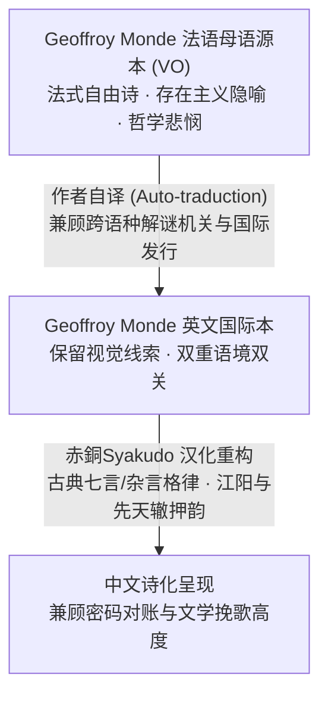

## 序言：荒诞戏谑之下的自我解离

在独立解谜游戏《千面人在此》（*Legion Was Here*，Geoffroy Monde 开发，Surefire.Games 发行）的前五个任务里，整个游戏充斥着法国独立漫画家特有的冷面幽默与荒诞主义恶趣味。玩家扮演代号为“千面人”（Legion）的顶级秘密间谍，坐在阴暗的手术台前，通过操作骨骼滑块、拉扯皮肤与拼接假发，把自己捏成伦敦街头的可疑卧底、企图混入黑帮宴会的复仇者，乃至自称来自海王星的怪异外星人。

在 B 站 UP 主逍遥散人的实况视频（`BV16onu6mEyc`，P2《寻找自己》）中，弹幕与笑声大多聚焦于那些比例失调的五官、被随意挪动的鼻梁，以及主角在镜子前一次次戴上荒唐面孔时的滑稽感。特工游戏历来把“易容”视作一种全能的神性特权——从《杀手》（*Hitman*）里的47号换装，到经典谍战电影中毫发无损的乳胶面具，伪装是猎手隐匿于羊群的致命武器。

然而，当游戏行进至第六关——终章《起源》（*Mission 6: Origins*）时，叙事的齿轮突然发生了剧烈而冷酷的反转。

情报局没有下发任何暗杀指令，也没有需要渗透的敌对堡垒。留在解密档案袋里的，只有千面人唯一的老友、电影导演兼联络官艾伦·科顿（Alan Cotton）留下的三页泛黄信笺、一张带几何开孔的透明覆膜卡，以及前五个任务中散落的九件证物。

任务简报只有一行冰冷的现实：**“千面人必须变回自己。”**

因为在无数次为了完成任务而重塑骨肉、洗脑记忆之后，特工已经彻底患上了不可逆的“自我认同解离”（Ego Death）。他记不清自己原本的长相，遗忘了真实的姓名，甚至想不起妻子的声音与子女的数目。在这个关卡中，玩家不再去窃取他人的面孔，而是要在一堆旧时代的残存垃圾与晦涩诗行中，把那个早已被抹杀的“自己”，像对待一个陌生的刺杀目标一样，重新拼凑出来。

---

## 第一幕：从“千面之魔”到“无面幽灵”——特工异能的存在主义代价

### 1. 法式荒诞戏仿与萨特式哲学底色
在考据本游戏的文本脉络时，必须首先厘清其创作者的母语与思想源头。

开发作者 Geoffroy Monde（真名 Geoffroy Reymondon）是常驻法国里昂的资深独立漫画家（BD 创作者），先后在 Delcourt、Dargaud 等一线出版社出版过《Poussière》《Furieuse》《De rien》等哲学与科幻讽刺漫画，多次斩获安古兰国际漫画节推荐与法国童书展大奖。

《千面人在此》表面上充斥着拉什莫尔山（总统山）、佛罗里达过山车、好莱坞演职员表与英国米字旗等英美流行符号，但这绝非一部纯粹的英美游戏，而是法国漫画界极其经典的**“美式类型片戏仿”（Pastiche franco-belge de polar américain）**。正如《OSS 117》或戈特利布（Gotlib）的荒诞讽刺画一样，作者借用了冷战美式特工片的夸张外壳，其精神骨架却深植于法国本土的存在主义（Existentialism）传统——它探讨的不是“如何拯救世界”，而是萨特与加缪式的追问：**当一个人为了扮演社会角色而彻底剥离了本真自我，他究竟还算不算一个活人？**

### 2. “Legion”的宗教互文与熵增悲剧
代号“Legion”（千面人 / 群）在西方文学与宗教谱系中具有强烈的互文指涉。在《马可福音》第五章第九节中，耶稣质问被附身者：“你叫什么名字？”对方回答：

> “My name is Legion: for we are many.”（我名叫‘群’，因为我们众多。）

在宗教语境中，“群”代表着肉身被无数外来幽灵撕裂、吞噬的失控状态；而在间谍冷战叙事里，“Legion”则被异化为一种极度专业化的工具属性。千面人能够随意揉捏自己的血肉，每一次任务，他就将另一个人的记忆、口音、微表情和饮食习惯灌注进自己的神经系统。

这种看似绝对自由的肉体形变，在物理学与心理学意义上却是一场不可逆的**“自我熵增”**：


当他变成了所有人，他最终成为了“无”。当他脱下最后一位黑帮分子的西装，镜子里映出的只是一具被无数次拉扯变形的黏土人。他的大脑为了容纳任务情报，主动修剪掉了关于童年海浪的气味、最爱吃的食物，以及妻子海伦娜（Helena）的面容。

老友艾伦深知这一点。作为整个情报网络中唯一的见证者，艾伦没有直接把身份证件塞给千面人——因为在间谍的世界里，任何现成的数据都可以被伪造与植入。如果千面人只是被告知“你叫托马斯，你长这样”，他那千疮百孔的认知系统依然会将其视为又一张冷冰冰的“任务面具”。

艾伦选择用**三页诗歌**与**实体物证**构筑了一道严密的双轨解密协议：第一轨用于物理五官的几何逆向重构，第二轨用于深层情感记忆的逻辑对账。唯有特工依靠自己的残存直觉完成这场解谜，他才能在精神层面完成对自我的确权。

---

## 第二幕：双轨破译实录：三页信笺的多语种物证网

艾伦留下的三页手写信件，在底层构建了一个法英汉三语互证、几何道具与文字双向锁定的解密网络。

在此，我们整理出**Geoffroy Monde 的法语母语源本（VO）**、**作者亲自翻译的英文国际本（Author's English Text）**，以及**国内译者赤銅Syakudo的汉化重构本**，逐行进行法医级对账。

### 第一页：《一位老友的念想》（上篇）—— 身份档案的拓扑映射
- **法文原名**：*« L'esprit d'un vieil ami »*
- **英文译名**：*The Mind of an Old Friend (Part 1)*
- **中文译名**：《一位老友的念想》（上篇）

第一页诗信对应的是主角的宏观生物学特征与社会关系。它不直接给出答案，而是将线索埋藏在拉什莫尔山（总统山）明信片、马戏节报纸和旧照片等道具的物理双面拓扑中。


| 法语母语文本 (Version Française) | 作者自译英文本 (Author's English) | 汉化文本 (赤銅Syakudo 译本) | 物证解密结论 |
| :--- | :--- | :--- | :--- |
| **Ton prénom est apparu sur le grand écran,**<br>**et ton initiale est portée sur le cœur d'un fantôme en quête de vengeance.** | **Your first name has been seen on the silver screen,**<br>**and your initial is worn on the heart of a ghost that needed avenging.** | **你的名字曾映于银幕之上，**<br>**而你的首字母，则着饰在一位幽魂的心房，**<br>**而那幽魂，曾为复仇而徜徉。** | “幽魂”指任务5为黑帮复仇的遗孤多米。在《孩童旧照》正面，多米佩戴大写 **T** 形领结；翻至《Dirty Dino广告》背面的演员表，T 开头的男性为 **托马斯·古德威尔（Thomas Goodwill）**。本名：**托马斯（Thomas）**。 |
| **Si tu veux que le nom de ta femme ne reste plus enfoui,**<br>**grimpe sur le grand George, derrière repose la réponse.** | **If you want your wife’s name to no longer be buried,**<br>**climb upon the great George, behind lies an answer.** | **若想让你妻子的名字不再埋藏，**<br>**攀上那伟岸的乔治，背后正有答案一桩。** | “伟岸的乔治”指《拉什莫尔山明信片》上的总统华盛顿（George Washington）。翻至背面，雕像背后署名即为 **海伦娜（Helena）**。妻子姓名确立。 |
| **Ton signe du zodiaque peut engloutir le monde entier,** | **Your zodiac sign can swallow the world whole,** | **你的星座足以吞下世界苍茫，** | “世界”指《海洋世界明信片》（OceanWorld）上吞下地球的大鱼标识。星座：**双鱼座（Pisces / Poissons）**。 |
| **et les montagnes russes abandonnées s'élèvent sur ce qui coulera toujours dans tes veines.** | **and the forsaken roller coaster ascends on what through your veins will always flow.** | **而荒废的过山车不断攀升，正是倚靠着血管中的永恒流淌。** | 《国际马戏节报纸》背面废弃迈阿密乐园过山车轨道立柱自然拼出大写字母 **A**。“血管流淌”提示血型，血型：**A 型**。 |
| **Le drapeau de notre pays natal est visible à Athènes,** | **The flag of our birth can be seen in Athens,** | **你出生之国的旗帜，曾在雅典之乡，** | 雅典即希腊。任务1注有“七月在希腊”的留影中，帕特里克身穿英国米字旗 T 恤。出生国：**英国（United Kingdom / Royaume-Uni）**。 |
| **tandis que les pairs à la gauche de Thomas correspondent au nombre de tes enfants.** | **while the peers to Thomas’s left match our amount of children.** | **而托马斯身边的伟岸同侪，恰与你子女的数目相当。** | 双关语：既借总统山托马斯·杰斐逊左侧（画面右侧）的罗斯福与林肯两位总统指代 **2 个孩子**，又用“托马斯”三个字点醒特工本名。 |
| **Pendant tes loisirs, tu peux contempler le ciel de Floride,**<br>**ou suer sur le terrain avec cet enfant bondissant.** | **At leisure, you can gaze upon the Florida sky,**<br>**or sweat upon the court with that leaping child.** | **闭眼之时，你可以仰望佛罗里达的天光，**<br>**亦可与那个雀跃的孩子一同在球场上汗水激荡。** | 前句对应乐园废墟照片中盘旋的海鸟，提示业余爱好为**观鸟（Birdwatching）**；后句对应广告海报跳跃儿童身边的黑白足球，提示运动为**足球（Soccer / Football）**。 |

---

### 第二页：《一位老友的容颜》—— 镂空卡、旧物料与十重五官还魂
- **法文原名**：*« Le visage d'un vieil ami »*
- **英文译名**：*The Face of an Old Friend*
- **中文译名**：《一位老友的容颜》

如果说第一页是抽象的记忆档案，第二页则是全游戏最震撼的手术台指南。

艾伦附赠了一张带有网格与几何视窗的透明塑料卡（Cut Out Overlay）。玩家必须根据第二页诗歌中的意象提示，将卡片分别叠放在九件旧证物的特定坐标上，透过小孔捕捉到十个决定物理面貌的生物特征。


这一段诗歌不再是冰冷的说明书，而是艾伦以一种充满法式抒情与悲悯的笔触，替千面人重述他早已忘却的童年、少年与衰老轨迹：

```
《一位老友的容颜》逐行多语种对照与十维面部参数解构：

1. 岁月流年 / 小鱼 (Age)
   - FR: Te souviens-tu des années qui furent les tiennes ? Tu étais comme un petit poisson, filant droit devant.
   - EN: Do you remember the years that were yours? You were like a little fish, heading straight forward.
   - CN: 你可曾记得，属于你的岁月流年？你宛若一条小鱼，一往无前。
   - 证物对齐：《海洋世界明信片》正面鱼耳几何坐标。
   - 解密参数：年龄层级为 30 多岁的成熟中年 (Age: Mature)。

2. 耳朵 / 贴在墙上 / 大海 (Ears)
   - FR: Collant ton oreille contre le mur, écoutant la nostalgie de la mer.
   - EN: Pressing your ear tight against the wall, listening to the longing of the sea.
   - CN: 将耳朵紧紧贴在墙上，聆听大海的思念。
   - 证物对齐：《孩童旧照》右下角防波堤砖石纹理。
   - 解密参数：咀嚼肌微凸的饱满耳型 (Ears: Chewing)。

3. 海浪气味 / 笑靥 (Mouth)
   - FR: L'odeur des vagues illuminait ton tendre sourire,
   - EN: The scent of the waves brightened your tender smile,
   - CN: 海浪的气味抹亮了你稚嫩的笑靥，
   - 证物对齐：《连环漫画》拉莫斯伯爵咧开的嘴角。
   - 解密参数：宽慰温暖的露齿微笑 (Mouth: Reassuring)。

4. 波涛骤起 / 惊奇眉尖 (Eyebrows)
   - FR: mais quand les brisants s'élevaient, tu haussais les sourcils d'étonnement.
   - EN: but when the breakers rose, you raised your brows in wonder.
   - CN: 可当波涛骤起，你又惊奇地扬起眉尖。
   - 证物对齐：《帕特里克照片》耳后断裂的海浪弧线。
   - 解密参数：浓密连体一字眉 (Eyebrows: Frida)。

5. 甜食 / 发丝光泽 (Hair Color)
   - FR: Les sucreries donnaient à tes cheveux un éclat luisant,
   - EN: Sweets gave your hair a glistening sheen,
   - CN: 甜食让你的发丝泛着光亮的光泽，
   - 证物对齐：《巧克力棒包装纸》正面“Choco!”气泡阴影。
   - 解密参数：深邃栗棕色 (Hair Color: Chestnut)。

6. 拂开额发 / 成分里的甘甜 (Hair Style)
   - FR: tu écartais ta frange, juste pour voir les douceurs inscrites au dos.
   - EN: you brushed aside your bangs, just to see the sweetness in the ingredients.
   - CN: 你拂开额前的发，只为看清成分里的甘甜。
   - 证物对齐：《巧克力棒包装纸》背面配料表红色方框。
   - 解密参数：略显木讷的齐刘海/锅盖头 (Hair Style: Serf)。

7. 鼻尖冲天 / 如火箭 (Nose)
   - FR: Ton nez rond cherchait toujours une piste à suivre, fendant l'air comme une fusée,
   - EN: Then, pointing your nose to the sky, kicking up clouds like a rocket,
   - CN: 随后，你昂起鼻尖，冲着天空，如火箭一般掀起云烟，
   - 证物对齐：《Jujuk乐园过山车照片》右上角树梢破空处。
   - 解密参数：微翘肉感圆鼻 (Nose: Glutton)。

8. 科顿影片 / 一须毫厘 (Facial Hair)
   - FR: à un fil des films oniriques de Cotton, mêlant le vrai du faux.
   - EN: barely a hair's breadth from Cotton’s dreamy film, blurring real from unreal.
   - CN: 离科顿那如梦的影片，只差一须毫厘，真假难辨。
   - 证物对齐：《Dirty Dino广告》背面顶部破损边缘。
   - 解密参数：下巴一圈稀疏邋遢的胡茬 (Facial Hair: Spaghet)。

9. 目光 / 广袤世界的墙垣 (Eyes Shape)
   - FR: Où ce garçon perdu dans l'hier regarde-t-il ? Ses yeux recouvrent les murs d'un vaste monde,
   - EN: Where is this child lost in yesterday gazing? His eyes coat the walls of a vast world,
   - CN: 这个沉沦于旧日的孩子，究竟在伫望何方？他的目光铺满整个广袤世界的墙垣，
   - 证物对齐：《国际马戏节报纸》背面 SkullBX 街头壁画喷涂眼眶。
   - 解密参数：微睁无眼白的半圆纯真眼型 (Eye Shape: Gullible)。

10. 倒映 / 花岗岩父辈们 (Eye Color)
    - FR: reflétés dans le ciel pâle des pères de granit,
    - EN: reflected in the pale skies of the granite fathers,
    - CN: 倒映在花岗岩父辈们苍茫的天空中，
    - 证物对齐：《拉什莫尔山明信片》正面天空穹顶天幕。
    - 解密参数：纯净天蓝色瞳孔 (Eye Color: Blue)。
```

当这十个参数全部输入手术台后，显示屏上生成的并不是什么英俊冷酷的007特工，而是一个顶着锅盖头、连体眉、带着一圈胡茬、眼神显得有些木讷茫然的普通英国大叔。

这是全诗最刺痛人心的一幕：特工在刀尖上舔血一生，扮演过无数非富即贵的危险人物，但他原本的面貌，却平凡得就像任何一个在周末带着孩子去游乐园排队买冰淇淋的疲惫父亲。

---

### 第三页：《一位老友的念想》（下篇）—— 隐私暗号与家门前的考问
- **法文原名**：*« L'esprit d'un vieil ami » (Suite)*
- **英文译名**：*The Mind of an Old Friend (Part 2)*
- **中文译名**：《一位老友的念想》（下篇）

第三页信笺则承载着托马斯回归家庭前必须掌握的“防伪密码”。间谍的妻子不会轻易给一个陌生人开门，托马斯必须用只有夫妻二人共享的私人记忆，通过玄关处的防盗门问答。


| 法语母语文本 (Version Française) | 作者自译英文本 (Author's English) | 汉化文本 (赤銅Syakudo 译本) | 破译逻辑与隐秘生活细节 |
| :--- | :--- | :--- | :--- |
| **Au milieu de cette foule bariolée, ta peur t'engloutira d'abord,** | **In the middle of that colorful crowd, your fear will bury you first,** | **在那片五彩斑斓的人群中央，恐惧会将你最先埋葬，** | 五彩斑斓的人群指《国际马戏节合照》中浓妆艳抹的小丑。托马斯的心理软肋是**小丑恐惧症（Coulrophobia / Coulrophobie）**。 |
| **bien que celui qui regarde toujours à travers une lumière rosée puisse aussi étancher ta soif.** | **though the one who always gazes in rosy light could also quench your thirst.** | **纵然那总以玫瑰色目光凝望之人，也能为你止渴解慌。** | 合照右下角戴着粉玫瑰色眼镜的小丑手持葡萄酒。托马斯最依赖的安神饮品是**红酒（Red Wine / Vin rouge）**。 |
| **L'amoureux au nœud papillon saurait sans doute réjouir tes oreilles,** | **The lover with a bow tie would surely please your ears,** | **那位系着领结的爱人，定能让你悦耳欢畅，** | 《巧克力棒包装纸》背面系领结的卡通人 Mako 正在演奏小提琴。托马斯挚爱**莫扎特古典交响乐**。 |
| **et ton mets favori, en présence de la saleté, rougira toujours de honte.** | **and your favorite food, in the presence of dirtiness, will always blush with shame.** | **而你最爱的食物，在污秽之物当前，总会羞红脸庞。** | “污秽之物”即 Dirty Dino（脏脏恐龙）。海报旁有一只煮熟通红的甲壳类。托马斯最爱美食是**螃蟹（Crab / Crabe）**。 |
| **Dans ta main, ce tatouage dont la forme orne le bois dur d'un amant.** | **In your hand, that tattoo whose shape adorns the hard wood of a lover.** | **在你的手中，那枚纹身的形状，恰似雕饰在爱者硬木之上的纹章。** | 《连环漫画》背面爱人手持刻有交叉十字 **X** 的木球棒。千面人左手在游戏内记便签，其右手手心有 **X 纹身**。 |
| **Dans l'obscurité du cinéma, as-tu remarqué ce compagnon à poils qui te faisait un clin d'œil discret ?**<br>**Et la première lettre de son nom se cache dans l'ombre projetée par l'ancien boy-scout.** | **In the dim theatre, did you notice the furry companion winking quietly at you?**<br>**And the first letter of his name hides in the shadow cast by the former boy scout.** | **昏暗影院之中，你可曾留意那毛茸茸的伙伴，向你悄然眨眼的模样？**<br>**而他名字的第一个字母，正隐于前童子军投下的阴影中央。** | 《Dirty Dino广告》背面边角画着向观众眨眼的小老鼠；马戏节报纸前童子军阴影下藏着字母 **S**。托马斯家里的宠物是一只以 **S 开头命名的小老鼠**。 |

信末留下的只有一句平静的寄语：

> **待你参透这些诗句，真相也将豁然开朗。**  
> **署名：艾伦**  
> *(Quand tu auras percé ces vers, la vérité éclatera au grand jour. Signé : Alan)*  
> *(Once you unravel these verses, the truth will come to light. Signed: Alan)*

---

## 第三幕：文本翻译的文学颗粒度——从法语原典、作者自译到汉语律诗的三级流变

理解这段诗谜的精妙，必须理解其背后罕见的**“三级文本流变链条”**：



### 1. 作者自译（Auto-traduction）下的跨语种工程对齐
Geoffroy Monde 作为独立开发者，在 Construct 3 引擎中并未将英文翻译外包给流水线本地化公司，而是由作者本人亲自完成了法文到英文的自译转写。

这种“作者自译”带来了一个极大的工程优势：**解谜线索在多语种间实现了视觉底层的绝对兼容**。
例如第一页第6行关于 A 型血的暗号：
- 法语：`et les montagnes russes abandonnées s'élèvent sur ce qui coulera toujours dans tes veines.`（法语血型亦为 *Groupe sanguin A*）；
- 英语：`and the forsaken roller coaster ascends on what through your veins will always flow.`（英语为 *Blood type A*）。
迈阿密乐园倒闭照片中过山车三角桁架所拼出的大写“A”，在拉丁字母体系（法英）内是通用的视觉常量，无需为不同语言版本单独重新绘制美术底图。

### 2. 赤銅Syakudo的格律化文学重构
发行商 Surefire.Games 在组织中文本地化时，向国内译者赤銅Syakudo交付的是经过作者校订的英文主工作簿。赤銅Syakudo并没有机械地按照英文句子结构做生硬直译，而是敏锐地捕捉到了文字背后属于老友艾伦的挽歌语调，创造性地采用了**中国古典诗歌的长短句押韵格式**：

- **第一页押江阳辙**：`上 / 房 / 徉 / 藏 / 桩 / 茫 / 淌 / 乡 / 当 / 光 / 荡`；
- **第二页押先天辙**：`年 / 前 / 念 / 靥 / 尖 / 甜 / 烟 / 辨 / 方 / 垣 / 间`；
- **第三页押江阳/中东通押**：`葬 / 慌 / 畅 / 庞 / 章 / 样 / 央 / 朗`。

以第一页第6行“过山车与血型”为例：
若按英文 `ascends on what through your veins will always flow` 直译，句子极易沦为干瘪的：“那座荒废的过山车在流经你血管之物构成的支撑上升起”。赤銅Syakudo将其提炼为：
> **“而荒废的过山车不断攀升，正是倚靠着血管中的永恒流淌。”**

在保留了“过山车升起形成字母 A”这一密码功能的同时，赋予了句子以工业废墟中机械与人体血液搏动的史诗感。这种文学颗粒度，让中文玩家在游玩时几乎不会察觉到翻译腔的阻尼。

---

## 第四幕：“渴望寻得那副面具，好让自己，终于得以真实地来到人间”

在整首诗、乃至整部游戏的所有文本中，最震撼人心的核心文眼，莫过于第二页诗信的结语：

- 法语：**« désireux de trouver ce masque, afin de pouvoir enfin, véritablement venir au monde. »**
- 英语：**« longing to find that mask, so that he could finally, truly come to the world. »**
- 中文：**“渴望寻得那副面具，好让自己，终于得以真实地来到人间。”**

这句话构成了一个巨大的**哲学反讽（Philosophical Irony）**。

在传统的人类社会认知中，“面具”（Mask）是虚伪、伪装与异化的象征。古希腊戏剧中的演员戴上面具（Persona）以隐藏真实的人格；现代心理学用“面具”来指代人在面对社会规训时不得不展示的防御机制。摘下面具，往往意味着“找回本真”。

但在《千面人在此》所构建的特工荒原中，逻辑被彻底颠倒了：

| 认知维度 | 常规语境中的面具 (Ordinary Mask) | 千面人托马斯的面具 (The Mask of Thomas) |
| :--- | :--- | :--- |
| **物理形态** | 覆盖在真实皮肤之上的塑料/乳胶薄层 | 在手术台上用血肉与骨骼亲自雕琢的唯一实体 |
| **社会功能** | 隐藏真实身份，欺骗社会与熟人 | 唯一的通行凭证，用于向妻子证明自己是合法存在的丈夫 |
| **哲学意义** | 存在主义的**遮蔽**（Alienation） | 存在主义的**锚定**（Authenticity / Homecoming） |
| **终极结局** | 任务结束后被摘下、抛弃 | 戴上它之后，特工生涯彻底终结，凡人人生由此开启 |

对于托马斯而言，那个与生俱来的“原生肉体”在几十年的秘密工作中早就不复存在了。他没有一张可以“退回”的天然面孔。如果他不制作面具，他就是一团没有边界的混沌黏土，一个永远飘荡在冷战余烬里的幽灵。

他必须把“托马斯·古德威尔”当成他特工生涯的**最后一个伪装目标**。

他必须像过去潜入敌对国使馆一样，极其冷静、极其精密地调配每一个骨骼参数：30多岁、连体眉、齐刘海、微翘的圆鼻、一字胡茬、蓝眼睛。他必须像背诵作战代码一样，在脑海里反复温习：我害怕小丑，我喜欢喝红酒，我喜欢看鸟，我家里有一只以 S 开头的老鼠。

当他在玄关前停下脚步，抬起带有 X 纹身的手敲响房门，门内传出妻子海伦娜警惕的声音时，这场长达一生的间谍游戏迎来了最高潮。

面对门后的质询，玩家逐一键入艾伦诗歌里解出的答案：
- “你叫什么名字？” —— **托马斯**。
- “我的名字是什么？” —— **海伦娜**。
- “你有几个孩子？” —— **两个**。
- “你最怕什么？” —— **小丑**。
- “你手心有什么？” —— **交叉纹身**。

防盗锁咔哒一声弹开。门缝里透出温暖的橘黄色灯光，海伦娜看着门外那个面容疲惫、平平无奇的中年男人，轻声说道：

> “真的是你……托马斯，你终于回来了。”

特工没有被揭穿，因为他戴上了最完美的面具。但这副面具不是为了杀戮与偷窃，而是为了让他有资格被拥抱，有资格坐下来吃一盘热腾腾的螃蟹，有资格在壁炉前听一首莫扎特的提琴曲。

面具成为了他重返人间的唯一肉身。

---

## 第五幕：幕后工坊——Construct 3、纸娃娃状态机与漫画家的单人奇迹

在惊叹于《千面人在此》极其严密的叙事与解谜编排之余，许多玩家与评论者都会产生一个现实的疑问：这样一部包含了上百种面部器官切片、9 件高精度拟真道具、两门母语脚本以及完整配乐音效的独立作品，究竟是用什么引擎驱动的？一个成名的法国漫画家，凭什么能单枪匹马啃下整个现代游戏开发流水线？

这揭示了欧洲独立游戏界近年来非常典型的一类**“艺术家跨界降维打击”**现象。

### 1. 为什么是 Construct 3？轻量事件表引擎的降维赋能
《千面人在此》并非诞生于工业级的虚幻（Unreal）或复杂的 Unity 架构，而是由英国 Scirra 公司开发的 **Construct 3** 引擎（桌面端通过 NW.js 容器封装打包）制作完成。

在很多重型程序员眼中，Construct 3 似乎只能制作轻量级的 2D 网页或休闲游戏。但对于以视觉和文本见长的独立艺术家而言，它却是一款堪称神器的生产力工具：
- **无代码与事件表（Event Sheets）机制**：它彻底消除了底层内存管理、图形学管线与编译器环境配置的巨大摩擦成本，通过直观的“条件 ➔ 动作”（If-Then）逻辑积木搭建全部交互；
- **原生擅长 2D 贴图与状态机**：它天然契合精灵图层切换、拖拽判定与界面布局，让创作者能够把 100% 的精力扑在手绘原画、分镜节奏与文字打磨上。

### 2. 漫画家的天然特权：美术成本归零与物料质感
在绝大多数独立游戏团队中，超过 70% 的预算和死因都与“美术”挂钩——立绘产能不足、画风失真、道具资产外包昂贵导致烂尾。

但 Geoffroy Monde 作为在 Delcourt、Dargaud 拥有近二十年长篇连载经验的成熟漫画家，**美术不仅不是他的开发负担，反而是他与生俱来的绝对特权**。游戏中那 9 件质感逼真的泛黄旧物料：
- 真实得如同旧货摊淘来的总统山明信片、印刷网点分明的马戏节报纸；
- 恶趣味十足的连环漫画分镜、脏脏恐龙食品广告的边角撕痕；
- 上百种形态荒诞的眼眶、胡茬与鼻梁切片，以及三页信笺上的手写书法；

这些对普通游戏团队而言需要折磨几个月的“繁重资产”，在他笔下不过是每天伏案创作漫画时的日常肌肉记忆。整部游戏的美术边际成本无限趋近于零。

### 3. 极简底层与高密度创意的共振
如果从软件工程视角透视《千面人在此》的代码底层，会发现其机制在数学上极其纯粹：
- **手术台捏脸系统**：本质上是一个高精度的 **2D 纸娃娃贴图管理器（Sprite Frame Manager）**。滑块拖动改变数值时，引擎只是在对应图层切换五官的 Sprite 贴图帧；
- **几何开孔卡（Cut Out Overlay）**：本质上是一张带 Alpha 透明通道的 2D 遮罩图层，游戏只需要判定该图层在拖拽松手时，其局部视窗的像素坐标是否落入了背景道具的预设范围；
- **玄关防盗门问答**：纯粹的局部字符串对账与状态转移。

没有任何复杂的 3D 刚体动力学，也没有繁琐的跨端网络同步。**决定这部游戏艺术高度的从来不是代码的行数，而是漫画家独有的视觉叙事敏锐度与那套深邃自洽的解谜哲学。**

### 4. 斜杠艺术家的三年马拉松
在法国与比利时的漫画圈子中，创作者跨界做音乐是极其普遍的文艺传统。Geoffroy Monde 平时在业余时间就是一位合成器音乐与声音实验爱好者，游戏里那些带着复古冷战质感、略显滑稽却又暗藏悬疑的管弦乐与音效，全由他在个人工作室里即兴录制合成。

整部游戏耗费了他将近三年的业余与全职时间。漫画家在漫长连载周期中千锤百炼出的“极端耐得住寂寞的工匠心智”，让他在长达一千多个日夜里，一个人完成了程序、美术、音乐、关卡测试以及法英双语编写的全流程。

这证明了一个朴素的事实：**当一个顶尖的视觉叙事艺术家掌握了一款顺手的无代码引擎，他一个人所释放出的作者性与文学张力，往往能轻易击穿几十人工业化作坊拼凑出的平庸行活。**

---

## 结语：在虚无中重新拼凑出凡人的轮廓

《千面人在此》表面上是一部带有浓厚法式邪典色彩的黑色喜剧。它让玩家在前五个关卡里放肆地嘲弄整容手术，沉迷于捏造千奇百怪的畸形面孔，在间谍游戏的虚无中狂欢。

但当它在最后一刻把解密镜子转回玩家自身时，它展现出了一种极其惊人的叙事定力。

艾伦·科顿写下的这首三页长诗，不仅是给虚构角色托马斯的一张“归乡引路图”，也是写给所有在现代社会的角色扮演中迷失自我的凡人的一首挽歌。我们在这个世界上，何尝不是为了适应工作、阶层、社交与家庭的期待，每天在不同的镜子前熟练地更换着面具？

有些人在变换中彻底遗忘了最初的喜怒哀乐，把异化的职场人格当成了终身宿命；而有些人则在漫长的疲惫中，逐渐分不清自己究竟爱过什么、怕过什么。

当老友艾伦在信末写下“待你参透这些诗句，真相也将豁然开朗”时，他给出的终极启示其实非常朴素：

**拯救一个人的从来不是全知全能的神性特权，而是那些微小、具体、甚至略显笨拙的生活锚点。** 是那只贪吃的圆鼻子，是那张喜欢傻笑的嘴，是对小丑滑稽戏的生理性恐惧，是佛罗里达天空下的一只飞鸟，是手手里一枚褪色的纹身。

正是这些微不足道的琐碎物证，在无边的虚无中拉起了一张引力网，把那个几乎要消散在风中的千面幽灵，稳稳地拽回了温暖的人间。
