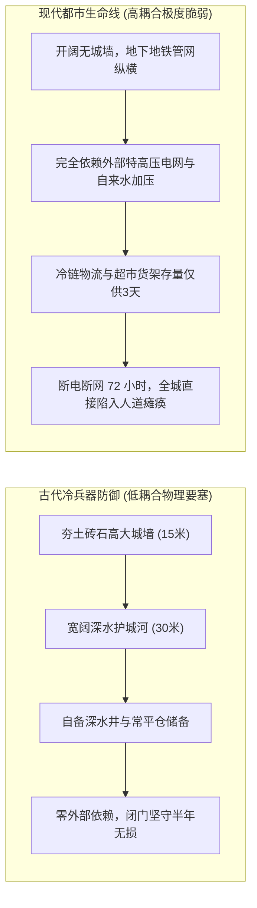
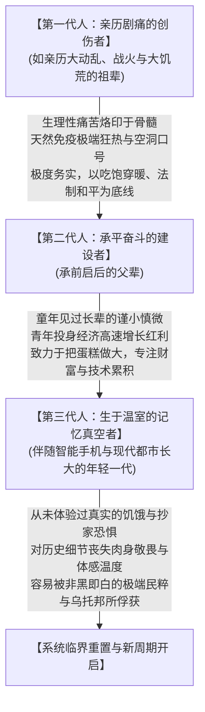

在德米特里·格鲁霍夫斯基（Dmitry Glukhovsky）创作的后启示录科幻经典《地铁2033》（*Metro 2033*）中，有一个令所有读者感到荒诞却又脊背发凉的终极隐喻：

核战争爆发后，地表沦为被辐射尘埃与变异飞魔统治的死亡废墟。仅存的几万名莫斯科幸存者，不得不像老鼠一样蜷缩在幽暗潮湿、空气浑浊的莫斯科地铁防空隧道里。在缺医少药、靠咀嚼变异猪肉和发光真菌苦苦支撑的绝境中，按照理性的生存逻辑，这群仅存的碳基幸存者应当结成最紧密的命运共同体。

然而，小说的描写却展现了人类最冷酷的本能：**即使被逼入了暗无天日的下水道，人类依然在站台与铁轨之间，毫无保留地按原样复刻了 20 世纪人类历史上全部血腥的意识形态内战**。

在“红线（Red Line）”站点，斯大林式的肃反委员会与政治保卫局在车厢里整肃异己；在“第四帝国（Fourth Reich）”站点，蒙着防毒面具的新纳粹狂徒拿着游标卡尺测量难民的头颅骨骼尺寸，凡是骨相不纯者即刻推入深坑坑杀；在环线的“汉萨同盟（Hansa）”，寡头商人掌控着唯一未受污染的环形水域，以军用穿甲弹作为硬通货放贷并压榨外围贫民站台。而在全书的终局，阿尔乔姆（Artyom）绝望地发现：整个莫斯科地铁之所以听不到地表外界的任何无线电电波，根本不是因为全世界文明都已毁灭，而是**地铁最高统治层为了维持地下防空洞内严酷的戒严秩序，在莫斯科四周秘密修筑了巨型无线电电磁压制塔，向全体幸存者编织了一个“外面全是欲置我们于死地的恶魔”的欺骗性楚门世界**。

这一惊心动魄的末日切片，与我们在现实中所观察到的历史阵痛产生了惊人的同构：

为什么一个系统维持绝对平稳的时间越长，最终爆发的危机反而越剧烈？为什么现代科技没有如乌托邦预言那般消弭苦难，反而在某些极权机器中将统治颗粒度推向了空前窒息的死局？为什么文明的承平日常如此迷人，其底层却潜藏着惊人的脆弱性？

本文试图穿透历史学、生态系统学与系统工程力学的边界，解开人类文明在繁荣与动荡之间往复循环的“野火律”。

---

## 一、 森林野火悖论：人为压制微量震荡，必将迎来系统性大火

在生态学与防灾减灾工程中，有一个著名的管理学教训，被称为**“斯莫基熊效应（Smokey Bear Effect / 森林野火悖论）”**。

自然状态下的原始森林，会频繁遭遇小规模的地表雷击火。这些小火顺着地面只燃烧枯死的落叶与杂草，几小时内便会自发熄灭，不仅伤害不到根深叶茂的大树，反而定期出清了系统的易燃杂质。

然而，当现代林业部门引入极其发达的消防科技，追求“五十年绝对无火灾”的平稳政绩时，悲剧的引线便被埋下：
- 每一处本该自然燃烧的小火星均被以最快速度扑灭；
- 原始地表上的落叶、枯枝与死树在五十年间越积越厚，堆积成了数十米厚的干柴地毯，系统的**“可燃物载荷（Fuel Load）”被无限推向物理极值**；
- 当某一天，一场无论如何也无法被人工干预的干雷暴劈向林区时，它绝不再是一场温和的地表小火，而是会瞬间升腾为高达上千度、将整片森林生态连根拔起烧成焦炭的**毁灭性树冠火（Crown Fire）**。

### 社会结构的物理映射
在人类文明与国家治理的复杂系统架构中，这套物理定律同样毫无偏差地运转着：
- **健康的社会系统具有“日常微量泄洪”的弹性（Antifragility）**：
  允许民间存在小摩擦，允许市民通过独立的法治诉讼去争辩对错，允许劳工与资本家通过工会谈判去博弈利益，允许文学与新闻直面权力的复杂与荒诞。这种低烈度的日常思想冲撞与制度纠偏，本质上是系统在安全排空底层的易燃应力；
- **过度防火的致命盲区**：
  如果一个系统把消除“哪怕是历史网文里的政治勾兑描写”、“哪怕是民间的琐碎抱怨”当作绝对安全红线，把所有低烈度的矛盾强行用高压手段抹平封口，表面上看确实是一片整齐划一、万籁俱寂的“绝对稳定”；
- 但矛盾与应力并没有在物理上蒸发，它们只是被强行压进了地壳深处。推迟得越久，系统积蓄的破坏性势能就呈指数级飙升。

---

### 二、 现代科技的双刃剑：高科技全景敞视与农耕要塞力学

很多现代人容易陷入一种技术决定论的技术迷信：以为科技越发达，极权就越难维系。然而现实的政治社会学事实却展现了截然相反的冷酷面貌。

#### 1. 科技填补了统治机器的“物理带宽盲区”
在农耕封建时代，哪怕是最残暴的帝王，也受制于古代极为落后的交通与通信效率，治理颗粒度极其粗糙，形成了所谓的“天高皇帝远、皇权不下县”。朝廷只关心收粮纳税，对于县城农户家里供奉什么神灵、私下说了什么话，既无法感知，更无力干涉。民间的宗族缓冲与物理逃亡空间极其广阔。

而现代信息通信技术（ICT）的出现，彻底弥补了国家机器在管理带宽上的物理短板：
- **从“管身”走向“管心”**：数字化户籍档案、全域基站三角定位、人脸识别算法与网络日志审计，让个体脱离中央数据库的自由流动成为物理不可能；
- **横向协同的物理扼杀**：现代电信与算法中枢使得底层两个素不相识的人想要在不被监听的前提下完成组织串联，在概率论上被压制到了零点。科技并没有天然带来解构，反而在缺乏制度制衡的土壤中，制造出了古代暴君在梦中都无法想象的“数字全景敞视监狱”。

#### 2. 系统脆弱性的逆转：从丧尸攻防看古代与现代的韧性反差
一个极具启发性的工程学思想实验，是对比封建社会与现代社会在面对外部非对称冲击（如经典丧尸末日模型）时的系统韧性：

- **现代大都市的防御死局**：
  现代都市是为商业流通而高度优化的“零防御系统”。这里没有城墙，全是玻璃幕墙与平坦马路；最致命的是，为了通勤修建的高速地铁网络和地下管廊，在失去电力后直接变成了无孔不入的地下巢穴。现代人失去电力 72 小时就会因断水断粮陷入内部混乱，系统的抗冲击冗余几乎为零；
- **古代城防工程的降维碾压**：
  古代要塞是纯粹为了抵御数以十万计地面冷兵器步兵而特化的“杀戮机器”。15 米高的垂直石砌城墙、数十米宽的深水护城河，配合城头重力势能巨大的礌石滚木与沸油金汁，对于缺乏工程智慧、不具备攻城器械的无脑冲击单位而言，是不可逾越的物理深渊；
- **力学对“尸体搭人梯”的终极否定**：
  好莱坞电影中常见的“成千上万丧尸堆叠成人肉斜坡”场景，在严谨的土力学与材料力学面前纯属视觉奇观。人体组织 70% 是水分与软组织，松散物体的休止角（Angle of Repose）决定了堆叠 15 米高的斜坡，底座宽度必须达到三四十米。在数千吨自重下，底层的人体会瞬间被压裂成流体泥浆发生侧向滑坡坍塌，根本无法提供攀爬所需的垂直剪切力。

**这个物理对比深刻地揭示了现代文明的本质代价值：我们用“极度精密的协同网络”换取了极高的生产力与舒适度，但代价是彻底交出了所有的物理韧性。文明越精细，一旦主干神经断裂，其休克速度越呈现崩塌式。**

---

## 三、 代际遗忘半衰期：为什么历史总是“隔两代人”就重蹈覆辙？

在观察大国兴衰与历史周期时，许多人常常误以为社会危机仅仅源自土地、人口与税收的物质失衡。然而，从代际社会学的视角审视，**“集体创伤记忆的生理性半衰期”才是点燃周期性震荡的更深层心理引信**。

人类的宏观历史周期，之所以往往呈现出 **50 到 70 年（约两代至三代人）**的震荡节律，核心在于肉身经验与书本知识之间的维度鸿沟。

### 1. 第一代人的“免疫抗体”：痛苦是刻在生理骨头里的
亲身经历过战火、大饥荒或文革动乱的一代人（如当下的祖辈），他们对于极左思潮、对于个人崇拜、对于把人划分为非黑即白的阶级敌人的狂热行为，有一种**本能的生理性恶心与恐惧**。

他们不需要读高深的政治哲学大部头，他们的理性是靠饿肚子的胃部痉挛、深夜被抄家的惊恐心跳换来的。这代人无论掌握多大权力，他们的第一反应永远是“千万不能再折腾”、“必须发展生产力”、“黑猫白猫抓住老鼠就是好猫”。只要这代人依然健康地坐在决策席上，整个国家机器哪怕有波动，也绝不会彻底滑向深渊。

### 2. 第三代人的“记忆真空”：历史被降维成冰冷的铅字
然而，文明的致命隐患在于**碳基生物的寿命是有上限的**：
- 当第一代亲历者逐渐老去、墓碑上的刻痕逐渐风化；
- 第三代年轻人出生在有空调、外卖、高铁和智能手机的超级和平温室中；
- 对他们而言，文革的批斗打砸、大清洗的暗夜枪声、粮食配给的残酷，不过是教科书上几句轻飘飘、毫无温度的抽象考试考点，甚至在短视频与网络滤镜的浪漫化加工下，被降维解构成了一种“那个年代的纯粹与理想主义”。

普朗克曾揭示过科学演进的残酷法则：**“科学真理之所以战胜旧观念，并不是因为说服了反对者，而是因为反对者都死光了，在他们死后成长起来的新一代从一开始就接受了新的真理。”**

在政治文明与社会周期中，这个法则呈现出了最悲剧的反向形态：
**理性的法治共识之所以逐渐被遗忘，并不是因为极端的观念被证明正确，而是因为当年受过剧痛惩罚的那一代亲历者全都死光了。新一代人在缺乏肉身敬畏的记忆真空中，很容易在某种新潮语言的包装下，欢天喜地地重新迈进那个吞噬一切的老陷阱中。**

---

## 四、 精灵社会的傲慢死局与人类文明的残酷新陈代谢

你曾提出过一个极其深刻的科幻假说：如果人类没有内乱、没有死亡，像奇幻小说里的“长生精灵”一样建立一个绝对永恒的社会，难道不是一种终极乌托邦吗？

答案是：**这非但不是乌托邦，反而是宇宙中能被设计出来的最恐怖的“赛博停滞地狱”。**

### 1. 永生社会的“老玩家不毕业”绝境
如果生命没有尽头：
- 第一代开拓者、长老和资本拥有者，将凭借永恒的生命永久霸占着最核心的权力、最好的土地、最重要的知识产权与话语权；
- 哪怕经历了一万年，新出生的年轻个体在这些资产与人脉盘根错节的长老面前，在物理上永远没有晋升的可能；
- 上升阶梯被绝对焊死，思想被永恒的先贤范式所囚禁，整个文明将不可避免地退化为绝对傲慢、绝对僵化、拒绝任何创新的木乃伊社会。

### 2. 动荡与出清：文明层面的“垃圾回收机制（Garbage Collection）”
从数千年乃至万年的文明宏观视角来看，社会矛盾的爆发、政权的代谢，固然伴随着惨烈的人间悲剧与血泪代价，但从系统演化力学来看，它在客观上扮演了**“强行粉碎深层固化利益集团、重置分配天平、为下一代幼苗腾出阳光”的残酷生理排毒机制**。

每一次制度的崩溃与重构，都像一场森林大火，烧尽了堆积在底层的僵化枯叶，迫使人类从废墟中总结出更具容错性的新制度法典。从秦汉郡县到近代立宪，从绝对君权到分权制约，文明的每一次跃迁，从来都不是在风平浪静的请客吃饭中自发诞生的，而是在一次次撞破南墙、流尽鲜血之后，被动逼出来的制度免疫升级。

---

## 五、 结语：在地铁暗影与街头微光之间

回到你最初的那个困惑：既然文明如此脆弱，既然宏观的周期如此冷酷，我们在街头吃着烧烤、在地铁车厢里看着形形色色人们的生活，究竟算是什么？

答案或许正是《地铁2033》给出的最深沉的启示：

即便莫斯科地铁的站台充斥着野蛮的内战与欺骗，即便人类的劣根性在毁灭后依然周而复始地复刻，但在那些昏暗车厢的角落里，依然会有一个老人就着煤油灯弹响生锈的吉他，依然会有一个年轻人在辐射的微尘中偷偷仰望从未见过的星空，依然会有平凡的个体在逼仄的黑暗中捍卫着最后的微观尊严与爱。

今天我们能够在和平的街道上享受一顿充满烟火气的烧烤，能够在安静的地铁里戴上降噪耳机去体味一段细腻的文字，**这绝不是什么永恒不变的自然天赐，而是我们的父辈与祖辈在穿越了漫长的饥寒、动乱与血泪之后，用整整两代人的隐忍、务实与苦干，在残酷的历史断层中为我们生生截流争取来的“奇迹时刻”**。

理解危机的不可避免，不是为了滑向虚无与恐惧，而是为了让我们在繁荣的平原上行走时，多一份对复杂常识的敬畏，少一份对极端狂热的盲从。

唯有守住对具体生活的感知、守住对历史伤疤的真实记忆，人类才能在这台高速运转的精密机器深处，守住那条最珍贵的微量泄洪通道，让头顶哪怕微弱但温暖的日常微光，在冰冷的周期铁律中多亮起哪怕一秒。
