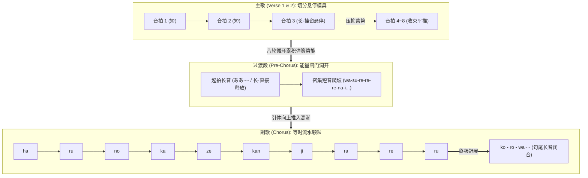

## 引子：声音的纵向时序——从“韵脚钢钉”到“音符时值”

在前作《方砖与流水：从东方Project同人曲到王勃诗篇，解构汉语押韵的声学击打感》中，我们曾将发声物理学的解剖刀对准诗歌与声乐的句末——当声波行进至段落终点，汉语依靠单音节无缓冲的陡峭能量脉冲、字头清辅音的瞬态截断与四声调值的物理位移，如同一柄铁锤将“韵脚铁钉”严丝合缝地钉入耳膜；而缺乏复合元音与闭音节的日语，则不得不借力英语的 `-tion` 闭音节或跨语种双声谐音实施声学代偿。

然而，句尾的韵脚终究只是音乐在时间横轴上的“空间落点”。如果说韵脚是建筑梁柱交接处的榫卯与钢钉，那么真正赋予一首歌流动生命与骨肉弹性的，是隐藏在乐句内部、纵向旋律线上的**音符时值分配（Note Duration Distribution）**。

音乐在本质上是对时间的刻度化分割。同一个旋律走向，若将音符时值进行微小的拉伸或压缩，带给听觉皮层的认知负荷与情感刺激将产生云泥之别。在绝大多数听众的直觉经验中，歌词往往被视为旋律的附属说明书；但在真正的词曲工程中，人类不同语言的音位系统（Phonological System）与发音器官的物理运动惯性，从底层反向规定了旋律时值的切割边界。

这场探讨的线索，源于一首在东方Project同人音乐界沉淀十余载的经典自作人声曲——收录于社团 Alstroemeria Records 2011年专辑《Double Counterpoint》（ARCD0031）中的《Spring Comes Along》（Masayoshi Minoshima 作曲、Haruka 作词、mican* 演唱）。

很多细腻的听众在初听这首长达近六分钟的曲目时，都会被一种难以言喻的呼吸感所吸引：在主歌段落中，每句歌词在唱出前两个轻盈的短音后，**旋律线上的第三个音符总会被异常突兀而执着地刻意拉长**；而到了副歌高潮，旋律却突然彻底放弃了任何中途拉扯，化作如初春融雪般连绵流淌、匀速推进的音节微粒。

为什么是“第三个音符”被刻意拉长？为什么被拉长的往往是语法上最无实义的助词或活用词尾？为什么这种在汉语中极易造成“倒字”与“卡壳”的危险切分，置于日语音位系统中却能激发出空前优美的物哀与延展？

穿透这一细微的旋律时值异动，我们将直面日语等时音拍（Mora-timed）、汉语声调方砖（Tone-timed）与英语重音律动（Stress-timed）三种截然不同的语言在发声物理机制上的生死分界。

---

### 【第一幕：主歌的“第三音悬停”——等时音拍（Mora）对虚词拉长的特权】

在流行音乐的编曲常模中，四四拍（4/4拍）的主歌乐句通常遵循平衡对称的音符分布。然而在《Spring Comes Along》的主歌第一段（Verse 1）与第二段（Verse 2）中，作曲者 Masayoshi Minoshima 却构筑了一套高度刚性、重复多达十余次的旋律模具。

我们首先必须澄清一个在非专业听觉中极易产生的认知偏差：**被拉长的并非歌词文本中视觉层面的“第三个汉字”，而是旋律线与节拍点上的“第三个乐音/音拍”**。

```
主歌 Verse 1 旋律时值与音节切分实测：

1. 消され枯れた思い (枯萎消失殆尽的思念)
   ke - sa - [re~] - ka - re - ta - o - mo - i
   [短] [短] [长·悬停] [短短短...]

2. 変わり果てた気持ち (变质走到尽头的心情)
   ka - wa - [ri~] - ha - te - ta - ki - mo - chi
   [短] [短] [长·悬停] [短短短...]

3. ここで沢山見た (这样的事情在这见过太多)
   ko - ko - [de~] - ta - ku - san - mi - ta
   [短] [短] [长·悬停] [短短短...]

4. そうね私も (是啊，我也是如此)
   so - u - [ne~] - wa - ta - shi - mo
   [短] [短] [长·悬停] [短短短...]

5. 季節変わるように (如同季节变迁一般)
   ki - se - [tsu~] - ka - wa - ru - yo - u - ni
   [短] [短] [长·悬停] [短短短...]

6. 気持ち変わりすぎて (那份心情也随之改变)
   ki - mo - [chi~] - ka - wa - ri - su - gi - te
   [短] [短] [长·悬停] [短短短...]

7. なにも信じられず (什么都无法相信)
   na - ni - [mo~] - shin - ji - ra - re - zu
   [短] [短] [长·悬停] [短短短...]

8. こんな世界で (在这样的世界里)
   kon - na - [se~] - ka - i - de
   [短] [短] [长·悬停] [短短短...]
```

```
主歌 Verse 2 旋律时值与音节切分实测（复刻模具）：

1. 夢を追い疲れた (因追梦而疲惫麻木)
   yu - me - [o~] - i - tsu - ka - re - ta
   [短] [短] [长·悬停] [短短短...]

2. そんな大人たちも (这样的大人们)
   son - na - [o~] - to - na - ta - chi - mo
   [短] [短] [长·悬停] [短短短...]

3. 変わるその前には (在变成那样之前)
   ka - wa - [ru~] - so - no - ma - e - ni - wa
   [短] [短] [长·悬停] [短短短...]

4. 夢を見ていた (也曾经梦见过梦想)
   yu - me - [o~] - mi - te - i - ta
   [短] [短] [长·悬停] [短短短...]
```

#### 1. 延迟重音（Delayed Accent）与悬停律动

从节奏动力学（Rhythmic Dynamics）分析，每个乐句的前两个音拍（如 `ke-sa-`、`ka-wa-`、`ki-se-`）以均等的短时值（通常为八分音符或弱起拍）轻巧垫步切入。听众的耳朵下意识地预判旋律将顺流而下，但就在第三个乐音降临的瞬间，旋律线突然刹车，这个音符直接霸占了跨小节的延伸时值（延音线挂留或占用两拍以上）。

这种手法在现代声乐编排中被称为**延迟重音（Delayed Accent）**或**切分悬停（Metrical Suspension）**：
- 它打破了传统节拍器般的方正对齐，让旋律在空气中形成一种类似杂技演员跃起后在最高点短暂停顿的失重感；
- 在情感维度上，两步急促的迈步后骤然停顿，在生理感知上模拟了人类在倾诉时**“话至唇边、猝然犹疑、深吸一口气陷入凝噎”**的物理停滞。面对“消逝的思念”与“变质的心情”，这种声音的迟疑比任何直白的哭腔都更具心理厚度。

#### 2. 音位学拆解：为什么虚词拥有被拉长的特权？

若将上述所有被赋予跨小节长时值的第三个音拍单独提取，一个在语言学上极具震撼力的规律赫然显现：

$$\text{被拉长音拍集合} = \{\text{れ (re)}, \text{り (ri)}, \text{で (de)}, \text{ね (ne)}, \text{つ (tsu)}, \text{ち (chi)}, \text{も (mo)}, \text{を (o)}, \text{る (ru)}\}$$

它们无一例外，全都是日语语法中的**接尾词、活用词尾（如被动态助动词「れる」的连用形、动词连用形尾音）或黏着助词（如格助词「で」「を」、提示助词「も」、终助词「ね」）**，几乎没有一个是承载核心词汇语义的实词词根（Root）。

在传统的朗读规范中，助词与词尾被归入轻读或弱化范畴，理应被快速一带而过。词作者 Haruka 与作曲者 Minoshima 为何敢于违背常规，把全句最显赫的时值与能量倾泻在这些“虚词”之上？

答案深植于**日语的等时音拍（Mora-timed）构造**：
1. **音位时钟的等长基准**：日语的基本节奏单位是“摩拉（Mora/音拍）”，而非印欧语系的音节（Syllable）。在物理上，每一个假名默认占据均等的发音时间窗口；
2. **缺乏字内声调（Lexical Tone）的刚性约束**：日语属于音高重音语言（Pitch-accent language），重音仅体现为词语内部音拍之间的高低阶跃，单个假名内部不存在汉语那样不可撼动的基频滑动曲线（F0 Contour）。这意味着，将一个假名无论拉长两拍、三拍还是四拍，其发音波形仅仅是在时间轴上做横向伸展，其音质核心（元音共振峰）保持高度纯净与恒定；
3. **语义解耦的安全性**：把「季節（ki-se-tsu）」的词尾「つ（tsu）」拉长，或者把提示助词「も（mo）」拉长，听觉中枢能够瞬时完成语法切分，绝不会将其误判为另一个具有完全不同意义的生词。

这种音位学特性，赋予了日文歌曲一种独一无二的审美特权：**歌手可以通过将虚词与语法接缝处的声音无限拉伸，在语义逻辑不发生丝毫断裂的前提下，极其从容地构建起空灵、悠远、带有些许叹息意味的情感留白。**

---

### 【第二幕：过渡段的时值解放与副歌的“流水颗粒”】

如果一首近六分钟的电子流行曲始终沉浸在“短-短-长”的悬停模式中，听众的听觉中枢势必会产生疲劳。Masayoshi Minoshima 展现其作为老牌同人电音巨擘的机心之处，正在于随后对这种时值形态实施的两次外科手术式爆破。

#### 1. 过渡段（Pre-Chorus）：第一音强释放破局

在主歌连续经历了整整八轮“短-短-长”的滞后压抑之后，旋律蓄积的弹簧已经紧绷到了临界点。此时，过渡段（Pre-Chorus）拔地而起：

```
ああ 無くせるのなら (啊 若能将这一切全部抹去)
[A - a~] [na - ku - se - ru - no - na - ra]
[长·爆发] [短 - 短 - 短 - 短 - 短 - 短]

ああ 苦しみはしない (啊 那么便不会再有这般痛苦了吧)
[A - a~] [ku - ru - shi - mi - wa - shi - na - i]
[长·爆发] [短 - 短 - 短 - 短 - 短 - 短]
```

在这里，此前锁死整首曲子的“先走两步、第三步拉长”的律动惯性被瞬间粉碎：
- 乐句不再有任何垫步，而是在**强拍的第一拍直接砸下一个毫无保留的八度长音「ああ（aa）」**；
- 这种在小节起拍直接长音铺陈的手法，宛如紧闭的闸门在重压之下轰然洞开，将主歌积攒的长程压抑以极高的动能一泄而出；
- 紧随其后的乐句后半程，旋律迅速收敛为密集的字音推进（`忘れられない / 大事なもの / ずっと見つめて`），完成向最终高潮副歌的引体向上。

#### 2. 副歌（Chorus）：开音节平推的“等时流水”

当乐曲最终跨入副歌《春の風》的核心主题时，许多初听者会凭直觉以为副歌会在“春”字上大肆拖腔以彰显宏大。然而真实声学波形揭示的真相恰恰相反——**副歌彻底抛弃了主歌的一切悬停阻尼，亦没有在句首盲目拉长，而是全速切换为如同清风穿林般的等时音拍平推**。

```
副歌乐句时值微观解构：

は・る・の・か・ぜ・かん・じ・ら・れ・る・こ・ろ・は~
ha - ru - no - ka - ze - kan - ji - ra - re - ru - [ko - ro - wa~]
[八分音符等时颗粒连续平推 (Mora Stream)............] [句尾长音释放]

も・う・い・ち・ど・じ・ぶ・ん・に・あ・え・る・か・ら~
mo - u - i - chi - do - ji - bu - n - ni - a - e - ru - [ka - ra~]
[八分音符等时颗粒连续平推 (Mora Stream)............] [句尾长音释放]
```

在副歌的前半句中，每一个音拍（ha、ru、no、ka、ze、kan、ji、ra、re、ru）都严格咬合在均等的八分音符网格上。没有重音突进，没有多余颤音，整条旋律线呈现出极度平滑、均匀的物理流动感。

这种“等时流水”之所以能在听觉上激发出震撼人心的纯净物哀感，由日语的两项极端声学特性决定：
1. **纯开音节（Open Syllable）的零摩擦通行**：日语绝大多数音节由“辅音+单元音（CV）”构成，除拨音外的元音之后绝无阻碍气流的辅音阻尼（Coda-free）。当一连串清脆的 CV 结构以高速连续发射时，气流在声门与口腔间畅通无阻，如水银泻地；
2. **长音后撤与能量终闭**：真正的延展长音被Minoshima严格管制并后撤到了乐句的最末端——直到唱至「頃は（ko-ro wa~）」与「逢えるから（ka-ra~）」时，旋律才舒展开来。



前半句如细雨滴阶般密集敲打，句末如烟云散开般悠然拉长。这种“前半句颗粒推进、句末从容落位”的动态对比，将东方Project世界观中对于季节流转、宿命沉浮与物哀守望的哲学，以最纯粹的音符时值语言镌刻在听众的神经突触之上。

---

### 【第三幕：三语“音乐生态位”矩阵——方砖、丝绸与架子鼓的声学生死线】

行文至此，一个贯穿跨语种声乐工程的核心问题浮现出来：这种在《Spring Comes Along》中惊艳无比的“第三音刻意拉长”与“副歌等时平推”，能否直接移植到汉语或英语的流行音乐之中？

答案是否定的。全人类的语言因其深层发音解剖学与音位体系的不同，在进入现代旋律工程时，各自撞上了不同的物理墙壁，进而被固化在各自完全不可替代的**“声学生态位（Acoustic Niches）”**之中。

#### 1. 汉语的“方砖与倒字之墙”

倘若一名中文词作者尝试将《Spring Comes Along》的主歌旋律原样填入中文词，他将立刻遭遇前作《方砖与流水》中所揭示的声学噩梦——**“倒字（Tone-Melody Mismatch）”与“方砖卡壳”**。

设想我们将“季節変わるように”按照意译填入：“当季节变~化的时候”：
- 旋律线在第三个字“变”上被强行拉长三拍；
- 汉字“变（biàn）”在现代普通话中是标准的**去声（第四声，调值 $[51]$）**，其物理本质是基频以极陡峭的斜率向下跌落的声学滑梯；
- 如果 Minoshima 的旋律在这个音符上是一个水平长音（如稳定在持续的高音 Do）或上行音阶，歌手在演唱时若顺应五线谱保持音高恒定，听众的大脑解码区在接收到平直基频的同时，会直接将去声的“变”纠偏解码为阴平（$[55]$）的“边”或阳平（$[35]$）的“便”；
- 听众听到的语义瞬间变成了“当季节边化的时候”或“当季节便化的时候”。原本肃穆的物哀瞬间坍塌为滑稽的语法事故。

更深层的阻碍在于汉语的**“独立方砖属性”**：
- 汉语是严格的一字一音一义，每个汉字都自带声母清辅音字头的瞬态爆破。如果强行把句中某一个无实义的虚词（如“的”、“地”、“得”）拉长三拍，在汉语听感中会显得极度愚蠢且做作，如同发音口吃；
- **汉语的独门生态位：句尾宏大拖腔与意境留白**。汉语极难在句中优雅悬停，但一旦行进至句尾，汉字饱满开阔的复元音与鼻韵母（如 -ang、-eng、-ou、-ai），便能借助五声音阶展开气吞山河的大开大合长音拖腔（如古典戏曲的甩腔、周杰伦《东风破》的句末归韵）。而在现代华语ACG或电子流行（如泠鸢yousa、塞壬唱片）中，若想模拟日系的轻盈流动，歌手往往被迫采取**“削弱声母字头爆破、大幅注水气声（Air Voice）”**的折中文学代偿。

#### 2. 英语的“抑扬格切分与肌肉律动（Groove）”

如果转向西方现代流行音乐的母语——英语，情况则走向了另一个极端。

英语属于典型的**重音计时语言（Stress-timed language）**。英语句子的时间流动不取决于音节总数，而取决于**重音音步（Stress Feet）的数量**：
- 英语天生不具备日语那种等时平推的基因，它天然排斥八分音符的绝对均等分布；
- 但英语极其擅长“短-短-长”的节奏切分。在古典英诗与现代流行乐中，这一结构拥有专属的术语——**抑扬格（Anapest，两短一长，如 “In the dark~”、“When we fall~”）**；
- 在西方 Progressive House 或 Trance 舞曲（如 Armin van Buuren 或 Above & Beyond 的经典曲目）中，制作人经常利用两到三个极度吞音弱化的单音节虚词引出第三个饱满的重读实词（如 `In a dream~`），利用重音的爆发力与合成器底鼓（Kick）形成强大的能量对撞。

然而，英语却永远无法复刻《Spring Comes Along》副歌那种纯粹的流水物哀感：
- 英语拥有极度发达的**词尾复辅音群（Consonant Clusters，如 -str-, -mps, -cts）**；
- 当英语试图高速平推短音时，舌尖、牙齿与唇部必须频繁进行复杂的阻气与爆破摩擦。这种物理阻尼使得英语的密集唱段天生自带强烈的**“打击乐肌肉感（Groove）”**，它更接近架子鼓的踩镲与军鼓，而绝非流水穿石的透明长笛。

#### 3. 三语声学与现代声乐生态位全景对账

| 比较维度 | 日语 (Japanese) | 汉语 (Chinese) | 英语 (English) |
| :--- | :--- | :--- | :--- |
| **底层节奏时钟** | **等时音拍 (Mora-timed)**<br>假名时间窗口绝对均等 | **音节声调 (Tone-timed)**<br>一字一音一义，携带固定调值 | **重音音步 (Stress-timed)**<br>重音等距，非重读音节高度弹性挤压 |
| **句中刻意拉长能力** | **极高 (T0级自由度)**<br>拉长助词/词尾不破坏语义，制造空灵悬停 | **极低 (受倒字与方砖双重锁死)**<br>强拉虚词显笨拙，强拉实词必倒字 | **中等偏高 (受词法重音刚性约束)**<br>天然契合抑扬格，但必须落在重读音节 |
| **句末长音发声质感** | **清凉纯净但共鸣受限**<br>仅5个单元音，尾音收敛干净，缺乏厚重感 | **宏大饱满、金石之声**<br>复合元音与鼻化共鸣腔体开阔，适合五声拖腔 | **弹性转音、戏剧张力**<br>依赖滑音与R&B多音节转音，情感外露剧烈 |
| **副歌密集短音听感** | **流水穿石、清脆透明**<br>纯开音节（CV结构）零阻尼平推，物哀感极致 | **容易陷入“机械念白”困境**<br>声母字头高频阻断，需靠气声与旋律起伏化解 | **架子鼓式的肌肉律动 (Groove)**<br>复辅音摩擦产生强力打击感，能量密度极高 |
| **现代音乐统治领域** | **二次元同人、J-Pop、Trance/ACG**<br>物哀、克制、呼吸感、透明空间感 | **国风流行、史诗叙事、宏大抒情**<br>字正腔圆的留白、意境凝练、情绪重锤 | **欧美流行、摇滚、Funk、EDM、Hip-Hop**<br>身体律动、多巴胺爆发、弹性伸缩张力 |

---

### 【第四幕：物证解析与 Alstroemeria Records 的“减法工匠精神”】

理解了语言发声物理构筑的生态位壁垒，我们才能真正读懂以 Alstroemeria Records 为代表的日本老牌同人音乐社团，在二十一世纪前十年的技术巅峰期究竟确立了怎样的编曲哲学。


*图：Alstroemeria Records ARCD0031《Double Counterpoint》官方封套。这张发行于 2011 年 Comic Market 80 的专辑，集中展现了 Masayoshi Minoshima 将西方 Trance 脉冲与日系物哀声乐严密咬合的极简工程学。*

#### 1. Masayoshi Minoshima 的“减法美学”

在当今许多追求感官刺激的现代流行与电子音乐制作中，编曲者往往热衷于“做加法”：堆叠数十轨华丽的合成器音色、塞满复杂的和弦转位（Chord Inversions）、在副歌中让歌手撕心裂肺地飙高音以制造廉价的情绪假高潮。

然而作为曾经缔造了《Bad Apple!! feat. nomico》这一传世神作的同人电音巨擘，Masayoshi Minoshima 的核心工匠壁垒恰恰在于**冷血的“做减法”**：
- 在长达 5 分 54 秒的《Spring Comes Along》中，底层的电子节拍始终维持着纯正 Trance 的恒定脉冲，没有多余的音效轰炸；
- 合成器铺底（Pad）与钢琴琶音被剥离了所有混浊的中低频共振，整体声场被清洗得极其空灵通透；
- 他将全部的情感重量，完全压在了**“音符时值的精准操控”**之上——用主歌的第三音悬停建立克制与迟疑，用副歌的一字一拍流水倾泻释放释然。

#### 2. Haruka 的作词留白与 mican* 的声学器乐化

与 Minoshima 的极简旋律工程严丝合缝的，是词作者 Haruka 与歌手 mican* 的绝妙协同：
- **作词的声学避让**：Haruka 的词作没有陷入繁琐晦涩的哲学名词堆砌，其核心意象高度凝聚在“枯萎的思念”、“变质的心情”与“初春的清风”等质朴物象中。更重要的是，他在主歌的所有长音节点上，极其耐心地安排了最舒展的开口元音假名，在副歌流水段落中密集排布清脆的轻音辅音，完成了对旋律线条的声学让行；
- **声线的器乐化演进**：歌手 mican* 在这首作品中的演绎，完全摒弃了过度戏剧化的胸腔共鸣与情绪撕裂，而是将自己的声带打磨成了一件冷冽而透明的木管乐器。她的发声点极其靠前，高位置的头腔共鸣与适度的气流包裹，使得日语音拍的每一次吐字都如同一颗被抛入清泉的水晶，在合成器的空间混响中激荡出漫长而干净的涟漪。

这种词、曲、唱在时值与声学维度上的高度互信，正是这首看似低调的东方自作同人曲能够在十五年时光淘洗后，依然在无数老玩家耳边反复回响的物理根基。

---

### 【第五幕：结语——每一种语言都是一件不可互换的乐器】

声学物理学与音位学的残酷之处在于，它无情地击碎了所有关于“世界语言能够无缝相互转译与翻唱”的浪漫幻想。

世界上没有哪一种语言是真正万能的声乐材料。人类在演化进程中所缔造的每一门语言，在成型的那一刻起，就已经由其发音器官的物理构造与音位体系，为自己打造了一具专属的骨骼：
- **英语是一副充满张力的架子鼓与合成贝斯**，它的天命在于对抗与摇摆，在错落有致的重音挤压中迸发出肌肉与骨骼的原始律动；
- **汉语是一口沉郁雄浑的青铜编钟与七弦古琴**，它的天命在于一字一顿的千钧重力与句末长音的金石交响，单字方砖若遇明匠，便能构筑起任何流水语言都无法企及的巍峨神殿；
- **而日语，则是一支清脆透明的钢片琴与竹木长笛**。它虽然缺乏汉语单字的万钧爆破力，亦没有英语大开大合的节奏弹性，但它在等时音拍的物理庇护下，获得了在虚词与接缝处优雅悬停、在副歌高速平推如春风拂面的至高特权。

听懂了《Spring Comes Along》中那个在第三个音符上悄然驻足的长音，我们便不仅听懂了一位同人音乐大师的旋律机心，更听懂了千百年来人类的声音在穿透物理枷锁时，所绽放出的最动人的和解。
