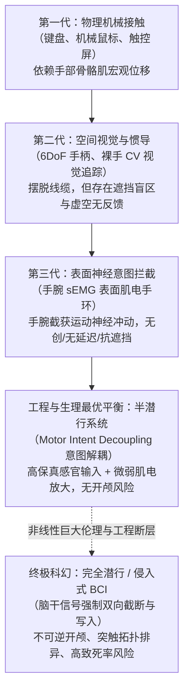
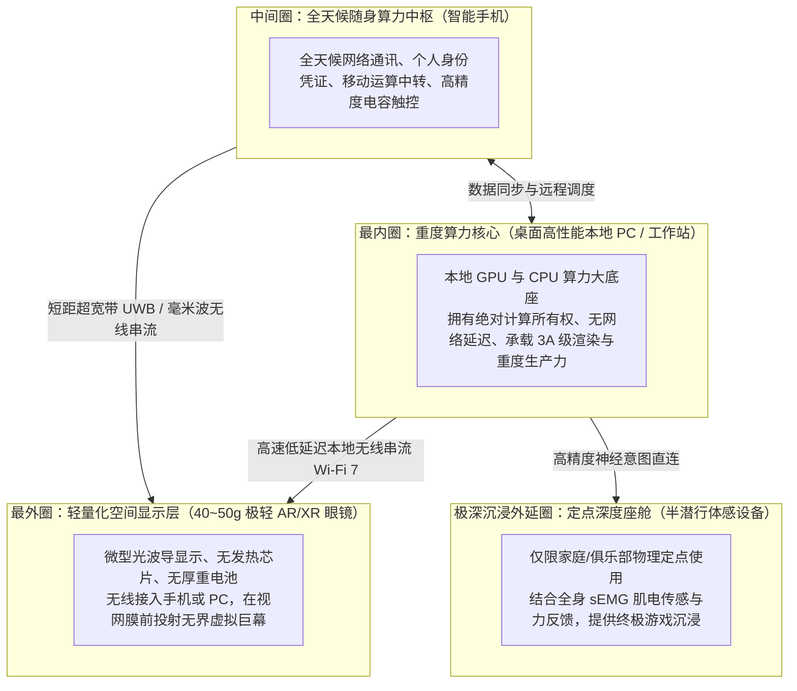

## 引言：从暗室里的一副 VR 头显说起

在深夜微弱的室内光线中，戴上 Meta Quest 3 打开 YouTube VR 的虚拟影院模式，整个视野瞬间被一座宏大的红丝绒座椅放映厅包裹。屏幕被拉至数十米开外，巨大的虚拟银幕悬在正前方，画质清晰，空间音频回荡在耳畔。

然而，在沉浸感拉满的最初十几分钟之后，一个极其本能的生理困惑浮上心头：

> “如果在夜晚很黑的环境下看电脑或手机屏幕，大家都知道非常伤眼睛；但是在实体电影院里，四周同样全黑，我们看两三个小时却不会觉得难受。那么，VR 里模拟出的这个‘观影院’，它贴在眼睛前面，实际对焦距离看起来并不远，这到底算哪一种？它究竟会不会伤眼睛？”

这个看似源于日常数码设备体验的微小疑问，像是一条严谨的物理线索。沿着它一路追问下去，问题的边界开始不断被打破和重构：
- 从视网膜感光对比度、透视（MR）环境光补偿与散光镜片的双重顶点距，到视觉辐辏调节冲突（VAC）这道横亘在现有一代 XR 硬件面前的物理铁壁；
- 从《节奏光剑》（Beat Saber）体感健身的设备保值账本，到 100 克轻量化分体式眼镜背后撞上的“热力学不可能三角”，以及 AI 专用视觉神经网络在图形渲染底层构建的确定性数学边界；
- 从智能隐形眼镜的角膜透氧极限、表面肌电手环（sEMG）对人体运动神经信号的物理截获，到对《刀剑神域》（SAO）跳过“半潜行”这一重大科幻设定逻辑漏洞的严肃解构；
- 从《纽伦堡法典》与《赫尔辛基宣言》对高危人体实验（死刑犯交易实验）的现代法理伦理绝对防线，最终推导至算力重力、云渲染商业账本与未来十年通用计算平台从“线性替代”走向“同心圆共存”的终极拓扑。

这不仅是一场数码外设的经验复盘，更是一场沿着物理学定律、人体生理机制、工程实现极限与商业本质层层剥离的深度思想实验。

---

## 一、 光学直射、固定焦距与眼肌代偿的生理真相

要厘清“VR 模拟影院是否伤眼”，首先必须剥开表象，从人类眼球的光学感知机制与物理光源特性谈起。

### 1. 关灯看屏幕 vs 实体影院 vs VR 观影

日常认知中“关灯看屏幕伤眼”的核心机理，在于**极端的光通量对比度**与瞳孔的生理性痉挛。

| 场景维度 | 光源物理属性 | 环境光对比度 | 睫状肌调节距离 | 眼球生理负担评级 |
| :--- | :--- | :--- | :--- | :--- |
| **关灯看手机 / 电脑** | 近距离高亮度背光直射（高比例蓝光波段） | 极高（黑白剧烈对立，四周无光） | 30~50 厘米（极度内聚收缩） | **重度负担**（瞳孔扩张与强光收缩反复痉挛） |
| **实体商业电影院** | 远距离白幕均匀漫反射光 | 中等偏低（银幕周围微弱环境诱导光） | 15~25 米（接近无限远，睫状肌完全放松） | **极轻负担**（漫反射光线柔和，明暗过渡平缓） |
| **Quest 3 纯黑虚拟影院** | 眼前 Pancake 透镜背光 LCD 直射光 | 较高（虚拟座椅仅带有算法渲染的微弱反光） | 物理焦距死锁在约 1.3 米 | **中度负担**（直射光通量偏高，但略优于全黑看手机） |
| **Quest 3 透视（MR）+ 室内暖光** | 直射屏幕光 + 摄像头实景重构漫反射光 | 平缓自然（真实房间暖色台灯作为背景光） | 物理焦距依然死锁在 1.3 米 | **轻度负担**（人眼瞳孔处于稳定生理区间） |

从光学本质来看：
- **实体电影院**的放映机光线经过银幕材料的微观颗粒散射后，到达人眼的是**漫反射光**。漫反射光的波前分布平滑，且影院内部留有微弱的安全地灯，明暗比通常控制在 100:1 左右，瞳孔无需剧烈调节。
- **VR 虚拟影院**虽然在软件着色器中渲染了模拟光线打在虚拟前排座椅上的微弱漫反射效果，但其本质依然是**两块距离角膜仅数厘米的高亮度液晶屏直射入眼**。
- **纯白背景的生理陷阱**：有人直觉认为把虚拟背景调成纯白便不会产生暗室反差。然而在眼部生理学中，这等于将两块大面积高亮度白光光源直接贴在角膜前。瞳孔被迫极度收缩至针尖大小，视网膜感光细胞承受极高的光通量负荷，睫状肌处于持续性痉挛状态，极易诱发眩光与流泪。
- **透视模式（MR）的最优解**：将头显切换为彩色透视模式，并在真实房间内开启一盏暖光台灯或小夜灯，让虚拟屏幕悬浮在真实的物理墙面之上。此时人眼感知到的是真实物理世界的柔和背景光，视网膜接受的光线分布立体而均匀，空间参照物能够有效抑制脑内前庭神经的前庭动眼反射（VOR）错位。

### 2. 视觉辐辏调节冲突（VAC）与 1.3 米的物理死锁

为什么许多人在 VR 里将画面拖到“几十米开外”，却总有一种“这其实就是客厅电视（家庭影院）”的微妙直觉？

这正是当前整个 XR 行业面临的最核心光学物理瓶颈——**视觉辐辏调节冲突（Vergence-Accommodation Conflict, VAC）**。

在真实世界中，人类双眼的对焦机制是双向耦合的：
- **辐辏（Vergence）**：双眼视轴向内转动的角度，用于三角测量距离；
- **调节（Accommodation）**：眼球睫状肌收缩或舒张，牵引晶状体变凸或变平，使焦点精准落在视网膜上。
你看近处的手机时，双眼内聚同时晶状体变凸；看远处的天空时，双眼平行同时晶状体彻底放松。

但在 Meta Quest 3 以及绝大多数消费级 VR 设备中，这套数百万年进化而来的协同反射被硬生生切断了：
1. **物理光学对焦距离被透镜死死锁死在约 1.3 米（4 到 5 英尺）**。无论在软件层面把银幕虚拟成 50 米外的巨幕，还是 30 厘米外的悬浮窗口，从透镜折射出来的光线波前，物理上永远等效于来自 1.3 米远的一个平面。
2. **大脑与肌肉的内耗打架**：当双眼看向虚拟巨幕时，大脑根据双目视差判断“目标在 30 米外”，神经系统下达指令让双眼球平行转动（辐辏看远）；然而为了看清这块巨幕上的像素点，睫状肌必须坚决抗拒看远的自然反射，死死将晶状体紧绷在 1.3 米处进行微调。

这种“眼球轴线在看远、晶状体却在对焦近”的神经与肌肉拉扯，正是戴 VR 超过一小时后眼球后部产生酸胀、隐痛的物理真凶。它不是软件能修补的代码错误，而是单焦透镜光学的底层宿命。

### 3. 散光、双重顶点距与瞳距（IPD）的容忍阈值

对于散光超过 200 度的视力障碍者，在 VR 内部佩戴近视框架眼镜时，往往会产生一种隐秘且不可逆的疲劳感：

```
[角膜 / 散光眼轴] <--- 顶点距 1 (12mm) ---> [框架眼镜凹透镜] <--- 顶点距 2 (10~15mm) ---> [VR Pancake 菲涅尔透镜] <--- 液晶屏
```

1. **双重顶点距与离轴畸变**：框架眼镜本身的验光参数是基于镜片后表面距离角膜约 12 毫米的标准设计的。戴入 VR 头显后，框架眼镜被面罩轻微挤压，顶点距发生微观形变，加上外层 Pancake 透镜的复杂光路折射，使得散光轴位发生微小偏移（Off-Axis Distortion）。眼球为了纠正这种扭曲，睫状肌必须处于高频次微幅震荡调节中。
2. **瞳距调节（IPD）的代偿分界线**：在《节奏光剑》等剧烈动态运动场景下，单次游玩时间通常在 20 到 30 分钟。在如此短的时间窗口内，人眼的晶状体和动眼神经具备充沛的代偿弹性，瞳距滚轮即使存在 2~3 毫米的机械偏差，也完全无伤大雅；
3. **文本阅读的死穴**：然而一旦场景切换为浏览器网页阅读或长篇代码排版，Quest 3 的角分辨率（约 25 PPD，远低于实体 4K 显示器的 60 PPD 视网膜级）会导致字体笔画边缘产生微观的亚像素锯齿。此时若瞳距不正，边缘离轴色散将迫使睫状肌陷入“不断尝试重聚焦却永远调不锐利”的无效死循环，在 1~2 小时内迅速耗尽耐受力。

---

## 二、 硬件研发的物理不可能三角与商业大饼的幻灭

在看清光学与生理的局限之后，一个紧接着的工程学疑问自然浮现：既然大家都知道单焦透镜有 VAC 冲突、LCD 屏对比度泛灰、头显太重，那么下一代产品（如传闻中的 Quest 4 或苹果形态）为什么迟迟不能将其彻底解决？

### 1. 热力学不可能三角与 100 克分体式妥协

消费级 XR 硬件研发长期以来被死死卡在一个违反基础热力学定律的**不可能三角**之中：

```
                    极致轻薄舒适
                  （像普通眼镜，≤100g）
                        /\
                       /  \
                      /    \
                     /  违  \
                    /   反   \
                   /   热力学  \
                  /     定律    \
                 /                \
超高算力与高刷新率 ---------------- 长续航与高亮度屏幕
（90Hz+，零晕动，无延迟）          （≥3000nits，持续运行数小时）
```

- 如果要把高性能计算芯片（高通 XR2 Gen 2/Gen 3 或苹果 M 系列）、主动散热风扇、大容量锂电池全部塞进头显主机，整机重量不可避免地突破 500 克大关（Quest 3 约 515 克，Vision Pro 高达 600~650 克）。这个重量挂在鼻梁和面部，哪怕使用顶级的第三方精英头戴进行受力重分配，面部毛细血管和颈椎力矩依然会在 90 分钟左右发出抗议。
- 如果要把重量压低到 100 克甚至几十克（如同普通太阳镜），根据当前的锂电池能量密度与半导体工艺制程功耗，机身甚至支撑不了十分钟的高负荷运算就会滚烫到灼伤皮肤。

这正是为什么产业界（包括 Meta 计划推出的分体式眼镜 Phoenix/Puffin，以及 Apple Vision Pro）不得不选择**“分体拖线外挂计算盒”**的折中路线——把发热大户（电池与核心 SOC）从脸上剥离下来，塞进玩家裤兜，通过一根物理 Type-C 线缆进行供电与数据串流。

这也直接宣告了初代科幻商业大饼的破产：科技巨头曾描绘“人人每天戴着无线头显工作生活 8 小时”的图景。然而现实是，普通人处理日常信息根本不需要戴着头显——口袋里的智能手机拿出来解锁只要 1 秒，交互更直接、更便携、且零生理负荷。

### 2. 渲染中的 AI：专用视觉神经网络 vs 大语言模型

面对硬件算力与功耗的刚性墙，近年 AI 的爆发给图形学带来了真正的突破口。然而，必须在计算机科学底层严格区分两类完全不同物种的“AI”：

| 对比维度 | 大语言模型（LLM，如 ChatGPT / Gemini） | 渲染级神经视觉网络（如 DLSS / FSR / 神经超分） |
| :--- | :--- | :--- |
| **数学本质** | 自回归概率预测（预测下一个 Token 的概率分布） | 严格几何约束下的高维函数逆求解与空间插值 |
| **输入底稿** | 非确定性的自然语言提示词上下文 | **确定性物理 G-Buffer**（深度图、运动矢量、世界法线） |
| **行为特征** | 具备发散性、创造力，但必然伴随“幻觉与事实捏造” | **高稳定性、无幻觉**，在确凿的三维几何边界内进行像素填空 |
| **计算延迟** | 数百毫秒至数秒（无法用于实时帧生成） | **微秒级（≤2ms）**，必须嵌入图形管线的每秒 90~120 帧循环中 |
| **典型失真** | 事实颠倒、逻辑胡言乱语 | 极高频运动或遮挡交界处的微弱“鬼影（Ghosting）” |

在图形渲染中，AI 不会像大模型那样凭空捏造不存在的物体。游戏引擎在向 AI 交付底稿时，已经提供了每一帧每个网格顶点的**真实深度缓冲区（Depth Buffer）**和**运动矢量（Motion Vectors）**。

AI 神经网络所做的事情，是基于确凿的物理轨迹，在较低功耗渲染出的 1080p 画面上进行亚像素级纹理重构，将其升采样为 4K 超高清。**AI 的介入，是用算法的确定性插值，绕过了物理硅片高功耗发热的硬墙**，这才是支撑未来 100 克超轻设备能够运行高质量画面的核心底层支柱。

### 3. 针对《节奏光剑》健身的设备生命周期判定

对于许多将 Quest 3 视作纯粹“体感健身房”的玩家而言，市场上关于下一代新品的传闻往往会引发资产贬值的焦虑。然而通过技术对账可以得出极其笃定的结论：**完全不需要急于出手等待新品**。

1. **产品线分化而非迭代淘汰**：
   - 即将问世的分体式轻薄眼镜（如 100 克级高昂定价设备），默认以裸手空间手势为主，甚至取消了标配手柄。腰间揣着沉甸甸的算力盒、身上拖着一根连接线，在进行《节奏光剑》这种大幅度、高爆发的身体闪转腾挪时，线缆抽打与盒子甩动反而是灾难性的体验倒退。
   - 传统无线一体机的迭代（Quest 4）仍处于遥远的时间线上，Quest 3 与 3S 依然是未来数年整个 Horizon OS 游戏生态的绝对装机量基准。
2. **玩法上限与画面属性**：
   - 《节奏光剑》并非依赖复杂光影渲染的写实 3A 大作，其核心魅力建立在极简色块、霓虹光刃与精准到毫秒级的打击节拍上。Quest 3 的算力与高刷新率屏幕早已将其手感推至天花板。即便未来设备换装 Micro-OLED 带来了更深邃的纯黑背景对比度，它也不会让你的挥剑命中率产生质的跃迁。

---

## 三、 从手势追踪、表面肌电到脑机接口的技术进化树

在人机交互的演进史上，人类一直在追求“让机器彻底理解人类意图”的最短物理路径。

### 1. 表面肌电手环（sEMG）：砍掉神经传导延迟的“物理外挂”

现代智能手机将人机交互推向了电容触控屏，而 XR 早期则寄托于空间摄像头视觉捕捉手势。但裸手手势识别存在无法解决的宿疾：**缺乏物理反馈（确认感缺失）**与**视场角遮挡盲区**。

真正的下一代突破口，落在了**表面肌电技术（Surface Electromyography, sEMG）**上：

```
传统外设交互链路：
大脑皮层决策 
  ──(神经电冲动)──> 脊髓 
  ──(外周运动神经)──> 手臂屈肌/伸肌 
  ──(肌纤维滑行收缩)──> 手指产生宏观机械位移 
  ──(克服弹簧阻力)──> 鼠标机械微动导通 
  ──(电路扫描延迟)──> 计算机响应
  [全程物理延迟：15 ~ 30 毫秒]

表面肌电手环（sEMG）链路：
大脑皮层决策 
  ──(神经电冲动)──> 沿运动神经传导至手腕 
  ──[手腕处 sEMG 传感器阵列瞬间截获神经电位突变] 
  ──(AI 模式识别解码)──> 计算机立即触发点击
  [手指尚未产生肉眼位移，信号已送达计算机；砍掉 15~20 毫秒物理生理延迟]
```

如果将这种设备交给职业电竞选手（如 MOBA 或 FPS 竞技）：
在大脑做出“闪避”或“开枪”决定的刹那，神经微电冲动刚路过手腕，指令就已经在游戏世界内生效。它直接将人体肌肉滑行收缩与外设按键行程的纯机械延迟抹杀殆尽。这种在物理层面上“超越人类神经生理极限”的交互外设，甚至会在职业竞技规则中被直接判定为不可容忍的“生理级硬件外挂”。

### 2. 人机交互外设与神经接口梯级对账



| 交互形态 | 硬件物理载体 | 信号捕获源 | 延迟水平 | 侵入性与生理风险 | 现实商业化成熟度 |
| :--- | :--- | :--- | :--- | :--- | :--- |
| **机械键鼠 / 触控** | 实体按键、微动开关、电容屏 | 肌肉收缩产生的机械物理压力 | 15~30ms（受限于肌肉行程） | **零风险** | **绝对成熟（基石平台）** |
| **空间裸手手势** | 头显前置灰度/红外摄像头 | 空间三维骨骼关键点几何解算 | 30~60ms（受图像处理帧率限制） | **零风险**（但极易引发手臂悬空肌无力） | **已商用（体验仍欠扎实）** |
| **手腕 sEMG 肌电** | 贴合手腕内侧的微电极阵列 | 运动神经元在腕部释放的微伏级电位差 | **<5ms**（提前在肌肉形变前截获） | **无创、零风险** | **工程验证期（未来3~5年主流）** |
| **半潜行舱 / 意图解耦** | 全身轻量化微电传感舱 / 智能服装 | 全身多路肌电微电位 + 空间高保真影音 | 微秒级电信号直通 | **无创、极低风险（可秒级物理中断）** | **理论完全成立，等待工业总装** |
| **侵入式脑机（BCI）** | 开颅植入脑皮层微米级柔性电极丝 | 神经元突触放电局部场电位（LFP） | 理论近乎零延迟 | **极高（脑出血、免疫排异、神经坏死）** | **医疗瘫痪康复期，严禁民用娱乐** |

---

## 四、 严肃科幻解构：为什么《刀剑神域》跳过“半潜行”是重大逻辑断裂？

任何优秀的科幻文学，其震撼力都源于对技术推演的自洽性。然而，从现代计算机科学与生物工程视角审视，川原砾在《刀剑神域》（Sword Art Online）中构想的 NerveGear 完全潜行设定，暴露出了一处巨大的**工程演进断层**与**制度逻辑漏洞**。

### 1. “半潜行（意图解耦）”才是工程可达的最优平原

在小说设定中，技术直接从简陋的头显跨越到了“能彻底阻断大脑延髓向身体发送运动神经信号，同时直接向脑内神经元双向写入五感”的完全潜行阶段。

但这在生物学上完全跳过了一座无论如何都会率先落地的巨大平原——**人类神经意图解耦（Motor Intent Decoupling）**：

1. **大脑的可塑性训练**：人类的神经中枢拥有惊人的学习能力。就像钢琴家可以独立控制无名指产生极其精细的力量变化，经过几天的适应性训练，普通人的大脑皮层完全能够学会**“只向肌肉发送 5% 强度的神经微电脉冲”**。
2. **微动放大与肉身安全**：在肉体层面，玩家只需静静躺在半沉浸座舱中，四肢肌肉几乎不产生任何肉眼可见的位移；而遍布手腕、脚踝与躯干的高灵敏度无创肌电传感器，可以轻松捕获这 5% 的神经冲动，由软件系统以数学方式放大为虚拟世界中全速奔跑、纵身劈砍的动作。
3. **零风险的代际优势**：这种半潜行形态**完全不需要向大脑深处注入危险的电流或微波，也根本不需要阻断脑干**。如果发生意外，玩家只需睁开眼睛或者收缩肌肉，物理层面的本能反射可以在毫秒内覆盖虚拟信号。

如果一条既安全、无创、成本可控、又足以提供 90% 极致沉浸感的工业路线已经铺展在眼前，没有任何理性的商业公司、监管机构和消费市场，会去批准直接研发一种需要将致命能量对准大脑、一旦断电就可能让人脑死亡的极端硬件。

### 2. “高功率微波自毁装置”在现代工业中的伪命题

SAO 故事最引人入胜的戏剧设定，在于“头盔拔掉电源后，内置电池会释放高功率微波烧毁玩家大脑”。

在纯文学中，作者可以用“首席天才架构师茅场晶彦暗中植入的恶意硬件”来解释。但在严肃的工业工程法医视角下，这在现实世界的硬件生产流水线中是绝对的无稽之谈：
- 一台面向消费市场公开发售数万台的消费电子设备，必须经过严苛的电气安全、电磁兼容（EMC/FCC）、以及医疗级光生物学安全认证（如 ISO 13485、CE、FDA、UL）。
- 想要在头显这种寸土寸金、散热被压榨到极致的密闭空间内，偷偷塞入一组能够短时间发射足以将颅骨内部脑浆加热沸腾的“军用级高功率微波发生器与储能电容”，其体积、走线、PCB 铜箔厚度与 BOM 物料成本根本不可能逃过任何一家代工厂（如富士康、立讯精密）产线工程师、品控质检员与全球海关安规实验室的法眼。

软件工程师确实可以在代码底层留下一扇极其隐蔽的后门（Backdoor），甚至在特定触发条件下将用户的数据锁死；但**软件后门绝不可能凭空创造出违背整机硬件 BOM 表的物理微波武器**。

### 3. 主观时间流速压缩与“下载知识”的科学边界

在更深层次的赛博朋克设定中，往往伴随着“虚拟世界时间流速比现实慢数倍”以及“向大脑直接拷贝知识（如《黑客帝国》秒学开直升机）”的神话。

这两者在神经生物学中分别对应着截然相反的科学现实：

#### 梦境时间拉长的代谢代价值
在极度专注、多巴胺高频释放或特定 REM 快速眼动期脑电节律下，大脑局部神经元的放电频率急剧攀升，信息处理密度倍增，确实会让人产生“在虚拟空间过了一整天，现实中仅过去一小时”的主观时间膨胀感。
但这绝非毫无代价的永动机——**主观时间拉长的本质，是以数倍的速度剧烈透支大脑葡萄糖储备、神经递质（如乙酰胆碱、多巴胺）与髓鞘代谢能力**。在虚拟世界里高强度“倍速生活”数小时，现实中的大脑皮层会陷入严重的神经元疲劳、突触传导效率骤降，甚至诱发不可逆的神经退行性损伤。

#### 为什么知识无法像 U 盘一样“复制粘贴”？
《黑客帝国》中插根管子就能将《牛津词典》或直升机驾驶指南灌入大脑，撞上了神经科学的根本铁律：**人脑的神经突触编码具备绝对的生物唯一性与拓扑异构性**。
- 计算机的文件是一串确定性的 ASCII 或二进制编码，无论放在哪块硬盘上，它的物理语义完全一致；
- 但人脑中的“苹果”这一概念，并不是存放在某一个特定神经元里的固定字节，而是由你童年时咬下苹果的清脆触觉、味蕾感知的果酸、瞳孔看到的红色光波、以及听到的音节共同交织形成的一张**跨越全脑数万个突触的动态加权网络**。
- 另一位人类大脑里的“苹果”，其突触拓扑图谱与你完全不同。如果强行把 A 大脑里学会微积分的突触权重矩阵通过电极打入 B 的大脑，其结果绝不是 B 学会了微积分，而是由于突触电流紊乱引发全脑神经元异常同步放电——即**严重的癫痫大发作与永久性失忆**。

未来脑机接口所能实现的极限，是向视觉与听觉底层皮层输入高保真的原始感觉流（类似《赛博朋克 2077》中的“超梦”）。它可以让你身临其境地观摩微积分大师的思维过程，但真正建立神经突触连接、将经验固化为知识的漫长生物化学过程，没有任何捷径，必须由每个人自己的神经元一步一步自主生长。

---

## 五、 人体实验的法理伦理绝对红线：《纽伦堡法典》与知情同意

在探讨高风险技术（如深部脑刺激、完全潜行原型机）的演进受阻时，一个经常被提出的灰色设想是：“如果技术的突破必须依赖高危人体实验，社会能否允许那些已被判处极刑、绝无生还希望的死刑犯，自愿通过参加神经实验来换取减刑或缓刑？”

在现代法学理论与全球医学伦理体系中，答案是斩钉截铁的：**绝对不行，这条路在法理与制度设计上被 100% 彻底封死**。

### 1. “知情同意”在死刑威逼下的法理失效

国际现代医学伦理的根本基石，是**“完全无胁迫的知情同意权（Free and Informed Consent）”**。

当一个人身处死牢、面对国家机器的合法处决威胁时，他与司法审判机构之间处于**极度不对等的强制权力场域**之中。此时如果向他开出“要么走上刑场执行死刑，要么去当脑机接口开颅实验品换取免死缓刑”的条件：
- 这在法学契约论上根本不是一种自由的个人意志抉择，而是赤裸裸的**“利用生命终极剥夺进行的不对等胁迫交易（Coercive Extraction）”**；
- 只要存在这种不对等，任何签署的知情同意书在法理上从签字那一刻起就是**绝对无效（Void Ab Initio）**的。

### 2. 制度寻租与滑向地狱的权力倾斜

禁止这一交易的更深层逻辑，不在于对受刑者个体的仁慈，而在于**对整个人类司法与科研权力体系的刚性防呆约束**：

```
允许“死刑犯换实验减刑”的致命制度死循环：
科研巨头需要“极端高危人体实验耗材” 
  ──(巨额科研资金与技术寻租)──> 游说司法机关 
  ──(制造法条解释弹性与扩大化指控)──> 诱导增加死刑判决数量 
  ──(迫使底层弱势群体入罪)──> 源源不断合法收割“人体耗材”
```

一旦在法律上撕开一条“死囚可以充当人体实验耗材”的口子，司法系统内部将不可避免地滋生出难以遏制的制度寻租冲动。权力机构与掌握尖端科技的资本完全有可能通过滥用公权力、扩大死刑罪名适用范围、制造冤假错案，来稳定获取供神经实验消耗的“合法肉体”。

这正是人类在二战惨痛浩劫之后，痛定思痛确立**《纽伦堡法典》（Nuremberg Code）第一条**以及**《赫尔辛基宣言》（Declaration of Helsinki）**的核心原点：**受试者的自愿同意绝对不可或缺；任何处于被剥夺自由或人身依附状态下的人群（囚犯、战俘、精神病患），无论何种理由，绝不准许作为高危非治疗性人体实验的对象。**

这是文明在经历深渊凝视后，用铁与血浇铸而成的不可妥协的底线，也是科技狂想绝对不得跨越的法理护城河。

---

## 六、 终极计算平台拓扑：算力重力、云渲染账本与共存同心圆

在扫清了光学物理、脑机外设与伦理法律的迷雾之后，关于通用计算平台未来十年的终极形态，所有的推演逻辑最终汇聚到了同一个宏观交汇点上：

> “从大型机、PC、智能手机，到现在的 XR 头显，未来的计算形态究竟是不是一个线性发展的链条？新的平台出现，到底会不会彻底消灭并淘汰旧的平台？”

### 1. 计算平台的同心圆演进定律（并非线性替代）

回望人类计算技术数十年的真实演变史，从来没有发生过“后者彻底消灭前者”的线性更迭：
- 个人电脑（PC）诞生后，淘汰大型中央服务器了吗？没有。服务器退守到了云端与数据中心，成为了整个现代互联网的算力底座；
- 智能手机普及后，淘汰个人电脑了吗？没有。智能手机接管了碎片化即时通讯、随身消费与地理位置服务；而真正的生产力编码、复杂工业制图、大型数据建模与重度 3A 游戏，依然死死锚定在桌面端的高性能 PC 与工作站上。

计算形态的演进，本质上是一个**以“算力重力”与“交互距离”为维度的同心圆向外扩张模型**：



### 2. 消费级“纯云端算力”的商业账本大溃败

在推演中，许多人曾寄希望于“网络基础设施极度发达之后，把所有运算都扔给云端服务器，我们头上只需戴一个极轻的显示屏接流”。

然而，这笔商业与物理账本在现实中根本无法跑通：

#### 物理定律的死线（光速与抖动）
XR 沉浸体验有一道绝对的生死线——**MTP 延迟（Motion-to-Photon，从头部动作到显示器光子刷新入眼的延迟）必须严格小于 20 毫秒**，否则人脑前庭系统就会产生剧烈的恶心与晕动症。
光信号在光纤中的传播速度约为每毫秒 200 公里。数据从家庭发射出去，经过路由器调制、光猫、城域网汇聚层、骨干网路由器路由跳折，到达数百公里外的云端机房，云端显卡耗费 10 毫秒完成渲染，再打包压缩编码、穿透公共网络回传至头显解码，哪怕在未来的 6G 时代，不可预知的公网丢包与网络微抖动（Jitter），都会瞬间击穿 20 毫秒的生死红线。

#### 商业付费账本的死穴
如果一位重度玩家每天戴着头显玩 4 小时 3D 游戏，云服务厂商必须在机房里为他**100% 独占分配一张等效于 RTX 4080/5080 级别的高端消费级或数据中心级 GPU**。
- 这张显卡伴随着巨大的折旧成本、机房精密空调电费、以及骨干网按带宽流量计费的高昂账单。
- 云厂商为了收回硬件投入与运维成本，每月必须向该玩家收取至少 **300 至 500 元人民币** 的高昂订阅服务费；
- 但普通大众对“娱乐与工具”的付费心智极其现实：消费者宁愿一次性掏出几千元买一台属于自己的物理电脑主机放在书桌底下，自己拥有、自己维护、零月租、零延迟、哪怕断网也能满血运行。

**本地算力的“一次性沉没买断成本”，在经济学上对“按月高昂订阅的云端租赁算力”构成了绝对的降维打击**。纯云端渲染只能作为特殊轻量场景的边缘补充，永远无法撼动消费级本地个人电脑的存在根基。

### 3. 未来十年的终极模块化形态：空间显示、随身中枢与古法键鼠的大一统

综合以上所有维度的严苛筛选，排除掉违背物理学、生物学、法律伦理与商业成本的所有死胡同，未来十年人类最现实、最舒适的数字交互图景，必然走向**功能解耦的模块化大一统**：

| 组件层级 | 物理形态 | 负责职能与定位 | 算力与能耗来源 |
| :--- | :--- | :--- | :--- |
| **空间显示终端** | 40~50 克的极轻无线 AR 眼镜（与普通光学近视镜外观无异） | 视网膜光子投影、空间虚实融合显示、空间音频 | 仅搭载微型显示驱动与微型无线天线，零高热计算芯片 |
| **随身便携算力盒** | 口袋里的智能手机 | 出行途中的随身网络基站、中轻度应用运算、快捷触控手势板 | 手机自身电池与先进移动 SOC |
| **定点高性能算力底座** | 桌下或机柜内的本地高性能 PC 主机 | 重度生产力渲染、本地大模型推理、3A 空间游戏算力供给 | 220V 交流电直供，拥有无限制的主动风冷/水冷散热 |
| **混合交互外设体系** | 手腕表面肌电手环（sEMG）+ 桌面物理机械键盘与鼠标 | 站立或躺卧时：隔空微动点选手环；桌面高强度工作时：物理实体键鼠 | 无线超低功耗微电池 |

当这一套体系合流时，一种优雅且符合人性尊严的工作与娱乐形态将彻底成型：
- 当你需要写长篇深度文章、编写复杂工程代码或处理精密商业大屏时，你坐在书桌前，桌上原本那台沉重逼隘的 27 寸物理显示器已经被彻底移走；
- 你戴上一副仅重 40 多克的普通镜框眼镜，空气中瞬间凭空展开了三块完全悬浮、无边框、色彩通透的 4K 虚拟巨幕；
- 你的双手搭在最熟悉的“古法”机械键盘与人体工学鼠标上，输入延迟为零，敲击段落感扎实确定；
- 而当你离开书桌走到客厅沙发上躺下时，随手抬腕，手腕上的肌电手环仅需感知指尖不到 5% 的微弱颤动，就能让你在空气中轻松滑动翻页，享受私人巨幕带来的极致安宁。

---

## 结语：在技术神话褪去后，看见真实人性的落脚点

从深夜关灯看 Meta Quest 3 虚拟影院时的一丝眼球酸胀，到一层层剥开视网膜感光、辐辏对焦冲突、散光轴位形变的微观生理代偿；从 100 克分体眼镜背后的热力学不可能三角，到 AI 视觉超分在确定性几何边界内的数学救赎；从肌电截获神经电位对动作延迟的物理削减，到《刀剑神域》科幻设定的逻辑断层与《纽伦堡法典》对生命尊严的绝对捍卫；最终在算力重力与商业账本的算盘声中，拼凑出下一代计算平台从狂热走向理性的终极拓扑。

这一整条长达数万字的思辨链条，向我们揭示了一个极其冷峻却充满美感的客观真理：

**科技的发展从来不是一蹴而就的狂暴跳跃，更不是凭空捏造的虚幻神话。它是一次次在严苛的物理定律、人体的生物极限、冷酷的商业账本与崇高的伦理防线面前撞得头破血流之后，退回来找到的那条最务实、最优雅的妥协之道。**

真正伟大的下一代计算革命，绝不会是把鲜活的人类肉体用电极粗暴地锁死在一具冰冷虚幻的“完全潜行”棺木里；而是在完全尊重我们这具经历了亿万年进化的血肉身躯与生理本能的前提下，用最克制、最轻盈的技术外设，将人类的认知与感知疆域，温柔地推向广袤无垠的物理空间之中。
