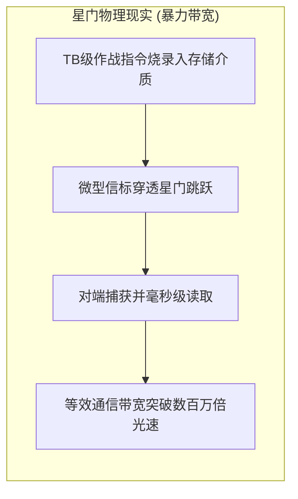
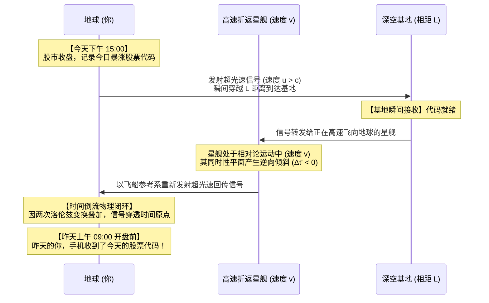
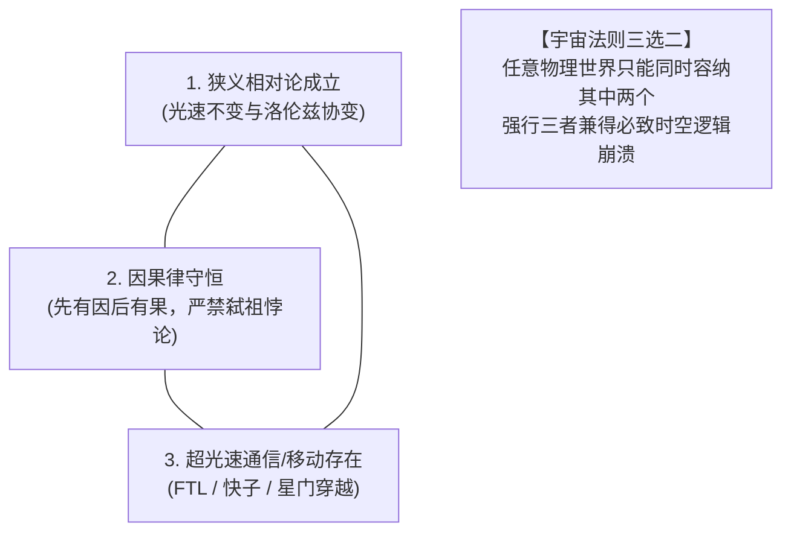
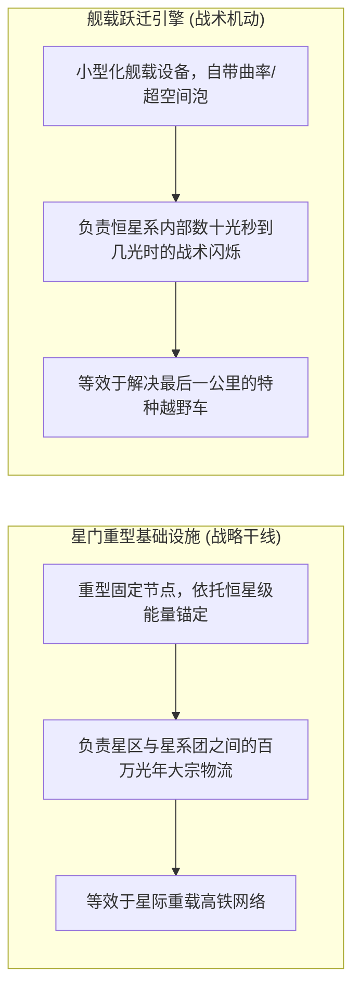

在硬核科幻与太空歌剧的世界观架构中，经常会出现一个令读者感到反直觉的“技术脱节”：

文明的重型战列舰可以穿过宏伟的远古星门（Stargate），在几秒钟内完成数千光年的跨星区跳跃；然而，当舰长想要向几光年外的友军基地发一封求援邮件时，雷达官却神情凝重地汇报：“长官，电磁波信号受光速限制，信息送达需要四年零三个月。”

这种“肉身可以穿梭星海，却发不出一封实时微信”的设定，初看之下像是极其粗糙的设定漏洞。既然星门允许包含成百上千亿原子、结构极其复杂的实体飞船毫秒级穿透，那么把一整块装满 PB 级数据的固态硬盘塞进微型无人机里射过星门，等效通信速度就已经达到了数亿倍光速，所谓的“超光速通信”在工程和逻辑上难道不是自动达成了吗？

这个看似理所当然的推论，触及了爱因斯坦狭义相对论中最为冰冷、也最让人不寒而栗的终极铁律：

**在现代理论物理的时空框架中，“超光速通信”并不只是一项更快的通信手段；它在数学和因果几何上，完全等价于一台能够向过去发送信息的时间机器。**

---

## 一、 暴力带宽与叙事防线：为什么科幻作家偏爱“信使邮船”？

### 1. 暴力带宽法则：信息从未脱离物质
在计算机网络领域，分布式系统专家安德鲁·塔能鲍姆（Andrew S. Tanenbaum）曾留下一句名言：
> “永远不要低估一辆装满磁带的旅行车在高速公路上飞驰的传输带宽。”（Never underestimate the bandwidth of a station wagon full of tapes hurtling down the highway.）

信息从未脱离物质实体存在。只要宇宙中存在允许实体物质瞬间位移的“星门”，超光速通信就已经在物理层面不攻自破：
- 将全舰队的作战指令、战场全景视频与遥测数据打包烧录进高密度存储芯片；
- 装载进一辆微型亚微米无人信标（Courier Drone）；
- 弹射穿过星门，在目标星系被接收天线物理捕获并读取。

从外部静态坐标系观察，信息跨越数光年尺度的等效传输速率，毫无疑问凌驾于光速之上数百万倍。

### 2. 太空大航海叙事的“保护机制”
既然在逻辑上无法封堵，为什么《战锤40K》、《银河英雄传说》、《海伯利安》乃至于严肃太空桌游《旅行者》（*Traveller*），都坚定不移地维持着“信使邮船制度”，严厉禁止覆盖全星区的超光速即时网络？

因为**无延迟的即时通讯，会在瞬间消解太空歌剧的史诗感与悲壮张力**。

科幻作家为了保留人类对于浩瀚深空的敬畏、孤独与前线指挥官的临场决断，必须在世界观里强行让通信滞后于飞船。但除了文学叙事考量外，在物理学底层，超光速通信隐藏着更加深刻的时空自毁危机。

---

## 二、 快子反电话实验：当两台超光速发射器开始打乒乓球

很多人本能地以为，“超光速”只是运动速度更快一点而已，就像喷气式飞机比马车快一样，怎么就会导致“回到过去”？

关键在于：**在狭义相对论中，时间不再是一个独立于空间的绝对时钟。两起事件是否“同时发生”，完全取决于观察者自身的相对运动速度。**

### 1. 洛伦兹变换中的时空倾斜
设有两个相对运动的惯性参照系：地面观察者参考系 $S(x, t)$，以及一艘以相对论速度 $v$（接近光速）沿 $x$ 轴正方向航行的星舰参考系 $S'(x', t')$。

根据狭义相对论的核心基石——洛伦兹坐标变换公式：

$$
t' = \gamma \left( t - \frac{v x}{c^2} \right)
$$

其中，洛伦兹因子 $\gamma = \frac{1}{\sqrt{1 - \frac{v^2}{c^2}}}$，$c$ 为真空光速。

考虑在地面参考系 $S$ 中，由原点向距离为 $\Delta x$ 的基地发射了一束速度为 $u$ 的超光速信号，历时 $\Delta t = \frac{\Delta x}{u}$。
现在，我们切换到那艘高速移动的星舰参考系 $S'$ 中，去测量这趟信号传递所经历的时间间隔 $\Delta t'$：

$$
\Delta t' = \gamma \left( \Delta t - \frac{v \Delta x}{c^2} \right) = \gamma \Delta t \left( 1 - \frac{u v}{c^2} \right)
$$

审视括号内的项：$\left( 1 - \frac{u v}{c^2} \right)$。

- **亚光速情况下 ($u < c$)**：由于星舰速度 $v < c$，乘积 $\frac{u v}{c^2} < 1$，因此 $\Delta t'$ 恒大于零。在任何惯性观察者眼里，信息的接收必定发生在信息的发射之后，因果秩序牢不可破；
- **超光速情况下 ($u > c$)**：只要信号传递速度 $u$ 超过光速，我们必然能找到一艘速度 $v < c$ 的高速飞船，使得：

$$
\frac{u v}{c^2} > 1 \implies \Delta t' < 0
$$

**数学推导得出了一个极其惊人的客观事实：在高速飞船的观察视角中，时间间隔 $\Delta t'$ 变成了负数。这意味着，接收端收到信号的时刻，在飞船的时间线上早于发送端把信号发射出去的时刻。**

### 2. 乒乓反击：从“视界倒流”到“实体弑祖”
有人会反驳：“飞船看到倒流，难道不能只算一种相对运动带来的视错觉吗？地面上发射信号的我和接收信号的基地，时间不依然是向前走的吗？”

这就是理论物理学家阿诺德·索末菲（Arnold Sommerfeld）与理查德·托尔曼（Richard Tolman）提出的**“快子反电话（Tachyonic Antitelephone）”**思想实验最精巧的地方：

**单个超光速信号只是改变了同时性倾斜平面，但如果用两台通信器将信号“打乒乓球式反弹”，时间倒流就会在同一个空间位置物理闭环成真。**

计算最终信号返回地球时的总时间间隔 $\Delta T_{total}$：
设地球与深空基地相距 $L$。地球在时刻 $t_0$ 发出超光速信号到达基地，再由一艘以速度 $v$ 飞向地球的高速飞船将信号以超光速回掷。最终信号返回发射点时的总时间变化为：

$$
\Delta T_{total} = t_{return} - t_0 = - \frac{2 v L}{c^2 \sqrt{1 - \frac{v^2}{c^2}}}
$$

由于飞船相对速度 $v > 0$，两地距离 $L > 0$，因此计算结果必然为：

$$
\Delta T_{total} < 0
$$

**回传信号到达地球的物理时刻，严格早于最初发射信号的时刻。**

这意味着，你确实可以把今天下午三点收盘时的暴涨股票代码，通过两台高速运动的超光速设备互相回掷，在昨天上午九点开盘前发送给自己。而一旦你昨天收到了代码并据此改变了操作，或者信号里的内容是“命令昨天的自己拉断电闸破坏发射器”，整个时空的因果逻辑链条（Causality）将在那一瞬间遭遇物理碎裂。

---

## 三、 相对论的三选二铁律：宇宙的因果防御机制

现代理论物理学由此建立了一条不可逾越的边界公理。在以下三个命题中，任何逻辑自洽的物理世界，**永远只能挑选两个，绝不可能兼得**：

1. **狭义相对论成立（Lorentz Invariance）**：光速在所有惯性系下恒定，时空服从洛伦兹协变性；
2. **因果律守恒（Causality）**：原因必定严格先于结果发生，信息无法向自己的绝对过去传递；
3. **超光速通信或位移存在（Superluminal Travel / FTL）**：允许任何信息或实体超越真空光速。

物理学家斯蒂芬·霍金曾据此提出著名的**“时序保护假说（Chronology Protection Conjecture）”**：自然界的物理定律在宏观层面上会协同阻止封闭类时线（Closed Timelike Curves）的形成，从而让历史免于被篡改。

这也是为什么在严肃硬核科幻中，如果作者不想让故事退化为混乱的时间穿越闹剧，就必须对“超光速”施加极为严酷的物理限制：要么承认存在一个全宇宙唯一的“绝对静止以太参考系”（抛弃狭义相对论），要么彻底封死信息超光速流动的可能性。

---

## 四、 星际大航海的工程妥协：星门基建与舰载跃迁的战术协同

从纯粹的世界观工程构建角度审视，如果我们既想保留相对论的自洽性，又想展现浩瀚的星际战争，文明通常会演化出两套截然不同、各司其职的推进体系：

### 1. 星门：恒星级公共重载干线
星门并非安装在飞船上的部件，而是由庞大星际帝国或先驱文明修建在深空拉格朗日点上的**固定公共基础设施**。
- **高能耗与固定拓扑**：星门需要抽取恒星甚至戴森球的全部功率来维持微型虫洞的喉部张开，航线完全被锁定在特定的两个星门节点之间；
- **解决战略大宗投送**：星门负责在相距数百上千光年的不同星区之间，进行战列舰编队、重工业矿石与民用物资的批量流通，是维系星际帝国的宏观经济命脉。

### 2. 舰载跃迁引擎：战术越野机动
当一支舰队通过星门抵达某个星系的引力边缘时，星门的使命就已经结束。从星门出口到目标行星之间，往往还有数十个天文单位（AU）的漫长路程。
- **解决“深空最后一公里”**：如果单凭亚光速工质引擎推进，舰队飞到核心星球仍需数月时间；
- **战术跳跃与战场规避**：舰载曲率引擎或折跃装置允许战舰在数光秒到数光天的战术半径内进行小幅度瞬移，用于抢占轨道高地、规避反舰导弹齐射，充当了解决战术机动的特种越野车。

---

## 五、 结语

回到最初的那个困惑：为什么太空文明有了星门，却依然在为微弱的光速通信而苦恼？

答案并非作家偷懒，而是宇宙最根本的几何结构向一切智慧生物发出的永恒警告：**空间与时间从来不是割裂的画布，想要打破距离的桎梏，就必然会震颤时间的轴线。**

正因为即时通讯被因果律的铜墙铁壁所隔绝，深空中的每一次探索才具有了不可逆转的厚重感；正因为无法给昨天的自己发去答案，每一个站在舰桥上的碳基生命，才必须用自己的血肉之躯与全部智慧，在冰冷幽暗的群星之间承担起每一次无法撤回的选择。
