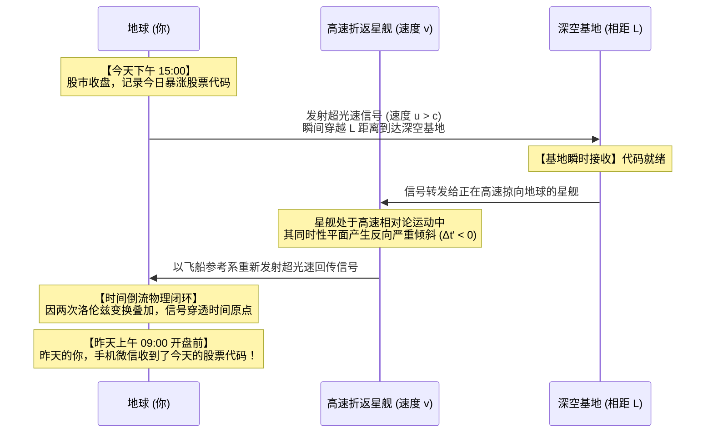
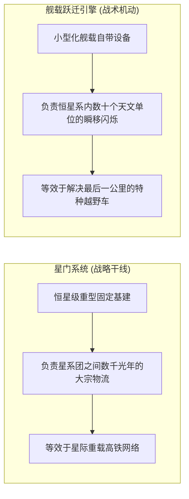

在探讨硬核科幻世界观的架构时，一个经常引发激烈争论的问题浮出水面：为什么在许多设定宏大的太空歌剧中，文明明明拥有能够瞬间跨越数千光年的“星门”，但在星系内部的通讯却依然要忍受漫长的光速延迟？

这究竟是科幻作家粗糙的逻辑漏洞，还是背后隐藏着物理学最严酷的因果律戒律？以下为这场关于超光速通信、洛伦兹变换与时序保护思想实验的真实问答实录。

---

### 【第一问：星门存在，通信在逻辑上难道不能超光速吗？】

> **问**：正常来说，科幻作品里有了星门，理论上通信也可以超光速吧，我是说逻辑上。既然连战列舰都能几秒钟穿过星门跳跃几千光年，为什么雷达官还要神情凝重地汇报“电磁波受光速限制，求援信送达需要几年”？把硬盘塞进飞船里运过去，不就是超光速通信吗？

**答**：在逻辑上，你的直觉完全正确。

在计算机网络和信息论中，分布式系统专家安德鲁·塔能鲍姆（Andrew S. Tanenbaum）曾留下一句经典的工程经验格言：
> “永远不要低估一辆装满磁带的旅行车在高速公路上飞驰的传输带宽。”（Never underestimate the bandwidth of a station wagon full of tapes hurtling down the highway.）

信息从来不能脱离物理载体独立存在。如果一个世界观里允许宏观物质通过星门进行超光速空间跳跃，那么超光速通信在工程上就已经自动达成了：
1. 将数十亿条战术指令、高清全景遥测数据烧录进微型固态芯片；
2. 搭载在一枚微型的亚微米无人信标（Courier Drone）或动能穿梭机上；
3. 穿过星门跳跃至目标星区，由接收端的天线阵列捕获并物理读取。

从宏观外部参考系来看，信息的有效传输速率（跨越光年尺度的位移比上穿越时间）毫无疑问已经超越光速数百万倍。

既然逻辑上封不住，为什么《战锤40K》、《银河英雄传说》、《海伯利安》乃至于严肃太空桌游《旅行者》（*Traveller*），都坚定不移地维持着“信使邮船制度”，严厉禁止全星区即时网络？

因为**无延迟的星际互联网，会在瞬间扼杀太空歌剧的大航海史诗感**：
- 如果前方战列舰遭遇异星未知文明时，舰长可以随时发起跨星区视频会议，数千光年外的母星最高官僚委员会就会立刻接管指挥权，要求层层审批、微观管理，一线舰长沦为提线木偶；
- 只有维持巨大的信息延迟，18 世纪风帆战舰时代孤立无援的悲壮感、战争迷雾与前线指挥官独断专行的英雄主义，才能够在冷酷的太空中复活。

然而，除了文学创作的需要外，物理学底层对“超光速通信”的封杀，源自更加致命的因果律危机。

---

### 【第二问：发微信给昨天的自己今天的股票？】

> **问**：？？你是说，有那种感觉像是星际大航海时代的星门的话，我就能微信发给昨天的自己今天的股票？？
> 不是应该配置跃迁引擎进行快速飞跃吗，星门用于远距离移动？

**答**：是的！在爱因斯坦狭义相对论的严谨数学推导下，**只要任何形式的“超光速通信”在物理上存在，你百分之百能够制造出一台时间机器，把今天下午股市收盘时的暴涨代码，发给昨天上午开盘前的自己！**

这就是理论物理学著名的**“快子反电话（Tachyonic Antitelephone）”**思想实验。

#### 1. 洛伦兹变换中的负时间间隔
很多人直觉上认为，超光速只是“跑得比光更快”而已，怎么就变成时间倒流了？
关键在于：**在狭义相对论中，时间从来不是独立于空间的公共时钟，两起事件是否“同时发生”，完全取决于观察者自身的相对运动速度。**

设地面观察者参考系为 $S(x, t)$，一艘以相对论速度 $v$（沿 $x$ 轴正方向接近光速航行）的飞船参考系为 $S'(x', t')$。
根据洛伦兹坐标变换公式：

$$
t' = \gamma \left( t - \frac{v x}{c^2} \right)
$$

其中，洛伦兹因子 $\gamma = \frac{1}{\sqrt{1 - \frac{v^2}{c^2}}}$，$c$ 为真空光速。

假设在地面参考系 $S$ 中，由原点向相距为 $\Delta x$ 的基地发射了一束速度为 $u$ 的超光速信号，历时 $\Delta t = \frac{\Delta x}{u}$。
现在，我们切换到那艘高速移动的飞船参考系 $S'$ 中，测量这趟信号传递所经历的时间间隔 $\Delta t'$：

$$
\Delta t' = \gamma \left( \Delta t - \frac{v \Delta x}{c^2} \right) = \gamma \Delta t \left( 1 - \frac{u v}{c^2} \right)
$$

审视括号内的项：$\left( 1 - \frac{u v}{c^2} \right)$。
- **亚光速情况下 ($u < c$)**：由于飞船自身速度 $v < c$，乘积 $\frac{u v}{c^2} < 1$，因此 $\Delta t'$ 永远大于零。在任何观察者眼里，信息的接收必定发生在发射之后；
- **超光速情况下 ($u > c$)**：只要信号速度 $u$ 超过光速，我们必然能找到一艘速度 $v < c$ 的高速飞船，使得：

$$
\frac{u v}{c^2} > 1 \implies \Delta t' < 0
$$

**在高速飞船的观察视角中，时间间隔变成了负数！这意味着，接收端收到信号的时刻，在飞船的时间线上早于发送端把信号发射出去的时刻。**

#### 2. 双机乒乓反击：因果倒流物理闭环
单条超光速信号只是改变了同时性倾斜面，但只要让**地球和高速折返星舰两台设备“打乒乓球”**，时间倒流就会在同一个物理位置成真：

推导最终信号返回地球时的总时间变化 $\Delta T_{total}$：
设地球与基地相距 $L$。地球在时刻 $t_0$ 发出超光速信号到达基地，再由一艘以速度 $v$ 飞向地球的高速飞船将信号以超光速回掷。最终信号返回发射点时的总时间变化为：

$$
\Delta T_{total} = t_{return} - t_0 = - \frac{2 v L}{c^2 \sqrt{1 - \frac{v^2}{c^2}}}
$$

由于飞船相对速度 $v > 0$，两地距离 $L > 0$，因此计算结果必然为：

$$
\Delta T_{total} < 0
$$

**回传信号到达地球的物理时刻，严格早于最初发射信号的时刻。**
你确实可以在昨天上午收到今天下午的暴涨代码，或者如果发回的内容是“命令昨天的自己自杀”，整个宇宙的因果逻辑链条（Causality）将在那一瞬间遭遇物理碎裂。

#### 3. 相对论的三选二铁律
理论物理学由此确立了一条公理：在以下三个命题中，任何逻辑自洽的宇宙，**永远只能挑选两个，绝不可能兼得**：
1. **狭义相对论成立（Lorentz Invariance）**：光速在所有惯性系下恒定，时空服从洛伦兹对称性；
2. **因果律守恒（Causality）**：原因必定严格先于结果，信息无法向自己的绝对过去传递；
3. **超光速通信或移动存在（FTL）**：允许任何信息或实体超越真空光速。

这也是物理学家斯蒂芬·霍金提出**“时序保护假说”**的原因：宇宙会在宏观物理定律层面阻止超光速信息回路的闭合，保护历史不被篡改。

#### 4. 星门与舰载跃迁的战术分工协同
至于你提到的“跃迁引擎与星门的分工”，在严谨的世界观工程中，文明通常会发展出双层拓扑结构：

- **星门是公共重型干线高铁**：固定在拉格朗日点，靠抽取整个恒星的能量维持虫洞开启，负责跨星区数千光年的战略大宗物资流通与主力舰队调动；
- **舰载跃迁引擎是特种越野车**：飞船通过星门到达目标恒星系边缘后，距离行星往往还有几十个天文单位（AU），舰载跃迁引擎负责解决这“最后一公里”的深空战术机动与规避。

---

### 【尾声】

空间与时间从来不是割裂的画布，想要打破距离的桎梏，就必然会震颤时间的轴线。

科幻世界中那些看似严苛的光速壁垒与信息延迟，恰恰是因果律在宇宙深处给文明设下的安全气囊。正因为无法给昨天的自己发去答案，深空中的每一次决断才具备了不可逆转的史诗分量。
