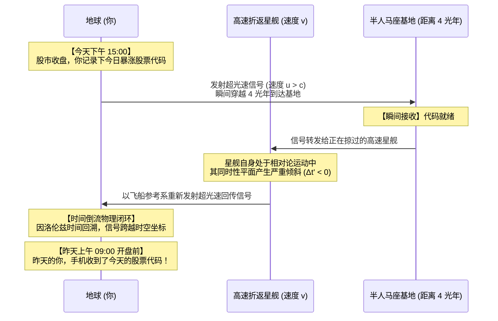
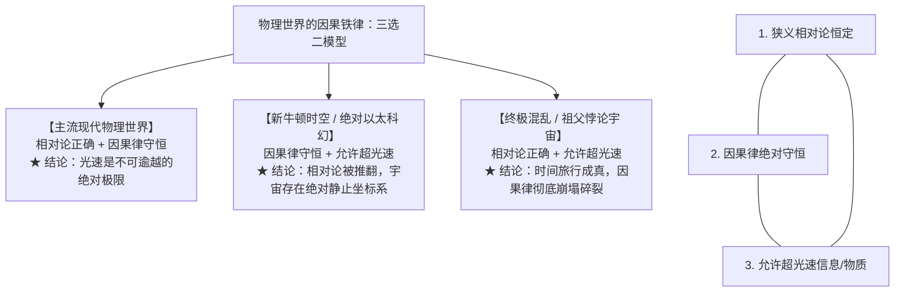

在太空歌剧与科幻世界观的架构中，常常存在一个令硬核读者感到极度违和的“逻辑裂缝”：

文明的重型战列舰可以穿过宏伟的远古星门（Stargate），在几秒钟内完成数千光年的跨星区跳跃；然而，当舰长想要向几光年外的友军基地发一封求援邮件时，雷达官却神情凝重地汇报：“长官，电磁波信号受光速限制，信息送达需要四年零三个月。”

这种“能肉身穿梭星海，却发不出一封实时微信”的反差，初看之下像是极其粗糙的逻辑硬伤。既然星门允许包含成百上千亿原子、高度有序的飞船物质毫秒级穿透，那么把一整块装满 PB 级数据的固态硬盘塞进无人导弹里射过星门，等效通信速度就已经达到了数亿倍光速，所谓的“超光速通信”在工程和逻辑上难道不是自动达成了吗？

这个看似理所当然的推论，触及了爱因斯坦时空流形中最为冰冷、也最让人不寒而栗的终极铁律：

**在狭义相对论的物理世界中，“超光速通信”并不只是一项更快的通信技术；它在数学和因果几何上，完全等价于一台能够向过去发送信息的时间机器。**

本文将从物理学史著名的“快子反电话（Tachyonic Antitelephone）”思想实验出发，用严密的洛伦兹变换推导为什么两台超光速通信器打乒乓球就能把今天的股票代码发给昨天的自己，并进一步解构科幻作者们为了挽救叙事史诗感与因果律，在世界观中做出的精妙工程妥协。

---

## 一、 逻辑的必然与叙事的困境：为什么作家要“封杀”即时通信？

### 1. 暴力带宽法则：信息从未脱离物质
在信息论与计算机科学中，有一句著名的经验格言：
> “永远不要低估一辆装满磁带的旅行车在高速公路上飞驰的传输带宽。”（Never underestimate the bandwidth of a station wagon full of tapes hurtling down the highway. —— Andrew S. Tanenbaum）

物质与信息在现代物理学中本质同构。如果星门允许物质以超光速在 A 点与 B 点之间建立通道，哪怕该通道存在某种严苛的物理限制导致纯电磁波与光子无法穿透，通信方也完全不需要依赖无线电广播：
- 将数十亿条通讯、指令与视频录像打包烧录进高密度存储介质中；
- 搭载于极小质量的亚微米无人信标（Courier Drone）或微型动能鱼雷；
- 穿透星门，在目标星系被接收端阵列捕获并物理读取。

从宏观外部坐标系观察，信息的有效传递速度即为无人机跨越光年尺度的位移比上穿越时间，其速度毫无疑问凌驾于光速之上数百万倍。

### 2. 太空大航海时代的叙事谋杀
既然在物理逻辑上无法封堵，为什么《战锤40K》、《银河英雄传说》、《海伯利安》乃至于严肃太空桌游《旅行者》（*Traveller*），都坚定不移地维持着“信使邮船制度”，严厉禁止覆盖全星区的超光速即时网络？

答案极其残酷：**因为无延迟的星际互联网，会在瞬间扼杀太空歌剧的史诗感。**

科幻作家为了保留人类对于浩瀚深空的敬畏、孤独与悲壮决断，必须在世界观里强行掐断超光速即时通信。然而，除了叙事层面的文学动机外，在物理学底层，超光速通信隐藏着更加致命的因果律自毁危机。

---

## 二、 快子反电话实验：当两台超光速发射器开始打乒乓球

很多人认为，“超光速”只是速度更快一点而已，就像喷气式客机比马车快一样，怎么就会导致“回到过去”？

关键在于：**在狭义相对论中，时间不再是一个独立于空间的公共时钟，两起事件是否“同时发生”，完全取决于观察者自身的相对运动速度。**

### 1. 洛伦兹变换中的时空倾斜
设有两个相对运动的惯性参照系：地面观察者参考系 $S(x, t)$，以及一艘以相对论速度 $v$（沿 $x$ 轴正方向，接近光速）高速航行的星舰参考系 $S'(x', t')$。

根据狭义相对论的核心基石——洛伦兹坐标变换公式：

$$
t' = \gamma \left( t - \frac{v x}{c^2} \right)
$$

其中，洛伦兹因子 $\gamma = \frac{1}{\sqrt{1 - \frac{v^2}{c^2}}}$，$c$ 为真空光速。

考虑在地面参考系 $S$ 中相隔距离为 $\Delta x$ 的两个地点，发生了一次速度为 $u$ 的信号传递，历时 $\Delta t = \frac{\Delta x}{u}$。
现在，我们切换到那艘高速移动的星舰参考系 $S'$ 中，去测量这趟信号传递所经历的时间间隔 $\Delta t'$：

$$
\Delta t' = \gamma \left( \Delta t - \frac{v \Delta x}{c^2} \right) = \gamma \Delta t \left( 1 - \frac{u v}{c^2} \right)
$$

仔细审视括号内的项：$\left( 1 - \frac{u v}{c^2} \right)$。

- **亚光速情况下 ($u < c$)**：由于星舰速度 $v < c$，乘积 $\frac{u v}{c^2} < 1$，因此 $\Delta t'$ 永远大于零。在任何观察者眼里，信息的接收必定发生在信息的发射之后，因果律稳如磐石。
- **超光速情况下 ($u > c$)**：只要信号传递速度 $u$ 超过光速，我们必然能找到一艘速度 $v < c$ 的高速星舰，使得：

$$
\frac{u v}{c^2} > 1 \implies \Delta t' < 0
$$

**数学推导得出了极其恐怖的物理现实：在高速飞船的观察视角中，时间间隔 $\Delta t'$ 变成了负数！这意味着，接收端收到信号的时刻，在飞船的时间线上，早于发送端把信号发射出去的时刻。**

### 2. 乒乓反击：从“视界倒流”到“实体弑祖”
有读者会提出质疑：“飞船看到倒流，只是视错觉吧？地面上发射信号的我和接收信号的基地，时间不依然是向前走的吗？”

这就是“快子反电话（Tachyonic Antitelephone）”思想实验最精巧的地方：**单个超光速信号只是改变了同时性平面，但如果用两台通信器将信号“打乒乓球式反弹”，因果倒流就会在同一个位置物理成真！**

推导其数学闭环：
设地球与半人马座相距 $L$。地球在时刻 $t_0$ 发出无限快（$u \to \infty$）的超光速信号到达半人马座基地，再由一艘以速度 $v$ 飞向地球的高速飞船将信号以超光速回掷。
计算最终信号返回地球时的总时间间隔 $\Delta T_{total}$：

$$
\Delta T_{total} = t_{return} - t_0 = - \frac{2 v L}{c^2 \sqrt{1 - \frac{v^2}{c^2}}}
$$

由于 $v > 0, L > 0$，因此：

$$
\Delta T_{total} < 0
$$

**信号回到地球的时刻，严格位于发射事件之前的过去！**

你确实可以把今天下午三点收盘时的暴涨股票代码，通过这一套超光速乒乓机制，在昨天上午九点开盘前发送给自己。而一旦你昨天收到了代码并据此买入，或者如果你发回的信息是“命令昨天的自己自杀”，整个宇宙的因果逻辑链条（Causality）将在那一瞬间遭遇物理碎裂。

---

## 三、 相对论的三选二铁律：宇宙的绝对禁区

现代理论物理学由此建立了一条不可逾越的边界公理。在以下三个命题中，任何自洽的物理世界，**永远只能挑选两个，绝不可能兼得**：

1. **狭义相对论成立（Lorentz Invariance）**：光速在所有惯性系下恒定，时空服从洛伦兹对称性；
2. **因果律守恒（Causality）**：原因必定严格先于结果发生，信息无法向自己的绝对过去传递；
3. **超光速通信/位移存在（Superluminal Travel / FTL）**：允许任何信息或物质超越真空光速。

斯蒂芬·霍金（Stephen Hawking）曾提出著名的**“时序保护假说（Chronology Protection Conjecture）”**：量子真空涨落会在任何即将形成闭合类时曲线（封闭时间环，即时间机器）的时空视界边缘发生无限发散与能量爆发，从而物理摧毁任何企图把信息送回过去的虫洞或超光速装置。宇宙在定律层面，厌恶时间机器。

---

## 四、 战术与战略分工：科幻工程学中的“星门”与“跃迁引擎”

在排除了因果倒流的极端漏洞后，回到现实的科幻世界观构建中。很多读者会产生第二个疑问：既然深空航行如此艰难，星际文明究竟该如何配置交通网络？

成熟的硬核太空歌剧（如《星战》、《EVE Online》、《群星 Stellaris》、《质量效应 Mass Effect》）建立了一套极其符合工程经济学与现代军事物流学的**双轨协同范式**。

### 1. 星门：洲际高铁与公共大动脉（Infrastructure）
- **工程本质**：由国家级文明倾尽恒星系资源在拉格朗日平衡点或柯伊伯带边缘兴建的**超重型永久固定结构**；
- **动力源**：直接汲取戴森云或巨型反物质约束堆的恒星级输出；
- **战术局限**：路线彻底固化。就像没有轨道的列车寸步难行，星门一旦被敌军重兵堵门（Gate Camp），战略投送就会彻底瘫痪。

### 2. 舰载跃迁引擎：全地形突击越野车（Unit Propulsion）
- **工程本质**：装载在单艘巡洋舰或无畏舰龙骨内部的自持式微型空间折叠发生器；
- **动力源**：由舰载重水聚变堆驱动，每次折跃极度消耗舰载电容；
- **战术核心**：**解决致命的“最后一公里（The Last Mile）”荒漠**。

### 3. 为什么二者缺一不可？
想象一场真实的星系攻防战：
- 帝国主力舰队借由星门完成了 10 万光年的战略机动，从母星瞬间抵达了太阳系边缘的冥王星外侧轨道；
- **此时若没有舰载跃迁引擎**：冥王星距离地球核心区约 40 个天文单位（约 60 亿公里）。即便战舰以千分之一光速（300 km/s）狂奔，穿过这片深空荒漠抵达内圈也需要**整整 230 天**。半年的巡航时间足以让防御方完成全套轨道防御部署与情报疏散；
- **双轨结合的终极杀阵**：主力舰队通过星门大动脉完成跨星区投送，穿出星门后，全舰立刻解开安全锁，点火启动舰载跃迁引擎，直接在星系内部进行数次天文单位级短途战术折跃，在数十分钟内兵临行星近地轨道，彻底终结战斗。

---

## 五、 结语：在浪漫与理性之间

从“能不能通过星门发微信”，到“把股票代码发给昨天的自己”，看似脑洞大开的思想跳跃，背后折射出的是现代物理学对因果逻辑最庄严的捍卫。

科幻作品中那些看似笨拙的“信息延迟”、那些在黑暗冰冷的深空里只能依靠孤独舰长拔剑决断的太空大航海时代，并不是作者知识贫乏的产物，而是创作者在深刻洞察了相对论因果律的恐怖之后，所做出的最深邃的叙事致敬：

**他们宁可让星际文明在信息孤岛中承受孤独与误解的血火代价，也不愿为了便利去打破时间的流向——因为因果律一旦碎裂，所有的抉择、牺牲与爱恨，都将在任意篡改的时间闭环中，彻底沦为毫无重量的虚无泡影。**
