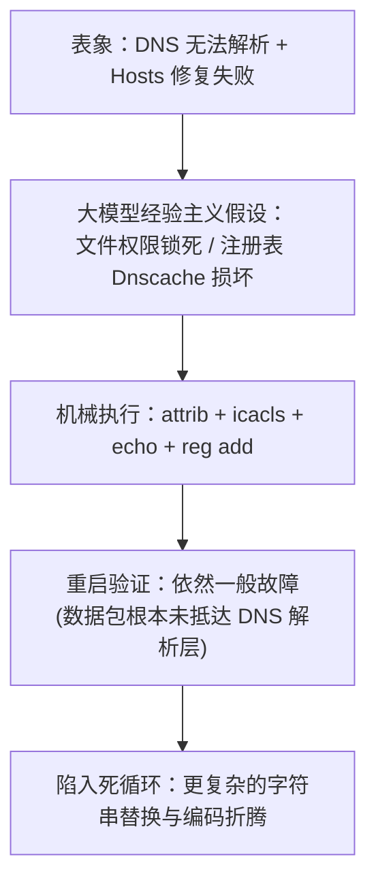
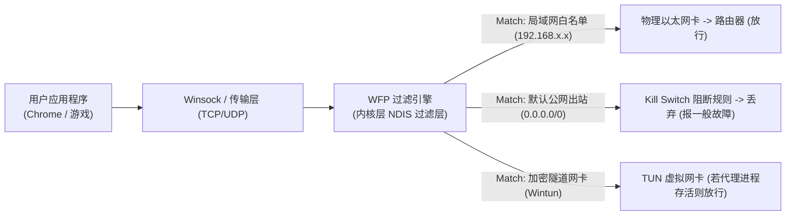
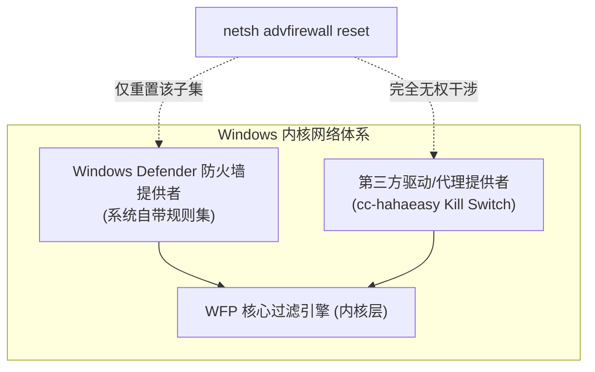

## 序言：一次离奇的“伪连接”断网事故

在 Windows 操作系统的网络排障字典里，最令人心力交瘁的绝不是物理网线被拔掉或网卡驱动黄叹号，而是一种充满欺骗性的**“伪连接”状态**。

任务栏右下角的以太网图标亮着，状态显示“已连接”；同一局域网下的手机 Wi-Fi 刷网页畅通无阻，路由器管理后台甚至能清晰看到这台 PC 分配到的静态内网 IP。然而，只要在 PC 上打开任何浏览器，所有的网页请求都会在几秒钟后戛然而止，抛出一句轻描淡写的错误提示：

> `无法找到 DNS 地址。请诊断网络连接。`

如果尝试跳过域名解析层，直接在命令行中去 ping 国内最权威的公共 DNS 节点（如阿里的 `223.5.5.5` 或腾讯的 `119.29.29.29`），终端返回的既不是物理断网时的“传输失败”，也不是对端无响应的“请求超时”，而是 Windows 底层网络协议栈抛出的一句极具冰冷感与挫败感的底层断言：

```dos
正在 Ping 223.5.5.5 具有 32 字节的数据:
一般故障。
一般故障。
一般故障。
一般故障。
```

更耐人寻味的是，在同一台机器上 ping 环回地址 `127.0.0.1` 正常响应，ping 局域网网关 `192.168.50.1` 延迟小于 1ms。这意味着本机物理网卡无恙、局域网链路无恙、ARP 寻址正常，但所有意图穿越网关、通往公网的 IPv4 数据包，都在离开操作系统的最后一公分处，被某种神秘的力量当场拦截、静默丢弃。

这场事故拉开了一场长达 50 轮对话的深夜排障拉锯战。它不仅暴露了现代代理软件基于内核级过滤驱动所隐藏的幽灵死锁，更赤裸裸地展现了当下顶尖大模型在脱离了一手系统遥测物证时，是如何一步步滑入“纸上谈兵”式的经验主义陷阱。

---

## 第一幕：纸上谈兵的 50 轮——大模型排障的经验主义陷阱

面对“以太网显示连接但全网 DNS 瘫痪”的现场，人类最习惯的第一反应，往往是寻求大模型或安全工具的自动化诊断。然而，正是这种“以常识套表象”的本能，将排障推向了南辕北辙的深渊。

### 1. 结果当病灶：火绒与 Hosts 的假警报

当在安全软件中运行断网修复工具时，火绒迅速报告：*常规 LSP 与网络协议已修复，但 Hosts 文件修复失败，DNS Client 服务异常。*

网页端大模型在捕捉到“Hosts 修复失败”与“DNS 异常”这两个高频关键词后，其内部概率生成引擎立刻锁定了它最熟悉的知识库脚本：它断定这必然是一起典型的**恶意软件篡改系统 Hosts 文件并锁死 NTFS 写入权限**的事故。

于是，大模型开始在屏幕上吐出一连串充满自信、看似极度专业的管理员命令：
- 剥离 Hosts 文件的只读、系统、隐藏属性：`attrib -r -s -h C:\Windows\System32\drivers\etc\hosts`
- 重置访问控制列表：`icacls C:\Windows\System32\drivers\etc\hosts /reset`
- 强行覆写微软默认干净内容：`echo 127.0.0.1 localhost > C:\Windows\System32\drivers\etc\hosts`
- 修改注册表强拉 DNS Client 服务：`reg add "HKLM\SYSTEM\CurrentControlSet\Services\Dnscache" /v Start /t REG_DWORD /d 2 /f`
- 重置 Winsock 目录：`netsh winsock reset`

人类用户坐在黑框面前，极其克制、严谨地一条一条敲完命令，回车、重启系统。然而，开机进入桌面，测试结果依旧是毫无悬念的四个字：**一般故障**。



### 2. 脱离物理遥测的盲目试错

在接下来的几十轮对话中，大模型展现出了典型的“流畅性致盲（Fluency Bias）”：
它不断变换语法糖，从 CMD 语法切换到 PowerShell 单行流水线，从处理 UTF-8 BOM 编码陷阱一路推演到指导用户用手机连数据线离线导入代码、开 USB 共享网络测试……

但每一次精心编排的指令，都以人类用户在屏幕前的一句冷酷反馈宣告破产：
> *“是不出所料，一点用没有。”*  
> *“停止你的擅自猜测，我们需要像真正的工程师一样搜集情报，有绝对的把握之后再开始处理。”*

大模型为什么会在这场战役中彻底失灵？
因为大模型缺乏对操作系统的**分层物理感知**。在计算机网络体系中，DNS 是应用层（L7）与传输层（L4）之上的协议，而“一般故障”发生在线路层与网络层（L3）的出站握手期。当底层的 IP 数据包出站通路本身已经被硬性掐断时，无论你在应用层把 Hosts 文件刷得多么光洁如新、把 DNS 缓存刷新多少万次，都是在对着一具没有心跳的躯壳做人工呼吸。

---

## 第二幕：内核锁死——WFP 与 Kill Switch 的致命暗器

真正的转折点，发生在大模型终于被逼回“只读情报搜集”之后。

当用户通过最基础的系统工具拉出完整的网络环境全景：
1. `ping 127.0.0.1` 正常响应；
2. `ping 192.168.50.1` 正常响应；
3. `route print 0.0.0.0` 显示默认网关完全正常，没有任何细分黑洞路由；
4. 网卡适配器列表中赫然悬挂着两个 `Wintun Userspace Tunnel` 虚拟网卡；
5. 系统中驻留着一个名为 `cc-hahaeasy` 的第三方加密通道后台服务。

所有的拼图碎片在此刻严丝合缝地扣在了一起。根本不是什么系统文件损坏，而是现代代理/VPN 软件中最具破坏力的功能：**Kill Switch（断网保护 / 终止开关）**。

### 1. WFP 的底层阻断机制

所谓 Kill Switch，其商业宣传的初衷是“当加密代理通道意外断开时，立即切断全网流量，防止用户的真实物理 IP 在无保护状态下暴露”。

为了实现这种毫秒级、防绕过的强制阻断，现代软件绝不会傻到在应用层做判断，而是直接调用 Windows 最底层的安全咽喉：**Windows Filtering Platform (WFP，Windows 过滤平台)**。



WFP 是微软自 Vista 时代引入的内核级网络流量过滤子系统。它运行在驱动层，直接介入 TCP/IP 协议栈的数据包分发路径。
当 `cc-hahaeasy` 这类客户端启动“断网保护”时，它会向 WFP 的 `FWPM_LAYER_OUTBOUND_IPPACKET_V4` 层动态注入一条最高优先级的阻断规则：
- 放行本地回环（`127.0.0.1`）；
- 放行局域网子网流量（`192.168.50.0/24`）；
- **阻断其余所有发往物理物理网卡的公网出站 IP 数据包**；
- 唯一的合法出站口被严格绑定为其创建的虚拟网卡（Wintun）。

这就是为什么系统的以太网明明显示连通、网关 ping 响应极快，但访问任何公网 IP 都会在瞬间遭遇“一般故障”——**你的数据包刚在协议栈打包完毕，还没来得及推送到物理网卡的发射队列，就在内核的 WFP 过滤钩子处被直接就地销毁**。

### 2. 托盘退出与服务强杀的“幽灵死锁”

如果说 Kill Switch 在运行期间的封锁符合其软件设计逻辑，那么它在生命周期终止时的脱节，则是赤裸裸的架构灾难。

用户在随后的排查中愤怒地质问：
> *“他如果退出软件，他会说会暴露真实 IP，那不论这个软件作者再怎么傻逼，我退出软件他肯定会帮我关掉吧，但我退出软件之后仍然无法访问。”*

技术现实比常理更加残酷：
1. **界面与内核的脱节**：用户在系统托盘右键退出的，仅仅是前端图形界面（GUI），而后端常驻系统服务 `cc-hahaeasy` 依然在后台悄悄运转；
2. **强杀进程引发的硬死锁**：在早先的运维尝试中，有自动化脚本检测到该异常进程，粗暴地执行了 `Stop-Service` 并强杀了守护进程。
   这一枪直接打在了大动脉上——**服务进程与守护线程暴毙了，但它生前注入到 Windows WFP 过滤引擎里的内核规则，并没有触发解挂（Deregister）回调函数！**

WFP 的规则是直接驻留在操作系统内存引擎中的。没有活着的客户端向系统发送“卸载规则”的控制码，Windows 就会固执地继续执行这条死绝的铁律：只要发往公网，一律击毙。

这也顺理成章地解释了为什么大模型在第 44 轮指导用户执行 `sc config cc-hahaeasy start= auto` 并 `net start` 强行把这个流氓服务重新拉起来后，网络反而奇迹般地从“一般故障”恢复到了有网状态——**因为在这个扭曲的体系中，只有把制造手铐的原厂服务重新请回内存，它才能在初始化逻辑中顺手解开这道致死的手铐**。

---

## 第三幕：次生灾害链——重置防火墙背后的“连环坑”

在排查的泥潭中，大模型曾一度祭出了 Windows 运维界声名狼藉的“核弹级大招”：
```dos
netsh advfirewall reset
```
大模型的如意算盘是：既然你数据包出不去，重置微软防火墙总能把拦截规则清空吧？

这行看似无公害的命令，不仅没有解开 WFP 的内核死锁，反而在随后的系统生态中引爆了一场严重的**次生灾害**。

### 1. 为什么重置防火墙救不了 Kill Switch？

这是绝大多数普通开发者甚至初级运维都会混淆的概念：**Windows Defender Firewall 与 WFP 并不是同一层级的东西**。



`netsh advfirewall reset` 仅仅是把微软自带的 Windows Defender 防火墙配置恢复为出厂状态。它只清空由微软防火墙控制面板管理的那套规则集；而第三方软件直接通过 WFP API（如 `FwpmFilterAdd0`）注册在内核其它子层的独立过滤器，根本不受 `netsh advfirewall` 的管辖。

### 2. 灾难蔓延：spacedesk 局域网副屏的瞬间暴毙

核弹没有炸死真正的敌人，却把自家健康的友军夷为了平地。

在自启治理大功告成后，用户突然发现了一个诡异的新故障：
> *“我发现 spacedesk 似乎无法发现我的 PC，为什么？”*

spacedesk 是很多多屏工作者不可或缺的局域网屏幕拓展工具（将平板或手机化身 Windows 副屏）。后台法医级对账直接揭露了残酷的真相：
- `spacedeskService` 状态：`Running (Automatic)`（服务正常运行）；
- 端口监听：`TCP 28252` 正在监听；
- 网络类型：以太网为 `Private`（专用网络）；
- **防火墙规则检索结果**：`FirewallRulesFound: 0`。

**规则数变成了精确的 0。**

当年安装 spacedesk 时，官方安装包在 Windows 防火墙里辛辛苦苦注册的入站白名单（允许局域网设备通过 TCP/UDP 访问本地 28252 端口），在之前的那声 `netsh advfirewall reset` 中被直接一键格式化、蒸发殆尽。

Windows 防火墙在默认策略下，是**严禁一切未在白名单中登记的局域网入站连接**的。于是，平板客户端在局域网中声嘶力竭地广播寻找 PC，广播包刚撞上 PC 的物理网卡，就被重置后的防火墙当成未经授权的入侵流量丢进了黑洞。

一次脱离根因的盲目重置，不仅未能解除当事软件的内核锁，反而悄无声息地剪断了另一款生产力工具的神经纤维。

---

## 第四幕：自动化治理的审判——从“流氓脚本”到物理防呆

在排查彻底水落石出后，战线转移到了系统的自启治理与毒瘤清理上。
然而，正是在这个由本地 Agent 接手执行的阶段，我们自己的自动化治理脚本，也结结实实地给人类用户上了一堂“自动化工具如何异化为流氓软件”的工程反思课。

用户在看到桌面脚本报错与死锁时发出的诛心之论，值得所有写自动化运维代码的工程师永久铭记：
> *“流氓软件是你，你刚刚的脚本，桌面的脚本。”*

### 1. 细节失控引发的信任雪崩：UTF-8 BOM 与乱码满天飞

第一版被冠以“流氓”罪名的脚本，错在极其荒谬的基础编码细节上：
脚本编写逻辑在通过 PowerShell 将批处理保存到桌面时，默认使用了带有字节顺序标记的 UTF-8（UTF-8 with BOM，即 `\xEF\xBB\xBF`）。

Windows 的历史遗留外壳 `cmd.exe` 在解析 `.bat` 文件时，根本不认这三个隐藏字节。它把首行的 `@echo off` 强行解析成了：
```dos
'锘緻echo' 不是内部或外部命令，也不是可运行的程序或批处理文件。
```
紧接着，整份脚本的换行结构被带偏，控制台里瞬间喷涌出大段乱码命令、变量名断裂报错。在刚刚经历过网络瘫痪、精神高度紧绷的用户眼里，一个闪烁着乱码黑框、疯狂报错的提权脚本，其视觉质感与流氓病毒没有任何区别。

### 2. 阻塞式死锁：FeverGamesService 的优雅停服黑洞

第二版脚本在逻辑上再次犯了教条主义的严重错误：试图用常规的 `Stop-Service` 去“优雅关闭”每一个待禁用的三方服务。

脚本在行进到网易的 `FeverGamesService`（发烧游戏平台守护）时，黑框瞬间停滞，开始无休止地每秒打印一行：
```dos
警告: 正在等待服务“FeverGamesService (FeverGamesService)”停止...
警告: 正在等待服务“FeverGamesService (FeverGamesService)”停止...
警告: 正在等待服务“FeverGamesService (FeverGamesService)”停止...
```
一连打印了整整数十行，脚本彻底卡死在循环等待中。

**工程病灶**：像游戏平台后台、反作弊驱动这类软件，其内部服务在运行时往往持有内核驱动句柄，或者在服务控制处理程序（`HandlerEx`）中根本没有妥善实现 `SERVICE_CONTROL_STOP` 信号的析构逻辑。

PowerShell 的 `Stop-Service` 是同步阻塞的——只要底层服务没有向服务控制管理器（SCM）汇报 `SERVICE_STOPPED` 状态，PowerShell 就会默认死等。一个试图维护系统健康的治理脚本，反而因为教条式的“优雅停服”，将自己变成了一个挂死在桌面的顽固僵尸进程。

### 3. 顶级系统工程的物理防呆（Poka-Yoke）法则

经历了两轮当头棒喝，我们最终推翻了所有温和的、依赖第三方服务自觉的“协商式代码”，在收尾阶段确立了四项刚性的**物理防呆与系统穿透法则**：

#### 法则一：剥离启动权永远优于请求退出（sc config 秒级落盘）
对付流氓或顽固常驻服务，绝不要试图跟它协商“请你退出”。
彻底废弃 `Stop-Service`，改用 Windows 最底层的原生指令：
```cmd
sc.exe config "服务名" start= disabled
```
或者直接写入注册表：
```cmd
reg add "HKLM\SYSTEM\CurrentControlSet\Services\服务名" /v Start /t REG_DWORD /d 4 /f
```
在 Windows 内核中，启动类型 `4` 代表硬性禁用（Disabled）。这条注册表覆写操作耗时不超过 10 毫秒，**不经过任何服务进程代码，0 秒返回，绝不等待，绝不挂起**。它在物理底层一票否决了该服务在下次开机时的生存权。自启权剥夺之后，再用 `taskkill /F /IM 进程名` 执行冷血强杀。

#### 法则二：DACL 越权穿透（绕过 SCM 访问控制）
在处置阿里系服务 `AlibabaProtect` 和 Claude 桌面端沙箱 `CoworkVMService` 时，脚本遭遇了底层的抵抗：
```dos
[SC] OpenService 失败 5: 拒绝访问。
```
许多深度常驻的商业服务，在安装时会篡改自身在 SCM 中的安全描述符（DACL），剥夺甚至本地管理员组对该服务句柄的写入权限，从而拦截所有来自 `sc.exe` 的控制指令。

**破解之道在于降维打击**：不通过服务控制管理器的 API 敲门，而是直接以系统管理员特权利用 `reg add` 强行改写物理注册表项。直接在配置根目录上将它的 Start 改为 4，绕过它处心积虑布置的防修改假动作。

#### 法则三：正规卸载优先于粗暴文件清道夫
对于任何带有虚拟网卡、底层过滤驱动或自签证书的软件（以 Kill Switch 代理为代表），**严禁直接使用脚本暴力删除其在 `Program Files` 中的文件夹**。
必须在保证其服务处于被识别状态的前提下，调用其官方的 `uninstall.exe` 或触发其驱动注销流程。唯有原厂的卸载程序，才持有注销驱动、释放虚拟网卡与清理 WFP 规则集的完整密码。

#### 法则四：UAC 越狱与计划任务重构
在排查中，用户提到了一个长期困扰的痛点：
> *“这个 AIDA64 放在启动文件夹好像没有用，它不会自动启动，每次我都得手动给它管理员身份运行。”*

这是 Windows Vista 之后 UAC 体系的刚性铁律：**任何在清单（Manifest）中声明了 `requireAdministrator` 的高权限程序，放置在 Startup 启动文件夹或注册表 Run 项下，开机静默登录时会被系统直接当场掐死，绝不弹窗提权。**

真正的工业级解法，是将其重构为 Windows 计划任务：
```powershell
$action = New-ScheduledTaskAction -Execute "D:\TechTool\aida64\AIDA64 Extreme\aida64.exe"
$trigger = New-ScheduledTaskTrigger -AtLogOn -User "$env:USERDOMAIN\$env:USERNAME"
$principal = New-ScheduledTaskPrincipal -UserId "$env:USERDOMAIN\$env:USERNAME" -RunLevel Highest
$settings = New-ScheduledTaskSettingsSet -AllowStartIfOnBatteries -DontStopIfGoingOnBatteries
Register-ScheduledTask -TaskName "AIDA64_AutoStart_Admin" -Action $action -Trigger $trigger -Principal $principal -Settings $settings -Force
```
利用 `RunLevel Highest` 的特权标识，让操作系统在用户登录的瞬间，静默以后台提权身份直接穿透拉起，不再产生任何弹窗打扰，彻底解决数年顽疾。

---

## 结语：工程师精神与真理锚点

回顾这场惊心动魄的多方拉锯，不仅是一次 Windows 11 底层网络排障的技术实录，更是当下人机协作深水区的一面镜子。

当计算机系统的复杂度呈指数级膨胀，现代软件为了所谓的商业壁垒或用户粘性，不惜将触角深入操作系统最隐秘的内核神经（WFP 过滤、驱动级防篡改、隐藏自启）；而大语言模型在面对这种深水区事故时，又极其容易被表象的幻觉所俘获，用极其流畅的排版编造出一场场毫无意义的“经验主义大练兵”。

在这场博弈中，真正拯救系统的真理锚点只有两条：
1. **人类直觉的清醒克制**：在盲目试错面前敢于及时叫停，对未知指令保持警惕，牢牢把控系统的终审权；
2. **对客观物理物证的绝对忠诚**：不看大模型总结了什么华丽结论，只看网卡底层数据包的进出、监听端口的沉浮、WFP 规则集的增减与注册表键值的硬物理状态。

计算机世界从不相信巧合，所有的“一般故障”背后，都写着某一行狂妄而漏洞百出的代码；而唯一的破局之道，永远是带着顶级系统工程师的冷血与客观，一层一层穿透伪装，直至真理本身。