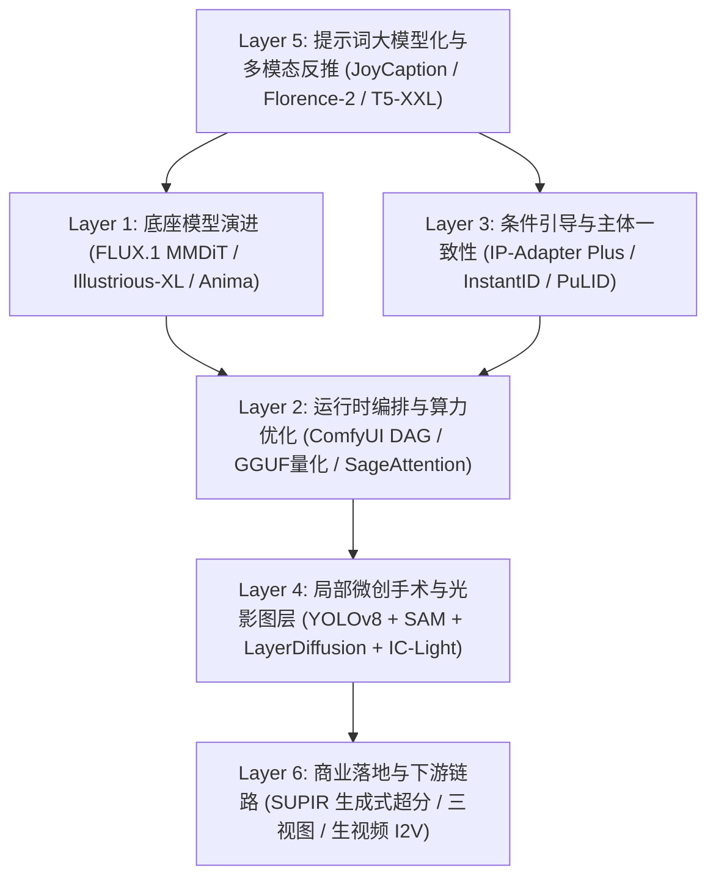
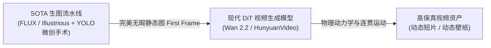

### 引言：从一段“不可思议”的二次元局部重绘谈起

在许多人对 AI 绘画的刻板印象里，图像生成依然停留在“在网页输入框里敲入一堆英语单词，按一下 Generate，然后像摇老虎机一样祈祷这次别多长一根手指”的阶段。

几天前，B站上一段关于二次元高阶工作流的实操演示（`BV1yDE96kEQX` - 每日提钢小助手5号《Anima局部重绘！换装！脱装备！修手脚！》）引起了我们团队的注意：视频里的作者没有进行任何繁琐的手动画笔涂抹，只见鼠标在画面上轻轻一点，人物身上厚重的机甲外套瞬间被剥离，露出了贴合人体肌肉透视的光洁肌肤；紧接着输入几组新服饰标签，一套赛博紧身衣天衣无缝地“生长”回原位；原本略显融化的手指被框选后，不到两秒钟便被重塑出清晰的指关节褶皱与高光。

这在普通观众眼里看似“魔法”或“黑科技”，但凡接触过现代工业级生产线的人都明白：**凡是看起来像魔法的东西，底层必然是一套极度严密、环环相扣的机器视觉工程流水线**。

过去三年间，整个 AIGC 视觉生成领域经历了一场波澜壮阔的底层技术清洗。2022–2023 年风靡一时的所谓“老旧体系”——以 **Automatic1111 WebUI** 单体架构、**SD 1.5 卷积 U-Net** 小模型、千字负面提示词咒语堆砌（`(worst quality, low quality:1.4)`）、粗暴全图双倍放大（Hires. fix）为代表的玩具式操作，在今天的严肃商业与高阶二次元创作中已经被全面降维淘汰。

今天，我们结合最新的全域技术调研与一线工程对账，彻底撕开一切玄学伪装，还原 2024–2026 年现代 AI 生图与视频生成的工业本质。

---

### 一、 范式裂变：为什么必须向 SD 1.5 与 WebUI A1111 彻底道别？

许多人常常会有一个巨大的概念误区：“现在的 Diffusion Transformer（DiT），不就是换了个皮的 SD 吗？”

**答案是：绝不是。这相当于汽车工业把传统的化油器内燃机，直接拆解替换为了高算力分布式电驱动总成。**

#### 1. 底层算子革命：从卷积 U-Net 到 Diffusion Transformer (DiT)
* **老一代 SD（SD 1.5 / SD 2.1 / SDXL）**：其核心特征提取与去噪网络基于 **U-Net（卷积神经网络）**。卷积核的天然局限在于“局部感应强、全局语义弱”，模型把画面当成局部像素网格去一层层压缩与放大。这就导致它在面对长句复杂逻辑时彻底抓瞎——你跟它说“左边站着戴眼镜的黑猫，右边桌子上放着红苹果”，它极大概率把红苹果直接画在猫的脑袋上；
* **现代 SOTA 体系（FLUX.1 / SD 3.5 / Sora / 混元 / 可图）**：底层发动机彻底换成了 **Transformer 架构（结合 Flow Matching 流匹配算法）**。也就是把 ChatGPT 理解自然语言的注意力机制（Attention）移植到了潜空间像素块（Patches）上。每一个像素块都能在全局范围内与文本提示词以及其他像素块进行多对多的全交叉计算，空间拓扑与长句理解力呈现指数级跃升。

#### 2. 交互中枢坍塌：WebUI 线性表单的必然出局
传统的 Automatic1111 WebUI 采用的是单体同步调用模型。你无法在同一个任务里先跑一个 12B 的底座模型出宏观构图、接着自动卸载底座把显存腾给 YOLO 目标检测模型抓人脸、然后再调入专有人脸修复模型进行亚像素放大、最后无缝切片导出带 Alpha 透明通道的图层。

WebUI 只要遇到多模型串联，显存（VRAM）就会瞬间被打爆（OOM）。而 **ComfyUI 基于有向无环图（DAG）** 的架构，实现了对显存生命周期的毫秒级动态调度（Dynamic Swap）——算完文本编码立刻将权重释放回系统内存，把宝贵的显存留给采样器，中间潜变量（Latent）可以在任意节点分叉与合并，使得极其复杂的工业级装配线在消费级显卡上成为可能。

#### 3. 提示词工程的终结：大语言模型（LLM/VLM）接管反推
过去，所谓“AI 绘画大师”的核心壁垒是记住成千上万个 Danbooru 杂质标签或抄袭长达数千字的负面词模板。而今天，**T5-XXL 40 亿参数长文本编码器**的引入，让模型原生具备了理解空间状语从句与主谓宾结构的能力；配合 **JoyCaption** 与微软 **Florence-2** 等专职视觉反推模型，用户只需给出一张草图或几个自然语言词汇，多模态大模型能在毫秒内反向输出媲美资深摄影师或原画师的专业布光、透视、材质与解剖结构描述，彻底宣告了“咒语念经时代”的终结。

---

### 二、 全景俯瞰：生图全域工业级 6 层全景架构图

为了建立清晰的工程坐标系，我们将当前现代 AI 生图全域技术按照数据流向与功能边界，解构为自顶向下的 **6 大一等公民技术层级**：

1. **Layer 5（大脑中枢：提示词与反推）**：负责理解意图。无论输入口语短句还是垫图，先由 VLM 反推结构化细节，再由双文本编码器（T5-XXL + CLIP-L）转化为高维 Conditioning 嵌入；
2. **Layer 1（骨架基因：底座演进）**：写实与电商领域由 **FLUX.1** 垄断；二次元领域由清洗了千万级数据的 **Illustrious-XL** 统一了 90% 的生态；局部重绘与微创解剖则由 **Anima** 专职接管；
3. **Layer 3（方向盘：条件引导）**：通过 **IP-Adapter Plus** 注入款式先验，通过 **InstantID / PuLID** 实现免微调人脸锁定，通过 **ControlNet Union** 提供空间深度与线稿骨骼；
4. **Layer 2（发动机机舱：运行时调度）**：ComfyUI 充当流水线控制中枢，结合 **GGUF / NF4 量化** 与 **SageAttention 算子加速**，在 12G~24G 显存内达成算力平衡；
5. **Layer 4（微创手术台：精修与光影）**：机器视觉进入实操阶段，目标检测与语义分割对局部实施换装与修手，并通过 **IC-Light** 重新计算环境光线散射；
6. **Layer 6（装配出厂：商业交付）**：经过 **SUPIR** 潜空间重新推理微观纹理放大至 4K/8K 印刷级，或作为起始首帧打通生视频模型。

---

### 三、 机器视觉外科手术：解密 Anima 换装、脱装与修手脚的物理本质

回到引言中提及的 `BV1yDE96kEQX` 视频，我们在 ComfyUI 中将其背后的数据流完整逆向提炼，其底层遵循的是标准的 **4 阶段微观手术拓扑**：

#### 1. 阶段一：自动开刀选区（选区定位）
传统重绘最大的痛点在于用鼠标画笔去涂抹掩码（Mask），涂多了会破坏人体边缘，涂少了会留下原服饰的残渣。现代工作流全面接入机器视觉目标检测：
* **换装场景**：使用 **SAM（Segment Anything）**，在服装核心区域轻点一下，或输入文本提示词 `dress, jacket, armor`，模型基于高维语义分割瞬间输出完美贴合布料褶皱的紧致轮廓；
* **修手场景**：接入 **YOLOv8（`hand_yolov8x.pt`）**，在整张大图中毫秒级检索并裁剪出手部 Bounding Box，自动将其提拉至独立视口。

#### 2. 阶段二：掩码边缘软化（预处理引擎）
任何直接在选区内重绘的尝试，都会导致新旧交界处产生惨烈的“白边”或贴图断层。流水线强制执行两道数学运算：
* **动态外扩（Mask Grow/Dilate: 6~10px）**：选区向外膨胀几个像素，确保彻底包裹住原衣物在人体皮肤上留下的投影边缘；
* **高斯羽化（Mask Blur: 4~8px）**：将二值化黑白掩码的边缘转化为连续平滑的灰度渐变，为像素过渡提供缓冲带。

#### 3. 阶段三：定点靶向重绘（微创手术执行）
在重绘核心区域，很多人误以为 Anima 只是一个普通的风格 LoRA，**实则不然——它是一个针对 SDXL 架构在潜空间解剖补全能力上深度微调的独立 Checkpoint 大底座**。
* **为什么普通人自己训 LoRA 无法替代？** 自己训 LoRA 只能让模型记住某个角色的发型或特定画风，根本无法赋予模型“理解衣服被移除后、被遮挡的胸骨与腹肌该以何种透视向内收敛”的解剖知识。Anima 吸收了数十万张带精准遮挡标签的数据对，具备极其强大的结构推断能力；
* **关键去噪参数（Denoise）配方契约**：
  * **服饰重构（换装）**：去噪幅度锁定在 **`Denoise = 0.65`**，CFG = 6.0。配合 Animadex 纯净词库输入新服饰特征，模型在保留人体底层姿势骨架的同时，重构出全新材质与垂坠褶皱；
  * **脱装备与身体重建**：去噪幅度提升至 **`Denoise = 0.75`**，CFG = 5.5。输入 `bare skin, detailed navel, anatomical torso`，负面词压制 `clothes, armor`。系统会严格依据未被遮挡的颈部与四肢肤色，向掩码内自然插值重构光影连贯的肌肉骨骼；
  * **微观修手**：去噪幅度必须严格收敛在 **`Denoise = 0.35 ~ 0.40`**。Denoise 大于 0.5 会导致手部位置大幅漂移、骨骼脱臼；小于 0.3 则无法消除粘连的六指与融化畸变。在 0.40 黄金窗口下，模型仅在原手指轮廓内重绘指甲盖、指节褶皱与明暗交界线。

#### 4. 阶段四：拉普拉斯金字塔无缝贴回（金字塔融合）
局部重绘完毕后，系统通过反向仿射变换将切片对齐回原图原位，利用**泊松融合（Poisson Blending）与拉普拉斯色彩金字塔对齐**，彻底抹平环境色相与光斑差异，产出毫无拼接痕迹的终极成品。

---

### 四、 谎言与真相：InstantID 锁脸为什么做不了连贯漫画？

在各种教程漫天飞舞的宣传中，“一键免微调人脸一致性”的 **InstantID** 与 **PuLID** 常常被冠以“漫画神器”的虚名。然而，凡是真正尝试拿它做过连载漫画（条漫）的人，都会遭遇惨痛的翻车。

#### 1. 物理维度的死穴：表情张力与极端透视的塌陷
* **底层机制**：InstantID 依赖 InsightFace 提取的人脸 512 维特征向量，配合 IdentityNet 的 5 点面部关键点强行施加空间约束；
* **漫画的本质是动态叙事**：商业漫画需要大量的极端透视（大俯视下巴尖锐、大仰视下颌方正）以及剧烈的表情张力（咆哮、痛哭、冷笑、颜艺）。当强行挂载 InstantID 时，由于关键点模型天然对“标准正脸/微侧脸证件照”具有极强先验，一旦人物做出夸张动作，模型会强行把五官“扯平”并死死按在脸上，导致面部像戴了一张僵死的水泥面具，透视彻底崩塌。

#### 2. 那么，大家到底拿 InstantID 干什么？
它的真实变现与商业生态集中在**弱连贯性、强单张质感**的流量场景中：
* **小红书 / Instagram / X (Twitter) 虚拟网红（AI Coser / Influencer）**：每天发一组写真，今天在东京街头穿和服，明天在海边穿比基尼。观众只需要确认“这组照片是同一个人”，根本不需要前因后果的剧情连贯性；
* **跨境电商外模换头出海**：国内商家拍摄义乌服装后，用 InstantID 一秒将国人模特脸换为金发碧眼的欧美模特脸，直接上架亚马逊与独立站，省去每小时昂贵的签约模特费；
* **个人定制头像小程序**：单图换脸生成婚纱照或古风肖像。

> **工业界做连续漫画的唯一正统路径**：给特定角色训练专有的 **Character Micro-LoRA**，配合 3D 软件（Blender 或 DAZ3D 摆好姿势导出 OpenPose + Depth 深度图），再使用 ControlNet 联合引导出图；或者依赖 **StoryDiffusion** 等跨分镜注意力共享机制，才能兼顾多角度透视与表情张力。

---

### 五、 从静态立绘到生视频中枢：Wan 2.2 与 HunyuanVideo 的双雄对决与壁纸奥秘

在现代工业流水线中，生图不再是终点，而是为生视频提供关键帧的“第 0 步”。

> [!CAUTION] 生产铁律：严禁直接文生视频 (T2V)
> 现存的所有视频生成大模型，其原生人脸与手部解剖能力远弱于静态生图模型。如果直接用文字描述生成视频，人物五官极容易随时间步产生“融化闪烁（Melting Artifacts）”。**工业级标准必须采用图生视频（I2V）**——先在静态图阶段把长相、服饰与光影全部精修闭环，再喂给视频模型。

#### 1. 腾讯 HunyuanVideo vs 阿里 Wan 2.2 深度对账
在开源视频领域，目前呈现出腾讯与阿里两强并立的格局：
* **腾讯 HunyuanVideo (混元视频)**：
  * **架构**：采用 **Dual-Stream DiT（双流 DiT）**，文本流与视频特征流完全解耦后交叉融合；
  * **优势**：**电影级大师运镜天花板**。航拍大视差、推拉摇移镜头极稳，流体飞溅与复杂光影折射非常逼真；
  * **门槛**：显存黑洞，完整体验必须依赖 **24GB 显存**（RTX 3090/4090 或 AutoDL 容器）。
* **阿里巴巴 Wan 2.2 (通义万相 2.2)**：
  * **架构**：采用 **MoE（Mixture of Experts 混合专家）DiT 架构**，高噪声专家主攻宏观运动轨迹，低噪声专家雕琢微观发丝材质；
  * **优势**：动作连贯度极高，提供 **5B 极速高清 TI2V（混合图生视频）** 版本，并衍生出 **S2V（音频直接驱动面部说话唱歌）** 模型；
  * **门槛**：5B 版本对 16G 显卡极其友好，出片速度极快。

#### 2. 动态壁纸（Wallpaper Engine）为什么用生视频模型容易翻车？
很多人试图直接拿 HunyuanVideo 生成动态壁纸，结果挂在桌面上看 3 分钟就头晕关掉。这是因为**壁纸与普通视频的需求完全相反**：
1. **壁纸要求“镜头死锁、微动呼吸感”**：桌面上还要放图标，如果镜头推拉晃动，人脑会产生严重生理疲劳。必须在提示词中强制注入 `static camera, fixed tripod view, subtle breathing, slight breeze gently blowing hair`，封杀一切运镜；
2. **壁纸要求“首尾无缝循环（Seamless Loop）”**：普通视频播放 3 秒后跳帧回第 1 帧会有剧烈卡顿。必须在 ComfyUI 尾端接入 **`Video Crossfade Loop` 节点**，把末尾 0.5 秒与开头 0.5 秒做半透明交叉溶解过渡；
3. **二次元微动首选仍然是 AnimateDiff**：对于二次元美少女眨眼与发丝飘动，AnimateDiff 的 `closed_loop = True` 开关能在潜空间数学上实现 100% 绝对平滑循环，依然是轻量动态壁纸的利器。

---

### 六、 显存算力账单与工程分级：12G 的妥协与 32G AutoDL 的满血自由

面对庞大的 DiT 架构模型，硬件环境的真实边界往往被商业营销所模糊：

* **家用级显卡（8G ~ 16G VRAM，如 RTX 3060 12G / 4060Ti 16G / 4070）**：
  * **必须接受量化妥协**：12B 的 FLUX.1 原始 FP16 需 24G 显存，家用卡必须使用 **ComfyUI-GGUF (Q4_K_M)** 或 **bitsandbytes NF4** 压缩至 6.8G；配合 **SageAttention** 优化与内存换出策略（Offload），虽能跑通，但多模型切换时伴随明显的系统内存读写等待。
* **工业云端 / 高端工作站（24G ~ 48G VRAM，如 AutoDL RTX 3090/4090, A5000 24G, L40S 48G）**：
  * **彻底告别 Q4 精度损失**：直接全开 **FP8 原生** 甚至 **BF16 全精度** FLUX.1-dev，保留最细腻的微距皮肤毛孔与弱光质感；
  * **流水线全量常驻**：24G+ 显存允许将 FLUX.1 底座、YOLO 探针、SAM 抠图引擎与 SUPIR 超分模型全部常驻于 GPU 显存，消除 CPU 搬运延迟，单图流转耗时大幅缩短；
  * **视频满血生成**：具备原生支撑 Wan 2.2 14B MoE 与 HunyuanVideo 13B 在 720P/1080P 下完成分钟级渲染的物理算力底座。

---

### 结语：现代 AIGC 的工程尊严

从玄学念经到参数控制，从盲盒抽卡到机器视觉微创手术，AI 图像与视频生成正在褪去最初的虚浮泡沫，蜕变成为一门严谨、可复现、可自动化的现代数字工程学科。

决定最终画面成败的，不再是抄来的冗长负面词，而是：
* 你是否准确理解了 **DiT 架构与注意力流向** 的物理特性；
* 你能否在 **ComfyUI DAG** 中精确编排每一个潜空间张量的生命周期；
* 你是否懂得用 **目标检测、动态掩码外扩与高斯羽化** 去平滑每一个拼接边缘；
* 你是否遵循了 **静态精修再喂入视频模型** 的首帧接缝铁律。

在这一轮全量深度调研与工程实证之后，我们已将包含上述 6 层架构、参数矩阵、BV1yDE96kEQX 逆向拓扑及视频选型指南的完整知识底座，全量接入并固化为全局工程技能 [`modern-ai-visual-hub`](file:///C:/Users/a1634/.gemini/config/skills/modern-ai-visual-hub/SKILL.md)。

技术的尽头不是神秘主义，而是对因果律的绝对敬畏与笃定掌控。
