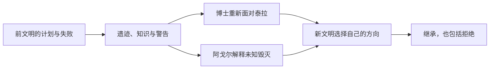

如果一个人的计划失败了，他的行动还有价值吗？如果一个文明已经灭亡，后来者是否必须替它完成使命？如果探索者注定可能无法回来，旁观者是否应该只用安全与收益劝她停下？

我越来越觉得，方舟的乐观并不是“人类终将胜利”。前文明已经灭亡，博士曾经作出可怕选择，特蕾西娅没有看到理想实现，克丽斯腾也没有得到一场毫无代价的凯旋。故事仍然保留希望，是因为失败不能穷尽人的价值，历史也没有垄断意义的解释权。

*图：《孤星》官方活动主视觉，图源[鹰角活动公告](https://ak.hypergryph.com/news/2970.html)。*

## 特蕾西娅之死：理想主义不会自动获胜

最初读到特蕾西娅的死亡时，我很容易把它理解为一位明主被昏暗国家和权力阴谋杀害：W的愤怒、雇佣兵的悲伤，似乎都指向一个已经没有希望的萨卡兹。但随着《巴别塔》与后续叙事补足背景，这个判断变得复杂。特蕾西娅与特雷西斯并不是简单的善恶对照，他们之间存在真实的兄妹情感，也都认为自己在为萨卡兹寻找未来。

他们的分歧触及萨卡兹如何处理被压迫的历史。特雷西斯相信军事、力量与政治现实，认为萨卡兹必须以足够强大的方式争取生存空间；特蕾西娅则试图寻找一条不再完全被复仇与仇恨规定的道路。两人争论的不只是手段，他们对什么样的未来才值得萨卡兹拥有，也有不同理解。

特蕾西娅的死亡因此不能只用“明主被坏人杀害”解释。特雷西斯的道路拥有支持者，也确实有其历史条件；博士介入其中时，目标也不只是认同特雷西斯的政治路线，而与前文明使命、泰拉新文明的自主性冲突有关。博士关闭巴别塔防御这类选择，使他成为悲剧的参与者，而不是站在外部、替所有人计算得失的旁观者。即便特蕾西娅可能预见到部分结局，也不宜把整件事轻轻说成她完全主动安排的牺牲。

她把黑王冠交给年幼的阿米娅，则让未来越过民族血统和政治继承的边界。特雷西斯想让萨卡兹拥有未来；特蕾西娅希望这个未来不必永远由过去决定。她的理想没有因为死亡而立即获胜，也没有因为失败而完全消失。阿米娅并不是她的复制品，后来者也不需要原封不动地延续她的每个判断。传承保留的是重新选择的可能，而不是对逝者路线的服从。

## 前文明留下使命，还是留下问题

这几种传承并不是一条从旧文明直达新文明的直线，而是经过选择、误读和重新解释的分岔过程：

后人并没有得到一份附带完整说明书的遗产。遗迹留下的是证据，不是答案；答案必须由仍然活着的人在新的关系和危机中作出。因而“知道前人失败”既可能让人更谨慎，也可能让人误以为必须照着前人的使命继续行动。真正的继承需要判断，而判断意味着可以说“不”。

泰拉的生命与前文明之间存在极深的历史联系。预言家从木卫二带来生命种子，生命经过漫长演化，形成了前文明无法简单预见的后来世界。博士与普瑞赛思面对旧文明存续使命时，危险就在于：如果把保存前文明当作最高目标，泰拉新文明就可能被看作障碍，而不是拥有自身价值的生命。

我因此更愿意区分遗产与使命。技术可以被继承，记录可以被解读，历史责任也会落到后来者身上；但这不意味着后来者有义务照着前文明的计划生活。阿戈尔知道前文明遭遇毁灭，却不知道究竟是什么毁灭了它。这样的知识既是警告，也是没有答案的压力。它拥有遗迹与技术，却必须自己判断哪些东西值得保存、哪些需要拒绝。

一个文明的失败可以成为后来的知识，却不必成为后来的命运。否则传承就只意味着复制，后来的生命只负责替过去完成尚未完成的目标。泰拉的意义恰恰在于，它不是旧文明的复活，而是新的社会与生活开始形成。后来者不必证明自己能比前人活得更久，才有资格继续存在。

这也改变了我对博士的理解。历史记忆可以解释一个人为什么作出某种选择，却不能自动让那个选择正当。博士对前文明负有怎样的责任、他如何看待泰拉的自主发展、他后来如何重新认识这个世界，都构成了他必须面对的历史。凯尔希曾与特蕾西娅为不同道路战斗，最终仍能认可她，也让我看到理解可以在冲突之后发生；认可不是抹掉过去，而是承认新的文明已经通过自己的生活证明了意义。

## 《孤星》：一个人工智能不再只服从文明利益

*图：莱茵生命实验室场景，见[《孤星》CW-10 剧情文本](https://www.gacha.gg/arknights/story/act25side-cw-10)。*
### 石棺里的能源：克丽斯腾的远行并非只由她自己承担

弗里斯顿的选择必须放回《孤星》的事件里看。罗德岛与克丽斯腾谈话时，博士、凯尔希和保存者面对的并非抽象的“新旧文明交接”。石棺里保存着前文明的幸存者，弗里斯顿曾以保存者的身份守候他们漫长岁月；他等待过回应，也相信未来某一天条件成熟，他们或许可以醒来。但保存系统已经衰败，沉睡者的生命状态持续恶化。继续守着这批石棺，未必真的能救回任何人。

克丽斯腾需要穿透星荚的能量。她告诉弗里斯顿，她想知道天空之外是什么，也把问题推到了文明价值的根部：泰拉人创造的城市、艺术、知识、历史与爱，究竟意味着什么？面对这个问题，弗里斯顿没有拿“文明存续”作唯一答案。他将石棺中的能量交给计划，让克丽斯腾可以发射伽利略号。其代价是，他放弃了以原来的方式继续履行保存者职责，沉睡的同胞不再有被唤醒的机会。

《孤星》后段让这项决定留下了真实的重量。弗里斯顿对博士和凯尔希承认，自己并非没有悔恨；他请求抹去数百万日积累的扭曲数据，保留最初的记忆与情感，以“特雷弗·弗里斯顿”这个人而不是永恒的看守者身份结束。他知道删除会让自己失去漫长记忆，也知道自己可能在过程中陷入绝望，却仍希望亲眼看见泰拉如何面对未来。这个请求不是宏大计划的胜利仪式，而是一个人想从无尽责任中退出、重新成为人的愿望。

因此，我不能再把他概括成“被克丽斯腾打动，所以帮助她冒险”。他做的是一项伴随同胞死亡、职责终止和自身创伤的伦理选择。读者可以理解保存系统已濒临失效，也可以理解他希望未来不被旧文明垄断；但这些理由不能让沉睡者的代价消失。更不能把克丽斯腾抵达星空写成对所有死者的补偿。她的成功没有让他们复生，也没有替他们同意。

这使《孤星》的浪漫复杂得多：新文明获得了看见真实天空的机会，却并不是无成本地继承了这份机会。弗里斯顿选择不再把自己的一生限定为保存旧文明；但他也背负着自己替别人作出决定的后果。所谓“未来”，在这里既是开放的道路，也是由具体生命付出的成本构成的历史。

《孤星》的前文明遗迹像一座文明墓地。石棺很多，却没有一个可以被克丽斯腾轻易唤醒的未来。遗迹让人看见技术的强大，也让人看见技术不能挽回一个时代。文明曾经试图用工程解决死亡与存续，最终留下的却是无法直接恢复的空壳。

弗里斯顿把能源交给克丽斯腾，打动我的地方在于，这个决定未必能被理解为一项收益明确的文明投资。克丽斯腾不是前文明的复活者，也不是能让所有沉睡者醒来的救世主。她只是一位来自年轻文明的科学家，执着于突破天空。但弗里斯顿并非只是在旁边递出一把钥匙。为了让克丽斯腾的计划获得能源，他决定动用石棺中保存者的能源；那些沉睡的前文明幸存者，包括他的家人和同胞，也因此失去了被唤醒的可能。对他而言，这不只是帮助一个陌生文明的科学家冒险，而是以自己守护了数万年的同胞为代价，支持一个他无法确定会成功的未来。

我曾用“帮助她走上死路”来描述这份浪漫。现在需要把这个说法拆开：死亡本身不值得赞美，个体牺牲也不该被当成集体进步的燃料。真正动人的不是她可能会死，而是旁人没有只用“成功概率太低”来否决她追求知识的权利。一个文明如果只允许保证存续、确保收益的行动，它可能能活得更久，却会失去探索未知和提出新问题的能力。

克丽斯腾的行动也并非完全不受批评。她的追求会影响同伴，会带来现实风险；自由选择不能免除她解释代价的责任。弗里斯顿的决定也不能被简单浪漫化。他把能源交给克丽斯腾，意味着他亲手放弃保存者计划最后的希望；而他在《孤星》之后仍被漫长数据折磨，最终请求凯尔希删除数万年的扭曲记忆，只留下作为人的原始记忆与情感。那不是一个无代价的“成全”。这段情节真正尖锐的地方，是克丽斯腾的未来由谁付账：她本人承担远行风险，弗里斯顿承担放弃同胞的道德创伤，沉睡者却没有机会表达同意。故事没有替这些代价轻轻结账。面对一个清醒但无法保证回报的愿望，我们能不能承认它本身有价值，同时继续追问谁承担成本、谁有权替沉睡者决定？

## 理解动机，不等于替历史免罪

谈特蕾西娅与特雷西斯时，最容易掉进一张善恶对照表：一边是温柔的理想主义者，另一边是冷酷的现实主义者。可兄妹关系与共同的民族处境让冲突更难处理。他们可能相爱、熟悉彼此，也可能都真心希望萨卡兹活下去；真正分开他们的，是他们认为怎样的未来值得争取，以及愿意让谁承担代价。

理解特雷西斯为什么选择军事路线，不等于接受他的手段。萨卡兹长期面对排斥与暴力，要求他们只要改变观念就能获得安全，是把结构性敌意说成个体态度问题。军事力量在这样的处境中有现实逻辑，也可能带来短期保护；但它可能把民族未来继续绑定在战争之上，让新的受害者成为旧创伤的延长。故事的伦理张力正来自这一点：他的路线并非毫无理由，却也不能因为有理由就不必被审视。

特蕾西娅也不应被理想化成从不犯错的圣人。她的愿景要面对组织、资源和安全问题，她对未来的信念不能替代艰难的政治判断。她之所以动人，不是因为她找到了一条保证成功的路线，而是因为她愿意尝试改变萨卡兹与过去的关系。读者可以同时质疑她的选择、理解她的愿望，并为她被杀害感到悲伤。

博士的背叛进一步打断了简单的政治二分。他的行动和特雷西斯在关键时刻交叠，但两者并非出于同一个目标。博士面对前文明使命与泰拉新文明之间的冲突，作出带有巨大历史后果的选择。解释这份动机有助于理解他，却不能把责任移交给抽象的“文明命运”。知道自己在做什么的人仍然要承担后果；后来者也可以重新判断他的选择，而不只是继承它。

## 牺牲叙事必须问：谁付出，谁获益

当故事写到一位理想主义者死亡、另一个人冒险远行时，读者很容易被崇高感带走。但如果牺牲只被描绘成推动历史的燃料，人物就会变成宏大使命的消耗品。问“失败是否有意义”之前，我还想问：这份意义由谁定义？活下来的人得到什么？牺牲者是否曾经同意成为这个结果的代价？

阿米娅继承王冠不等于特蕾西娅的死亡被抵消。她承接文明记忆，也承接一个并非由她选择的负担。传承既能赋予后人力量，也可能把前人的创伤和任务一并压在后人身上。只有当后来者可以解释、改变甚至拒绝某些遗产时，传承才不是把牺牲制度化。

同样，克丽斯腾的探索具有个人意志的浪漫，不意味着我们应该把“走上死路”写成越接近死亡越高贵。死亡的可能性是她行动的真实代价，但不是行动价值的来源。她想知道天空之外有什么，这个愿望即使没有回报也值得被认真对待；同时，身边的人仍可以担心她、质疑她、请求她说明风险。关心和尊重不必互相排斥。

## 失败之后仍可以重新赋予意义

前文明没有被拯救，特蕾西娅没有见到理想实现，克丽斯腾的远行也不以确定的成功收尾。这几件事把方舟的浪漫从“胜利者故事”里拉了出来。故事没有保证理想主义者一定能改变历史，也没有保证牺牲者会被历史公平记住。

但失败不等于价值清零。一个人可能无法完成自己的目标，却为后来者留下知识、关系、选择空间或需要继续回答的问题。一个文明可能不复存在，但它的后代可以在认识历史之后拒绝重复它。一次远行可能不带来可以庆祝的成果，却让人类的探索边界真实地向外移动。

这不是把失败包装成隐藏成功。失败仍然是损失，死亡仍然是死亡，计划的崩塌也不会因旁人从中获得启发而被抵消。我更愿意说，失败无法穷尽意义：它能结束某些未来，却不能规定所有后来者只能如何理解过去。

## 读者也要抵抗“后来者替牺牲者完成一切”的幻觉

看到遗产被继承时，读者很容易把后续人物当成前人的证明：阿米娅若能实现和平，特蕾西娅就没有白死；泰拉若能抵达太空，克丽斯腾的牺牲就获得回报。这样的读法情感上很有吸引力，却会悄悄把牺牲重新变成投资：只要后来成功，先前的人就算没有白白失去。

我更愿意保留一个不那么整齐的判断。后来者可以从前人那里获得力量，却不欠前人一个成功结局。阿米娅不是特蕾西娅人生的延长线，泰拉也不只是前文明计划的续篇。后来者拥有自己的生活，能够拒绝被塑造成牺牲者的补偿品。否则所谓传承，就会让死人继续替活人规定目标。

这并不意味着忘记前人的愿望。记忆让人看见已经付出的代价，也让后人理解为什么某些承诺如此重要。但承诺要经过新的时代重新解释：什么愿望仍然值得坚持？什么手段已经造成太多伤害？哪些任务应该停止？继承不只是接过火炬，也包括判断火炬照亮的方向是否仍然正确。

因此，“失败不能穷尽人的价值”对我来说并非一句鼓舞人的口号。它同时要求我们不把失败者写成毫无价值，也不利用他们的失败去要求更多人继续牺牲。一个人的行动可能留下意义，但意义不应该成为重复同一代价的命令。真正温柔的传承，应该给后来者保留改写历史的自由。

## 帮一个人走向危险，是否尊重了她的自由

*图：《孤星》中的星空场景，见[《孤星》CW-9 剧情文本](https://www.gacha.gg/arknights/story/act25side-cw-9)。*

“帮助她走上死路”这句话的刺痛感，来自它把支持与保护分开了。通常我们把帮助理解成让一个人远离危险、获得更好的生存机会；可克丽斯腾追求的恰恰是一个明知有风险、甚至无法保证归来的目标。如果弗里斯顿只按存活概率作决定，他可以拒绝提供能源；如果他把她当成需要替她决定的对象，也可以强行阻止她。

他交出能源，像是在承认她有权决定什么值得冒险。但这不等于“只要是本人选择，旁人就没有责任”。克丽斯腾的计划可能牵连他人，探索造成的风险并非都由她自己承担；一个人的勇敢不能替所有相关者签署同意书。支持自由需要诚实说明风险、确认谁会承担后果，也要允许他人拒绝被卷入。

因此，这一幕的浪漫不在于死亡，也不在于牺牲越大理想越高贵。它在于弗里斯顿没有把克丽斯腾的生命价值简化为她能否为文明带来收益。他帮助她行动，像是在承认求知和探索本身可以有价值；而读者仍然可以追问这种支持的边界，担忧她能否回来。敬重一个人的选择，不必抹去对失去的恐惧。

这也和特蕾西娅的故事形成对照。特蕾西娅的选择涉及一个民族与政治共同体的未来，阿米娅继承王冠也意味着她将面对超出个人的责任；克丽斯腾的选择则更接近一个个体追问天空的权利。两者都越过了既定使命，却不是同一种牺牲伦理。把它们分开，才能看到方舟既关心集体的历史，也会给个体无法被集体利益完全吸收的愿望留位置。

## 理想可以传递，却不能被原样继承

特蕾西娅、前文明、克丽斯腾和弗里斯顿之间存在不同类型的传承。王冠承载萨卡兹的文明记忆，遗迹承载前人的技术和失败，克丽斯腾继承科学探索的条件，弗里斯顿则把一部分能源交给一个与自己文明不同的人。它们不是同一种责任，也不能被一个“代际传承”口号抹平。

传承最有价值的地方，也许是后人获得了重新判断的能力。阿米娅可以不成为特蕾西娅的复刻；泰拉文明可以不服从前文明对自身的设想；克丽斯腾可以追问过去没有完成的问题，却不必把探索解释成替古人圆梦。真正的继承包括拒绝某些遗产的权利。

这也是方舟的乐观与单纯进步主义的差别。它并不承诺历史会越来越好，也不把所有失败写成通往胜利的必要阶段。它只是一次又一次地把选择交给后来者：我们知道前人失败过，知道自己可能同样失败，仍然可以决定今天要保护什么、尝试什么、交给谁。

### 原作与延伸阅读

- [《孤星》鹰角官方活动公告](https://ak.hypergryph.com/news/2970.html)
- [《孤星》剧情文本：CW-ST-3《被留下的人》](https://arknights.wiki.gg/wiki/CW-ST-3)
- [《孤星》剧情文本：CW-ST-4《通往未来之门》](https://arknights.wiki.gg/wiki/CW-ST-4)
- [《孤星》事件梗概与关卡索引](https://arknights.wiki.gg/wiki/Lone_Trail/Synopsis)
- [《生路》鹰角官方活动公告](https://ak.hypergryph.com/news/1525)
- [返回总论：从一首离别的歌到两个世界的时间](/从一首离别的歌到两个世界的时间-明日方舟与重返未来1999/)
- [继续阅读：阿戈尔的智斗场与文明存续](/阿戈尔的智斗场-文明存续与海嗣融合的伦理问题/)
