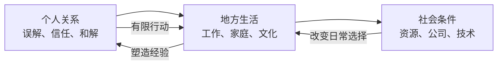

我喜欢《直到大地变成一颗酸橙》，不只是因为它是一段轻快的公路旅行。它让我看到一种成年人的童话：故事可以认真对待贫困、家庭矛盾、地方文化、公司利益和技术变化，也可以让少女们在旅途中感到新奇、开玩笑、争执、和好，并且真实地快乐。

我不想把快乐当作苦难的反证，也不想要求严肃故事必须一直沉重。真正值得讨论的是：当困境没有被彻底解决时，人还有没有资格享受一段旅程？我的答案是有，而且这份快乐本身可能就是人物生活不可被苦难占满的证据。

*图：SideStory「直到大地变成一颗酸橙」活动视觉；活动资料见[鹰角官方公告](https://ak.hypergryph.com/news/8571)。*

## 童话不是世界里没有大灰狼

“童话”这个词经常被理解成逃避现实，好像一个故事只要有幸福结尾，就必须把阶级、贫困、创伤和不公平从画面里清除。但《酸橙》让我想到另一种可能：童话并不承诺世界没有大灰狼，它只是不肯把大灰狼当成世界的全部。

这部公路故事里有困难的人、有并不完美的家庭关系、有竞争者和商业利益，也有地方社会的差异。几个少女从相遇到同行，关系并不是一开始就温柔顺畅。她们会出现隔阂，会误解彼此，也会因各自生活经验不同而说错话。旅行不只是沿途看风景，而是让人物离开熟悉的语境，在不断变化的地方和关系里暴露自己。

如果故事只在旅程结束时告诉读者“大家都和好了”，那只是把和解当作路线终点。真正让旅程有质感的是中间过程：人与人怎么建立信任，什么时候开始失望，怎样知道自己误解了对方，又愿不愿意回来把事情说清楚。友谊不是旅途奖励，而是旅途里必须不断维护的关系。

## 旅途把社会问题变成日常

*图：旅途经过的荒漠，见[《直到大地变成一颗酸橙》AS-8 剧情文本](https://www.gacha.gg/arknights/story/act35side-as-8)。*

### 这趟旅行从一件寄错的译码器包裹开始

具体情节比“少女公路旅行”要更有方向感。安洁莉娜送往雷姆必拓南部办事处的译码器包裹没有按时送达；路线零号沿途的远程通讯又在“大断联”后中止。南方采集到的数据因此无法及时译出。安洁莉娜决定亲自沿着横贯雷姆必拓的旧路把数据追回来，途中遇上刚满十八岁、正想离开温泉小镇的塔妮，又在旅途中结识嘉辛塔和阿梅利娅。她们的同行不是为了完成一个抽象的青春仪式，而是被一件确实需要解决的工作牵在一起。

塔妮想出发，与她的家庭并非单纯“控制孩子”。父母希望她先等两年，送给她的是为未来岗位准备的交换机耳机；塔妮却担心继续等待会让祖母的故事和那条路从自己生活中消失。她反复跑到镇外又折返，直到安洁莉娜的车带她真正越过熟悉的边界。旅途后来让她遇见外婆留下的怀表和照片，也让她重新理解外婆并非只想做探路者：她曾经离开，也曾经回到自己爱的人身边。塔妮最终与父母重新通信，父母承认她已经成年，愿意让她按自己的选择生活。这个和解并不是“父母从一开始就错了”，而是两代人终于说出了各自害怕失去什么。

嘉辛塔把家庭矛盾带入另一种尺度。她是矿业家族的女儿，也是感染者；她长期接受治疗、不断收到病危通知，习惯把死亡想成孤身一人的事。在瑞沙镇，她提出让相信矿石病永生说的感染者举办自己的葬礼。棺木里的体验让她承认自己害怕消失时没有人哭，也让其他感染者说出未竟的关系和心愿。这个场面没有靠一场辩论把所有人“劝回正常生活”：一部分人被触动，仍有人留在即将到来的天灾中拒绝离开。善意能开启一个表达的机会，却不能强迫每个人选择同一条生路。

阿梅利娅的冲突则把公司竞争落到了具体的工作责任上。她设计的二代通讯系统出了问题，公司主管阿什顿一面把项目赶工压在她身上，一面准备把失败归咎于一个没有话语权的基层员工；她原本是被拔高的“工程总监”，实则在组织记录里只是普通研究员。她害怕高处，却爬上通讯塔修复设备，最后当着所有人的面辞职。这不是技术天才打败坏老板的轻松胜利：她的专业能力确实修复了通讯塔，但这项工作没有让公司突然变得公正。嘉辛塔、塔妮和安洁莉娜的支持，帮助她把长期写好却递不出去的辞职信变成实际行动。

路线零号上的通讯塔、沙暴、矿石病和不同城镇不是旅行明信片。它们决定谁可以获得信息、谁会被困在原地、谁能离开，谁的技术劳动会被承认或被拿去当替罪羊。安洁莉娜自己也带着失去罗德岛本舰后的哀伤上路；当她面对不肯离开瑞沙镇的感染者时，她选择等待、倾听，再带着无法改变的部分继续前进。她的重力源石技艺后来托住从塔上跳下的阿梅利娅，也成为四人旅途共同承担的具体动作。她既不能救回已经失去的旧家，也不能把每个感染者都带走；但她可以在眼前这一刻接住朋友。

这样看，故事里的“幸福”不是所有冲突都迎刃而解。四个人最终到达大陆尽头，看见日出，塔妮得知家人愿意让她出发，阿梅利娅离开不公的公司，嘉辛塔获得了一段与朋友同行的自由；但感染者仍有人选择留在灾区，企业也没有被旅行者们改造，通讯网依旧要靠人逐段修复。结尾的喜悦没有抹去这些未完成的事情，而是把它们和真实发生过的陪伴放在一起。

公路片有一个很特别的结构：人物不断进入新的地方，但地方不会因为主角经过就只剩下风景。每一处环境都有自己的生活方式、资源条件和人与自然的关系。交通路线、当地习惯、工作机会、技术设施与公司的经营方式，都能改变居民的日常。

技术在这类叙事里既不是万能救星，也不是单纯的危险源。它会解决一些实际问题，也会改变谁能控制资源、谁的工作被替代、谁需要适应新的规则。公司竞争也不是只发生在会议室，它最终会体现在地方居民能否留下、以什么方式谋生、是否还拥有决定本地未来的空间。

这让《酸橙》带有社会小说的颗粒。人物的旅程会把我们带到自然奇观，也会让人看到商业力量如何进入地方生活。风景不只是供角色合影的背景，地方文化也不只是一个可爱装饰。它们之所以可爱，正因为那里有人正在生活；当外来组织改变当地条件，受到影响的就不是抽象的“世界观”，而是具体人的时间、工作和关系。

同时，故事没有把少女们塑造成可以一次解决所有结构问题的英雄。她们能看到不公平，能在具体处境中帮到人，却无法因为真诚就让公司消失，也不能替每个家庭修复创伤。帮助有范围，旅行也有终点。这种有限性让故事的善意更可信：人物可以做一件有意义的小事，而不必证明自己有能力拯救整个社会。

## 苦难没有取消人物的生活

我所说的“成年”，是故事知道人物的快乐不会自动解决问题。贫困者的处境不会因主角一番鼓励就立刻变好，家庭矛盾也未必能靠一次坦诚交谈彻底抹平。现实压力仍然存在，人物却没有因此被要求只以痛苦的方式活着。

这点并不轻松。我们常常把受苦者想成只应该悲伤、坚强或值得同情的人，仿佛他们有幽默、有欲望、有闲暇和短暂快乐，就显得不够严肃。但那会把他们变成单一的苦难符号。一个人能在困难里笑，不代表困难不严重；一个人能享受旅途，也不代表他背后的贫困已经被解决。

因此，快乐不是故事替社会发的免责证明。它不能告诉我“大家最后过得很好，所以之前的伤害不重要”。它只能提醒我，伤害并没有取得定义人物全部生活的权力。人物依旧会因风景感到惊喜，会因朋友的一句话生气，会因为一路同行而变得亲近。这些感受没有必要等到世界公正以后才允许出现。

如果一个故事只留下悲惨，我们会误以为苦难是人物的全部；如果它只留下轻松，我们会忽略困境的真实重量。《酸橙》的独特之处，是它让这两种情绪共同存在。它让人读得开心，却不要求我把开心误认为问题解决；它让人看见残酷，也不要求我放弃讲述幸福。

## 不天真的理想主义

这种写法背后是一种不天真的理想主义。它不相信只要主角够善良，世界就会照着主角的愿望重新安排；它更像是在说，理解、陪伴与行动可以在有限范围内改变一些事。结果可能不彻底，仍然值得发生。

理想主义如果只允许宏大胜利，普通人的努力就很容易被判为无效。只有推翻制度、战胜敌人、拯救所有人才算成功，那么大多数真实生活都只能被视为失败的前奏。《酸橙》让我愿意重新看待尺度：一次旅行让几个人不再互相误解，一段关系在冲突后有了新的信任，一个地方的人在外来力量面前仍保有自己的声音，这些都不是救世，却能改变下一步如何发生。

这并不是说个人情谊可以替代社会改变。它们不能互相取代。友谊不会自动改写商业规则，制度改革也不会自动修复亲密关系。人物的生活同时发生在不同尺度上：她们既要面对公司、家庭与地方社会，也要处理眼前这一句说错的话和这个同行的人。故事让这些尺度互相影响，而不把其中之一说成万能答案。

## 与《重返未来：1999》的差别在于“之后”

把《酸橙》与1999的故事并置时，我会注意到两边都能写人物的情谊、日常笑声和微观温暖，但这些温暖是否能进入未来，叙事答案不一样。方舟的故事经常让我想象：人物的改变会不会成为后续历史的条件？地方能不能把一次危机后的新生活维持下去？

1999有时会让一个小镇在人物层面达成和解、找到新的发展可能，却仍然被暴雨带走。那个圆满没有机会成为更长历史的起点。两种故事因而带来不同的余味：方舟让我想继续追踪成果是否保存，1999让我为可能已经消失的生活感到惋惜。

这不表示方舟只有希望，也不表示1999只有悲伤。它们都可以写失败与欢乐。差别在于，方舟经常把微观成果接到仍在展开的历史上；1999则会让微观生活本身成为需要记住的目的地，即使它没有通往未来的道路。更多关于两种时间经验的比较，见[总论专题：可被理解的世界与可被怀念的时代](/方舟与1999的时间方向及文化颗粒度/)。

## 旅途作为认识方法

*图：旅途中的倒悬金字塔，见[《直到大地变成一颗酸橙》AS-9 剧情文本](https://www.gacha.gg/arknights/story/act35side-as-9)。*

### 一段旅程同时经过三种尺度

这篇公路故事之所以可以同时轻快和沉重，是因为旅途让几种尺度并排出现。最小的尺度是少女之间的关系：误会、玩笑、争执和重新靠近；中间尺度是地方生活：一个城镇如何谋生，文化如何延续，家庭如何应对变化；更大的尺度是外部组织和技术如何进入地方，重新分配机会和风险。它们不是三条互不相干的线。宏观力量会进入家庭，地方经验会改变旅行者的判断，朋友之间的信任又会影响她们能否一起处理现实问题。

这张关系图也说明，故事不必让少女们解决整个社会，才算和社会议题有关。她们能做的行动有边界，但她们对边界的认识、对当地人的倾听以及相互支持，都会影响具体处境。宏大结构不是只由政令改变，个人行动也不是天然无效；故事可以让两者保持尺度差异，同时看见它们相互触碰。

### 相遇不等于拥有对方的经验

旅行中的友谊常有一种容易被忽略的不对等：同行者可能彼此亲近，却来自不同家庭、阶层和生活条件。她们能够分享路途，却不一定分享同一种风险。一个人觉得这次冒险是成长，另一个人可能觉得它会影响家人收入；一个人能够随时回家，另一个人也许没有安全的退路。

所以，和解不应被理解成“大家终于发现彼此都一样”。真正的理解更像是发现彼此并不一样，却仍然愿意调整相处方式。人物不必把差异全部消除，才算友谊成立；相反，她们越能承认对方的经验不可被自己完全代替，就越能避免把自己的善意变成命令。

这让少女关系与地方社会形成呼应。外来者可以真心喜欢一个地方，却不能因此拥有它；同行者可以深爱朋友，却不能因此替朋友决定。无论是地域还是亲密关系，尊重都包括承认对方保有自己的解释权。公路故事给人物不断相遇的机会，也给她们练习这种有限理解的机会。

## 公路结构让“离开”成为一种认识方法

公路故事的关键不只是人物从甲地走到乙地，而是离开熟悉环境之后，原本看不见的生活规则变得可见。一个人到了陌生地方，会发现自己习以为常的安排并非普遍标准：交通是否方便、资源由谁管理、年轻人是否能留下、地方传统怎样应对新技术，都会改变“生活可以怎样继续”的答案。

旅途还会让人物不断面对短暂关系。她们进入某个地方，认识当地的人，理解一部分处境，然后继续上路。这样的结构有天然限制：外来者无法凭一次停留掌握完整的地方历史，也不能把当地人的生活据为自己的成长素材。故事若能承认这种限制，旅行就不是主角巡视世界并作出裁决，而是主角承认自己只看见了一部分，必须带着这部分认识继续走。

这里有一种很日常的谦逊。少女们不能把所有社会问题处理完，但她们可以修正对彼此和当地人的判断；她们不能替居民决定什么叫进步，却可以让当地人的选择被看见。旅行的意义不在于“见多识广”自动让人高明，而在于遇到不同生活之后，原本自以为理所当然的尺度开始松动。

## “酸橙”与故事不把快乐包装成奖励

标题里的酸橙给旅程带来一种具体的味觉感：酸、清新，也可能让人皱眉。它不像抽象的“希望”那样预先规定读者应当获得什么情绪。旅途中的快乐也有类似质地：它不是完成全部社会任务后发下来的奖章，而是人物在路上真实遇见的东西，有时短暂，有时夹着尴尬和疲惫。

我愿意把这种快乐称为生活的资格。人物不需要先证明自己足够坚强，不需要把创伤转化成励志故事，才有权享受风景、食物和朋友。受困的人也可以拒绝被苦难独占；正在解决问题的人也可以休息。故事肯给人物这些片刻，等于承认生活不只由可量化的成果组成。

当然，快乐也可能被叙事用来粉饰问题。判断关键在于，故事有没有让困境继续存在于结尾之外：居民是否仍需面对现实条件，友谊有没有替代制度改变，外部帮助有没有造成新的依赖。如果故事诚实保留这些问题，轻快就不是廉价的“万事大吉”，而是一段没有被苦难取消的真实经验。

## 为什么我愿意跟着这场旅行走

我不是每次都需要主线向前推进，才愿意继续读方舟。只要故事还发生在泰拉，只要它让我看到这个世界里又出现了新的生活、社会与可能，我就愿意跟着人物走一段。公路篇章能够扩展世界的横向空间：人们怎样离开家乡、怎样理解陌生地方、怎样在交通和技术变化中重新建立关系。

《酸橙》因此并非和方舟的宏大政治叙事无关。它用旅途、友谊、地方文化和家庭关系，让我记住宏大历史最终由哪些日常生活构成。一个国家和世界值得延续，不只是因为它们能在地图上继续存在，也因为里面的人仍然有机会走路、旅行、吵架、认错和开心。

童话的成熟并不是告别快乐，而是知道快乐不能替人解决所有问题，仍愿意把它写出来。生活如果只有苦难才显得真实，人物就会被现实剥夺完整性。《直到大地变成一颗酸橙》让我相信，在承认残酷以后仍然讲述幸福，并不幼稚；那可能是拒绝让残酷占有全部叙事的方式。

### 原作与延伸阅读

- [《直到大地变成一颗酸橙》活动资料页](https://arknights.wiki.gg/wiki/Till_the_Lands_Become_an_Orange)
- [PRTS：《直到大地变成一颗酸橙》剧情章节目录](https://prts.wiki/w/%E5%89%A7%E6%83%85)
- [泰拉剧情笔记：《直到大地变成一颗酸橙》剧情与原文索引](https://arknights.nideriji.top/events/till-the-lands-become-an-orange)
- [返回总论：从一首离别的歌到两个世界的时间](/从一首离别的歌到两个世界的时间-明日方舟与重返未来1999/)
- [阅读《不义之财》专题：阶层、善意与责任](/不义之财-在阶层和善意之间看涤火杰西卡的选择/)
